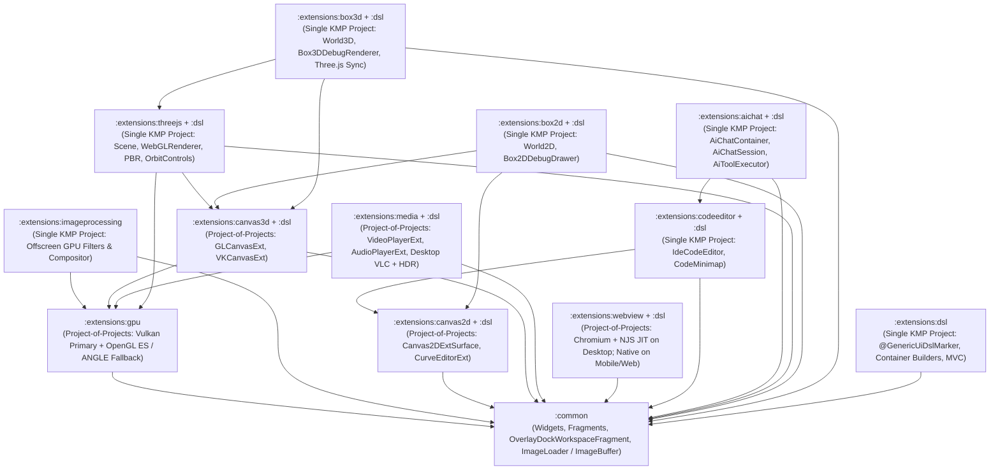

# GenericUI — First-Party Extensions Submodule (`:extensions`)

> **Parent Repository**: [**GenericUI Root (`../README.md`)**](../README.md) · [**Root Extensions Architecture (`../docs/extensions.md`)**](../docs/extensions.md) · [**Source Sets Hierarchy (`../docs/sourcesets.md`)**](../docs/sourcesets.md) · [**Native Backends (`../docs/backends.md`)**](../docs/backends.md) · [**Gradle Plugin (`../docs/gradle-plugin.md`)**](../docs/gradle-plugin.md)

The **`extensions/`** submodule houses all **12 first-party GenericUI extension modules** and **9 companion `:extensions:<ext>:dsl` submodules**. Every extension is engineered to keep `:common` lean while providing opt-in hardware-accelerated GPU compute, offscreen image manipulation, 2D/3D canvases, VLC + HDR media playback, Chromium + `:NJS` / native WebViews, IDE code editing, multi-provider AI agent chat, Three.js 3D scene rendering, Box2D/Box3D rigid-body physics, and a `kotlinx.html`-inspired declarative Kotlin UI & Style DSL.

---

## 1. Categorized Master Index of GenericUI Extensions

### Category 1 — GPU Compute, Offscreen Image Processing, & Canvases
- [**`:extensions:gpu`**](docs/gpu.md) — Cross-platform GPU device management (`GpuDevice`), offscreen compute & shader contexts (`GpuOffscreenContext`), double-buffered swapchains (`GpuDoubleBufferedSurface`), textures (`GpuTexture`), buffers (`GpuBuffer`), and dual-target shader programs (`GpuShaderProgram`: Vulkan 1.2+ `#version 450` SPIR-V primary + OpenGL ES 3.0 `#version 300 es` / Google ANGLE / MoltenVK / WebGPU / WebGL2 fallback).
- [**`:extensions:imageprocessing`**](docs/imageprocessing.md) — Headless/offscreen GPU-accelerated image manipulation (`GpuImageProcessor`, `GpuImagePipelineBuilder`, `GpuImageCompositor`), 12 Porter-Duff & artistic blend modes (`ImageBlendMode`), Lanczos-3 resampling, 256-bin histograms (`ImageHistogramResult`), and built-in GPU filters (`BrightnessContrastFilter`, `HueSaturationLightnessFilter`, `ExposureGammaFilter`, `ColorMatrixFilter`, `LevelsFilter`, `GaussianBlurFilter`, `ConvolutionKernelFilter`, `ChromaKeyFilter`, `VignetteFilter`).
- [**`:extensions:canvas2d` & `:extensions:canvas2d:dsl`**](docs/canvas2d.md) — Hardware-accelerated 2D vector & raster surface (`Canvas2DExtSurface`, `Canvas2D`, `Canvas2DContext`, `OffscreenCanvas2D`), direct `:common` `ImageBuffer` drawing/extraction, VBlank-synchronized `registerVBlankRender` (`deltaMs`) animation loops, interactive cubic-Bezier animation curve editor (`CurveEditorExt`), and `canvas2DExt { ... }` / `curveEditorExt { ... }` DSL builders.
- [**`:extensions:canvas3d` & `:extensions:canvas3d:dsl`**](docs/canvas3d.md) — Hardware-accelerated 3D & programmable shader canvases (`GLCanvasExt`, `VKCanvasExt`, `OffscreenCanvas3D`, `GLCanvasConfig`, `VKCanvasConfig`) powered by `:extensions:gpu` (Vulkan 1.2+ / MoltenVK / WebGPU primary and OpenGL ES 3.0+ / Google ANGLE on Windows / LWJGL 3 on Swing / WebGL2 on Web), with `glCanvasExt { ... }` and `vkCanvasExt { ... }` DSL builders.

### Category 2 — Multimedia & Embedded Web Engines
- [**`:extensions:media` & `:extensions:media:dsl`**](docs/media.md) — Cross-platform `VideoPlayerExt`, `AudioPlayerExt`, `AudioAnalyzerExt` (real-time FFT spectrum & `AudioEnergyBands`), `MediaSessionManager`, and `WebVttSrtParser`. **Strictly owns all VLC video/audio/HDR/clock/shader code for desktop targets** in `:extensions:media:desktop` (`DesktopLibVlcVideoPlayerImpl`, `LibVlcBindings`, `VlcHdrToneMapper`, `VlcColorMatrixBuilder`, `VlcCie1931MatrixMath`, `VlcPlaybackClock`, `VlcVideoOutputPipeline`, `VlcDecoderRegistry`) with Vulkan `#version 450` primary + OpenGL ES `#version 300 es` fallback HDR tone-mapping (`SMPTE ST 2084 PQ`, `ARIB STD-B67 HLG`, `Dolby Vision`, `Hable`/`BT.2390`/`Mobius`/`Reinhard`), plus `videoPlayerExt`, `audioPlayerExt`, and `audioAnalyzerExt` DSL builders.
- [**`:extensions:webview` & `:extensions:webview:dsl`**](docs/webview.md) — Embedded web browser widget (`WebView`, `WebViewConfig`, `WebViewExtension`) powered by **Chromium (`ChromiumBlinkEngine`) + [`:NJS` (`../lib/NJS/README.md`)](../lib/NJS/README.md) ([Native JIT](../lib/NJS/docs/native-jit.md) / [JVM Bytecode Compiler](../lib/NJS/docs/jvm-compiler.md))** on Desktop (`:windows`, `:macos`, `:gtk`, `:qt`, `:swing`), native `android.webkit.WebView` on Android, `WKWebView` on iOS, and HTML5 `<iframe>` on Web (**never uses `:NJS` on Mobile or Web**), with bidirectional JS bridge and `webViewExt { ... }` DSL builders. See also the [NJS Master Documentation Index (`../lib/NJS/docs/README.md`)](../lib/NJS/docs/README.md).

### Category 3 — Code Editing & Multi-Provider AI Agents
- [**`:extensions:codeeditor` & `:extensions:codeeditor:dsl`**](docs/codeeditor.md) — Full IDE code editor widget (`IdeCodeEditor`, `CodeDocumentBuffer`, `SyntaxTokenizer`, `CodeEditorTheme`, `CodeMinimap`) built atop `:extensions:canvas2d`, featuring lexical syntax highlighting for Kotlin, JavaScript, TypeScript, GLSL, Python, JSON, HTML, CSS, and Markdown, gutter line numbers, breakpoints, code folding (`CodeFoldingRegion`), compiler diagnostics (`CodeDiagnostic`), autocomplete (`CodeCompletionProvider`), and `codeEditor { ... }` / `codeMinimap { ... }` DSL builders.
- [**`:extensions:aichat` & `:extensions:aichat:dsl`**](docs/aichat.md) — Multi-provider AI Studio chat & tool-orchestration UI (`AiChatContainer`, `AiChatSession`, `AiBackendType`, `ReasoningEffort`, `AiStreamChunk`, `AiToolExecutor`, `AiToolDefinition`, `AiChatMessageView`, `AiChatToolCallCard`, `AiChatReasoningAccordion`) supporting OpenAI, Anthropic Claude, Google Gemini, xAI Grok, Ollama, LM Studio, and custom OpenAI/Claude endpoints, plus `aiChat { ... }` DSL builders.

### Category 4 — 3D Scene Graph & 2D/3D Rigid-Body Physics
- [**`:extensions:threejs` & `:extensions:threejs:dsl`**](docs/threejs.md) — Pure Kotlin Multiplatform port of Three.js (`Scene`, `PerspectiveCamera`, `OrthographicCamera`, `WebGLRenderer`, `OrbitControls`, `TransformControls`, `AmbientLight`, `DirectionalLight`, `PointLight`, `SpotLight`, `MeshStandardMaterial`, `MeshPhysicalMaterial`, `ShaderMaterial`, `BoxGeometry`, `SphereGeometry`, `TorusGeometry`, `Mesh`, `InstancedMesh`, `SkinnedMesh`, `AnimationMixer`, `Raycaster`, `GltfLoader`, `ObjLoader`), dockable inside `:common`'s `OverlayDockWorkspaceFragment`, with `threeJsGlCanvas { ... }` and `threeJsVkCanvas { ... }` DSL builders.
- [**`:extensions:box2d` & `:extensions:box2d:dsl`**](docs/box2d.md) — 2D rigid-body physics engine (`World2D`, `BodyDef2D`, `Body2D`, `BodyType2D`, `FixtureDef2D`, `PolygonShape2D`, `CircleShape2D`, `EdgeShape2D`, `ChainShape2D`, `RevoluteJoint2D`, `PrismaticJoint2D`, `DistanceJoint2D`, `WeldJoint2D`, `MouseJoint2D`, `ContactListener2D`) and `Box2DDebugDrawer` bound to `:extensions:canvas2d`, with `box2dDebugCanvas { ... }` and `world2D { ... }` DSL builders.
- [**`:extensions:box3d` & `:extensions:box3d:dsl`**](docs/box3d.md) — 3D rigid-body physics engine (`World3D`, `RigidBodyDesc3D`, `RigidBody3D`, `ColliderDesc3D`, `BoxShape3D`, `SphereShape3D`, `CapsuleShape3D`, `CylinderShape3D`, `ConvexHullShape3D`, `TriMeshShape3D`, `HeightfieldShape3D`, `HingeJoint3D`, `SliderJoint3D`, `FixedJoint3D`, `SphericalJoint3D`, `SpringJoint3D`, `CharacterController3D`, `Box3DDebugRenderer`) with automatic `:extensions:threejs` `Object3D` transform synchronization every simulation step, plus `box3dDebugCanvas { ... }` and `world3D { ... }` DSL builders.

### Category 5 — Declarative Kotlin UI & Style DSL
- [**`:extensions:dsl` & Extension `:dsl` Submodules**](docs/dsl.md) — `kotlinx.html`-inspired in-place declarative UI builder DSL (`@GenericUiDslMarker`, `buildDiv`, `buildContainer`, `Container.build`, `div`, `row`, `col`, `hstack`, `vstack`, `flexBox`, `h1`..`h6`, `p`, `span`, `button`, `textInput`, `select { option(...) }`, `table { tr { th(...); td(...) } }`, `lazyList`, `lazyGrid`, `treeView`), inline `style { ... }` blocks with `LinearGradient` and `RadialGradient`, and Model-View-Controller (`MvcModel`, `MvcView<M>`, `MvcController<M, V>`) architecture.

---

## 2. Inter-Extension Dependency Graph



---

## 3. Architecture & Transitive Dependency Matrix

Extensions use one of two Gradle structural patterns (detailed in [Root Extensions Guide (`../docs/extensions.md`)](../docs/extensions.md) and [Source Sets Guide (`../docs/sourcesets.md`)](../docs/sourcesets.md)):
1. **Project-of-Projects (`:extensions:<ext>:common`, `:desktop:*`, `:mobile:*`, `:web`)**: Used when an extension requires platform-native C/C++/ObjC, JNI/LWJGL, or DOM bindings per target backend.
2. **Single KMP Project (`:extensions:<ext>`)**: Used when an extension is written in 100% `commonMain` Kotlin on top of `:common` and lower-level extensions.

| Extension Module | Companion DSL Module | Gradle Structure | Gradle Plugin DSL Function | Direct Extension & Core Dependencies | Auto-Wired `:dsl` Submodule When `dsl()` Is Enabled |
| :--- | :--- | :--- | :--- | :--- | :--- |
| [`:extensions:gpu`](docs/gpu.md) | *(None — Headless/Context API)* | **Project-of-Projects** (`common`, `desktop:shared`, `desktop:swing`, `mobile:shared`, `mobile:android`, `mobile:ios`, `web`) | `gpu()` | `:common` | — |
| [`:extensions:imageprocessing`](docs/imageprocessing.md) | *(None — Functional Pipeline API)* | **Single KMP Project** | `imageProcessing()` | `:extensions:gpu`, `:common` (`ImageBuffer`) | — |
| [`:extensions:canvas2d`](docs/canvas2d.md) | [`:extensions:canvas2d:dsl`](docs/canvas2d.md) | **Project-of-Projects** (`common`, `desktop:{shared,windows,macos,gtk,qt,swing}`, `mobile:{shared,android,ios}`, `web`) | `canvas2d()` | `:common` (`ImageBuffer`, `AbstractCanvas`) | `:extensions:canvas2d:dsl` |
| [`:extensions:canvas3d`](docs/canvas3d.md) | [`:extensions:canvas3d:dsl`](docs/canvas3d.md) | **Project-of-Projects** (`common`, `desktop:{shared,windows,macos,gtk,qt,swing}`, `mobile:{shared,android,ios}`, `web`) | `canvas3d()` | `:extensions:gpu`, `:extensions:canvas2d:common`, `:common` | `:extensions:canvas3d:dsl` |
| [`:extensions:media`](docs/media.md) | [`:extensions:media:dsl`](docs/media.md) | **Project-of-Projects** (`common`, `desktop:{shared,windows,macos,gtk,qt,swing}`, `mobile:{shared,android,ios}`, `web`) | `media()` | `:extensions:gpu`, `:common` (+ `libvlc` on native Desktop, `vlcj` on Swing) | `:extensions:media:dsl` |
| [`:extensions:webview`](docs/webview.md) | [`:extensions:webview:dsl`](docs/webview.md) | **Project-of-Projects** (`common`, `desktop:{shared,windows,macos,gtk,qt,swing}`, `mobile:{shared,android,ios}`, `web`) | `webView()` | `:common` (+ Chromium & `:NJS` on Desktop/Swing **only**) | `:extensions:webview:dsl` |
| [`:extensions:codeeditor`](docs/codeeditor.md) | [`:extensions:codeeditor:dsl`](docs/codeeditor.md) | **Single KMP Project** | `codeEditor()` | `:extensions:canvas2d`, `:common` | `:extensions:codeeditor:dsl` |
| [`:extensions:aichat`](docs/aichat.md) | [`:extensions:aichat:dsl`](docs/aichat.md) | **Single KMP Project** | `aiChat()` | `:extensions:codeeditor`, `:extensions:canvas2d`, `:common` | `:extensions:aichat:dsl` |
| [`:extensions:threejs`](docs/threejs.md) | [`:extensions:threejs:dsl`](docs/threejs.md) | **Single KMP Project** | `threeJs()` | `:extensions:canvas3d`, `:extensions:gpu`, `:common` (`ImageLoader`) | `:extensions:threejs:dsl` |
| [`:extensions:box2d`](docs/box2d.md) | [`:extensions:box2d:dsl`](docs/box2d.md) | **Single KMP Project** | `box2d()` | `:extensions:canvas2d`, `:extensions:canvas3d`, `:common` | `:extensions:box2d:dsl` |
| [`:extensions:box3d`](docs/box3d.md) | [`:extensions:box3d:dsl`](docs/box3d.md) | **Single KMP Project** | `box3d()` | `:extensions:threejs`, `:extensions:canvas3d`, `:extensions:gpu`, `:common` | `:extensions:box3d:dsl` |
| [`:extensions:dsl`](docs/dsl.md) | *(Base DSL Module)* | **Single KMP Project** | `dsl()` | `:common` *(strictly no dependencies on other extensions)* | Activates `:extensions:<ext>:dsl` for all enabled extensions |

---

## 4. Configuring Extensions via the GenericUI Gradle Plugin

The [GenericUI Gradle Plugin (`../docs/gradle-plugin.md`)](../docs/gradle-plugin.md) provides the `genericui { extensions { ... } }` block, which automatically wires:
1. Common multiplatform APIs into `commonMain`.
2. Target-specific native providers (`:desktop:*`, `:mobile:*`, `:web`) for Project-of-Projects extensions based on the active `backends { ... }` selection.
3. Transitive extension dependencies (e.g., enabling `box3d()` automatically resolves `:extensions:threejs`, `:extensions:canvas3d`, and `:extensions:gpu`).
4. **Automatic `:dsl` Submodule Resolution**: Whenever `dsl()` is enabled in `extensions { ... }`, the plugin automatically adds `:extensions:<ext>:dsl` for every enabled component extension (`canvas2d`, `canvas3d`, `media`, `webview`, `codeeditor`, `aichat`, `threejs`, `box2d`, `box3d`).

```kotlin
plugins {
    id("com.nexustools.genericui")
}

genericui {
    backends {
        allExceptSwing() // :windows, :macos, :gtk, :qt, :android, :ios, :web
    }
    extensions {
        dsl()              // Enables :extensions:dsl + auto-wires :dsl submodules below
        gpu()              // Enables :extensions:gpu across all active backends
        imageProcessing()  // Enables :extensions:imageprocessing
        canvas2d()         // Enables :extensions:canvas2d + :extensions:canvas2d:dsl
        canvas3d()         // Enables :extensions:canvas3d + :extensions:canvas3d:dsl
        media()            // Enables :extensions:media (Desktop VLC + HDR) + :extensions:media:dsl
        webView()          // Enables :extensions:webview + :extensions:webview:dsl
        codeEditor()       // Enables :extensions:codeeditor + :extensions:codeeditor:dsl
        aiChat()           // Enables :extensions:aichat + :extensions:aichat:dsl
        threeJs()          // Enables :extensions:threejs + :extensions:threejs:dsl
        box2d()            // Enables :extensions:box2d + :extensions:box2d:dsl
        box3d()            // Enables :extensions:box3d + :extensions:box3d:dsl
    }
}
```

---

## 5. Cross-References across the GenericUI Ecosystem

- **Root Documentation**:
  - [GenericUI Root Overview (`../README.md`)](../README.md)
  - [First-Party Extensions Architecture (`../docs/extensions.md`)](../docs/extensions.md)
  - [Kotlin Multiplatform Source Sets (`../docs/sourcesets.md`)](../docs/sourcesets.md)
  - [Native Target Backends (`../docs/backends.md`)](../docs/backends.md)
  - [Gradle Plugin Reference (`../docs/gradle-plugin.md`)](../docs/gradle-plugin.md)
- **Backend Submodule Documentation**:
  - [Desktop Backends (`:windows`, `:macos`, `:gtk`, `:qt`, `:swing`) (`../desktop/README.md`)](../desktop/README.md)
  - [Mobile Backends (`:android`, `:ios`) (`../mobile/README.md`)](../mobile/README.md)
  - [Web Backend (`:web` JS & WasmJS) (`../web/README.md`)](../web/README.md)
