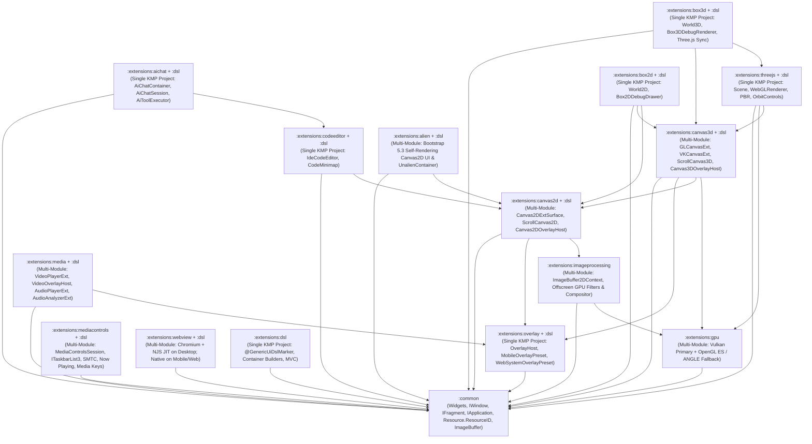

# GenericUI — First-Party Extensions Submodule (`:extensions`)

> **Parent Repository**: [**GenericUI Root (`../README.md`)**](../README.md) · [**Root Extensions Architecture (`../docs/extensions.md`)**](../docs/extensions.md) · [**Layouts & Responsive Helpers (`../docs/layouts-and-helpers.md`)**](../docs/layouts-and-helpers.md) · [**Fragments & Windows (`../docs/fragments-and-windows.md`)**](../docs/fragments-and-windows.md) · [**Resources (`../docs/resources.md`)**](../docs/resources.md) · [**Application & Targets (`../docs/application.md`)**](../docs/application.md) · [**Source Sets Hierarchy (`../docs/sourcesets.md`)**](../docs/sourcesets.md) · [**Native Backends (`../docs/backends.md`)**](../docs/backends.md) · [**Gradle Plugin (`../docs/gradle-plugin.md`)**](../docs/gradle-plugin.md)

The **`extensions/`** submodule houses all **14 first-party GenericUI extension modules** and **12 companion `:extensions:<ext>:dsl` submodules**. Every extension is engineered to keep `:common` lean while providing opt-in hardware-accelerated GPU compute, offscreen image manipulation, universal interactive overlays, 2D/3D canvases, VLC + native media playback, standalone system media controls & hardware media key hooks, Chromium + `:NJS` / native WebViews, IDE code editing, multi-provider AI agent chat, Three.js 3D scene rendering, Box2D/Box3D rigid-body physics, self-rendering Bootstrap 5.3 UI, and a `kotlinx.html`-inspired declarative Kotlin UI & Style DSL.

---

## 1. Categorized Master Index of GenericUI Extensions

### Category 1 — GPU Compute, Offscreen Image Processing, Overlays, & Canvases
- [**`:extensions:gpu`**](docs/gpu.md) — Cross-platform GPU device management (`GpuDevice`), offscreen compute & shader contexts (`GpuOffscreenContext`), double-buffered swapchains (`GpuDoubleBufferedSurface`), textures (`GpuTexture`), buffers (`GpuBuffer`), and dual-target shader programs (`GpuShaderProgram`: Vulkan 1.2+ `#version 450` SPIR-V primary + OpenGL ES 3.0 `#version 300 es` / Google ANGLE / MoltenVK / WebGPU / WebGL2 fallback).
- [**`:extensions:imageprocessing`**](docs/imageprocessing.md) — Universal hardware-accelerated `ImageBuffer` & `ImageBuffer2DContext` (`imageBuffer.getContext()`) plus headless/offscreen GPU-accelerated image manipulation (`GpuImageProcessor`, `GpuImagePipelineBuilder`, `GpuImageCompositor`), 12 Porter-Duff & artistic blend modes (`ImageBlendMode`), Lanczos-3 resampling, 256-bin histograms (`ImageHistogramResult`), and built-in GPU filters.
- [**`:extensions:overlay` & `:extensions:overlay:dsl`**](docs/overlay.md) — 100% generic, domain-agnostic overlay framework (`OverlayHost`, `OverlayHostBox`, `AbstractOverlay`, `PresetOverlay`, `MobileOverlayPreset`, `WebSystemOverlayPreset`, `OverlayPresetResolver`, `AutoHideController` with 3500ms delay / 200ms fade, `OverlayInputRouter`, `TrackSeekBar` & `SliderSeekBar` using app `themeColor`, `GradientScrim`, `MetadataHeader`, `OverlayBadgeStrip`, `CenterTransportCluster`, `VolumeControl`, `SubtitleCueView`, `OverlayPopoverPanel`, `OverlayModalDialog`, `OverlayCurtain`, and `setPictureInPictureMode(Boolean)`), integrated into `:extensions:media`, `:extensions:canvas2d`, and `:extensions:canvas3d`.
- [**`:extensions:canvas2d` & `:extensions:canvas2d:dsl`**](docs/canvas2d.md) — Hardware-accelerated 2D vector & raster surface (`Canvas2DExtSurface`, `Canvas2D`, `ScrollCanvas2D`, `CurveEditorExt`), viewport-only overlay hosts (`Canvas2DOverlayHost`, `ScrollCanvas2DOverlayHost`), direct `:common` `ImageBuffer` drawing/extraction, VBlank-synchronized `registerVBlankRender` (`deltaMs`) animation loops, and `canvas2DExt { ... }` / `scrollCanvas2D { ... }` / `canvas2DOverlayHost { ... }` DSL builders.
- [**`:extensions:canvas3d` & `:extensions:canvas3d:dsl`**](docs/canvas3d.md) — Hardware-accelerated 3D & programmable shader canvases (`GLCanvasExt`, `VKCanvasExt`, `ScrollCanvas3D`, `ScrollGLCanvas`, `ScrollVKCanvas`, `OffscreenCanvas3D`) and overlay hosts (`Canvas3DOverlayHost`, `ScrollCanvas3DOverlayHost`) powered by `:extensions:gpu`, with `glCanvasExt { ... }`, `vkCanvasExt { ... }`, and `canvas3DOverlayHost { ... }` DSL builders.

### Category 2 — Multimedia, System Media Controls, & Embedded Web Engines
- [**`:extensions:media` & `:extensions:media:dsl`**](docs/media.md) — Cross-platform `VideoPlayerExt`, `AudioPlayerExt`, `AudioAnalyzerExt` (real-time FFT spectrum & `AudioEnergyBands`), `VideoOverlayHost` / `VideoPlayerOverlayBinder` (`attachVideoOverlay` / `withOverlay`), and `WebVttSrtParser`. Uses native `libvlc` in `:extensions:media:desktop:nativeCommon`, `libvlcj` (`uk.co.caprica:vlcj`) in `:extensions:media:desktop:swing`, native OS media components in `:extensions:media:mobile:{android,ios}`, and HTML5 `<video>` / `<audio>` / WebAudio `AnalyserNode` in `:extensions:media:web`, plus `videoPlayerExt`, `videoOverlayHost`, `audioPlayerExt`, and `audioAnalyzerExt` DSL builders.
- [**`:extensions:mediacontrols` & `:extensions:mediacontrols:dsl`**](docs/mediacontrols.md) — Standalone system & web media controls and hardware keyboard media key hooks extension (`MediaControlsSession`, `MediaControlMetadata`, `MediaPlaybackStatus`, `MediaControlButtonConfig`, `MediaControlEvent`, `MediaControlsCapabilities`). Depends **only on `:common`**, providing Windows `ITaskbarList3` taskbar thumbnail preview buttons + SMTC + `WM_APPCOMMAND` / `WH_KEYBOARD_LL` media key hooks, macOS Control Center / Now Playing + `NSSystemDefined` media key hooks, Linux GTK/Qt `XF86Audio*` / MPRIS2, Swing multimedia keys, and Web `navigator.mediaSession`, plus `mediaControlsSession { ... }` DSL builders.
- [**`:extensions:webview` & `:extensions:webview:dsl`**](docs/webview.md) — Embedded web browser widget (`WebView`, `WebViewConfig`, `WebViewExtension`) powered by **Chromium (`ChromiumBlinkEngine`) + [`:NJS` (`../lib/NJS/README.md`)](../lib/NJS/README.md) ([Native JIT](../lib/NJS/docs/native-jit.md) / [JVM Bytecode Compiler](../lib/NJS/docs/jvm-compiler.md))** on Desktop (`:desktop:common`, `:desktop:nativeCommon`, `:desktop:{windows,macos,gtk,qt,swing}`), native `android.webkit.WebView` on Android, `WKWebView` on iOS, and HTML5 `<iframe>` on Web (**never uses `:NJS` on Mobile or Web**), with bidirectional JS bridge and `webViewExt { ... }` DSL builders.

### Category 3 — Code Editing & Multi-Provider AI Agents
- [**`:extensions:codeeditor` & `:extensions:codeeditor:dsl`**](docs/codeeditor.md) — Full IDE code editor widget (`IdeCodeEditor`, `CodeDocumentBuffer`, `SyntaxTokenizer`, `CodeEditorTheme`, `CodeMinimap`) built atop `:extensions:canvas2d`, featuring lexical syntax highlighting for Kotlin, JavaScript, TypeScript, GLSL, Python, JSON, HTML, CSS, and Markdown, gutter line numbers, breakpoints, code folding (`CodeFoldingRegion`), compiler diagnostics (`CodeDiagnostic`), autocomplete (`CodeCompletionProvider`), and `codeEditor { ... }` / `codeMinimap { ... }` DSL builders.
- [**`:extensions:aichat` & `:extensions:aichat:dsl`**](docs/aichat.md) — Multi-provider AI Studio chat & tool-orchestration UI (`AiChatContainer`, `AiChatSession`, `AiBackendType`, `ReasoningEffort`, `AiStreamChunk`, `AiToolExecutor`, `AiToolDefinition`, `AiChatMessageView`, `AiChatToolCallCard`, `AiChatReasoningAccordion`) supporting single-placement `TitleBar` action binding (`bindHeaderActionsToTitleBar` via `TitleCapabilities`), OpenAI, Anthropic Claude, Google Gemini, xAI Grok, Ollama, LM Studio, and custom OpenAI/Claude endpoints, plus `aiChat { ... }` DSL builders.

### Category 4 — 3D Scene Graph & 2D/3D Rigid-Body Physics
- [**`:extensions:threejs` & `:extensions:threejs:dsl`**](docs/threejs.md) — Pure Kotlin Multiplatform port of Three.js (`Scene`, `PerspectiveCamera`, `OrthographicCamera`, `WebGLRenderer`, `OrbitControls`, `TransformControls`, `AmbientLight`, `DirectionalLight`, `PointLight`, `SpotLight`, `MeshStandardMaterial`, `MeshPhysicalMaterial`, `ShaderMaterial`, `BoxGeometry`, `SphereGeometry`, `TorusGeometry`, `Mesh`, `InstancedMesh`, `SkinnedMesh`, `AnimationMixer`, `Raycaster`, `GltfLoader`, `ObjLoader`), dockable inside `:common`'s `DockWorkspaceFragment` / `OverlayDockWorkspaceFragment`, with `threeJsGlCanvas { ... }` and `threeJsVkCanvas { ... }` DSL builders.
- [**`:extensions:box2d` & `:extensions:box2d:dsl`**](docs/box2d.md) — 2D rigid-body physics engine (`World2D`, `BodyDef2D`, `Body2D`, `BodyType2D`, `FixtureDef2D`, `PolygonShape2D`, `CircleShape2D`, `EdgeShape2D`, `ChainShape2D`, `RevoluteJoint2D`, `PrismaticJoint2D`, `DistanceJoint2D`, `WeldJoint2D`, `MouseJoint2D`, `ContactListener2D`) and `Box2DDebugDrawer` bound to `:extensions:canvas2d`, with `box2dDebugCanvas { ... }` and `world2D { ... }` DSL builders.
- [**`:extensions:box3d` & `:extensions:box3d:dsl`**](docs/box3d.md) — 3D rigid-body physics engine (`World3D`, `RigidBodyDesc3D`, `RigidBody3D`, `ColliderDesc3D`, `BoxShape3D`, `SphereShape3D`, `CapsuleShape3D`, `CylinderShape3D`, `ConvexHullShape3D`, `TriMeshShape3D`, `HeightfieldShape3D`, `HingeJoint3D`, `SliderJoint3D`, `FixedJoint3D`, `SphericalJoint3D`, `SpringJoint3D`, `CharacterController3D`, `Box3DDebugRenderer`) with automatic `:extensions:threejs` `Object3D` transform synchronization every simulation step, plus `box3dDebugCanvas { ... }` and `world3D { ... }` DSL builders.

### Category 5 — Declarative Kotlin UI & Style DSL & Self-Rendering Bootstrap 5.3 Canvas UI
- [**`:extensions:dsl` & Extension `:dsl` Submodules**](docs/dsl.md) — `kotlinx.html`-inspired in-place declarative UI builder DSL (`@GenericUiDslMarker`, `buildDiv`, `buildContainer`, `Container.build`, `div`, `row`, `col`, `hstack`, `vstack`, `flexBox`, `h1`..`h6`, `p`, `span`, `button`, `textInput`, `select { option(...) }`, `table { tr { th(...); td(...) } }`, `lazyList`, `lazyGrid`, `treeView`), strictly isolated `style { ... }` (`ComponentStyle`), `bootstrap { ... }` (`ComponentBootstrap`), and `important { ... }` DSL builders (`DslStyleAndBootstrapBuilders.kt`), hybrid responsive layout DSL builders (`hybridColumnLayout`, `hybridSplitNavigationLayout`, `collapsibleBottomDockLayout`, `responsiveMasterDetailLayout`, `adaptiveNavigationScaffold`, `responsiveBentoGridLayout`), and Model-View-Controller (`MvcModel`, `MvcView<M>`, `MvcController<M, V>`) architecture.
- [**`:extensions:alien` & `:extensions:alien:dsl`**](docs/alien.md) — Self-rendering Bootstrap 5.3 component engine (`IAlien`, `AlienPrecompiledBootstrapStyleSheet` precompiled from `bootstrap.scss`, `AlienFactory`, `AlienContainer`, `AlienFragment`, `AlienScrollFragment`, `UnalienContainer`, and `*AlienImpl` implementations for every `:common` component) supporting **100% of all CSS properties and 100% of all CSS transitions**, per-Alien `addStyleSheet` / `removeStyleSheet` (`IAlien.BOOTSTRAP_STYLE_SHEET_ID`), and `insertApplicationStyleSheets` (default `1`) on System targets (`:extensions:alien:systemCommon`, with transparent hole cutting & mouse passthrough for underlay `UnalienContainer` and extension surfaces), while forwarding directly to native browser DOM components on `:extensions:alien:web`.

---

## 2. Inter-Extension Dependency Graph



---

## 3. Architecture & Submodule Layout Matrix

Extensions follow two clean Gradle structural patterns (detailed in [Root Extensions Guide (`../docs/extensions.md`)](../docs/extensions.md) and [Source Sets Guide (`../docs/sourcesets.md`)](../docs/sourcesets.md)):
1. **Multi-Module Project-of-Projects**: Used when an extension requires platform-specific native C/C++/ObjC, JVM/LWJGL, or browser DOM implementations. Submodules use the standardized target hierarchy:
   - `:common` (all 8 targets)
   - `:systemCommon` (all 7 system targets: Windows, macOS, GTK, Qt, Swing, Android, iOS)
   - `:desktop:common` (pure-Kotlin desktop logic across Windows, macOS, GTK, Qt, Swing — used in `:extensions:webview:desktop:common`)
   - `:desktop:nativeCommon` (native Kotlin/Native desktop targets: Windows `mingwX64`, macOS `macosArm64`/`macosX64`, Linux `linuxX64`/`linuxArm64`)
   - `:desktop:{windows,macos,gtk,qt,swing}` (per-backend desktop implementations)
   - `:mobile:common` and `:mobile:{android,ios}` (mobile implementations)
   - `:web` (`js` and `wasmJs` browser implementation)
2. **Single KMP Project (`:extensions:<ext>`)**: Used when an extension is authored in 100% `commonMain` Kotlin compiling directly across all 8 KMP targets on top of `:common` and lower-level extensions (`overlay`, `codeeditor`, `aichat`, `threejs`, `box2d`, `box3d`, `dsl`).

| Extension Module | Companion DSL Module | Gradle Structure & Submodules | Gradle Plugin DSL Function | Direct Extension & Core Dependencies | Auto-Wired `:dsl` Submodule When `dsl()` Is Enabled |
| :--- | :--- | :--- | :--- | :--- | :--- |
| [`:extensions:gpu`](docs/gpu.md) | *(None — Context API)* | **Multi-Module** (`common`, `systemCommon`, `desktop:nativeCommon`, `desktop:swing`, `mobile:common`, `mobile:android`, `mobile:ios`, `web`) | `gpu()` | `:common` | — |
| [`:extensions:imageprocessing`](docs/imageprocessing.md) | *(None — Pipeline API)* | **Multi-Module** (`common`, `systemCommon`, `web`) | `imageProcessing()` | `:extensions:gpu`, `:common` (`ImageBuffer`) | — |
| [`:extensions:overlay`](docs/overlay.md) | [`:extensions:overlay:dsl`](docs/overlay.md) | **Single KMP Project** (all 8 targets) | `overlay()` | `:common` *(strictly domain-agnostic)* | `:extensions:overlay:dsl` |
| [`:extensions:canvas2d`](docs/canvas2d.md) | [`:extensions:canvas2d:dsl`](docs/canvas2d.md) | **Multi-Module** (`common`, `systemCommon`, `desktop:nativeCommon`, `desktop:{windows,macos,gtk,qt,swing}`, `mobile:{common,android,ios}`, `web`) | `canvas2d()` | `:extensions:imageprocessing`, `:extensions:overlay`, `:common` | `:extensions:canvas2d:dsl` |
| [`:extensions:canvas3d`](docs/canvas3d.md) | [`:extensions:canvas3d:dsl`](docs/canvas3d.md) | **Multi-Module** (`common`, `systemCommon`, `desktop:nativeCommon`, `desktop:{windows,macos,gtk,qt,swing}`, `mobile:{common,android,ios}`, `web`) | `canvas3d()` | `:extensions:gpu`, `:extensions:canvas2d`, `:extensions:overlay`, `:common` | `:extensions:canvas3d:dsl` |
| [`:extensions:media`](docs/media.md) | [`:extensions:media:dsl`](docs/media.md) | **Multi-Module** (`common`, `systemCommon`, `desktop:nativeCommon`, `desktop:{windows,macos,gtk,qt,swing}`, `mobile:{common,android,ios}`, `web`) | `media()` | `:extensions:overlay`, `:common` (+ `libvlc` on native Desktop, `libvlcj` on Swing) | `:extensions:media:dsl` |
| [`:extensions:mediacontrols`](docs/mediacontrols.md) | [`:extensions:mediacontrols:dsl`](docs/mediacontrols.md) | **Multi-Module** (`common`, `systemCommon`, `desktop:nativeCommon`, `desktop:{windows,macos,gtk,qt,swing}`, `mobile:{common,android,ios}`, `web`) | `mediaControls()` | `:common` *(zero dependencies on other extensions)* | `:extensions:mediacontrols:dsl` |
| [`:extensions:webview`](docs/webview.md) | [`:extensions:webview:dsl`](docs/webview.md) | **Multi-Module** (`common`, `systemCommon`, `desktop:common`, `desktop:nativeCommon`, `desktop:{windows,macos,gtk,qt,swing}`, `mobile:{common,android,ios}`, `web`) | `webView()` | `:common` (+ Chromium & `:NJS` on Desktop/Swing **only**) | `:extensions:webview:dsl` |
| [`:extensions:codeeditor`](docs/codeeditor.md) | [`:extensions:codeeditor:dsl`](docs/codeeditor.md) | **Single KMP Project** (all 8 targets) | `codeEditor()` | `:extensions:canvas2d`, `:common` | `:extensions:codeeditor:dsl` |
| [`:extensions:aichat`](docs/aichat.md) | [`:extensions:aichat:dsl`](docs/aichat.md) | **Single KMP Project** (all 8 targets) | `aiChat()` | `:extensions:codeeditor`, `:extensions:canvas2d`, `:common` | `:extensions:aichat:dsl` |
| [`:extensions:threejs`](docs/threejs.md) | [`:extensions:threejs:dsl`](docs/threejs.md) | **Single KMP Project** (all 8 targets) | `threeJs()` | `:extensions:canvas3d`, `:extensions:gpu`, `:common` | `:extensions:threejs:dsl` |
| [`:extensions:box2d`](docs/box2d.md) | [`:extensions:box2d:dsl`](docs/box2d.md) | **Single KMP Project** (all 8 targets) | `box2d()` | `:extensions:canvas2d`, `:extensions:canvas3d`, `:common` | `:extensions:box2d:dsl` |
| [`:extensions:box3d`](docs/box3d.md) | [`:extensions:box3d:dsl`](docs/box3d.md) | **Single KMP Project** (all 8 targets) | `box3d()` | `:extensions:threejs`, `:extensions:canvas3d`, `:extensions:gpu`, `:common` | `:extensions:box3d:dsl` |
| [`:extensions:alien`](docs/alien.md) | [`:extensions:alien:dsl`](docs/alien.md) | **Multi-Module** (`common`, `systemCommon`, `web`) | `alien()` | `:extensions:canvas2d`, `:extensions:imageprocessing`, `:extensions:gpu`, `:common` | `:extensions:alien:dsl` |
| [`:extensions:dsl`](docs/dsl.md) | *(Base DSL Module)* | **Single KMP Project** (all 8 targets) | `dsl()` | `:common` *(strictly no dependencies on other extensions)* | Activates `:extensions:<ext>:dsl` for all enabled extensions |

---

## 4. Automatic Provider Wiring via the GenericUI Gradle Plugin

The [GenericUI Gradle Plugin (`../docs/gradle-plugin.md`)](../docs/gradle-plugin.md) provides the `genericui { extensions { ... } }` block, which automatically configures everything needed for a single-`commonMain` project:
1. **Common Multiplatform APIs**: Adds the enabled extension modules to `commonMain`.
2. **Automatic Backend Provider Registration**: Generates and invokes the appropriate backend provider registrations inside each target's generated launcher (`GeneratedAppDescriptor`) at startup—consumer code never writes manual per-backend provider initialization boilerplate.
3. **Transitive Extension Resolution**: Automatically enables required lower-level extensions (for example, `media()`, `canvas2d()`, and `canvas3d()` automatically enable `overlay()`; `box3d()` automatically enables `threeJs()`, `canvas3d()`, and `gpu()`).
4. **Automatic `:dsl` Submodule Resolution**: Whenever `dsl()` is enabled in `extensions { ... }`, the plugin automatically adds `:extensions:<ext>:dsl` for every enabled extension (`overlay`, `canvas2d`, `canvas3d`, `media`, `mediacontrols`, `webview`, `codeeditor`, `aichat`, `threejs`, `box2d`, `box3d`, `alien`).

```kotlin
plugins {
    id("com.nexustools.genericui")
}

genericui {
    app {
        id = "com.example.studio"
        name = "GenericUI Studio"
        version = "1.0.0"
    }

    backends {
        allExceptSwing() // :windows, :macos, :gtk, :qt, :android, :ios, :web
    }

    extensions {
        dsl()              // Enables :extensions:dsl + auto-wires :dsl submodules below
        gpu()              // Enables :extensions:gpu across all active backends
        imageProcessing()  // Enables :extensions:imageprocessing
        overlay()          // Enables :extensions:overlay + :extensions:overlay:dsl
        canvas2d()         // Enables :extensions:canvas2d + :extensions:canvas2d:dsl (+ overlay & imageProcessing)
        canvas3d()         // Enables :extensions:canvas3d + :extensions:canvas3d:dsl (+ gpu, canvas2d & overlay)
        media()            // Enables :extensions:media + :extensions:media:dsl (+ overlay)
        mediaControls()    // Enables :extensions:mediacontrols + :extensions:mediacontrols:dsl
        webView()          // Enables :extensions:webview + :extensions:webview:dsl
        codeEditor()       // Enables :extensions:codeeditor + :extensions:codeeditor:dsl
        aiChat()           // Enables :extensions:aichat + :extensions:aichat:dsl
        threeJs()          // Enables :extensions:threejs + :extensions:threejs:dsl
        box2d()            // Enables :extensions:box2d + :extensions:box2d:dsl
        box3d()            // Enables :extensions:box3d + :extensions:box3d:dsl
        alien()            // Enables :extensions:alien + :extensions:alien:dsl
    }
}
```

---

## 5. Cross-References across the GenericUI Ecosystem

- **Root Documentation**:
  - [GenericUI Root Overview (`../README.md`)](../README.md)
  - [First-Party Extensions Architecture (`../docs/extensions.md`)](../docs/extensions.md)
  - [Fragments, Windows, & TitleBar Capabilities (`../docs/fragments-and-windows.md`)](../docs/fragments-and-windows.md)
  - [Multi-Backend Resources & `Resource.ResourceID` (`../docs/resources.md`)](../docs/resources.md)
  - [Application Lifecycle & `BackendTarget` (`../docs/application.md`)](../docs/application.md)
  - [Kotlin Multiplatform Source Sets (`../docs/sourcesets.md`)](../docs/sourcesets.md)
  - [Native Target Backends (`../docs/backends.md`)](../docs/backends.md)
  - [Gradle Plugin Reference (`../docs/gradle-plugin.md`)](../docs/gradle-plugin.md)
- **Backend Submodule Documentation**:
  - [Desktop Backends (`:windows`, `:macos`, `:gtk`, `:qt`, `:swing`) (`../desktop/README.md`)](../desktop/README.md)
  - [Mobile Backends (`:android`, `:ios`) (`../mobile/README.md`)](../mobile/README.md)
  - [Web Backend (`:web` JS & WasmJS) (`../web/README.md`)](../web/README.md)
