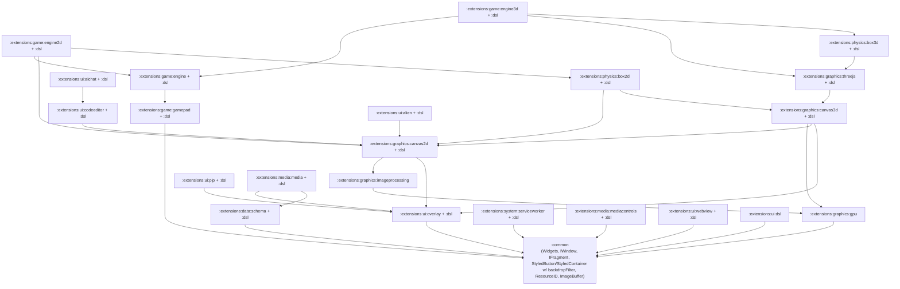

# GenericUI — First-Party Extensions (`:extensions`)

> **Parent Repository**: [**GenericUI Root (`../README.md`)**](../README.md) · [**Root Extensions Guide (`../docs/extensions.md`)**](../docs/extensions.md) · [**Layouts & Responsive Helpers (`../docs/layouts-and-helpers.md`)**](../docs/layouts-and-helpers.md) · [**Fragments & Windows (`../docs/fragments-and-windows.md`)**](../docs/fragments-and-windows.md) · [**Resources (`../docs/resources.md`)**](../docs/resources.md) · [**Application & Targets (`../docs/application.md`)**](../docs/application.md) · [**Source Sets Hierarchy (`../docs/sourcesets.md`)**](../docs/sourcesets.md) · [**Native Backends (`../docs/backends.md`)**](../docs/backends.md) · [**Gradle Plugin (`../docs/gradle-plugin.md`)**](../docs/gradle-plugin.md)

The **`extensions/`** tree houses all **21 First-Party GenericUI Extension Modules**, **18 companion `:dsl` modules**, and **`:extensions:ui:dsl`** (`= 40 extension Gradle projects` organized across **7 categories**). Every extension is a **Single Consolidated KMP Project** compiling `commonMain`, `systemMain`, `desktop` / `nativeDesktop` / per-OS, `mobile` / `android` / `ios`, and `web` source sets cleanly inside a unified project without nested Project-of-Projects subtrees.

---

## 1. Categorized Master Index of GenericUI Extensions

### Category 1 — Graphics (`:extensions:graphics:*`)
- [**`:extensions:graphics:gpu`**](docs/gpu.md) — Cross-platform GPU device management (`GpuDevice`), offscreen compute & shader contexts (`GpuOffscreenContext`), double-buffered swapchains (`GpuDoubleBufferedSurface`), textures (`GpuTexture`), buffers (`GpuBuffer`), and dual-target shader programs (`GpuShaderProgram`: Vulkan 1.2+ `#version 450` SPIR-V primary + OpenGL ES 3.0 `#version 300 es` / Google ANGLE / MoltenVK / WebGPU / WebGL2 fallback).
- [**`:extensions:graphics:imageprocessing`**](docs/imageprocessing.md) — Universal hardware-accelerated `ImageBuffer` & `ImageBuffer2DContext` (`imageBuffer.getContext()`) plus offscreen GPU manipulation (`GpuImageProcessor`, `GpuImagePipelineBuilder`, `GpuImageCompositor`), 12 Porter-Duff & artistic blend modes (`ImageBlendMode`), Lanczos-3 resampling, 256-bin histograms (`ImageHistogramResult`), and built-in GPU filters.
- [**`:extensions:graphics:canvas2d` & `:dsl`**](docs/canvas2d.md) — Hardware-accelerated 2D vector & raster surface (`Canvas2D`, `ScrollCanvas2D`, `CurveEditor`), viewport-only overlay hosts (`Canvas2DOverlayHost`, `ScrollCanvas2DOverlayHost`), direct `:common` `ImageBuffer` drawing/extraction, VBlank-synchronized `registerVBlankRender`, and declarative `:dsl` builders.
- [**`:extensions:graphics:canvas3d` & `:dsl`**](docs/canvas3d.md) — Unified hardware-accelerated 3D & programmable shader canvas (`Canvas3D`, `Canvas3DConfig`, fail-fast `Canvas3DRegistry`, `ScrollCanvas3D`, `OffscreenCanvas3D`) and overlay hosts (`Canvas3DOverlayHost`, `ScrollCanvas3DOverlayHost`) powered by `:extensions:graphics:gpu`.
- [**`:extensions:graphics:threejs` & `:dsl`**](docs/threejs.md) — Pure Kotlin Multiplatform port of Three.js (`Scene`, `PerspectiveCamera`, `OrthographicCamera`, `WebGLRenderer`, `OrbitControls`, `TransformControls`, lights, PBR/shader materials, geometries, skeletons, raycasting, `GltfLoader`, `ObjLoader`).

### Category 2 — Physics (`:extensions:physics:*`)
- [**`:extensions:physics:box2d` & `:dsl`**](docs/box2d.md) — Deterministic 2D rigid-body physics (`World2D`, `BodyDef2D`, `Body2D`, shapes, joints, raycasting, `ContactListener2D`) and `Box2DDebugDrawer` integrated with `:extensions:graphics:canvas2d` & `canvas3d`.
- [**`:extensions:physics:box3d` & `:dsl`**](docs/box3d.md) — 3D rigid-body physics (`World3D`, `RigidBodyDesc3D`, `RigidBody3D`, shapes, joints, `CharacterController3D`, `Box3DDebugRenderer`) synchronized automatically with `:extensions:graphics:threejs` `Object3D` transforms.

### Category 3 — Game & Input (`:extensions:game:*`)
- [**`:extensions:game:gamepad` & `:dsl`**](../docs/gamepad.md) — Unified Switch Pro/Joy-Con, DualSense/DualShock 4, Xbox, & HID controller input (`GamepadManager`, `ControllerHardwareProfile`, `GamepadLayoutMapper`), six-axis IMU fusion, vendor haptics/triggers/LEDs, and zero-config `GamepadUiNavigator`.
- [**`:extensions:game:engine`, `engine2d`, `engine3d` & `:dsl`**](../docs/game-engines.md) — Modular 3-layer game engine suite with dedicated logic tick thread (`PlatformGameLogicThread`), VBlank `AnimationScheduler` + 31 curves, `Skeleton2D` SVG rigging + `TwoBoneIkSolver2D`, pure-UI `UiStageHost`, `Game2DCanvasHost` (`Box2D`), and `Game3DCanvasHost` (`Three.js` + `Box3D`).

### Category 4 — Media & System Controls (`:extensions:media:*`)
- [**`:extensions:media:media` & `:dsl`**](docs/media.md) — Cross-platform `VideoPlayer`, `AudioPlayer`, FFT `AudioAnalyzer` (`AudioEnergyBands`), 5-SVG pure-Bezier `MediaVolumeIcons` (`com.nexustools.genericui.component.media.res.R`), animated 3-wave `ExpandingVolumeSlider` (with desktop stage HUD wave-alpha sync), transparent codec introspection (`MediaExtension.isVideoCodecSupported(...)`, `isAudioCodecSupported(...)`, `MediaCodecSupportProvider` via `LibVlcCodecSupportProvider` & `CachingMediaCodecSupportProvider`), `@SchemaData` **`VlcConfiguration`** + `MediaExtension.getPlayerSettingsSchema()`, `VideoOverlayHost`, and `YoutubeMediaOverlayHelper`.
- [**`:extensions:media:mediacontrols` & `:dsl`**](docs/mediacontrols.md) — Standalone OS media transport controls and hardware keyboard media key hooks (`MediaControlsSession`, `MediaControlMetadata`, `MediaControlsRegistry`, `DefaultPlatformMediaControlsFactory` across Windows SMTC / `ITaskbarList3`, macOS/iOS `MPNowPlayingInfoCenter` / `MPRemoteCommandCenter`, Linux MPRIS2, Swing, Android `MediaSession`, and Web `navigator.mediaSession`) depending **only on `:common`**.

### Category 5 — Data & Meta-Schema (`:extensions:data:*`)
- [**`:extensions:data:schema` & `:dsl`**](docs/schema.md) — Declarative meta-schema engine (`ObjectSchema`, 12 typed `SchemaFieldSpec`s + `SchemaGroupSpec` / `SchemaIndexedGroupSpec` / `SchemaAsyncGroupSpec` / `SchemaSeparatorSpec`, `SchemaCondition` `visibleWhen` / `enabledWhen`, `SchemaPreset`, `SchemaLayoutMode` `STACKED`/`RESPONSIVE_GRID`/`COMPACT_INLINE`/`TABBED`, `SchemaForm`, `SchemaModal`, `@SchemaData` + `@SchemaField(..., legacyKeys = ...)` compile-time codegen via `SchemaExtensionContributor`, `SchemaCustomFieldRenderer` / `SchemaRegistry`, `SchemaJsonCodec`, and `SchemaPreferenceCodec`).

### Category 6 — System & Background Execution (`:extensions:system:*`)
- [**`:extensions:system:serviceworker` & `:dsl`**](docs/serviceworker.md) — Persistent background service lifecycle & typed IPC (`ServiceWorker`, `@MainServiceWorker`, `ServiceWorkerOptions`, `ServiceWorkerExtension`, `@ServiceWorkerMessage` codegen + `ServiceWorkerCodecRegistry`, `ServiceWorkerChannel`). Runs as secondary singleton `serviceworker` executable (`serviceworker.exe`, `Contents/MacOS/serviceworker`, `serviceworker`, or Swing `GeneratedSwingServiceWorkerMain`) with tray & login autostart on Desktop, `GeneratedAndroidServiceWorkerService` (`ServiceCompat.startForeground` + default `"Stop"` notification button + conditional `BOOT_COMPLETED` receiver) on Android, and unified `./serviceworker.js` + `${appBaseName}.sw.js`/`${appBaseName}.sw.wasm` on Web, while **honestly reporting `ServiceWorkerExtension.isSupported == false` on iOS & iPadOS with zero simulation**.

### Category 7 — UI, Overlays, PiP, WebView, Editor, & AI (`:extensions:ui:*`)
- [**`:extensions:ui:dsl`**](docs/dsl.md) — `kotlinx.html`-inspired declarative UI builder DSL (`@GenericUiDslMarker`, `buildDiv`, `Container.build`), strictly isolated `style { ... }` (`ComponentStyle`), `bootstrap { ... }` (`ComponentBootstrap`), `important { ... }` (`DslStyleAndBootstrapBuilders.kt`), hardware `backdropFilter` on `StyledButton` + `StyledContainer`, hybrid responsive layouts (`HybridLayoutDsl.kt`), and MVC (`MvcModel`, `MvcView`, `MvcController`).
- [**`:extensions:ui:overlay` & `:dsl`**](docs/overlay.md) — Pure, background-free `LayeredContainer` overlay framework (`OverlayHost`, `OverlayHostBox`, `AbstractOverlay`, `Overlay`, `AutoHideController`, `OverlayInputRouter`), 9 pure-Bezier SVG icons (`com.nexustools.genericui.ext.overlay.res.R` via `OverlayIcons`), `OverlayControlButton` / `OverlayFullscreenButton` / `OverlayControlButtons`, 3-zone `YoutubePlayerOverlay`, and `HybridOverlayDifferenceController` (`SMALL_MOBILE_PORTRAIT` with `BELOW_CONTROLS` timeline & hardware `backdrop-filter` center glass buttons vs. `MEDIUM_LARGE`).
- [**`:extensions:ui:pip` & `:dsl`**](docs/pip.md) — Cross-platform Picture-in-Picture framework (`@PiPCompatible`, `FragmentPipHelper`, `FragmentPipRegistry`, `PipRegistry`, `PipControlOverlay`, `ComponentReparentSlot`) backed by `AndroidPipBackend`, `IosPipBackend` (`AVPictureInPictureController`), always-on-top `DesktopFloatingPipBackend` / `SwingFloatingPipBackend`, and `WebPipBackend` (`documentPictureInPicture` / native `<video>` PiP / in-place fallback).
- [**`:extensions:ui:alien` & `:dsl`**](docs/alien.md) — Self-rendering Bootstrap 5.3 component engine (`IAlien`, `com.nexustools.genericui.ext.alien.res.R.style.bootstrap`, `AlienPrecompiledBootstrapStyleSheet`, `AlienContainer`, `AlienFragment`, `AlienScrollFragment`, `AlienFragmentHostFragment`, `UnalienContainer`, `*AlienImpl`) supporting 100% of CSS properties & transitions over `Canvas2D` on System targets and zero-overhead DOM pass-through on Web.
- [**`:extensions:ui:webview` & `:dsl`**](docs/webview.md) — Embedded browser (`WebView`, `WebViewConfig`, `WebViewExtension`) powered by **Chromium + [`:NJS` (`../lib/NJS/README.md`)](../lib/NJS/README.md)** on Desktop/Swing, `android.webkit.WebView` on Android, `WKWebView` on iOS, and `<iframe>` on Web.
- [**`:extensions:ui:codeeditor` & `:dsl`**](docs/codeeditor.md) — IDE code editor (`IdeCodeEditor`, `CodeDocumentBuffer`, `SyntaxTokenizer`, `CodeEditorTheme`, `CodeMinimap`) built atop `:extensions:graphics:canvas2d`.
- [**`:extensions:ui:aichat` & `:dsl`**](docs/aichat.md) — Multi-provider AI Studio chat & tool-orchestration UI (`AiChatContainer`, `AiChatSession`, `AiBackendType`, `ReasoningEffort`, `AiToolExecutor`) supporting `bindHeaderActionsToTitleBar` (`TitleCapabilities`).

---

## 2. Inter-Extension Dependency Graph



---

## 3. Consolidated Extension Catalog & Submodule Matrix

All **21 extensions** follow a single-project KMP layout under `extensions/<category>/<name>` (plus optional `:dsl` child project `extensions/<category>/<name>/dsl`):

| Extension Module | Companion `:dsl` Module | Gradle DSL Function | Direct Extension & Core Dependencies | Dedicated Guide |
| :--- | :--- | :--- | :--- | :--- |
| `:extensions:graphics:gpu` | *(Context API)* | `gpu()` | `:common` | [`docs/gpu.md`](docs/gpu.md) |
| `:extensions:graphics:imageprocessing` | *(Pipeline API)* | `imageProcessing()` | `:extensions:graphics:gpu` | [`docs/imageprocessing.md`](docs/imageprocessing.md) |
| `:extensions:graphics:canvas2d` | `:extensions:graphics:canvas2d:dsl` | `canvas2d()` | `:extensions:graphics:imageprocessing`, `:extensions:ui:overlay` | [`docs/canvas2d.md`](docs/canvas2d.md) |
| `:extensions:graphics:canvas3d` | `:extensions:graphics:canvas3d:dsl` | `canvas3d()` | `:extensions:graphics:gpu`, `:extensions:graphics:canvas2d`, `:extensions:ui:overlay` | [`docs/canvas3d.md`](docs/canvas3d.md) |
| `:extensions:graphics:threejs` | `:extensions:graphics:threejs:dsl` | `threeJs()` | `:extensions:graphics:gpu`, `:extensions:graphics:canvas3d` | [`docs/threejs.md`](docs/threejs.md) |
| `:extensions:physics:box2d` | `:extensions:physics:box2d:dsl` | `box2d()` | `:extensions:graphics:canvas2d`, `:extensions:graphics:canvas3d` | [`docs/box2d.md`](docs/box2d.md) |
| `:extensions:physics:box3d` | `:extensions:physics:box3d:dsl` | `box3d()` | `:extensions:graphics:canvas3d`, `:extensions:graphics:threejs` | [`docs/box3d.md`](docs/box3d.md) |
| `:extensions:game:gamepad` | `:extensions:game:gamepad:dsl` | `gamepad()` | `:common` | [`../docs/gamepad.md`](../docs/gamepad.md) |
| `:extensions:game:engine` | `:extensions:game:engine:dsl` | `engine()` | `:common`, `:extensions:game:gamepad` | [`../docs/game-engines.md`](../docs/game-engines.md) |
| `:extensions:game:engine2d` | `:extensions:game:engine2d:dsl` | `engine2d()` | `:extensions:game:engine`, `:extensions:graphics:canvas2d`, `:extensions:physics:box2d` | [`../docs/game-engines.md`](../docs/game-engines.md) |
| `:extensions:game:engine3d` | `:extensions:game:engine3d:dsl` | `engine3d()` | `:extensions:game:engine`, `:extensions:graphics:threejs`, `:extensions:physics:box3d` | [`../docs/game-engines.md`](../docs/game-engines.md) |
| `:extensions:media:media` | `:extensions:media:media:dsl` | `media()` | `:extensions:ui:overlay`, `:extensions:data:schema` (+ `libvlc`/`vlcj` on Desktop) | [`docs/media.md`](docs/media.md) |
| `:extensions:media:mediacontrols` | `:extensions:media:mediacontrols:dsl` | `mediaControls()` | `:common` | [`docs/mediacontrols.md`](docs/mediacontrols.md) |
| `:extensions:data:schema` | `:extensions:data:schema:dsl` | `schema()` | `:common` | [`docs/schema.md`](docs/schema.md) |
| `:extensions:system:serviceworker` | `:extensions:system:serviceworker:dsl` | `serviceWorker()` / `serviceWorker { ... }` | `:common` | [`docs/serviceworker.md`](docs/serviceworker.md) |
| `:extensions:ui:dsl` | *(Base DSL Module)* | `dsl()` | `:common` | [`docs/dsl.md`](docs/dsl.md) |
| `:extensions:ui:overlay` | `:extensions:ui:overlay:dsl` | `overlay()` | `:common` | [`docs/overlay.md`](docs/overlay.md) |
| `:extensions:ui:pip` | `:extensions:ui:pip:dsl` | `pip()` | `:extensions:ui:overlay`, `:common` | [`docs/pip.md`](docs/pip.md) |
| `:extensions:ui:alien` | `:extensions:ui:alien:dsl` | `alien()` | `:extensions:graphics:canvas2d` | [`docs/alien.md`](docs/alien.md) |
| `:extensions:ui:webview` | `:extensions:ui:webview:dsl` | `webView()` | `:common` (+ Chromium & `:NJS` on Desktop/Swing) | [`docs/webview.md`](docs/webview.md) |
| `:extensions:ui:codeeditor` | `:extensions:ui:codeeditor:dsl` | `codeEditor()` | `:extensions:graphics:canvas2d` | [`docs/codeeditor.md`](docs/codeeditor.md) |
| `:extensions:ui:aichat` | `:extensions:ui:aichat:dsl` | `aiChat()` | `:extensions:ui:codeeditor` | [`docs/aichat.md`](docs/aichat.md) |

---

## 4. Automatic Provider Wiring & Codegen via the GenericUI Gradle Plugin

```kotlin
plugins {
    id("com.nexustools.genericui")
}

genericui {
    app {
        id = "com.example.studio"
        name = "GenericUI Studio"
        version = "1.0.0"
    }

    backends {
        allExceptSwing()
    }

    extensions {
        dsl()              // Enables :extensions:ui:dsl + auto-wires every enabled extension's :dsl
        gpu()
        imageProcessing()
        overlay()
        pip()              // Auto-enables overlay()
        canvas2d()         // Auto-enables imageProcessing() + overlay()
        canvas3d()         // Auto-enables gpu() + canvas2d() + overlay()
        schema()           // @SchemaData codegen & SchemaForm / SchemaModal
        serviceWorker {    // @MainServiceWorker + @ServiceWorkerMessage codegen
            autostart = true
            openWindowOnLaunch = true
        }
        media()            // Auto-enables overlay() + schema()
        mediaControls()
        gamepad()
        engine()           // Auto-enables gamepad()
        engine2d()         // Auto-enables engine() + canvas2d() + box2d()
        engine3d()         // Auto-enables engine() + threeJs() + box3d()
        webView()
        codeEditor()
        aiChat()
        threeJs()
        box2d()
        box3d()
        alien()            // Auto-enables canvas2d()
    }
}
```

---

## 5. Cross-References across the GenericUI Ecosystem

- [GenericUI Root (`../README.md`)](../README.md) · [First-Party Extensions Guide (`../docs/extensions.md`)](../docs/extensions.md) · [Fragments & Windows (`../docs/fragments-and-windows.md`)](../docs/fragments-and-windows.md) · [Multi-Backend Resources (`../docs/resources.md`)](../docs/resources.md) · [Application Lifecycle (`../docs/application.md`)](../docs/application.md) · [Source Sets (`../docs/sourcesets.md`)](../docs/sourcesets.md) · [Native Backends (`../docs/backends.md`)](../docs/backends.md) · [Gradle Plugin (`../docs/gradle-plugin.md`)](../docs/gradle-plugin.md)
- [Desktop Backends (`../desktop/README.md`)](../desktop/README.md) · [Mobile Backends (`../mobile/README.md`)](../mobile/README.md) · [Web Backend (`../web/README.md`)](../web/README.md)
