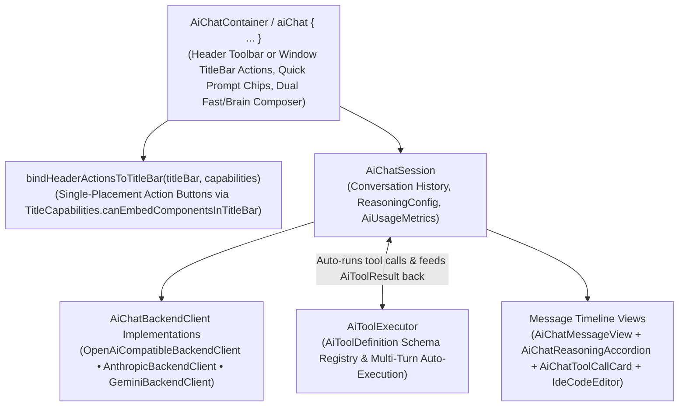

# `:extensions:aichat` & `:extensions:aichat:dsl` — Multi-Provider AI Agent Studio Chat & Tool Orchestration

> **Navigation**: [**GenericUI Root (`../../README.md`)**](../../README.md) · [**Extensions Index (`../README.md`)**](../README.md) · [**Root Extensions Guide (`../../docs/extensions.md`)**](../../docs/extensions.md) · [**Source Sets (`../../docs/sourcesets.md`)**](../../docs/sourcesets.md) · [**Backends (`../../docs/backends.md`)**](../../docs/backends.md) · [**Gradle Plugin (`../../docs/gradle-plugin.md`)**](../../docs/gradle-plugin.md)

`:extensions:aichat` is a **Single Multiplatform Project** (`src/commonMain` across all 8 platform targets) built atop [`:extensions:codeeditor`](codeeditor.md) ($\rightarrow$ [`:extensions:canvas2d`](canvas2d.md)) and `:common`. It delivers a complete AI Studio chat interface (**`AiChatContainer`**), single-placement window `TitleBar` action button integration (**`bindHeaderActionsToTitleBar`**), streaming session state (**`AiChatSession`**), multi-provider backend clients (**`AiBackendType`**), reasoning effort selectors (**`ReasoningEffort`**), collapsible chain-of-thought accordions (**`AiChatReasoningAccordion`**), live tool-invocation cards (**`AiChatToolCallCard`**), and an automated multi-turn function/tool executor (**`AiToolExecutor`**).

---

## 1. Architecture & Multi-Provider Streaming Loop



### Supported `AiBackendType` Providers
| `AiBackendType` Enum | Default Base URL | Default Model | Protocol Client |
| :--- | :--- | :--- | :--- |
| **`OPENAI`** | `https://api.openai.com/v1` | `gpt-4o` | `OpenAiCompatibleBackendClient` |
| **`ANTHROPIC`** | `https://api.anthropic.com/v1` | `claude-3-7-sonnet-latest` | `AnthropicBackendClient` |
| **`GEMINI`** | `https://generativelanguage.googleapis.com/v1beta` | `gemini-2.5-pro` | `GeminiBackendClient` |
| **`GEMINI_GOOGLE_ONE`** | `https://generativelanguage.googleapis.com/v1beta` | `gemini-2.5-pro` | `GeminiBackendClient` (OAuth Bearer) |
| **`XAI_GROK`** | `https://api.x.ai/v1` | `grok-2-latest` | `OpenAiCompatibleBackendClient` |
| **`OLLAMA`** | `http://localhost:11434/v1` | `llama3.3` | `OpenAiCompatibleBackendClient` |
| **`LM_STUDIO`** | `http://localhost:1234/v1` | `local-model` | `OpenAiCompatibleBackendClient` |
| **`OPENAI_COMPATIBLE`** / **`CUSTOM_OPENAI`** | Configurable (`http://localhost:8000/v1`) | Configurable | `OpenAiCompatibleBackendClient` |
| **`CUSTOM_CLAUDE`** | Configurable | Configurable | `AnthropicBackendClient` |

---

## 2. Single-Placement `TitleBar` Action Buttons (`bindHeaderActionsToTitleBar`)

`AiChatContainer` provides three header action buttons (`⚙️ AI Provider`, `🧰 Tools`, and `🗑️ Clear` via `headerActionButtons: List<Button>`). When an application hosts `AiChatContainer` inside a window that has a custom `TitleBar`, calling **`bindHeaderActionsToTitleBar(titleBar, capabilities)`** inspects `capabilities.canEmbedComponentsInTitleBar`:

- **When `capabilities.canEmbedComponentsInTitleBar == true`**: The action buttons (`⚙️ AI Provider`, `🧰 Tools`, `🗑️ Clear`) are removed from `AiChatContainer.headerToolbar` and embedded directly into `titleBar` (`areHeaderActionsInTitleBar == true`).
- **When `capabilities.canEmbedComponentsInTitleBar == false`** (or after calling `unbindHeaderActionsFromTitleBar(titleBar)`): The action buttons remain in (or are restored to) `AiChatContainer.headerToolbar` (`areHeaderActionsInTitleBar == false`).
- **Guaranteed Single Placement**: In both modes, the header action buttons are rendered **only once** — never duplicated across both the window `TitleBar` and the in-panel `headerToolbar`.

```kotlin
hostingWindow?.let { win ->
    val titleBar = TitleBar(title = "AI Studio")
    win.setTitleBar(titleBar)
    aiChatContainer.bindHeaderActionsToTitleBar(
        titleBar = titleBar,
        capabilities = win.titleCapabilities
    )
}
```

---

## 3. Gradle Plugin Configuration

Enabling `aiChat()` in the [GenericUI Gradle Plugin (`../../docs/gradle-plugin.md`)](../../docs/gradle-plugin.md) automatically configures `:extensions:aichat`, `:extensions:codeeditor`, `:extensions:canvas2d`, and (when `dsl()` is active) `:extensions:aichat:dsl`:

```kotlin
plugins {
    id("com.nexustools.genericui")
}

genericui {
    backends {
        allExceptSwing()
    }
    extensions {
        dsl()    // Enables :extensions:dsl
        aiChat() // Automatically includes :extensions:aichat, :extensions:codeeditor, :extensions:canvas2d, and :extensions:aichat:dsl
    }
}
```

---

## 4. Core API Reference (`com.nexustools.genericui.ext.aichat`)

| Class / Interface / Enum | Package | Description & Key Members |
| :--- | :--- | :--- |
| `AiChatContainer` | `ext.aichat` | Complete AI Studio chat UI extending `VStack`. Key members: `session: AiChatSession`, `activeReasoningLevel: ReasoningEffort`, `welcomeMessageMarkdown: String`, `showReasoningEffortSelector: Boolean`, `headerActionButtons: List<Button>`, `boundHeaderTitleBar: TitleBar?`, `areHeaderActionsInTitleBar: Boolean`, `bindHeaderActionsToTitleBar(titleBar: TitleBar, capabilities: TitleCapabilities = TitleCapabilities()): Boolean`, `unbindHeaderActionsFromTitleBar(titleBar: TitleBar? = boundHeaderTitleBar)`, `selectBackend(backendType, model, apiKey, baseUrl)`, `selectReasoningEffort(effort, budgetTokens)`, `setQuickPromptChips(chips)`, `stageAttachment(attachment)`, `submitPromptAsync(promptText, effortOverride)`, `submitPrompt(promptText, onChunk): AiChatMessage`, `resetToWelcomeMessage()`, `onOpenProviderSettings`, `onOpenToolsCatalog`, `onPromptExecutedCallback`. |
| `AiChatSession` | `ext.aichat` | Stateful multi-turn conversation & tool orchestration session: `config: AiBackendConfig`, `toolExecutor: AiToolExecutor`, `messages: List<AiChatMessage>`, `cumulativeUsage: AiUsageMetrics`, `isStreaming: Boolean`, `switchBackend(backendType, model, apiKey, baseUrl)`, `setReasoningEffort(effort, budgetTokens)`, `sendUserMessage(text, attachments, onChunk): AiChatMessage`, `cancelStreaming()`, `clearHistory()`. |
| `AiBackendConfig` | `ext.aichat` | Immutable connection & generation settings: `backendType: AiBackendType`, `baseUrl: String`, `model: String`, `apiKey: String`, `systemPrompt: String`, `temperature: Double`, `maxTokens: Int`, `reasoningConfig: ReasoningConfig`. |
| `ReasoningEffort` / `ReasoningConfig` | `ext.aichat` | Enum controlling extended thinking / chain-of-thought budget: `NONE`, `LOW`, `MEDIUM`, `HIGH`, `MAX`, paired with `ReasoningConfig(effort, budgetTokens)`. |
| `AiStreamChunk` / `AiStreamChunkType` | `ext.aichat` | Streaming delta emitted during generation (`TEXT_DELTA`, `REASONING_DELTA`, `TOOL_CALL_START`, `TOOL_CALL_ARGS_DELTA`, `TOOL_RESULT`, `USAGE`, `DONE`, `ERROR`). |
| `AiToolExecutor` / `AiToolDefinition` / `AiToolCall` / `AiToolResult` | `ext.aichat` | Tool schema registry and multi-turn dispatcher: `registerTool(definition, handler)`, `registerSimpleTool(name, description, parametersJsonSchema, requiresConfirmation, handler)`, `execute(toolCall): AiToolResult`, `getToolDefinitions(): List<AiToolDefinition>`. |
| `AiChatMessageView` | `ext.aichat` | Renders a single `AiChatMessage` with role badge, markdown text, syntax-highlighted code blocks, `AiChatReasoningAccordion`, and `AiChatToolCallCard` items. |
| `AiChatToolCallCard` | `ext.aichat` | Expandable card inspecting a tool call's name, status (`PENDING`, `RUNNING`, `SUCCEEDED`, `FAILED`), JSON arguments, execution duration, and JSON output. |
| `AiChatReasoningAccordion` | `ext.aichat` | Collapsible chain-of-thought (`<think>`) accordion displaying live streaming reasoning tokens. |
| `aiChat` / `aiChatContainer` | `ext.aichat.dsl` | Declarative DSL builders in `:extensions:aichat:dsl` configured via `AiChatDslConfigScope` (`backend`, `systemPrompt`, `welcomeMessage`, `reasoning`, `quickPrompt`, `tool`, `onPromptExecuted`). |
| `aiChatMessageView` / `aiChatToolCallCard` / `aiChatReasoningAccordion` | `ext.aichat.dsl` | Granular DSL builders for individual AI chat subcomponents. |

---

## 5. Imperative Kotlin Examples

### Example 1: Configuring `AiChatSession`, Registering Suspending Tools, & Binding `TitleBar` Actions

```kotlin
import com.nexustools.genericui.component.navigation.TitleBar
import com.nexustools.genericui.core.Window
import com.nexustools.genericui.ext.aichat.AiBackendConfig
import com.nexustools.genericui.ext.aichat.AiBackendType
import com.nexustools.genericui.ext.aichat.AiChatContainer
import com.nexustools.genericui.ext.aichat.AiChatSession
import com.nexustools.genericui.ext.aichat.AiQuickPromptChip
import com.nexustools.genericui.ext.aichat.ReasoningConfig
import com.nexustools.genericui.ext.aichat.ReasoningEffort

fun createSceneAssistantChat(hostingWindow: Window? = null): AiChatContainer {
    val session = AiChatSession(
        config = AiBackendConfig(
            backendType = AiBackendType.ANTHROPIC,
            model = "claude-3-7-sonnet-latest",
            apiKey = "sk-ant-...",
            systemPrompt = "You are a 3D scene & shader engineering assistant inside GenericUI.",
            reasoningConfig = ReasoningConfig(effort = ReasoningEffort.MEDIUM, budgetTokens = 4096)
        )
    )

    // Register a callable tool that the AI agent can invoke autonomously across multi-turn loops
    session.toolExecutor.registerSimpleTool(
        name = "spawn_threejs_mesh",
        description = "Spawns a 3D primitive mesh inside the active Three.js viewport.",
        parametersJsonSchema = """
            {
              "type": "object",
              "properties": {
                "shape": { "type": "string", "enum": ["box", "sphere", "torus"] },
                "colorHex": { "type": "string", "description": "Hex color such as #3b82f6" }
              },
              "required": ["shape"]
            }
        """.trimIndent()
    ) { argumentsJson ->
        // Execute the requested operation and return structured JSON to the model
        """{"status":"spawned","details":$argumentsJson}"""
    }

    val container = AiChatContainer(session = session, width = 420, height = 820).apply {
        welcomeMessageMarkdown = "### Welcome to GenericUI AI Studio\nSelect a quick prompt or ask me to inspect/modify your scene."
        setQuickPromptChips(
            listOf(
                AiQuickPromptChip(
                    label = "🧊 Spawn Blue Cube",
                    prompt = "Call spawn_threejs_mesh to create a blue box.",
                    tooltip = "Spawns a 3D BoxGeometry mesh"
                ),
                AiQuickPromptChip(
                    label = "✨ Write Vulkan Shader",
                    prompt = "Write a Vulkan #version 450 fragment shader with Hable filmic tone mapping.",
                    tooltip = "Generates a GLSL #version 450 shader"
                )
            )
        )
        resetToWelcomeMessage()
    }

    // Bind header action buttons (⚙️ AI Provider, 🧰 Tools, 🗑️ Clear) into the Window TitleBar when supported
    hostingWindow?.let { win ->
        val titleBar = TitleBar(title = "GenericUI AI Studio")
        win.setTitleBar(titleBar)
        container.bindHeaderActionsToTitleBar(titleBar, win.titleCapabilities)
    }

    return container
}
```

---

## 6. Declarative `:extensions:aichat:dsl` Examples

When `dsl()` and `aiChat()` are enabled, configure the entire AI provider, reasoning budget, quick prompt chips, and suspending tool handlers declaratively using `aiChat { ... }`:

```kotlin
import com.nexustools.genericui.enums.css.CssBorderStyle
import com.nexustools.genericui.ext.aichat.AiBackendType
import com.nexustools.genericui.ext.aichat.ReasoningEffort
import com.nexustools.genericui.ext.aichat.dsl.aiChat
import com.nexustools.genericui.ext.dsl.ColorRgba
import com.nexustools.genericui.ext.dsl.buildDiv
import com.nexustools.genericui.style.css.CssCornerRadii
import com.nexustools.genericui.style.css.CssEdgeLengths

val aiStudioDrawer = buildDiv(classes = "h-100") {
    aiChat(width = 440, height = 840, id = "studio-ai-chat") {
        backend(
            type = AiBackendType.GEMINI,
            model = "gemini-2.5-pro",
            apiKey = "AIzaSy..."
        )

        systemPrompt("You are an expert Kotlin Multiplatform and GPU graphics assistant.")
        welcomeMessage("👋 **AI Assistant Ready.** Ask a question or trigger a registered tool below.")

        reasoning(
            effort = ReasoningEffort.MEDIUM,
            enabled = true,
            budgetTokens = 4096
        )

        quickPrompt(
            id = "analyze-perf",
            label = "Analyze GPU Frame Timing",
            prompt = "Inspect the current VBlank deltaMs metrics and suggest shader optimizations.",
            icon = "⚡",
            reasoningEffort = ReasoningEffort.HIGH
        )

        tool(
            name = "query_gpu_device",
            description = "Returns the active GpuDevice backend type and driver version.",
            parametersJsonSchema = """{"type":"object","properties":{}}"""
        ) { _ ->
            """{"backend":"VULKAN","apiVersion":"1.3.280"}"""
        }

        onPromptExecuted { assistantMessage ->
            println("Turn finished (${assistantMessage.toolCalls.size} tool calls executed)")
        }

        style {
            backgroundColor = ColorRgba(15, 23, 42, 1.0)
            borderRadius = CssCornerRadii.px(10f)
            borderWidth = CssEdgeLengths.px(1f)
            borderStyle = CssBorderStyle.SOLID
            borderColor = ColorRgba(51, 65, 85, 1.0)
        }
    }
}
```

---

## 7. Related Extensions & Cross-References

- **Related Extensions**:
  - [`:extensions:codeeditor` (`codeeditor.md`)](codeeditor.md) — Powers syntax-highlighted code blocks and diffs inside `AiChatMessageView`.
  - [`:extensions:canvas2d` (`canvas2d.md`)](canvas2d.md) — Transitive 2D rendering surface for code blocks inside chat messages.
  - [`:extensions:threejs` (`threejs.md`)](threejs.md) — Frequently paired with `:extensions:aichat` to let AI tools manipulate 3D scenes inside `OverlayDockWorkspaceFragment`.
  - [`:extensions:dsl` (`dsl.md`)](dsl.md) — Base declarative Kotlin UI & Style DSL.
- **Root & Backend Documentation**:
  - [GenericUI Root (`../../README.md`)](../../README.md) · [Extensions Architecture (`../../docs/extensions.md`)](../../docs/extensions.md) · [Source Sets (`../../docs/sourcesets.md`)](../../docs/sourcesets.md) · [Backends (`../../docs/backends.md`)](../../docs/backends.md) · [Gradle Plugin (`../../docs/gradle-plugin.md`)](../../docs/gradle-plugin.md)
  - [Desktop Backends (`../../desktop/README.md`)](../../desktop/README.md) · [Mobile Backends (`../../mobile/README.md`)](../../mobile/README.md) · [Web Backend (`../../web/README.md`)](../../web/README.md)
