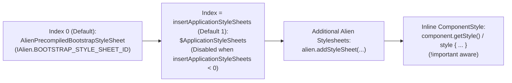
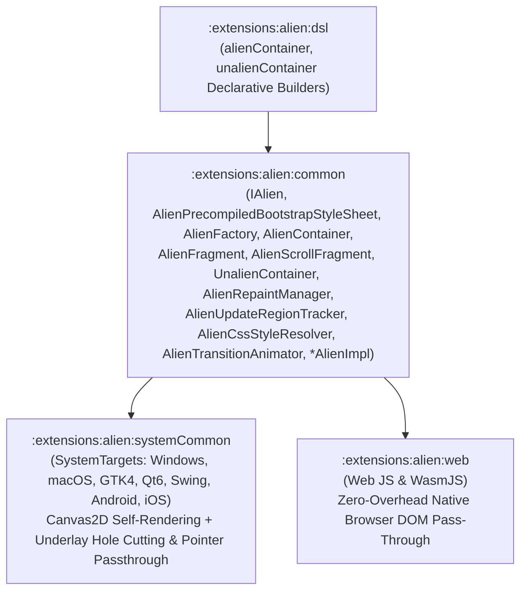

# `:extensions:alien` & `:extensions:alien:dsl` — Self-Rendering Bootstrap 5.3 Canvas2D UI, Precompiled `bootstrap.scss`, `IAlien` Stylesheet Cascade, & 100% CSS + Transition Engine

> **Navigation**: [**GenericUI Root (`../../README.md`)**](../../README.md) · [**Extensions Index (`../README.md`)**](../README.md) · [**Root Extensions Guide (`../../docs/extensions.md`)**](../../docs/extensions.md) · [**Fragments & Windows (`../../docs/fragments-and-windows.md`)**](../../docs/fragments-and-windows.md) · [**Resources (`../../docs/resources.md`)**](../../docs/resources.md) · [**Source Sets (`../../docs/sourcesets.md`)**](../../docs/sourcesets.md) · [**Backends (`../../docs/backends.md`)**](../../docs/backends.md) · [**Gradle Plugin (`../../docs/gradle-plugin.md`)**](../../docs/gradle-plugin.md)

`:extensions:alien` is a **Multi-Module Project-of-Projects** extension (`:extensions:alien:common`, `:extensions:alien:systemCommon`, `:extensions:alien:web`, and `:extensions:alien:dsl`) providing a self-rendering Bootstrap 5.3 component engine (`IAlien`, `AlienPrecompiledBootstrapStyleSheet`, `AlienFactory`, `AlienContainer`, `AlienFragment`, `AlienScrollFragment`, `UnalienContainer`, and `*AlienImpl` implementations for every component in `:common`) powered by [`:extensions:canvas2d`](canvas2d.md) (`Canvas2D` backed by [`:extensions:imageprocessing`](imageprocessing.md)'s `ImageBuffer`), an `AlienRepaintManager` with dirty update region tracking (`AlienUpdateRegionTracker`), and a complete CSS/SASS style & transition engine (`AlienCssStyleResolver` + `AlienTransitionAnimator`).

---

## 1. `:extensions:alien` vs. Native OS System Applications

| Capability | Native OS System Applications (`:windows`, `:macos`, `:gtk`, `:qt`, `:swing`, `:android`, `:ios`) | `:extensions:alien` (`AlienContainer`, `AlienFragment`, `AlienScrollFragment`) |
| :--- | :--- | :--- |
| **Default Control Appearance (`BootstrapType.NONE`)** | Renders **authentic native OS system controls** for the active `LIGHT` / `DARK` theme (Win32 `UxTheme` `DarkMode_Explorer::BUTTON` / `Explorer::BUTTON` on Windows, native AppKit/GTK4/Qt6/Swing/Android/iOS controls). **Never** uses Bootstrap CSS styling. | Renders **browser-identical Bootstrap 5.3 controls** (`AlienPrecompiledBootstrapStyleSheet` attached at index `0` by default, removable via `removeStyleSheet(IAlien.BOOTSTRAP_STYLE_SHEET_ID)`). |
| **Semantic `BootstrapType` (`PRIMARY`, `DANGER`, `SUCCESS`, etc.)** | **Colorizes the native OS control** to the semantic color of the `BootstrapType` (blue for `PRIMARY`, red for `DANGER`, green for `SUCCESS`, amber for `WARNING`, cyan for `INFO`, etc., supporting `outline = true/false`). | Evaluates full Bootstrap 5.3 `.btn-*` / `.btn-outline-*` / `.alert-*` / `.badge` / `.bg-*` / `.text-*` / `.border-*` rules from `AlienPrecompiledBootstrapStyleSheet` (including `:hover`, `:focus`, `:active`, `:disabled`, `:checked`). |
| **CSS Property & Transition Coverage** | Applies supported native layout/color/font/cursor properties and **silently ignores** unsupported CSS properties or transitions without warnings or errors. | Supports **100% of all `ComponentStyle`, `ComponentBootstrap`, and `PrecompiledStyleSheet` CSS properties** (gradients, multi-layer `box-shadow`, `text-shadow`, `filter`, `backdrop-filter`, `transform`, `accent-color`, custom cursors) and **100% of all CSS transitions** (`AlienTransitionAnimator`). |
| **Web Target (`:web`)** | Uses standard browser DOM elements + `WebDomElement.enumClassList` + `<link rel="stylesheet">`. | Zero-overhead pass-through directly to native browser DOM elements (`:extensions:alien:web`). |

---

## 2. Precompiled Bootstrap 5.3 SCSS (`bootstrap.scss` $\rightarrow$ `AlienPrecompiledBootstrapStyleSheet`)

`:extensions:alien:common` stores the canonical Bootstrap 5.3 SCSS source at:
- `extensions/alien/common/src/commonMain/resources/styles/bootstrap.scss`

During the build, the `syncPrecompileAlienBootstrapScss` (`precompileAlienBootstrapScss`) Gradle task in `:extensions:alien:common` compiles `bootstrap.scss` directly into **`AlienPrecompiledBootstrapStyleSheet`** (`implements PrecompiledStyleSheet`). Whenever `bootstrap.scss` is updated, `AlienPrecompiledBootstrapStyleSheet` automatically updates its precompiled `CompiledStyleRule` set — including `.bs-theme-light` and `.bs-theme-dark` theme variables, `.btn`, `.btn-primary`..`.btn-link`, `.btn-outline-*`, `.btn-sm`, `.btn-lg`, `:hover`/`:focus`/`:active`/`:disabled`/`:checked` states, `.alert`, `.badge`, `.card`, `.form-control`, `.form-select`, `.form-check-input`, `.navbar`, `.modal-content`, `.popover`, and all Bootstrap sizing/flex/spacing/border/shadow/typography utility classes.

---

## 3. `IAlien` Interface & Stylesheet Cascade (`insertApplicationStyleSheets`)

`AlienContainer`, `AlienFragment`, and `AlienScrollFragment` all implement **`IAlien`** (`com.nexustools.genericui.ext.alien.IAlien`):



### 3.1 Default Bootstrap Stylesheet & Removing/Re-Adding via `IAlien.BOOTSTRAP_STYLE_SHEET_ID`
- Every `AlienContainer`, `AlienFragment`, and `AlienScrollFragment` attaches `AlienPrecompiledBootstrapStyleSheet` at index `0` by default (`isBootstrapStyleSheetEnabled == true`).
- To opt out of Bootstrap 5.3 styling on a specific Alien container or fragment and use only your own custom stylesheets, remove it using the provided `ResourceID` constant **`IAlien.BOOTSTRAP_STYLE_SHEET_ID`** (or `IAlien.BOOTSTRAP_RESOURCE_ID` / `AlienPrecompiledBootstrapStyleSheet.RESOURCE_ID`):
  ```kotlin
  // Remove default Bootstrap 5.3 stylesheet from this AlienFragment / AlienContainer
  alien.removeStyleSheet(IAlien.BOOTSTRAP_STYLE_SHEET_ID)

  // Re-add the default Bootstrap 5.3 stylesheet at any time
  alien.addStyleSheet(IAlien.BOOTSTRAP_STYLE_SHEET_ID)
  ```

### 3.2 Per-Alien `addStyleSheet` / `removeStyleSheet` / `hasStyleSheet` Overloads
`IAlien` supports attaching and removing stylesheets per `AlienContainer` or `AlienFragment` by resource path (`String`), `ResourceID` (`R.style.<name>`), `PrecompiledStyleSheet`, or `CssStyleSheet`:
- `fun addStyleSheet(styleSheetPath: String)`
- `fun addStyleSheet(styleSheetResourceId: ResourceID)`
- `fun addStyleSheet(styleSheet: PrecompiledStyleSheet)`
- `fun addStyleSheet(styleSheet: CssStyleSheet)`
- `fun removeStyleSheet(styleSheetPath: String): Boolean`
- `fun removeStyleSheet(styleSheetResourceId: ResourceID): Boolean`
- `fun removeStyleSheet(styleSheet: PrecompiledStyleSheet): Boolean`
- `fun removeStyleSheet(styleSheet: CssStyleSheet): Boolean`
- `fun hasStyleSheet(styleSheetPath: String): Boolean`
- `fun hasStyleSheet(styleSheetResourceId: ResourceID): Boolean`
- `fun hasStyleSheet(styleSheet: PrecompiledStyleSheet): Boolean`
- `fun hasStyleSheet(styleSheet: CssStyleSheet): Boolean`
- `fun getStyleSheets(): List<PrecompiledStyleSheet>`
- `fun getStyleSheetPaths(): List<String>`

### 3.3 Controlling `$ApplicationStyleSheets` Insertion Order (`insertApplicationStyleSheets: Int = 1`)
`IAlien.insertApplicationStyleSheets` (`var insertApplicationStyleSheets: Int`, defaulting to **`1`**) controls where the application's global stylesheets (`IApplication.addStyleSheet(...)` / `globalStyleSheet`) are inserted into the Alien stylesheet cascade:
- **`insertApplicationStyleSheets = 1` (Default)**:
  - Evaluation order: `[Bootstrap, $ApplicationStyleSheets, AllAdditionalStyleSheets...]`
  - Application stylesheets automatically override default Bootstrap rules, while per-Alien stylesheets added after index `0` override application stylesheets.
- **`insertApplicationStyleSheets = 0`**:
  - Evaluation order: `[$ApplicationStyleSheets, Bootstrap, AllAdditionalStyleSheets...]`
- **`insertApplicationStyleSheets = -1` (or any `< 0`)**:
  - **Disables `$ApplicationStyleSheets` completely** for that `AlienContainer` or `AlienFragment` so only the stylesheets explicitly attached to that `IAlien` instance are evaluated.

---

## 4. Architecture & Submodule Layout



- **Mixing Native & Extension Components (`UnalienContainer` + Underlay Hole Cutting & Pointer Passthrough)**:
  - **`UnalienContainer`** acts as a native container inside an `AlienContainer` or `AlienFragment`, restoring the host OS `NativeFactory` so genuine OS-native `:common` components (rendered via Win32 `UxTheme`, AppKit, GTK4, Qt6, Swing, Android View, or UIKit) can be mixed seamlessly into an Alien interface.
  - **Extension-provided components** (`GLCanvasExt`, `VKCanvasExt`, `VideoPlayerExt`, `AudioAnalyzerExt`, `WebView`, etc.) and **`UnalienContainer`** are attached to the `AlienContainer` / `AlienFragment` **below** the `Canvas2D`, and the `Canvas2D` either cuts a transparent hole (`AlienExtensionLayerMode.CUT_TRANSPARENT_HOLE`) with mouse/pointer/wheel passthrough or draws higher-Z Alien components on top of them.

---

## 5. Gradle Plugin Configuration

Enable `alien()` inside the `genericui { extensions { ... } }` block in `build.gradle.kts`. The GenericUI Gradle plugin automatically enables `canvas2d()`, `imageProcessing()`, `overlay()`, and `gpu()`, wires the platform provider into generated launchers, and includes `:extensions:alien:dsl` when `dsl()` is enabled:

```kotlin
plugins {
    id("com.nexustools.genericui")
}

genericui {
    app {
        id = "com.example.alienstudio"
        name = "Alien Studio"
    }
    backends {
        allExceptSwing()
    }
    extensions {
        dsl()   // Enables :extensions:dsl + :extensions:alien:dsl
        alien() // Automatically enables :extensions:alien, :extensions:canvas2d, :extensions:imageprocessing, and :extensions:gpu
    }
}
```

---

## 6. Core Classes & `*AlienImpl` Component Set

| Class / Interface | Package | Description |
| :--- | :--- | :--- |
| [`IAlien`](../alien/common/src/commonMain/kotlin/com/nexustools/genericui/ext/alien/IAlien.kt) | `com.nexustools.genericui.ext.alien` | Common interface implemented by `AlienContainer`, `AlienFragment`, and `AlienScrollFragment`. Provides `BOOTSTRAP_STYLE_SHEET_ID`, `insertApplicationStyleSheets` (default `1`), `addStyleSheet`, `removeStyleSheet`, `hasStyleSheet`, `getStyleSheets`, `isBootstrapStyleSheetEnabled`, and `repaintAlien`. |
| [`AlienPrecompiledBootstrapStyleSheet`](../alien/common/src/commonMain/kotlin/com/nexustools/genericui/ext/alien/AlienPrecompiledBootstrapStyleSheet.kt) | `com.nexustools.genericui.ext.alien` | Precompiled Bootstrap 5.3 `PrecompiledStyleSheet` generated from `src/commonMain/resources/styles/bootstrap.scss` via `syncPrecompileAlienBootstrapScss`. |
| [`AlienFactory`](../alien/common/src/commonMain/kotlin/com/nexustools/genericui/ext/alien/AlienFactory.kt) | `com.nexustools.genericui.ext.alien` | Implements `NativeFactory`, returning `*AlienImpl` instances for all `:common` components while delegating OS windows, file dialogs, and system services to `hostFactory`. |
| [`AlienContainer`](../alien/common/src/commonMain/kotlin/com/nexustools/genericui/ext/alien/AlienContainer.kt) | `com.nexustools.genericui.ext.alien` | Self-rendering `Container` implementing `IAlien` and overriding `resolveChildFactory()` to provide `AlienFactory` on System targets while forwarding to the parent DOM container on `:web`. |
| [`AlienFragment`](../alien/common/src/commonMain/kotlin/com/nexustools/genericui/ext/alien/AlienFragment.kt) | `com.nexustools.genericui.ext.alien` | Self-rendering `Fragment` implementing `IFragment` and `IAlien`, providing `AlienFactory` on System targets and forwarding to the parent DOM container on `:web`. |
| [`AlienScrollFragment`](../alien/common/src/commonMain/kotlin/com/nexustools/genericui/ext/alien/AlienScrollFragment.kt) | `com.nexustools.genericui.ext.alien` | Scrollable self-rendering `Fragment` subclass implementing `IFragment` and `IAlien`. |
| [`UnalienContainer`](../alien/common/src/commonMain/kotlin/com/nexustools/genericui/ext/alien/UnalienContainer.kt) | `com.nexustools.genericui.ext.alien` | Native container inside an `AlienContainer` / `AlienFragment` that unwraps `AlienFactory.hostFactory` so genuine OS-native `:common` components can be mixed in. |
| [`AlienCssStyleResolver`](../alien/common/src/commonMain/kotlin/com/nexustools/genericui/ext/alien/AlienCssStyleResolver.kt) & [`AlienTransitionAnimator`](../alien/common/src/commonMain/kotlin/com/nexustools/genericui/ext/alien/AlienTransitionAnimator.kt) | `com.nexustools.genericui.ext.alien` | Full CSS cascade resolver (evaluating `AlienPrecompiledBootstrapStyleSheet`, `$ApplicationStyleSheets` at `insertApplicationStyleSheets`, additional Alien stylesheets, `ComponentBootstrap`, and `!important`-aware `ComponentStyle`) and 100% CSS property transition interpolator. |
| [`AlienRepaintManager`](../alien/common/src/commonMain/kotlin/com/nexustools/genericui/ext/alien/AlienRepaintManager.kt) & [`AlienUpdateRegionTracker`](../alien/common/src/commonMain/kotlin/com/nexustools/genericui/ext/alien/AlienUpdateRegionTracker.kt) | `com.nexustools.genericui.ext.alien` | Coordinates layout passes, CSS transition ticks, transparent hole cutting for underlay slots, and partial dirty-region repaints on `Canvas2D`. |
| [`AlienImpl`](../alien/common/src/commonMain/kotlin/com/nexustools/genericui/ext/alien/impl/AlienImpl.kt) & `*AlienImpl` | `com.nexustools.genericui.ext.alien.impl` | Self-rendered implementations of all `:common` components (`ButtonAlienImpl`, `ContainerAlienImpl`, `DropdownAlienImpl`, `TextInputAlienImpl`, `SelectAlienImpl`, `CheckboxAlienImpl`, `RangeSliderAlienImpl`, `TextAlienImpl`, `MarkdownViewAlienImpl`, `ImageAlienImpl`, `TableAlienImpl`, `ScrollViewAlienImpl`, `DividerAlienImpl`, `BookContainerAlienImpl`, `CollapseAlienImpl`, `TabAlienImpl`, `TabContainerAlienImpl`, `NavbarAlienImpl`, `BottomNavigationBarAlienImpl`, `ProgressBarAlienImpl`, `SpinnerAlienImpl`, `PopoverAlienImpl`, `SplitPaneAlienImpl`, `MenuBarAlienImpl`, `MenuAlienImpl`, `MenuItemAlienImpl`, `ContextMenuAlienImpl`, `DialogWindowAlienImpl`, `DockWorkspaceAlienImpl`, `DockAreaAlienImpl`, `DockGroupAlienImpl`, `DockPanelAlienImpl`, `DockWindowAlienImpl`, `ToolPaletteAlienImpl`, `LazyListAlienImpl`, `LazyGridAlienImpl`, `TreeViewAlienImpl`). |

---

## 7. Usage Examples (`@MainAppFragment`, `IAlien` Stylesheets, `style { ... }` / `bootstrap { ... }`, & `UnalienContainer`)

```kotlin
import com.nexustools.genericui.component.fragment.FragmentBundle
import com.nexustools.genericui.component.fragment.MainAppFragment
import com.nexustools.genericui.enums.bootstrap.*
import com.nexustools.genericui.enums.css.CssCursor
import com.nexustools.genericui.ext.alien.AlienFragment
import com.nexustools.genericui.ext.alien.IAlien
import com.nexustools.genericui.ext.alien.dsl.alienContainer
import com.nexustools.genericui.ext.alien.dsl.unalienContainer
import com.nexustools.genericui.ext.dsl.*
import com.nexustools.genericui.style.css.CssCornerRadii
import com.nexustools.genericui.style.transition.CssTransitionSpec
import com.nexustools.genericui.style.transition.TransitionTimingFunction

@MainAppFragment(label = "Alien Studio")
class StudioAlienFragment : AlienFragment() {
    override fun onCreate(savedState: FragmentBundle?) {
        super.onCreate(savedState)

        // Default cascade: [Bootstrap (index 0), $ApplicationStyleSheets (index 1), ...additional]
        insertApplicationStyleSheets = 1

        // Optional: attach an additional custom Alien stylesheet (or remove Bootstrap via removeStyleSheet(IAlien.BOOTSTRAP_STYLE_SHEET_ID))
        addStyleSheet("styles/studio-overrides.scss")

        rootContainer.build {
            alienContainer {
                bootstrap {
                    padding = SpacingScale.S4
                }

                h2("Custom Alien Interface (100% CSS & Transitions)")

                button("Bootstrap 5.3 Alien Button") {
                    bootstrap {
                        type = BootstrapType.PRIMARY
                        size = BootstrapSize.LG
                        shadow = ShadowElevation.SM
                    }
                    style {
                        cursor = CssCursor.POINTER
                        setTransitions(
                            listOf(
                                CssTransitionSpec(
                                    property = "all",
                                    durationMs = 180,
                                    timingFunction = TransitionTimingFunction.EASE_IN_OUT
                                )
                            )
                        )
                        important {
                            borderRadius = CssCornerRadii.px(10f)
                        }
                    }
                }

                // Mix in genuine OS-native components (Win32 UxTheme, AppKit, GTK4, Qt6, etc.) via unalienContainer
                unalienContainer {
                    bootstrap {
                        marginTop = SpacingScale.S3
                        padding = SpacingScale.S2
                        borderRadius = BorderRadiusStyle.ROUNDED
                    }
                    // BootstrapType.NONE renders the authentic OS system button; semantic types colorize the native button
                    button("Authentic Host OS Native Button", type = BootstrapType.NONE)
                    button("Semantic Colored Native Button", type = BootstrapType.DANGER)
                }
            }
        }
    }
}
```

---

## 8. Related Extensions & Cross-References

- [`:extensions:dsl` (`dsl.md`)](dsl.md) — Strictly isolated `style { ... }`, `bootstrap { ... }`, `important { ... }`, and hybrid layout DSL builders.
- [`:extensions:canvas2d` & `:extensions:canvas2d:dsl` (`canvas2d.md`)](canvas2d.md) — Provides the hardware-accelerated `Canvas2D` surface used by `AlienRepaintManager`.
- [`:extensions:imageprocessing` (`imageprocessing.md`)](imageprocessing.md) — Provides `ImageBuffer` and `ImageBuffer2DContext`.
- [`:extensions:gpu` (`gpu.md`)](gpu.md) — Underlying Vulkan 1.2+ and OpenGL ES 3.0+ GPU foundation.
- [GenericUI Root (`../../README.md`)](../../README.md) · [Layouts & Responsive Helpers (`../../docs/layouts-and-helpers.md`)](../../docs/layouts-and-helpers.md) · [Fragments & Windows (`../../docs/fragments-and-windows.md`)](../../docs/fragments-and-windows.md) · [Resources (`../../docs/resources.md`)](../../docs/resources.md) · [Gradle Plugin (`../../docs/gradle-plugin.md`)](../../docs/gradle-plugin.md)
