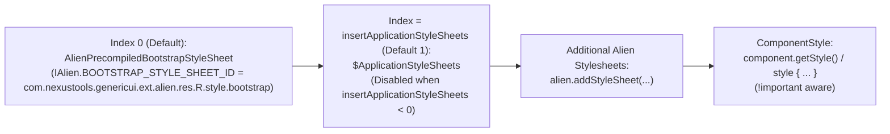

# `:extensions:ui:alien` & `:extensions:ui:alien:dsl` — Self-Rendering Bootstrap 5.3 Canvas2D UI, Precompiled `bootstrap.scss`, `com.nexustools.genericui.ext.alien.res.R`, & 100% CSS + Transition Engine

> **Navigation**: [**GenericUI Root (`../../README.md`)**](../../README.md) · [**Extensions Index (`../README.md`)**](../README.md) · [**Root Extensions Guide (`../../docs/extensions.md`)**](../../docs/extensions.md) · [**Fragments & Windows (`../../docs/fragments-and-windows.md`)**](../../docs/fragments-and-windows.md) · [**Resources (`../../docs/resources.md`)**](../../docs/resources.md) · [**Source Sets (`../../docs/sourcesets.md`)**](../../docs/sourcesets.md) · [**Backends (`../../docs/backends.md`)**](../../docs/backends.md) · [**Gradle Plugin (`../../docs/gradle-plugin.md`)**](../../docs/gradle-plugin.md)

`:extensions:ui:alien` is a **Single Consolidated KMP Project** compiled across all GenericUI targets (native Desktop, JVM Swing, Android, iOS/iPadOS via `systemMain`, and zero-overhead browser DOM pass-through on `webMain`) providing a self-rendering Bootstrap 5.3 component engine (`IAlien`, `AlienImplProvider`, `AlienPrecompiledBootstrapStyleSheet`, `AlienFactory`, `AlienContainer`, `AlienFragment`, `AlienScrollFragment`, `AlienFragmentHostFragment`, `UnalienContainer`, and `*AlienImpl` implementations for every `:common` component including `StyledButtonAlienImpl` and `StyledContainerAlienImpl`) powered by [`:extensions:graphics:canvas2d`](canvas2d.md) (`Canvas2D` backed by [`:extensions:graphics:imageprocessing`](imageprocessing.md)'s `ImageBuffer`), an `AlienRepaintManager` with dirty region tracking (`AlienUpdateRegionTracker`), and a complete CSS/SASS style & transition engine (`AlienCssStyleResolver` + `AlienTransitionAnimator`).

---

## 1. `:extensions:ui:alien` vs. Native OS System Applications

| Capability | Native OS System Applications (`:windows`, `:macos`, `:gtk`, `:kde`, `:swing`, `:android`, `:ios`) | `:extensions:ui:alien` (`AlienContainer`, `AlienFragment`, `AlienScrollFragment`, `AlienFragmentHostFragment`) |
| :--- | :--- | :--- |
| **Default Control Appearance (`BootstrapType.NONE && !outline`)** | Mounts **100% unmodified genuine native OS system controls** for the active `LIGHT` / `DARK` theme (`ComCtl32 v6` `HWND` / AppKit `NSControl` / GTK4 `GtkWidget*` / KDE `KF6` + `Breeze` alien `QWidget*` / Swing L&F / Material 3 / UIKit). **Never** uses Bootstrap CSS styling. | Renders **browser-identical Bootstrap 5.3 controls** (`AlienPrecompiledBootstrapStyleSheet` attached at index `0` via `com.nexustools.genericui.ext.alien.res.R.style.bootstrap`, removable via `removeStyleSheet(IAlien.BOOTSTRAP_STYLE_SHEET_ID)`). |
| **Semantic `BootstrapType` (`PRIMARY`, `DANGER`, `SUCCESS`, etc.)** | `Button` mounts custom Bootstrap button widgets on native desktop (or tinted control graphics on Swing/mobile), and Bootstrap non-control surfaces mount custom native semantic widgets styled via `SemanticSurfaceStyleResolver`. | Evaluates full Bootstrap 5.3 `.btn-*` / `.btn-outline-*` / `.alert-*` / `.badge` / `.bg-*` / `.text-*` / `.border-*` rules from `AlienPrecompiledBootstrapStyleSheet` (including `:hover`, `:focus`, `:active`, `:disabled`, `:checked`). |
| **CSS Property & Transition Coverage** | Honors typography on text elements and full `ComponentStyle` aesthetics (including 10-op `backdropFilter`) on `StyledComponent`, `StyledContainer`, & `StyledButton`; ignores aesthetic overrides on standard controls. | Supports **100% of all `ComponentStyle`, `ComponentBootstrap`, and `PrecompiledStyleSheet` CSS properties** (gradients, multi-layer `box-shadow`, `text-shadow`, `filter`, `backdrop-filter`, `transform`, `accent-color`, custom cursors) and **100% of all CSS transitions** (`AlienTransitionAnimator`) on every component. |
| **Web Target (`:web`)** | Uses `<genericui:app>`, `<genericui:fragment>`, and compiled styles in `<head>`. | Zero-overhead pass-through directly to native browser DOM elements, using `<genericui:fragment>` for `AlienFragment`, `AlienScrollFragment`, and `AlienFragmentHostFragment`. |

---

## 2. Precompiled Bootstrap 5.3 SCSS (`bootstrap.scss` $\rightarrow$ `R.style.bootstrap` & `AlienPrecompiledBootstrapStyleSheet`)

`:extensions:ui:alien` stores its canonical Bootstrap 5.3 SCSS source at:
- [`extensions/ui/alien/src/commonMain/resources/styles/bootstrap.scss`](../ui/alien/src/commonMain/resources/styles/bootstrap.scss)

During builds, GenericUI compiles `bootstrap.scss` into **`com.nexustools.genericui.ext.alien.res.R.style.bootstrap`** and synchronizes [`AlienPrecompiledBootstrapStyleSheet`](../ui/alien/src/commonMain/kotlin/com/nexustools/genericui/ext/alien/AlienPrecompiledBootstrapStyleSheet.kt) (`implements PrecompiledStyleSheet`). Every `IAlien` instance defaults `IAlien.BOOTSTRAP_STYLE_SHEET_ID` directly to `com.nexustools.genericui.ext.alien.res.R.style.bootstrap`.

---

## 3. `IAlien` Interface, `AlienImplProvider` Composition, & Stylesheet Cascade (`insertApplicationStyleSheets`)

Only **`AlienContainer`**, **`AlienFragment`**, **`AlienScrollFragment`**, and **`AlienFragmentHostFragment`** implement **`IAlien`** ([`com.nexustools.genericui.ext.alien.IAlien`](../ui/alien/src/commonMain/kotlin/com/nexustools/genericui/ext/alien/IAlien.kt)).

### 3.1 Protected `AlienImplProvider` Composition Pattern & Viewport Resize Forwarding
To avoid code duplication across container and fragment hierarchies (`Container`, `Fragment`, `ScrollFragment`, and `FragmentHostFragment`), all four `IAlien` roots delegate to:
```kotlin
protected open val alienImplProvider: AlienImplProvider
```
- **`AlienImplProvider` does NOT implement `IAlien`**. It centralizes Alien state, `AlienRenderSession` lifecycle, `Canvas2D` surface attachment (`AlienHostCanvasContainerAlienImpl`), stylesheet cascade synchronization (`activeStyleSheets`, `insertApplicationStyleSheets`), and custom component `NativeImpl` creator overrides (`registerAlienComponentImpl`).
- **Automatic Viewport Resize Forwarding (`onResize(viewportWidth, viewportHeight)`)**: When a `Window` or the underlying `Canvas2D` surface in `AlienHostCanvasContainerAlienImpl` is resized, the resize forwards automatically to `session.resizeViewport(w, h)` / `resizeAlienViewport` and `(alienRoot as? IFragment)?.onResize(w, h)`.

### 3.2 `AlienFragmentHostFragment` for Multi-Screen Alien Apps & Games
```kotlin
open class AlienFragmentHostFragment(
    appTitle: String = "",
    transitionSpec: FragmentTransitionSpec = FragmentTransitionSpec.None,
    navigationChrome: FragmentNavigationChromeConfig = FragmentNavigationChromeConfig(),
    val syncBrowserUrlHash: Boolean = true
) : FragmentHostFragment(
    appTitle = appTitle,
    transitionSpec = transitionSpec,
    navigationChrome = navigationChrome
), IAlien
```
Multi-screen Alien apps and games can annotate an `AlienFragmentHostFragment` subclass with `@MainAppFragment` and host `@AppFragment` routes (`registerFragment`, `navigateTo`, `goBack`, `goForward`, `FragmentTransitionSpec`, `FragmentNavigationChromeConfig`) directly without a child `AlienContainer`.



### 3.3 Default Bootstrap Stylesheet & `IAlien.BOOTSTRAP_STYLE_SHEET_ID`
- Every `AlienContainer`, `AlienFragment`, `AlienScrollFragment`, and `AlienFragmentHostFragment` attaches `AlienPrecompiledBootstrapStyleSheet` at index `0` by default (`isBootstrapStyleSheetEnabled == true`, backed by `com.nexustools.genericui.ext.alien.res.R.style.bootstrap`).
- Opt out or re-enable cleanly via `removeStyleSheet(IAlien.BOOTSTRAP_STYLE_SHEET_ID)` / `addStyleSheet(IAlien.BOOTSTRAP_STYLE_SHEET_ID)` (or `IAlien.BOOTSTRAP_RESOURCE_ID` / `AlienPrecompiledBootstrapStyleSheet.RESOURCE_ID`).

### 3.4 Per-Alien Stylesheet Overloads & `$ApplicationStyleSheets` Order (`insertApplicationStyleSheets`)
- Overloads for `addStyleSheet`, `removeStyleSheet`, and `hasStyleSheet` accept `String`, `ResourceID` (`R.style.<name>`), `PrecompiledStyleSheet`, and `CssStyleSheet` alongside `getStyleSheets()` and `getStyleSheetPaths()`.
- `IAlien.insertApplicationStyleSheets` defaults to **`1`** (`[Bootstrap, $ApplicationStyleSheets, Additional...]`). Set to `0` to place `$ApplicationStyleSheets` ahead of Bootstrap, or `< 0` (`-1`) to omit `$ApplicationStyleSheets`.

---

## 4. Architecture & Hybrid Underlay Composition

- **Consolidated Module Layout (`extensions/ui/alien/`)**:
  - `commonMain`: `IAlien`, `AlienImplProvider`, `AlienPrecompiledBootstrapStyleSheet`, `AlienFactory`, `AlienContainer`, `AlienFragment`, `AlienScrollFragment`, `AlienFragmentHostFragment`, `UnalienContainer`, `AlienCssStyleResolver`, `AlienTransitionAnimator`, `AlienRepaintManager`, `AlienUpdateRegionTracker`, and `*AlienImpl` widgets (including `StyledButtonAlienImpl` & `StyledContainerAlienImpl`).
  - `systemMain`: Renders onto `:extensions:graphics:canvas2d` on System targets (`Windows`, `macOS`, `GTK`, `KDE`, `Swing`, `Android`, `iOS`) using `SystemAlienBootstrap` with underlay transparent hole cutting (`AlienExtensionLayerMode.CUT_TRANSPARENT_HOLE`) and pointer passthrough.
  - `webMain`: Zero-overhead pass-through (`WebAlienBootstrap`) directly to native browser DOM elements (`<genericui:fragment>`).
  - `:extensions:ui:alien:dsl`: Declarative `alienContainer` & `unalienContainer` builders.
- **4 Auto-Wired Companion `:alien` Modules (Zero Underlay Holes)**:
  When `alien()` (or Desktop `webView()`) is active in `build.gradle.kts`, `GenericUiExtensionsConfig` automatically adds and registers matching `:alien` companion modules for enabled media/graphics extensions so they paint directly into the Alien scene graph without OS HWND/underlay holes:
  1. **`:extensions:graphics:svg:alien`** ([`SvgAlienExtension`](../graphics/svg/alien/src/commonMain/kotlin/com/nexustools/genericui/ext/svg/alien/SvgAlienExtension.kt) $\rightarrow$ `SvgAlienImpl`) — Self-rendered `Svg` scene graph rasterized & cached per `(sceneVersion, rasterWidth, rasterHeight)`.
  2. **`:extensions:graphics:canvas2d:alien`** ([`Canvas2DAlienExtension`](../graphics/canvas2d/alien/src/commonMain/kotlin/com/nexustools/genericui/ext/canvas2d/alien/Canvas2DAlienExtension.kt) $\rightarrow$ `Canvas2DAlienImpl`) — Self-rendered child `Canvas2D` backed by `ImageBuffer` / `ImageBuffer2DContext`.
  3. **`:extensions:graphics:canvas3d:alien`** ([`Canvas3DAlienExtension`](../graphics/canvas3d/alien/src/commonMain/kotlin/com/nexustools/genericui/ext/canvas3d/alien/Canvas3DAlienExtension.kt) $\rightarrow$ `Canvas3DAlienImpl`) — Self-rendered `Canvas3D` / `ScrollCanvas3D` (with offscreen `AlienOffscreenGlContext` / `VKContext` fallback in `Canvas3DRegistry`).
  4. **`:extensions:media:media:alien`** ([`MediaAlienExtension`](../media/media/alien/src/commonMain/kotlin/com/nexustools/genericui/ext/media/alien/MediaAlienExtension.kt) $\rightarrow$ `VideoPlayerAlienImpl`) — Self-rendered `VideoPlayer` compositing offscreen decoded RGBA video frames into Alien's `ImageBuffer2DContext`.
- **Mixing Native & Extension Components (`UnalienContainer`)**:
  - **`UnalienContainer`** restores the host OS `NativeFactory` so genuine OS-native `:common` components can be embedded inside an `IAlien` tree.
  - Remaining underlay components (such as `AudioAnalyzer` or `UnalienContainer`) mount beneath `Canvas2D` with automatic hole cutting and pointer/wheel passthrough (`AlienUnderlayExtensionSlotNode`).

---

## 5. Gradle Plugin Configuration

Enable `alien()` inside `genericui { extensions { ... } }` in `build.gradle.kts` (automatically enables `canvas2d()`, `imageProcessing()`, `overlay()`, and `gpu()`, and includes `:extensions:ui:alien:dsl` when `dsl()` is active):

```kotlin
plugins {
    id("com.nexustools.genericui")
}

genericui {
    app {
        id = "com.example.alienstudio"
        name = "Alien Studio"
    }
    backends {
        allExceptSwing()
    }
    extensions {
        dsl()   // Enables :extensions:ui:dsl + :extensions:ui:alien:dsl
        alien() // Enables :extensions:ui:alien -> canvas2d -> imageProcessing + overlay + gpu
    }
}
```

---

## 6. Core Classes & `*AlienImpl` Component Set

| Class / Interface | Package | Description |
| :--- | :--- | :--- |
| [`IAlien`](../ui/alien/src/commonMain/kotlin/com/nexustools/genericui/ext/alien/IAlien.kt) | `com.nexustools.genericui.ext.alien` | Contract implemented strictly by `AlienContainer`, `AlienFragment`, `AlienScrollFragment`, and `AlienFragmentHostFragment`. Exposes `BOOTSTRAP_STYLE_SHEET_ID` (`com.nexustools.genericui.ext.alien.res.R.style.bootstrap`), `insertApplicationStyleSheets`, `addStyleSheet`, `removeStyleSheet`, `hasStyleSheet`, `getStyleSheets`, `resizeAlienViewport`, `repaintAlien`, and `registerAlienComponentImpl`. |
| [`AlienImplProvider`](../ui/alien/src/commonMain/kotlin/com/nexustools/genericui/ext/alien/AlienImplProvider.kt) | `com.nexustools.genericui.ext.alien` | Protected composition helper held via `alienImplProvider` on the four `IAlien` roots. |
| [`AlienPrecompiledBootstrapStyleSheet`](../ui/alien/src/commonMain/kotlin/com/nexustools/genericui/ext/alien/AlienPrecompiledBootstrapStyleSheet.kt) | `com.nexustools.genericui.ext.alien` | Precompiled Bootstrap 5.3 `PrecompiledStyleSheet` synced with `bootstrap.scss`. |
| [`AlienFactory`](../ui/alien/src/commonMain/kotlin/com/nexustools/genericui/ext/alien/AlienFactory.kt) | `com.nexustools.genericui.ext.alien` | `NativeFactory` returning `*AlienImpl` instances while delegating OS windows/dialogs to `hostFactory`. |
| [`AlienContainer`](../ui/alien/src/commonMain/kotlin/com/nexustools/genericui/ext/alien/AlienContainer.kt) | `com.nexustools.genericui.ext.alien` | Self-rendering `Container` implementing `IAlien`. |
| [`AlienFragment`](../ui/alien/src/commonMain/kotlin/com/nexustools/genericui/ext/alien/AlienFragment.kt) & [`AlienScrollFragment`](../ui/alien/src/commonMain/kotlin/com/nexustools/genericui/ext/alien/AlienScrollFragment.kt) | `com.nexustools.genericui.ext.alien` | Self-rendering `Fragment` / scrollable fragment implementing `IFragment` and `IAlien`. |
| [`AlienFragmentHostFragment`](../ui/alien/src/commonMain/kotlin/com/nexustools/genericui/ext/alien/AlienFragmentHostFragment.kt) | `com.nexustools.genericui.ext.alien` | Self-rendering `FragmentHostFragment` implementing `IAlien` for multi-screen `@AppFragment` apps. |
| [`AlienHostCanvasContainerAlienImpl`](../ui/alien/src/commonMain/kotlin/com/nexustools/genericui/ext/alien/impl/AlienHostCanvasContainerAlienImpl.kt) | `com.nexustools.genericui.ext.alien.impl` | Root host managing underlay slots and top `Canvas2D` viewport resize forwarding. |
| [`UnalienContainer`](../ui/alien/src/commonMain/kotlin/com/nexustools/genericui/ext/alien/UnalienContainer.kt) | `com.nexustools.genericui.ext.alien` | Native container inside Alien unwrapping `hostFactory` for OS-native `:common` components. |
| [`AlienCssStyleResolver`](../ui/alien/src/commonMain/kotlin/com/nexustools/genericui/ext/alien/AlienCssStyleResolver.kt) & [`AlienTransitionAnimator`](../ui/alien/src/commonMain/kotlin/com/nexustools/genericui/ext/alien/AlienTransitionAnimator.kt) | `com.nexustools.genericui.ext.alien` | Full CSS cascade resolver and transition interpolator. |
| [`AlienRepaintManager`](../ui/alien/src/commonMain/kotlin/com/nexustools/genericui/ext/alien/AlienRepaintManager.kt) & [`AlienUpdateRegionTracker`](../ui/alien/src/commonMain/kotlin/com/nexustools/genericui/ext/alien/AlienUpdateRegionTracker.kt) | `com.nexustools.genericui.ext.alien` | Coordinates layout passes, CSS transition ticks, underlay hole cutting, and partial dirty-region repaints. |
| [`AlienImpl`](../ui/alien/src/commonMain/kotlin/com/nexustools/genericui/ext/alien/impl/AlienImpl.kt) & `*AlienImpl` | `com.nexustools.genericui.ext.alien.impl` | Self-rendered implementations of all `:common` widgets (`ButtonAlienImpl`, `StyledButtonAlienImpl`, `ContainerAlienImpl`, `StyledContainerAlienImpl`, `DropdownAlienImpl`, `TextInputAlienImpl`, `SelectAlienImpl`, `CheckboxAlienImpl`, `RangeSliderAlienImpl`, `TextAlienImpl`, `MarkdownViewAlienImpl`, `ImageAlienImpl`, `TableAlienImpl`, `ScrollViewAlienImpl`, `DividerAlienImpl`, `BookContainerAlienImpl`, `CollapseAlienImpl`, `TabAlienImpl`, `TabContainerAlienImpl`, `NavbarAlienImpl`, `BottomNavigationBarAlienImpl`, `ProgressBarAlienImpl`, `SpinnerAlienImpl`, `PopoverAlienImpl`, `SplitPaneAlienImpl`, `MenuBarAlienImpl`, `MenuAlienImpl`, `MenuItemAlienImpl`, `ContextMenuAlienImpl`, `DialogWindowAlienImpl`, `DockWorkspaceAlienImpl`, `DockAreaAlienImpl`, `DockGroupAlienImpl`, `DockPanelAlienImpl`, `DockWindowAlienImpl`, `ToolPaletteAlienImpl`, `LazyListAlienImpl`, `LazyGridAlienImpl`, `TreeViewAlienImpl`). |

---

## 7. Usage Examples

### 7.1 Single-Screen `AlienFragment` with `UnalienContainer`
```kotlin
import com.nexustools.genericui.component.fragment.FragmentBundle
import com.nexustools.genericui.component.fragment.MainAppFragment
import com.nexustools.genericui.enums.bootstrap.*
import com.nexustools.genericui.enums.css.CssCursor
import com.nexustools.genericui.ext.alien.AlienFragment
import com.nexustools.genericui.ext.alien.IAlien
import com.nexustools.genericui.ext.alien.dsl.alienContainer
import com.nexustools.genericui.ext.alien.dsl.unalienContainer
import com.nexustools.genericui.ext.dsl.*
import com.nexustools.genericui.style.css.CssCornerRadii
import com.nexustools.genericui.style.transition.CssTransitionSpec
import com.nexustools.genericui.style.transition.TransitionTimingFunction

@MainAppFragment(label = "Alien Studio")
class StudioAlienFragment : AlienFragment() {
    override fun onCreate(savedState: FragmentBundle?) {
        super.onCreate(savedState)

        // Default cascade: [Bootstrap (index 0, R.style.bootstrap), $ApplicationStyleSheets (index 1), ...]
        insertApplicationStyleSheets = 1
        addStyleSheet("styles/studio-overrides.scss")

        rootContainer.build {
            alienContainer {
                bootstrap { padding = SpacingScale.S4 }
                h2("Custom Alien Interface (100% CSS & Transitions)")

                button("Bootstrap 5.3 Alien Button") {
                    bootstrap {
                        type = BootstrapType.PRIMARY
                        size = BootstrapSize.LG
                        shadow = ShadowElevation.SM
                    }
                    style {
                        cursor = CssCursor.POINTER
                        setTransitions(
                            listOf(
                                CssTransitionSpec(
                                    property = "all",
                                    durationMs = 180,
                                    timingFunction = TransitionTimingFunction.EASE_IN_OUT
                                )
                            )
                        )
                        important { borderRadius = CssCornerRadii.px(10f) }
                    }
                }

                // Mix in genuine OS-native components via unalienContainer
                unalienContainer {
                    bootstrap {
                        marginTop = SpacingScale.S3
                        padding = SpacingScale.S2
                        borderRadius = BorderRadiusStyle.ROUNDED
                    }
                    button("Authentic Host OS Native Button", type = BootstrapType.NONE)
                    button("Semantic Colored Native Button", type = BootstrapType.DANGER)
                }
            }
        }
    }
}
```

### 7.2 Multi-Screen `AlienFragmentHostFragment` Hosting `@AppFragment` Routes
```kotlin
import com.nexustools.genericui.component.fragment.AppFragment
import com.nexustools.genericui.component.fragment.FragmentBundle
import com.nexustools.genericui.component.fragment.MainAppFragment
import com.nexustools.genericui.component.fragment.helper.FragmentNavigationChromeConfig
import com.nexustools.genericui.component.fragment.helper.FragmentTransitionSpec
import com.nexustools.genericui.ext.alien.AlienFragment
import com.nexustools.genericui.ext.alien.AlienFragmentHostFragment

@AppFragment(id = "lobby", label = "Lobby")
class LobbyAlienFragment : AlienFragment()

@AppFragment(id = "arena", label = "Arena")
class ArenaAlienFragment : AlienFragment()

@MainAppFragment(label = "Alien Game Host")
class GameHostFragment : AlienFragmentHostFragment(
    appTitle = "Alien Game Host",
    transitionSpec = FragmentTransitionSpec.SlideHorizontal(),
    navigationChrome = FragmentNavigationChromeConfig(showTopBar = true)
) {
    override fun onCreate(savedState: FragmentBundle?) {
        super.onCreate(savedState)
        registerFragment("lobby", "Lobby") { LobbyAlienFragment() }
        registerFragment("arena", "Arena") { ArenaAlienFragment() }
        if (savedState == null) {
            navigateTo("lobby", addToBackStack = false)
        }
    }
}
```

---

## 8. Related Extensions & Cross-References

- [`:extensions:ui:dsl` (`dsl.md`)](dsl.md) — Strictly isolated `style { ... }`, `bootstrap { ... }`, `important { ... }`, and hybrid layout DSL builders.
- [`:extensions:ui:webview` & `:extensions:ui:webview:dsl` (`webview.md`)](webview.md) — Runs Alien + `:system` Stylesheet Engine + the 4 `:alien` companion modules (`svg:alien`, `canvas2d:alien`, `canvas3d:alien`, `media:alien`) + `:NJS` inside an isolated Desktop worker subprocess over `:extensions:system:ipc`.
- [`:extensions:graphics:svg` (`svg.md`)](svg.md), [`:extensions:graphics:canvas2d` (`canvas2d.md`)](canvas2d.md), [`:extensions:graphics:canvas3d` (`canvas3d.md`)](canvas3d.md), & [`:extensions:media:media` (`media.md`)](media.md) — Core modules and companion `:alien` renderers.
- [`:extensions:graphics:imageprocessing` (`imageprocessing.md`)](imageprocessing.md) — Provides `ImageBuffer` and `ImageBuffer2DContext`.
- [`:extensions:graphics:gpu` (`gpu.md`)](gpu.md) — Underlying Vulkan 1.2+ and OpenGL ES 3.0+ GPU foundation.
- [GenericUI Root (`../../README.md`)](../../README.md) · [Layouts & Responsive Helpers (`../../docs/layouts-and-helpers.md`)](../../docs/layouts-and-helpers.md) · [Fragments & Windows (`../../docs/fragments-and-windows.md`)](../../docs/fragments-and-windows.md) · [Resources (`../../docs/resources.md`)](../../docs/resources.md) · [Gradle Plugin (`../../docs/gradle-plugin.md`)](../../docs/gradle-plugin.md)
