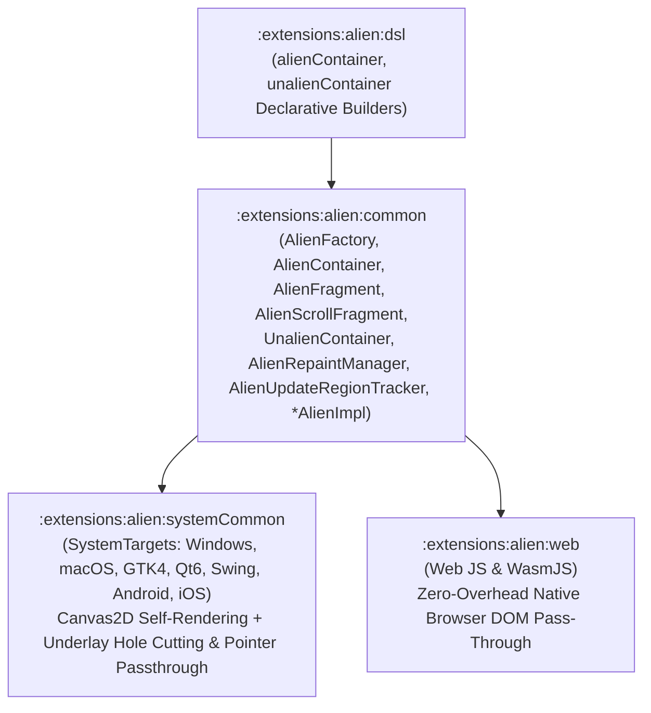

# `:extensions:alien` & `:extensions:alien:dsl` — Self-Rendering Bootstrap 5.3 Canvas2D UI & Hybrid Native Compositor

> **Navigation**: [**GenericUI Root (`../../README.md`)**](../../README.md) · [**Extensions Index (`../README.md`)**](../README.md) · [**Root Extensions Guide (`../../docs/extensions.md`)**](../../docs/extensions.md) · [**Fragments & Windows (`../../docs/fragments-and-windows.md`)**](../../docs/fragments-and-windows.md) · [**Source Sets (`../../docs/sourcesets.md`)**](../../docs/sourcesets.md) · [**Backends (`../../docs/backends.md`)**](../../docs/backends.md) · [**Gradle Plugin (`../../docs/gradle-plugin.md`)**](../../docs/gradle-plugin.md)

`:extensions:alien` is a **Multi-Module Project-of-Projects** extension (`:extensions:alien:common`, `:extensions:alien:systemCommon`, `:extensions:alien:web`, and `:extensions:alien:dsl`) providing a self-rendering Bootstrap 5.3 component engine (`AlienFactory`, `AlienContainer`, `AlienFragment`, `AlienScrollFragment`, `UnalienContainer`, and `*AlienImpl` implementations for every component in `:common`) powered by [`:extensions:canvas2d`](canvas2d.md) (`Canvas2D` backed by [`:extensions:imageprocessing`](imageprocessing.md)'s `ImageBuffer`), an `AlienRepaintManager` with dirty update region tracking (`AlienUpdateRegionTracker`), and a full CSS/SASS style & transition engine (`AlienCssStyleResolver` + `AlienTransitionAnimator`).

---

## 1. Architecture & Submodule Layout



- **Browser-Identical Bootstrap 5.3 Default Rendering + Full CSS Theming & Transitions**:
  - By default, Alien components render identically to how Bootstrap 5.3 renders in a browser (`#0d6efd` primary, `#6c757d` secondary, `.375rem` radii, `.25rem` `rgba(..., 0.25)` focus rings, `.15s ease-in-out` hover/focus/active transitions).
  - Supports full CSS/SASS theming (`--bs-*` CSS custom variables, `data-bs-theme="dark"`, `CssStyleSheet`, `PrecompiledStyleSheet`, `ComputedStyle` gradients, multi-layer `box-shadow`, 2D `transform`, and cubic-Bezier transitions).
- **System Targets (`:extensions:alien:systemCommon`) vs. Web Target Pass-Through (`:extensions:alien:web`)**:
  - On **System targets** (`Windows`, `MacOS`, `Gtk`, `Qt`, `Swing`, `Android`, `IOS`), `:extensions:alien:systemCommon` renders Alien component trees onto a hardware-accelerated `Canvas2D` surface with dirty-region coalescing.
  - On the **Web target** (`js` and `wasmJs`), `AlienContainer`, `AlienFragment`, and `UnalienContainer` forward directly to the parent container / `WebNativeFactory`, using standard browser DOM `Web*Impl` native implementations with zero `Canvas2D` overhead.
- **Mixing Native & Extension Components (`UnalienContainer` + Underlay Hole Cutting & Pointer Passthrough)**:
  - **`UnalienContainer`** acts as a native container inside an `AlienContainer` or `AlienFragment`, restoring the host OS `NativeFactory` so native OS `:common` components can be mixed seamlessly into an Alien interface.
  - **Extension-provided components** (`GLCanvasExt`, `VKCanvasExt`, `VideoPlayerExt`, `AudioAnalyzerExt`, `WebView`, etc.) and **`UnalienContainer`** are attached to the `AlienContainer` / `AlienFragment` **below** the `Canvas2D`, and the `Canvas2D` either cuts a transparent hole (`AlienExtensionLayerMode.CUT_TRANSPARENT_HOLE`) with mouse/pointer/wheel passthrough or draws higher-Z Alien components on top of them.

---

## 2. Gradle Plugin Configuration

Enable `alien()` inside the `genericui { extensions { ... } }` block in `build.gradle.kts`. The GenericUI Gradle plugin automatically enables `canvas2d()`, `imageProcessing()`, `overlay()`, and `gpu()`, wires the platform bootstrap into generated launchers, and includes `:extensions:alien:dsl` when `dsl()` is enabled:

```kotlin
plugins {
    id("com.nexustools.genericui")
}

genericui {
    app {
        id = "com.example.alienstudio"
        name = "Alien Studio"
    }
    backends {
        allExceptSwing()
    }
    extensions {
        dsl()   // Enables :extensions:dsl + :extensions:alien:dsl
        alien() // Automatically enables :extensions:alien, :extensions:canvas2d, :extensions:imageprocessing, and :extensions:gpu
    }
}
```

---

## 3. Core Classes & `*AlienImpl` Component Set

| Class | Package | Description |
| :--- | :--- | :--- |
| [`AlienFactory`](../alien/common/src/commonMain/kotlin/com/nexustools/genericui/ext/alien/AlienFactory.kt) | `com.nexustools.genericui.ext.alien` | Implements `NativeFactory`, returning `*AlienImpl` instances for all `:common` components while delegating OS windows, file dialogs, and system services to `hostFactory`. |
| [`AlienContainer`](../alien/common/src/commonMain/kotlin/com/nexustools/genericui/ext/alien/AlienContainer.kt) | `com.nexustools.genericui.ext.alien` | Self-rendering `Container` overriding `resolveChildFactory()` to provide `AlienFactory` on System targets and forwarding to the parent DOM container on `:web`. |
| [`AlienFragment`](../alien/common/src/commonMain/kotlin/com/nexustools/genericui/ext/alien/AlienFragment.kt) | `com.nexustools.genericui.ext.alien` | Self-rendering `Fragment` implementing `IFragment` and overriding `resolveChildFactory()` to provide `AlienFactory` on System targets while forwarding to the parent DOM container on `:web`. |
| [`AlienScrollFragment`](../alien/common/src/commonMain/kotlin/com/nexustools/genericui/ext/alien/AlienScrollFragment.kt) | `com.nexustools.genericui.ext.alien` | Scrollable self-rendering `Fragment` subclass implementing `IFragment`. |
| [`UnalienContainer`](../alien/common/src/commonMain/kotlin/com/nexustools/genericui/ext/alien/UnalienContainer.kt) | `com.nexustools.genericui.ext.alien` | Native container inside an `AlienContainer` / `AlienFragment` that unwraps `AlienFactory.hostFactory` so genuine OS-native `:common` components can be mixed in. |
| [`AlienRepaintManager`](../alien/common/src/commonMain/kotlin/com/nexustools/genericui/ext/alien/AlienRepaintManager.kt) | `com.nexustools.genericui.ext.alien` | Coordinates layout passes, CSS transition ticks, transparent hole cutting for underlay slots, and partial dirty-region repaints on `Canvas2D`. |
| [`AlienUpdateRegionTracker`](../alien/common/src/commonMain/kotlin/com/nexustools/genericui/ext/alien/AlienUpdateRegionTracker.kt) | `com.nexustools.genericui.ext.alien` | Coalesces overlapping/adjacent dirty `Rect` regions and clips them to the viewport. |
| [`AlienImpl`](../alien/common/src/commonMain/kotlin/com/nexustools/genericui/ext/alien/impl/AlienImpl.kt) & `*AlienImpl` | `com.nexustools.genericui.ext.alien.impl` | Self-rendered implementations of all `:common` components (`ButtonAlienImpl`, `ContainerAlienImpl`, `DropdownAlienImpl`, `TextInputAlienImpl`, `SelectAlienImpl`, `CheckboxAlienImpl`, `RangeSliderAlienImpl`, `TextAlienImpl`, `MarkdownViewAlienImpl`, `ImageAlienImpl`, `TableAlienImpl`, `ScrollViewAlienImpl`, `DividerAlienImpl`, `BookContainerAlienImpl`, `CollapseAlienImpl`, `TabAlienImpl`, `TabContainerAlienImpl`, `NavbarAlienImpl`, `BottomNavigationBarAlienImpl`, `ProgressBarAlienImpl`, `SpinnerAlienImpl`, `PopoverAlienImpl`, `SplitPaneAlienImpl`, `MenuBarAlienImpl`, `MenuAlienImpl`, `MenuItemAlienImpl`, `ContextMenuAlienImpl`, `DialogWindowAlienImpl`, `DockWorkspaceAlienImpl`, `DockAreaAlienImpl`, `DockGroupAlienImpl`, `DockPanelAlienImpl`, `DockWindowAlienImpl`, `ToolPaletteAlienImpl`, `LazyListAlienImpl`, `LazyGridAlienImpl`, `TreeViewAlienImpl`). |

---

## 4. Usage Example (`@MainAppFragment` + Declarative DSL + `UnalienContainer`)

```kotlin
import com.nexustools.genericui.component.fragment.FragmentBundle
import com.nexustools.genericui.component.fragment.MainAppFragment
import com.nexustools.genericui.enums.bootstrap.BootstrapType
import com.nexustools.genericui.ext.alien.AlienFragment
import com.nexustools.genericui.ext.alien.dsl.alienContainer
import com.nexustools.genericui.ext.alien.dsl.unalienContainer
import com.nexustools.genericui.ext.dsl.*

@MainAppFragment(label = "Alien Studio")
class StudioAlienFragment : AlienFragment() {
    override fun onCreate(savedState: FragmentBundle?) {
        super.onCreate(savedState)
        rootContainer.build {
            alienContainer(classes = "p-4") {
                h2("Custom Alien Interface")
                button("Bootstrap 5.3 Alien Button", type = BootstrapType.PRIMARY)

                // Mix in genuine OS-native components via unalienContainer
                unalienContainer(classes = "mt-3 p-2 border rounded") {
                    button("Host OS Native Button", type = BootstrapType.SECONDARY)
                }
            }
        }
    }
}
```

---

## 5. Related Extensions & Cross-References

- [`:extensions:canvas2d` & `:extensions:canvas2d:dsl` (`canvas2d.md`)](canvas2d.md) — Provides the hardware-accelerated `Canvas2D` surface used by `AlienRepaintManager`.
- [`:extensions:imageprocessing` (`imageprocessing.md`)](imageprocessing.md) — Provides `ImageBuffer` and `ImageBuffer2DContext`.
- [`:extensions:gpu` (`gpu.md`)](gpu.md) — Underlying Vulkan 1.2+ and OpenGL ES 3.0+ GPU foundation.
- [`:extensions:dsl` (`dsl.md`)](dsl.md) — Base declarative Kotlin UI & Style DSL.
- [GenericUI Root (`../../README.md`)](../../README.md) · [Fragments & Windows (`../../docs/fragments-and-windows.md`)](../../docs/fragments-and-windows.md) · [Gradle Plugin (`../../docs/gradle-plugin.md`)](../../docs/gradle-plugin.md)
