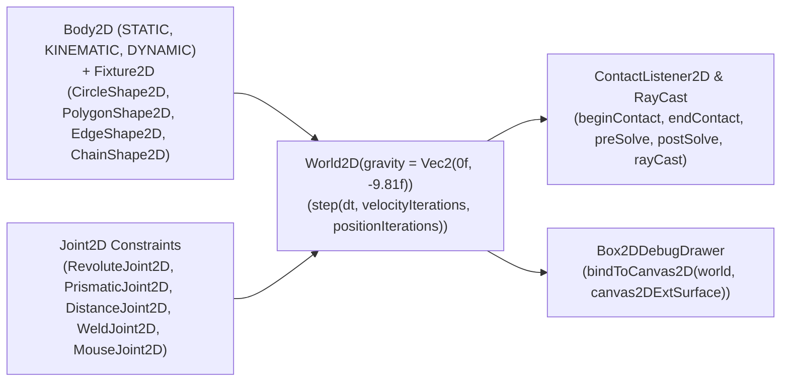

# `:extensions:box2d` & `:extensions:box2d:dsl` — 2D Rigid-Body Physics Engine & Debug Visualizer

> **Navigation**: [**GenericUI Root (`../../README.md`)**](../../README.md) · [**Extensions Index (`../README.md`)**](../README.md) · [**Root Extensions Guide (`../../docs/extensions.md`)**](../../docs/extensions.md) · [**Source Sets (`../../docs/sourcesets.md`)**](../../docs/sourcesets.md) · [**Backends (`../../docs/backends.md`)**](../../docs/backends.md) · [**Gradle Plugin (`../../docs/gradle-plugin.md`)**](../../docs/gradle-plugin.md)

`:extensions:box2d` is a **Single Multiplatform Project** providing a deterministic 2D rigid-body physics engine (`World2D`, `Body2D`, `Fixture2D`, collision shapes, constraints/joints, raycasting, and contact listeners) integrated with [`:extensions:canvas2d`](canvas2d.md) (`Canvas2DExtSurface`) and [`:extensions:canvas3d`](canvas3d.md) via `Box2DDebugDrawer`. Its companion `:extensions:box2d:dsl` module provides declarative `box2dDebugCanvas { ... }` and `world2D { ... }` builders.

---

## 1. Architecture & VBlank Simulation Loop



---

## 2. Gradle Plugin Configuration

Enabling `box2d()` in the [GenericUI Gradle Plugin (`../../docs/gradle-plugin.md`)](../../docs/gradle-plugin.md) automatically configures `:extensions:box2d`, `:extensions:canvas2d`, `:extensions:canvas3d`, and (when `dsl()` is active) `:extensions:box2d:dsl`:

```kotlin
plugins {
    id("com.nexustools.genericui")
}

genericui {
    backends {
        allExceptSwing()
    }
    extensions {
        dsl()   // Enables :extensions:dsl
        box2d() // Automatically includes :extensions:box2d, :extensions:canvas2d, :extensions:canvas3d, and :extensions:box2d:dsl
    }
}
```

---

## 3. Core API Reference (`com.nexustools.genericui.ext.box2d`)

| Class / Interface / Enum | Package | Description & Key Members |
| :--- | :--- | :--- |
| `World2D` | `ext.box2d` | 2D physics simulation world. Key members: `gravity: Vec2`, `allowSleeping: Boolean`, `bodies: List<Body2D>`, `joints: List<Joint2D>`, `contactListener: ContactListener2D?`, `createBody(def: BodyDef2D): Body2D`, `destroyBody(body: Body2D)`, `createJoint(def: JointDef2D): Joint2D`, `destroyJoint(joint: Joint2D)`, `step(dt: Float, velocityIterations: Int = 8, positionIterations: Int = 3)`, `rayCast(input: RayCastInput2D, callback)`, `queryAABB(aabb: AABB2D, callback)`. |
| `BodyDef2D` / `Body2D` / `BodyType2D` | `ext.box2d` | Rigid body definition (`type: BodyType2D` — `STATIC`, `KINEMATIC`, `DYNAMIC`, `position: Vec2`, `angle: Float`, `linearVelocity: Vec2`, `angularVelocity: Float`, `linearDamping: Float`, `angularDamping: Float`, `fixedRotation: Boolean`, `bullet: Boolean`) and live `Body2D` (`createFixture(def)`, `applyForceToCenter(force, wake)`, `applyLinearImpulse(impulse, point, wake)`, `setTransform(position, angle)`). |
| `FixtureDef2D` / `Fixture2D` | `ext.box2d` | Collision fixture descriptor (`shape: Shape2D`, `density: Float = 1f`, `friction: Float = 0.2f`, `restitution: Float = 0f`, `isSensor: Boolean = false`). |
| `Shape2D` Implementations | `ext.box2d` | `CircleShape2D(radius: Float, center: Vec2)`, `PolygonShape2D` (`setAsBox(halfWidth, halfHeight)`, `set(vertices)`), `EdgeShape2D(v1: Vec2, v2: Vec2)`, `ChainShape2D` (`createLoop(vertices)`, `createChain(vertices)`). |
| `Joint2D` Implementations | `ext.box2d` | `RevoluteJoint2D` (hinge/pin with motor & angle limits), `PrismaticJoint2D` (linear slider with motor & translation limits), `DistanceJoint2D` (spring-damper distance constraint), `WeldJoint2D` (rigid weld), `MouseJoint2D` (interactive pointer dragging). |
| `ContactListener2D` / `Contact2D` / `ContactImpulse2D` | `ext.box2d` | Collision callback interface (`beginContact(contact)`, `endContact(contact)`, `preSolve(contact, oldManifold)`, `postSolve(contact, impulse)`). |
| `Box2DDebugDrawer` | `ext.box2d` | Hardware-accelerated wireframe & fill visualizer on `Canvas2DExtSurface`: `pixelsPerMeter: Float = 50f`, `offsetX: Float`, `offsetY: Float`, `drawShapes: Boolean`, `drawJoints: Boolean`, `drawAABBs: Boolean`, `drawCenterOfMass: Boolean`, `render(world, ctx)`, `bindToCanvas2D(world, canvas, velocityIterations, positionIterations)`. |
| `Vec2` / `Mat22` / `Rot` / `Transform2D` / `AABB2D` | `ext.box2d` | 2D math primitives for vectors, $2 \times 2$ matrices, rotations, rigid transforms, and axis-aligned bounding boxes. |
| `box2dDebugCanvas` / `world2D` | `ext.box2d.dsl` | Declarative DSL builders in `:extensions:box2d:dsl` (`Box2DWorldDslScope`: `body`, `staticBody`, `dynamicBody`, `kinematicBody`; `Box2DBodyDslScope`: `fixture`, `circleFixture`, `boxFixture`, `edgeFixture`). |

---

## 4. Imperative Kotlin Examples

### Example 1: Building a 2D Physics World with Bodies, Joints, Contact Listener, & `Box2DDebugDrawer`

```kotlin
import com.nexustools.genericui.ext.box2d.BodyDef2D
import com.nexustools.genericui.ext.box2d.BodyType2D
import com.nexustools.genericui.ext.box2d.Box2DDebugDrawer
import com.nexustools.genericui.ext.box2d.CircleShape2D
import com.nexustools.genericui.ext.box2d.Contact2D
import com.nexustools.genericui.ext.box2d.ContactListener2D
import com.nexustools.genericui.ext.box2d.DistanceJoint2D
import com.nexustools.genericui.ext.box2d.FixtureDef2D
import com.nexustools.genericui.ext.box2d.PolygonShape2D
import com.nexustools.genericui.ext.box2d.RevoluteJoint2D
import com.nexustools.genericui.ext.box2d.Vec2
import com.nexustools.genericui.ext.box2d.World2D
import com.nexustools.genericui.ext.canvas2d.Canvas2DExtSurface

fun createBox2DSimulationCanvas(): Canvas2DExtSurface {
    val world = World2D(gravity = Vec2(0f, -9.81f), allowSleeping = true)

    // 1. Static ground platform
    val ground = world.createBody(BodyDef2D(type = BodyType2D.STATIC, position = Vec2(0f, -4f)))
    ground.createFixture(
        FixtureDef2D(
            shape = PolygonShape2D().setAsBox(halfWidth = 8f, halfHeight = 0.5f),
            density = 0f,
            friction = 0.6f
        )
    )

    // 2. Dynamic crate & bouncing sphere connected by a DistanceJoint2D spring
    val crate = world.createBody(BodyDef2D(type = BodyType2D.DYNAMIC, position = Vec2(-1.5f, 3f)))
    crate.createFixture(
        FixtureDef2D(
            shape = PolygonShape2D().setAsBox(halfWidth = 0.6f, halfHeight = 0.6f),
            density = 2.0f,
            friction = 0.4f,
            restitution = 0.2f
        )
    )

    val ball = world.createBody(BodyDef2D(type = BodyType2D.DYNAMIC, position = Vec2(1.5f, 4.5f)))
    ball.createFixture(
        FixtureDef2D(
            shape = CircleShape2D(radius = 0.5f),
            density = 1.0f,
            friction = 0.2f,
            restitution = 0.75f
        )
    )

    val springJoint = DistanceJoint2D(
        bodyA = crate,
        bodyB = ball,
        localAnchorA = Vec2(0f, 0f),
        localAnchorB = Vec2(0f, 0f),
        length = 3.0f,
        frequencyHz = 4.0f,
        dampingRatio = 0.5f
    )
    world.addJoint(springJoint)

    // 3. Listen for collision events
    world.contactListener = object : ContactListener2D {
        override fun beginContact(contact: Contact2D) {
            println("Collision started between ${contact.fixtureA} and ${contact.fixtureB}")
        }
    }

    // 4. Bind World2D to a Canvas2DExtSurface via Box2DDebugDrawer (steps automatically on VBlank)
    val surface = Canvas2DExtSurface(width = 800, height = 600)
    val debugDrawer = Box2DDebugDrawer(
        pixelsPerMeter = 45f,
        offsetX = 400f,
        offsetY = 300f
    ).apply {
        drawShapes = true
        drawJoints = true
        drawAABBs = false
        drawCenterOfMass = true
    }
    debugDrawer.bindToCanvas2D(world = world, canvas = surface)

    return surface
}
```

---

## 5. Declarative `:extensions:box2d:dsl` Examples

With `dsl()` and `box2d()` enabled, build 2D physics worlds and debug viewports declaratively using `box2dDebugCanvas { ... }` or `world2D { ... }`:

```kotlin
import com.nexustools.genericui.ext.box2d.Vec2
import com.nexustools.genericui.ext.box2d.dsl.box2dDebugCanvas
import com.nexustools.genericui.ext.box2d.dsl.world2D
import com.nexustools.genericui.ext.dsl.ColorRgba
import com.nexustools.genericui.ext.dsl.buildDiv
import com.nexustools.genericui.ext.dsl.button
import com.nexustools.genericui.ext.dsl.h4
import com.nexustools.genericui.ext.dsl.hstack

val physics2DPlayground = buildDiv(classes = "p-3") {
    h4("Box2D Physics Sandbox")

    val simWorld = world2D(gravity = Vec2(0f, -9.81f)) {
        staticBody(x = 0f, y = -4.5f) {
            boxFixture(halfWidth = 7.5f, halfHeight = 0.4f, friction = 0.7f)
            edgeFixture(v1 = Vec2(-7.5f, -4.1f), v2 = Vec2(-7.5f, 4.0f))
            edgeFixture(v1 = Vec2(7.5f, -4.1f), v2 = Vec2(7.5f, 4.0f))
        }
    }

    hstack(classes = "gap-2 mb-2") {
        button("Spawn Bouncing Ball") {
            onClick = {
                val body = simWorld.createBody(
                    com.nexustools.genericui.ext.box2d.BodyDef2D(
                        type = com.nexustools.genericui.ext.box2d.BodyType2D.DYNAMIC,
                        position = Vec2(0f, 3.5f)
                    )
                )
                body.createFixture(
                    com.nexustools.genericui.ext.box2d.FixtureDef2D(
                        shape = com.nexustools.genericui.ext.box2d.CircleShape2D(radius = 0.45f),
                        density = 1.2f,
                        restitution = 0.8f
                    )
                )
            }
        }
    }

    box2dDebugCanvas(
        world = simWorld,
        width = 800,
        height = 520,
        pixelsPerMeter = 48f
    ) {
        dynamicBody(x = -1.2f, y = 2.5f) {
            boxFixture(halfWidth = 0.5f, halfHeight = 0.5f, density = 1.5f, restitution = 0.3f)
        }
        dynamicBody(x = 0.8f, y = 4.0f) {
            circleFixture(radius = 0.45f, density = 1.0f, restitution = 0.75f)
        }
    }.apply {
        style {
            borderRadiusPx = 10f
            borderWidthPx = 1f
            borderColor = ColorRgba(71, 85, 105, 1.0)
        }
    }
}
```

---

## 6. Related Extensions & Cross-References

- **Related Extensions**:
  - [`:extensions:canvas2d` (`canvas2d.md`)](canvas2d.md) — Provides `Canvas2DExtSurface` used by `Box2DDebugDrawer`.
  - [`:extensions:canvas3d` (`canvas3d.md`)](canvas3d.md) — Hardware-accelerated 3D canvas extension.
  - [`:extensions:box3d` (`box3d.md`)](box3d.md) — Sister 3D rigid-body physics engine (`World3D`, `RigidBody3D`, Three.js transform synchronization).
  - [`:extensions:dsl` (`dsl.md`)](dsl.md) — Base declarative Kotlin UI & Style DSL.
- **Root & Backend Documentation**:
  - [GenericUI Root (`../../README.md`)](../../README.md) · [Extensions Architecture (`../../docs/extensions.md`)](../../docs/extensions.md) · [Source Sets (`../../docs/sourcesets.md`)](../../docs/sourcesets.md) · [Backends (`../../docs/backends.md`)](../../docs/backends.md) · [Gradle Plugin (`../../docs/gradle-plugin.md`)](../../docs/gradle-plugin.md)
  - [Desktop Backends (`../../desktop/README.md`)](../../desktop/README.md) · [Mobile Backends (`../../mobile/README.md`)](../../mobile/README.md) · [Web Backend (`../../web/README.md`)](../../web/README.md)
