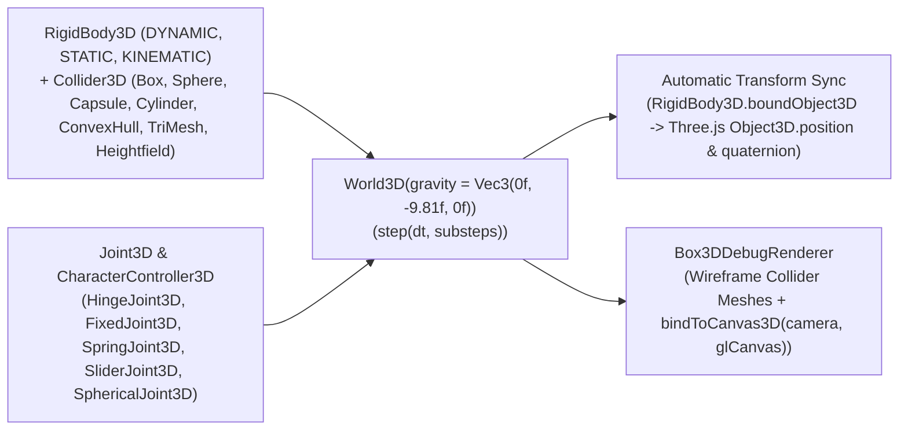

# `:extensions:box3d` & `:extensions:box3d:dsl` — 3D Rigid-Body Physics Engine & Automatic Three.js Transform Synchronizer

> **Navigation**: [**GenericUI Root (`../../README.md`)**](../../README.md) · [**Extensions Index (`../README.md`)**](../README.md) · [**Root Extensions Guide (`../../docs/extensions.md`)**](../../docs/extensions.md) · [**Source Sets (`../../docs/sourcesets.md`)**](../../docs/sourcesets.md) · [**Backends (`../../docs/backends.md`)**](../../docs/backends.md) · [**Gradle Plugin (`../../docs/gradle-plugin.md`)**](../../docs/gradle-plugin.md)

`:extensions:box3d` is a **Single Multiplatform Project** (`src/commonMain` across all 8 platform targets) providing a full 3D rigid-body physics engine (**`World3D`**, **`RigidBody3D`**, **`Collider3D`**, 7 collision shape types, 5 3D joint constraints, **`CharacterController3D`**, 3D raycasting, and **`Box3DDebugRenderer`**) built directly atop [`:extensions:threejs`](threejs.md) and [`:extensions:canvas3d`](canvas3d.md). Every `RigidBody3D` can bind to a Three.js `Object3D` (`Mesh`, `Group`) so its 3D position and quaternion rotation are automatically synchronized on every simulation step.

---

## 1. Architecture & Automatic Three.js Synchronization



---

## 2. Gradle Plugin Configuration

Enabling `box3d()` in the [GenericUI Gradle Plugin (`../../docs/gradle-plugin.md`)](../../docs/gradle-plugin.md) automatically configures `:extensions:box3d`, `:extensions:threejs`, `:extensions:canvas3d`, `:extensions:overlay`, `:extensions:gpu`, and (when `dsl()` is active) `:extensions:box3d:dsl`, and automatically registers the underlying 3D/GPU providers at startup:

```kotlin
plugins {
    id("com.nexustools.genericui")
}

genericui {
    backends {
        allExceptSwing()
    }
    extensions {
        dsl()   // Enables :extensions:dsl
        box3d() // Automatically includes :extensions:box3d, :extensions:threejs, :extensions:canvas3d, :extensions:gpu, and :extensions:box3d:dsl
    }
}
```

---

## 3. Core API Reference (`com.nexustools.genericui.ext.box3d`)

| Class / Interface / Enum | Package | Description & Key Members |
| :--- | :--- | :--- |
| `World3D` | `ext.box3d` | 3D physics world. Key members: `gravity: Vec3`, `bodies: List<RigidBody3D>`, `joints: List<Joint3D>`, `collisionListener: CollisionEventListener3D?`, `createRigidBody(desc: RigidBodyDesc3D, boundObject3D: Object3D? = null): RigidBody3D`, `removeRigidBody(body)`, `addJoint(joint)`, `removeJoint(joint)`, `createCharacterController(radius, halfHeight, maxSlopeRadians, stepOffset): CharacterController3D`, `step(dt: Float = 1f / 60f, substeps: Int = 4)`, `raycast(ray: Ray3D, maxDistance: Float): RaycastHit3D?`. |
| `RigidBodyDesc3D` / `RigidBody3D` / `BodyType3D` | `ext.box3d` | Rigid body descriptor (`type: BodyType3D` — `DYNAMIC`, `STATIC`, `KINEMATIC`, `position: Vec3`, `rotation: Quat3D`, `linearVelocity: Vec3`, `angularVelocity: Vec3`, `linearDamping: Float`, `angularDamping: Float`, `gravityScale: Float`, `canSleep: Boolean`) and live `RigidBody3D` (`boundObject3D: Object3D?`, `attachCollider(desc): Collider3D`, `applyForce(force)`, `applyImpulse(impulse)`, `applyTorque(torque)`, `syncToBoundObject3D()`). |
| `ColliderDesc3D` / `Collider3D` | `ext.box3d` | Collider descriptor (`shape: ColliderShape3D`, `density: Float = 1f`, `friction: Float = 0.5f`, `restitution: Float = 0.1f`, `isSensor: Boolean = false`, `localOffset: Vec3`). |
| `ColliderShape3D` Implementations | `ext.box3d` | `BoxShape3D(hx, hy, hz)`, `SphereShape3D(radius)`, `CapsuleShape3D(halfHeight, radius)`, `CylinderShape3D(halfHeight, radius)`, `ConvexHullShape3D(points: List<Vec3>)`, `TriMeshShape3D(vertices: List<Vec3>, indices: IntArray)`, `HeightfieldShape3D(rows, cols, heights, scale)`. |
| `Joint3D` Implementations | `ext.box3d` | `HingeJoint3D` (revolute axis with motor & limits), `FixedJoint3D` (6-DOF rigid lock), `SpringJoint3D` (3D Hooke's law spring-damper), `SliderJoint3D` (prismatic axis), `SphericalJoint3D` (ball-and-socket). |
| `CharacterController3D` | `ext.box3d` | Kinematic capsule character controller (`radius`, `halfHeight`, `maxSlopeRadians`, `stepOffset`, `isGrounded: Boolean`, `move(body, desiredDisplacement, dt)`). |
| `Box3DDebugRenderer` | `ext.box3d` | Synchronizes wireframe Three.js collider meshes in a `Scene` and binds VBlank simulation loops (`update()`, `bindToCanvas3D(camera, glCanvas, vkCanvas, substeps)`). |
| `Vec3` / `Quat3D` / `Mat33` / `Transform3D` / `AABB3D` / `Ray3D` | `ext.box3d` | 3D physics math primitives. |
| `box3dDebugCanvas` / `world3D` | `ext.box3d.dsl` | Declarative DSL builders in `:extensions:box3d:dsl` (`Box3DWorldDslScope`: `rigidBody`, `dynamicRigidBody`, `staticRigidBody`, `kinematicRigidBody`; `Box3DRigidBodyDslScope`: `collider`, `boxCollider`, `sphereCollider`, `capsuleCollider`). |

---

## 4. Imperative Kotlin Examples

### Example 1: Synchronizing `World3D` Rigid Bodies with Three.js `Mesh` Nodes & `CharacterController3D`

```kotlin
import com.nexustools.genericui.ext.box3d.BodyType3D
import com.nexustools.genericui.ext.box3d.Box3DDebugRenderer
import com.nexustools.genericui.ext.box3d.BoxShape3D
import com.nexustools.genericui.ext.box3d.ColliderDesc3D
import com.nexustools.genericui.ext.box3d.Ray3D
import com.nexustools.genericui.ext.box3d.RigidBodyDesc3D
import com.nexustools.genericui.ext.box3d.SphereShape3D
import com.nexustools.genericui.ext.box3d.SpringJoint3D
import com.nexustools.genericui.ext.box3d.Vec3
import com.nexustools.genericui.ext.box3d.World3D
import com.nexustools.genericui.ext.canvas3d.GLCanvasExt
import com.nexustools.genericui.ext.threejs.cameras.PerspectiveCamera
import com.nexustools.genericui.ext.threejs.geometries.BoxGeometry
import com.nexustools.genericui.ext.threejs.geometries.SphereGeometry
import com.nexustools.genericui.ext.threejs.lights.AmbientLight
import com.nexustools.genericui.ext.threejs.lights.DirectionalLight
import com.nexustools.genericui.ext.threejs.materials.MeshStandardMaterial
import com.nexustools.genericui.ext.threejs.math.Color
import com.nexustools.genericui.ext.threejs.objects.Mesh
import com.nexustools.genericui.ext.threejs.scenes.Scene

fun createPhysicsDrivenThreeJsScene(): GLCanvasExt {
    val scene = Scene().apply {
        background = Color(0x0f172a)
        add(AmbientLight(Color(0xffffff), 0.5f))
        add(DirectionalLight(Color(0xffffff), 1.2f).apply { position.set(5f, 12f, 8f) })
    }

    val world = World3D(gravity = Vec3(0f, -9.81f, 0f))

    // 1. Static floor mesh + bound static RigidBody3D
    val floorMesh = Mesh(BoxGeometry(20f, 1f, 20f), MeshStandardMaterial(color = Color(0x334155)))
    scene.add(floorMesh)
    val floorBody = world.createRigidBody(
        desc = RigidBodyDesc3D(type = BodyType3D.STATIC, position = Vec3(0f, -0.5f, 0f)),
        boundObject3D = floorMesh
    )
    floorBody.attachCollider(ColliderDesc3D(shape = BoxShape3D(10f, 0.5f, 10f), friction = 0.8f))

    // 2. Dynamic falling sphere automatically synced to its Three.js Mesh
    val sphereMesh = Mesh(SphereGeometry(radius = 0.6f), MeshStandardMaterial(color = Color(0x10b981)))
    scene.add(sphereMesh)
    val sphereBody = world.createRigidBody(
        desc = RigidBodyDesc3D(type = BodyType3D.DYNAMIC, position = Vec3(0f, 5f, 0f)),
        boundObject3D = sphereMesh
    )
    sphereBody.attachCollider(
        ColliderDesc3D(shape = SphereShape3D(radius = 0.6f), density = 1.5f, restitution = 0.65f)
    )

    // 3. SpringJoint3D suspending a dynamic cube from an overhead anchor
    val anchorBody = world.createRigidBody(RigidBodyDesc3D(type = BodyType3D.STATIC, position = Vec3(2.5f, 6f, 0f)))
    val suspendedCubeMesh = Mesh(BoxGeometry(1f, 1f, 1f), MeshStandardMaterial(color = Color(0x3b82f6)))
    scene.add(suspendedCubeMesh)
    val suspendedCubeBody = world.createRigidBody(
        desc = RigidBodyDesc3D(type = BodyType3D.DYNAMIC, position = Vec3(2.5f, 3.5f, 0f)),
        boundObject3D = suspendedCubeMesh
    )
    suspendedCubeBody.attachCollider(ColliderDesc3D(shape = BoxShape3D(0.5f, 0.5f, 0.5f)))
    world.addJoint(
        SpringJoint3D(
            bodyA = anchorBody,
            bodyB = suspendedCubeBody,
            restLength = 2.0f,
            stiffness = 35f,
            damping = 2.5f
        )
    )

    // 4. Perform a 3D raycast downward
    val hit = world.raycast(Ray3D(origin = Vec3(0f, 10f, 0f), direction = Vec3(0f, -1f, 0f)), maxDistance = 50f)
    println("Raycast hit body at distance: ${hit?.distance}")

    // 5. Bind Box3DDebugRenderer to a GLCanvasExt
    val glCanvas = GLCanvasExt(width = 1024, height = 600)
    val camera = PerspectiveCamera(50f, 1024f / 600f, 0.1f, 1000f).apply {
        position.set(0f, 4f, 11f)
        lookAt(0f, 1.5f, 0f)
    }
    val debugRenderer = Box3DDebugRenderer(world, scene)
    debugRenderer.bindToCanvas3D(camera = camera, glCanvas = glCanvas, substeps = 4)

    return glCanvas
}
```

---

## 5. Declarative `:extensions:box3d:dsl` Examples

With `dsl()` and `box3d()` enabled, use `box3dDebugCanvas { ... }` and `world3D { ... }` to declare 3D rigid bodies and colliders in-place:

```kotlin
import com.nexustools.genericui.ext.box3d.ConvexHullShape3D
import com.nexustools.genericui.ext.box3d.Vec3
import com.nexustools.genericui.ext.box3d.dsl.box3dDebugCanvas
import com.nexustools.genericui.ext.dsl.ColorRgba
import com.nexustools.genericui.ext.dsl.buildDiv
import com.nexustools.genericui.ext.dsl.h4

val physics3DViewport = buildDiv(classes = "p-3") {
    h4("Declarative Box3D + Three.js Viewport")

    box3dDebugCanvas(width = 960, height = 540, id = "box3d-canvas") {
        // Static ground slab
        staticRigidBody(x = 0f, y = -1f, z = 0f) {
            boxCollider(hx = 8f, hy = 0.5f, hz = 8f, friction = 0.8f)
        }

        // Dynamic falling box, sphere, and capsule
        dynamicRigidBody(x = -1.5f, y = 4f, z = 0f) {
            boxCollider(hx = 0.5f, hy = 0.5f, hz = 0.5f, density = 1.2f, restitution = 0.35f)
        }

        dynamicRigidBody(x = 0f, y = 6f, z = 0f) {
            sphereCollider(radius = 0.55f, density = 1.0f, restitution = 0.7f)
        }

        dynamicRigidBody(x = 1.5f, y = 5f, z = 0f) {
            capsuleCollider(halfHeight = 0.6f, radius = 0.3f, density = 1.1f)
        }

        // Custom convex hull rigid body
        dynamicRigidBody(x = 0f, y = 8f, z = -1f) {
            collider(
                shape = ConvexHullShape3D(
                    points = listOf(
                        Vec3(0f, 0.8f, 0f),
                        Vec3(-0.6f, -0.4f, 0.6f),
                        Vec3(0.6f, -0.4f, 0.6f),
                        Vec3(0f, -0.4f, -0.6f)
                    )
                ),
                density = 1.4f
            )
        }
    }.apply {
        style {
            borderRadius = com.nexustools.genericui.style.css.CssCornerRadii.px(12f)
            borderWidth = com.nexustools.genericui.style.css.CssEdgeLengths.px(1f)
            borderStyle = com.nexustools.genericui.enums.css.CssBorderStyle.SOLID
            borderColor = ColorRgba(16, 185, 129, 0.5)
        }
    }
}
```

---

## 6. Related Extensions & Cross-References

- **Related Extensions**:
  - [`:extensions:threejs` (`threejs.md`)](threejs.md) — Provides `Scene`, `Object3D`, `Mesh`, `PerspectiveCamera`, and `WebGLRenderer` synchronized with `World3D`.
  - [`:extensions:canvas3d` (`canvas3d.md`)](canvas3d.md) — Provides `GLCanvasExt`, `VKCanvasExt`, and `Canvas3DOverlayHost` viewports.
  - [`:extensions:gpu` (`gpu.md`)](gpu.md) — Provides the underlying Vulkan 1.2+ and OpenGL ES 3.0+ GPU foundation.
  - [`:extensions:box2d` (`box2d.md`)](box2d.md) — Sister 2D rigid-body physics engine.
  - [`:extensions:dsl` (`dsl.md`)](dsl.md) — Base declarative Kotlin UI & Style DSL.
- **Root & Backend Documentation**:
  - [GenericUI Root (`../../README.md`)](../../README.md) · [Extensions Architecture (`../../docs/extensions.md`)](../../docs/extensions.md) · [Source Sets (`../../docs/sourcesets.md`)](../../docs/sourcesets.md) · [Backends (`../../docs/backends.md`)](../../docs/backends.md) · [Gradle Plugin (`../../docs/gradle-plugin.md`)](../../docs/gradle-plugin.md)
  - [Desktop Backends (`../../desktop/README.md`)](../../desktop/README.md) · [Mobile Backends (`../../mobile/README.md`)](../../mobile/README.md) · [Web Backend (`../../web/README.md`)](../../web/README.md)
