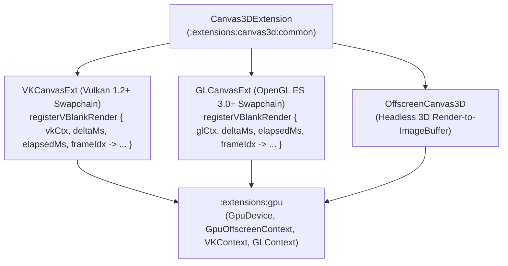

# `:extensions:canvas3d` & `:extensions:canvas3d:dsl` — Hardware-Accelerated Vulkan & OpenGL ES 3D Canvases

> **Navigation**: [**GenericUI Root (`../../README.md`)**](../../README.md) · [**Extensions Index (`../README.md`)**](../README.md) · [**Root Extensions Guide (`../../docs/extensions.md`)**](../../docs/extensions.md) · [**Source Sets (`../../docs/sourcesets.md`)**](../../docs/sourcesets.md) · [**Backends (`../../docs/backends.md`)**](../../docs/backends.md) · [**Gradle Plugin (`../../docs/gradle-plugin.md`)**](../../docs/gradle-plugin.md)

`:extensions:canvas3d` is a **Project-of-Projects** extension providing interactive, VBlank-synchronized 3D and programmable shader canvases—**`VKCanvasExt`** (Vulkan 1.2+ / MoltenVK / WebGPU), **`GLCanvasExt`** (OpenGL ES 3.0+ / Google ANGLE / LWJGL 3 / WebGL2), simulated viewport-only scrollable 3D canvases (**`ScrollCanvas3D`**, **`ScrollGLCanvas`**, **`ScrollVKCanvas`**), plus headless **`OffscreenCanvas3D`** rendering. Built directly atop [`:extensions:gpu`](gpu.md) and `:common`'s `AbstractCanvas`, it serves as the rendering viewport foundation for [`:extensions:threejs`](threejs.md) and [`:extensions:box3d`](box3d.md).

---

## 1. Architecture & Platform Swapchain Matrix



| Target Backend | Submodule | `VKCanvasExt` Backend | `GLCanvasExt` Backend | Backend Documentation |
| :--- | :--- | :--- | :--- | :--- |
| **Windows (`:windows`)** | `:extensions:canvas3d:desktop:windows` | Native `VkWin32SurfaceKHR` (`vulkan-1.dll`) | **Google ANGLE** (`libEGL.dll` + `libGLESv2.dll` over Direct3D 11) | [Desktop Backends (`../../desktop/README.md`)](../../desktop/README.md) |
| **macOS (`:macos`)** | `:extensions:canvas3d:desktop:macos` | **MoltenVK** (`VK_EXT_metal_surface` over `CAMetalLayer`) | Metal-backed OpenGL ES / `NSOpenGLView` | [Desktop Backends (`../../desktop/README.md`)](../../desktop/README.md) |
| **Linux GTK4 (`:gtk`)** | `:extensions:canvas3d:desktop:gtk` | Native `VkWaylandSurfaceKHR` / `VkXlibSurfaceKHR` | Native EGL / `GtkGLArea` OpenGL ES 3.0+ | [Desktop Backends (`../../desktop/README.md`)](../../desktop/README.md) |
| **Linux Qt6 (`:qt`)** | `:extensions:canvas3d:desktop:qt` | Qt6 `QVulkanWindow` / native Vulkan surface | Qt6 `QOpenGLWidget` OpenGL ES 3.0+ | [Desktop Backends (`../../desktop/README.md`)](../../desktop/README.md) |
| **Desktop JVM (`:swing`)** | `:extensions:canvas3d:desktop:swing` | Optional **LWJGL 3 Vulkan** (`SwingVKCanvasImpl`) | Optional **LWJGL 3 OpenGL ES** (`SwingGLCanvasImpl`) | [Desktop Backends (`../../desktop/README.md`)](../../desktop/README.md) |
| **Android (`:android`)** | `:extensions:canvas3d:mobile:android` | `SurfaceView` / `ANativeWindow` Vulkan 1.1+ (`AndroidVKCanvasImpl`) | `GLSurfaceView` EGL14 / GLES 3.0 (`AndroidGLCanvasImpl`) | [Mobile Backends (`../../mobile/README.md`)](../../mobile/README.md) |
| **iOS (`:ios`)** | `:extensions:canvas3d:mobile:ios` | **MoltenVK** over `CAMetalLayer` (`IosVKCanvasImpl`) | `GLKView` / `CAEAGLLayer` OpenGL ES 3.0 (`IosGLCanvasImpl`) | [Mobile Backends (`../../mobile/README.md`)](../../mobile/README.md) |
| **Web (`:web`)** | `:extensions:canvas3d:web` | **WebGPU** `<canvas>` (`WebVKCanvasImpl`) | **WebGL2** `<canvas>` (`WebGLCanvasImpl`) | [Web Backend (`../../web/README.md`)](../../web/README.md) |

---

## 2. Gradle Plugin Configuration

Enabling `canvas3d()` in the [GenericUI Gradle Plugin (`../../docs/gradle-plugin.md`)](../../docs/gradle-plugin.md) automatically configures `:extensions:canvas3d`, `:extensions:gpu`, and (when `dsl()` is active) `:extensions:canvas3d:dsl`:

```kotlin
plugins {
    id("com.nexustools.genericui")
}

genericui {
    backends {
        allExceptSwing()
    }
    extensions {
        dsl()      // Enables :extensions:dsl
        canvas3d() // Automatically includes :extensions:canvas3d, :extensions:gpu, and :extensions:canvas3d:dsl
    }
}
```

---

## 3. Core API Reference (`com.nexustools.genericui.ext.canvas3d` & `ext.gpu`)

| Class / Function | Package | Description & Key Members |
| :--- | :--- | :--- |
| `Canvas3DExtension` | `ext.canvas3d` | Singleton coordinator for 3D context creation (`createGLContext(config, width, height)`, `createVKContext(config, width, height)`, `acquireGpuOffscreenContext(preferVulkan)`). |
| `GLCanvasExt` | `ext.canvas3d` | Extended OpenGL ES 3.0+ / Google ANGLE 3D canvas widget extending `GLCanvas`. Key members: `config: GLCanvasConfig`, `gpuContext: GpuOffscreenContext`, `uploadImageBufferTexture(imageBuffer): GLTexture`, `uploadGpuTexture(imageBuffer): GpuTexture`, `registerVBlankRender { glCtx, deltaMs, elapsedMs, frameIdx -> ... }`, `resolveRenderingContext(): GLContext?`. |
| `VKCanvasExt` | `ext.canvas3d` | Extended Vulkan 1.2+ / MoltenVK / WebGPU 3D canvas widget extending `VKCanvas`. Key members: `config: VKCanvasConfig`, `gpuContext: GpuOffscreenContext`, `uploadImageBufferTexture(imageBuffer): Long`, `uploadGpuTexture(imageBuffer): GpuTexture`, `registerVBlankRender { vkCtx, deltaMs, elapsedMs, frameIdx -> ... }`, `resolveRenderingContext(): VKContext?`. |
| `OffscreenCanvas3D` | `ext.canvas3d` | Headless 3D rendering surface backed by `:extensions:gpu` (`width`, `height`, `preferVulkan`, `renderToImageBuffer { gpuCtx -> ... }: ImageBuffer`). |
| `ScrollCanvas3D` / `ScrollGLCanvas` / `ScrollVKCanvas` | `ext.canvas3d` | Scrollable 3D canvases with virtual `contentWidth` x `contentHeight` where the physical 3D swapchain only fills `viewportWidth` x `viewportHeight` and scrolling is simulated via `onScroll`. On Web renders `<genericui:scrollcanvas3d>` with `position: relative`, inner `<div>` sized to `contentWidth` x `contentHeight`, and `<canvas>` with `position: absolute; left: 0; top: 0; width: 0; height: 0;`; on System targets composes the viewport 3D canvas with `rightScrollBar` and `bottomScrollBar`. |
| `ScrollCanvas3DListener` | `ext.canvas3d` | `fun interface` (`onScrollChanged(scrollX, scrollY, viewportWidth, viewportHeight, contentWidth, contentHeight)`) invoked whenever simulated scroll position or dimensions change. |
| `GLCanvasConfig` | `ext.gpu` | Configuration for `GLCanvasExt`: `versionMajor: Int = 3`, `versionMinor: Int = 0`, `depthBits: Int = 24`, `stencilBits: Int = 8`, `msaaSamples: Int = 4`, `vsync: Boolean = true`, `preferAngleOnWindows: Boolean = true`. |
| `VKCanvasConfig` | `ext.gpu` | Configuration for `VKCanvasExt`: `enableValidationLayers: Boolean = false`, `preferDiscreteGpu: Boolean = true`, `srgbSwapchain: Boolean = true`, `depthFormatBits: Int = 32`, `msaaSamples: Int = 4`, `vsync: Boolean = true`. |
| `glCanvasExt` / `glCanvas` | `ext.canvas3d.dsl` | Declarative DSL builders in `:extensions:canvas3d:dsl` for mounting `GLCanvasExt` and `GLCanvas`. |
| `vkCanvasExt` / `vkCanvas` | `ext.canvas3d.dsl` | Declarative DSL builders in `:extensions:canvas3d:dsl` for mounting `VKCanvasExt` and `VKCanvas`. |
| `scrollCanvas3D` / `scrollGlCanvas` / `scrollVkCanvas` | `ext.canvas3d.dsl` | Declarative DSL builders in `:extensions:canvas3d:dsl` for mounting `ScrollCanvas3D`, `ScrollGLCanvas`, and `ScrollVKCanvas` with `onScroll` listeners. |

---

## 3.1 `ScrollCanvas3D`, `ScrollGLCanvas`, & `ScrollVKCanvas` — Viewport-Only Swapchain with Simulated Scrolling

`ScrollCanvas3D` (and type-safe `ScrollGLCanvas` / `ScrollVKCanvas`) implements a scrollable 3D canvas with a configurable virtual content size (`contentWidth` x `contentHeight`), while **the actual 3D `<canvas>` swapchain only fills the visible viewport (`viewportWidth` x `viewportHeight`) and scrolling is simulated** via `ScrollCanvas3DListener` (`onScroll { scrollX, scrollY, viewportWidth, viewportHeight, contentWidth, contentHeight -> ... }`):
- **Web (`:extensions:canvas3d:web` — `WebScrollCanvas3DImpl`)**:
  - Renders `<genericui:scrollcanvas3d>` (`WebDomElement("genericui:scrollcanvas3d")`) with `position: relative` and `overflow: auto`.
  - Contains an inner `<div>` (`contentSizerDiv`) sized to `width: ${contentWidth}px; height: ${contentHeight}px;`.
  - Places an HTML `<canvas>` (`canvasElement`) overtop the `<div>` with `position: absolute; left: 0; top: 0; width: 0; height: 0;` whose WebGPU/WebGL2 swapchain only allocates `viewportWidth` x `viewportHeight`.
- **System Targets (`:desktop`, `:mobile`, `:swing`)**:
  - Composes the viewport-sized 3D canvas (`GLCanvasExt` or `VKCanvasExt`) with a vertical scrollbar component at the right (`rightScrollBar: RangeSlider`) and a horizontal scrollbar component at the bottom (`bottomScrollBar: RangeSlider`).
  - Moving the right or bottom scrollbar (or scrolling with the mouse wheel) updates `scrollX` / `scrollY` and invokes `onScroll` so the 3D camera/projection matrix re-renders the viewport immediately.

---

## 4. Imperative Kotlin Examples

### Example 1: OpenGL ES 3.0 / Google ANGLE Shader Rendering with `GLCanvasExt`

```kotlin
import com.nexustools.genericui.enums.media.ShaderType
import com.nexustools.genericui.ext.canvas3d.GLCanvasExt
import com.nexustools.genericui.ext.gpu.GLCanvasConfig
import com.nexustools.genericui.ext.gpu.GLContext
import com.nexustools.genericui.image.ImageBuffer

fun createCustomShaderGlCanvas(albedoImage: ImageBuffer): GLCanvasExt {
    val config = GLCanvasConfig(
        versionMajor = 3,
        versionMinor = 0,
        depthBits = 24,
        stencilBits = 8,
        msaaSamples = 4,
        preferAngleOnWindows = true
    )

    val canvas = GLCanvasExt(config = config, width = 1024, height = 576)

    // Upload a :common ImageBuffer directly as an OpenGL ES 2D texture
    val glTexture = canvas.uploadImageBufferTexture(albedoImage)

    // Register a VBlank-synchronized render loop receiving deltaMs and elapsedMs
    canvas.registerVBlankRender { gl, deltaMs, elapsedMs, frameIdx ->
        gl.viewport(0, 0, canvas.surfaceWidth, canvas.surfaceHeight)
        gl.clearColor(0.06f, 0.09f, 0.16f, 1.0f)
        gl.clear(GLContext.GL_COLOR_BUFFER_BIT or GLContext.GL_DEPTH_BUFFER_BIT)

        // Bind texture and issue draw calls
        gl.bindTexture(GLContext.GL_TEXTURE_2D, glTexture)
        gl.drawArrays(mode = GLContext.GL_TRIANGLES, first = 0, count = 3)
    }

    return canvas
}
```

### Example 2: Vulkan 1.2+ / MoltenVK / WebGPU Swapchain Rendering with `VKCanvasExt`

```kotlin
import com.nexustools.genericui.ext.canvas3d.VKCanvasExt
import com.nexustools.genericui.ext.gpu.VKCanvasConfig
import com.nexustools.genericui.image.ImageBuffer

fun createVulkanViewport(environmentMap: ImageBuffer): VKCanvasExt {
    val vkConfig = VKCanvasConfig(
        enableValidationLayers = false,
        preferDiscreteGpu = true,
        srgbSwapchain = true,
        msaaSamples = 4,
        vsync = true
    )

    val vkCanvas = VKCanvasExt(config = vkConfig, width = 1280, height = 720)
    val envTexHandle = vkCanvas.uploadImageBufferTexture(environmentMap)

    vkCanvas.registerVBlankRender { vkCtx, deltaMs, elapsedMs, frameIdx ->
        vkCtx.beginFrame()
        vkCtx.setClearColor(0.05f, 0.07f, 0.12f, 1.0f)
        // Record SPIR-V pipeline bind and indexed draw commands for this VBlank frame
        vkCtx.endFrameAndPresent()
    }

    return vkCanvas
}
```

---

## 5. Declarative `:extensions:canvas3d:dsl` Examples

Use `glCanvasExt { ... }` and `vkCanvasExt { ... }` inside any [`:extensions:dsl`](dsl.md) layout container:

```kotlin
import com.nexustools.genericui.ext.canvas3d.dsl.glCanvasExt
import com.nexustools.genericui.ext.canvas3d.dsl.vkCanvasExt
import com.nexustools.genericui.ext.dsl.ColorRgba
import com.nexustools.genericui.ext.dsl.buildDiv
import com.nexustools.genericui.ext.dsl.col
import com.nexustools.genericui.ext.dsl.h4
import com.nexustools.genericui.ext.dsl.row
import com.nexustools.genericui.ext.gpu.GLCanvasConfig
import com.nexustools.genericui.ext.gpu.GLContext
import com.nexustools.genericui.ext.gpu.VKCanvasConfig

val dual3DViewportComparison = buildDiv(classes = "p-3") {
    row(classes = "gap-3") {
        col(span = 6) {
            h4("Vulkan 1.2+ / MoltenVK / WebGPU Primary Viewport")
            vkCanvasExt(
                config = VKCanvasConfig(preferDiscreteGpu = true, srgbSwapchain = true),
                width = 600,
                height = 400,
                onRender = { vk, deltaMs, elapsedMs, _ ->
                    vk.beginFrame()
                    vk.setClearColor(0.08f, 0.12f, 0.22f, 1.0f)
                    vk.endFrameAndPresent()
                }
            ) {
                style {
                    borderRadiusPx = 8f
                    borderWidthPx = 1f
                    borderColor = ColorRgba(59, 130, 246, 0.6)
                }
            }
        }

        col(span = 6) {
            h4("OpenGL ES 3.0 / Google ANGLE Fallback Viewport")
            glCanvasExt(
                config = GLCanvasConfig(msaaSamples = 4, preferAngleOnWindows = true),
                width = 600,
                height = 400,
                onRender = { gl, deltaMs, elapsedMs, _ ->
                    gl.clearColor(0.08f, 0.18f, 0.14f, 1.0f)
                    gl.clear(GLContext.GL_COLOR_BUFFER_BIT or GLContext.GL_DEPTH_BUFFER_BIT)
                }
            ) {
                style {
                    borderRadiusPx = 8f
                    borderWidthPx = 1f
                    borderColor = ColorRgba(16, 185, 129, 0.6)
                }
            }
        }
    }
}
```

---

## 6. Related Extensions & Cross-References

- **Related Extensions**:
  - [`:extensions:gpu` (`gpu.md`)](gpu.md) — Underlying GPU device, `VKContext`, `GLContext`, and shader compilation foundation.
  - [`:extensions:threejs` (`threejs.md`)](threejs.md) — High-level 3D scene graph (`Scene`, `PerspectiveCamera`, `WebGLRenderer`, PBR materials, lights, `OrbitControls`) rendered onto `GLCanvasExt` and `VKCanvasExt`.
  - [`:extensions:box3d` (`box3d.md`)](box3d.md) — 3D rigid-body physics engine with `Box3DDebugRenderer` bound to `GLCanvasExt`.
  - [`:extensions:box2d` (`box2d.md`)](box2d.md) — 2D rigid-body physics engine.
  - [`:extensions:canvas2d` (`canvas2d.md`)](canvas2d.md) — Sister 2D vector/raster canvas extension (`Canvas2DExtSurface`, `CurveEditorExt`).
  - [`:extensions:dsl` (`dsl.md`)](dsl.md) — Base declarative Kotlin UI & Style DSL.
- **Root & Backend Documentation**:
  - [GenericUI Root (`../../README.md`)](../../README.md) · [Extensions Architecture (`../../docs/extensions.md`)](../../docs/extensions.md) · [Source Sets (`../../docs/sourcesets.md`)](../../docs/sourcesets.md) · [Backends (`../../docs/backends.md`)](../../docs/backends.md) · [Gradle Plugin (`../../docs/gradle-plugin.md`)](../../docs/gradle-plugin.md)
  - [Desktop Backends (`../../desktop/README.md`)](../../desktop/README.md) · [Mobile Backends (`../../mobile/README.md`)](../../mobile/README.md) · [Web Backend (`../../web/README.md`)](../../web/README.md)
