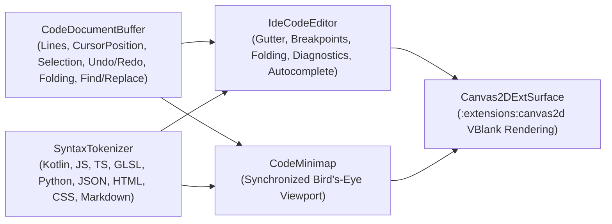

# `:extensions:codeeditor` & `:extensions:codeeditor:dsl` — Multi-Language IDE Code Editor & Minimap

> **Navigation**: [**GenericUI Root (`../../README.md`)**](../../README.md) · [**Extensions Index (`../README.md`)**](../README.md) · [**Root Extensions Guide (`../../docs/extensions.md`)**](../../docs/extensions.md) · [**Source Sets (`../../docs/sourcesets.md`)**](../../docs/sourcesets.md) · [**Backends (`../../docs/backends.md`)**](../../docs/backends.md) · [**Gradle Plugin (`../../docs/gradle-plugin.md`)**](../../docs/gradle-plugin.md)

`:extensions:codeeditor` is a **Single Multiplatform Project** (`src/commonMain` across all 8 platform targets) built atop [`:extensions:canvas2d`](canvas2d.md) (`Canvas2DExtSurface`) and `:common`. It provides a hardware-accelerated IDE code editor (**`IdeCodeEditor`**) and synchronized overview minimap (**`CodeMinimap`**) with multi-language lexical syntax highlighting, gutter line numbers, interactive breakpoints, `{ ... }` code folding, compiler/linter diagnostic squiggle underlines, hover diagnostic popovers, find & replace, undo/redo history, and context-aware IntelliSense autocomplete.

---

## 1. Architecture & Supported Languages



### Supported `CodeLanguage` Modes (`SyntaxTokenizer`)
- **`CodeLanguage.KOTLIN`** — Kotlin keywords, annotations (`@GenericUiDslMarker`), string templates, comments, numbers, and declarations.
- **`CodeLanguage.JAVASCRIPT`** & **`CodeLanguage.TYPESCRIPT`** — ES2024+ / TypeScript types, decorators, template literals, and async/await keywords.
- **`CodeLanguage.GLSL`** — Vulkan `#version 450` and OpenGL ES `#version 300 es` shaders (`vec2`, `vec3`, `vec4`, `mat4`, `sampler2D`, `uniform`, `layout`).
- **`CodeLanguage.PYTHON`** — Python 3 keywords, decorators, docstrings, and built-ins.
- **`CodeLanguage.JSON`** — JSON keys, strings, booleans, and numeric literals.
- **`CodeLanguage.HTML`** & **`CodeLanguage.CSS`** — Tags, attributes, selectors, and CSS properties.
- **`CodeLanguage.MARKDOWN`** & **`CodeLanguage.PLAIN_TEXT`** — Headings, fenced code blocks, emphasis, and plain text.

---

## 2. Gradle Plugin Configuration

Enabling `codeEditor()` in the [GenericUI Gradle Plugin (`../../docs/gradle-plugin.md`)](../../docs/gradle-plugin.md) wires `:extensions:codeeditor`, `:extensions:canvas2d`, `:extensions:overlay`, `:extensions:imageprocessing`, `:extensions:gpu`, and (when `dsl()` is active) `:extensions:codeeditor:dsl`, and automatically registers all required providers at startup:

```kotlin
plugins {
    id("com.nexustools.genericui")
}

genericui {
    backends {
        allExceptSwing()
    }
    extensions {
        dsl()        // Enables :extensions:dsl
        codeEditor() // Automatically includes :extensions:codeeditor, :extensions:canvas2d, and :extensions:codeeditor:dsl
    }
}
```

---

## 3. Core API Reference (`com.nexustools.genericui.ext.codeeditor`)

| Class / Interface / Enum | Package | Description & Key Members |
| :--- | :--- | :--- |
| `IdeCodeEditor` | `ext.codeeditor` | Full IDE code editor widget extending `Container`. Key members: `document: CodeDocumentBuffer`, `tokenizer: SyntaxTokenizer`, `theme: CodeEditorTheme`, `language: CodeLanguage`, `readOnly: Boolean`, `fontFamily: String`, `fontSizePx: Float`, `lineHeightPx: Float`, `gutterWidthPx: Float`, `breakpoints: MutableSet<Int>`, `completionProvider: CodeCompletionProvider?`, `editorCanvas: Canvas2DExtSurface`, `minimap: CodeMinimap`, `getText(): String`, `setText(text: String)`, `setDiagnostics(diagnostics: List<CodeDiagnostic>)`, `getDiagnostics()`, `scrollToLine(lineIndex)`, `find(query, ignoreCase): List<TextRange>`, `replaceNext(query, replacement, ignoreCase): Boolean`, `replaceAll(query, replacement, ignoreCase): Int`, `triggerAutocomplete()`, `acceptSelectedCompletion()`, `setOnTextChanged(listener)`, `setOnCursorChanged(listener)`. |
| `CodeDocumentBuffer` | `ext.codeeditor` | Multi-line text buffer with undo/redo stack, bracket matching, and folding detection: `lineCount`, `primaryCursor: CursorPosition`, `selectionRange: TextRange?`, `tabSize: Int`, `getLine(index)`, `insertTextAtCursor(text)`, `insertNewLineWithAutoIndent()`, `deleteBackward()`, `deleteForward()`, `undo()`, `redo()`, `findMatchingBracket(cursor)`, `detectFoldingRegions(): List<CodeFoldingRegion>`, `findAll(query, ignoreCase)`. |
| `CodeEditorTheme` | `ext.codeeditor` | Color scheme for editor surface, gutter, syntax tokens, and diagnostics. Built-in presets: `CodeEditorTheme.DARK_IDE` and `CodeEditorTheme.LIGHT_IDE`. |
| `CodeLanguage` | `ext.codeeditor` | Enum: `KOTLIN`, `JAVASCRIPT`, `TYPESCRIPT`, `GLSL`, `PYTHON`, `JSON`, `HTML`, `CSS`, `MARKDOWN`, `PLAIN_TEXT`. |
| `SyntaxTokenizer` / `SyntaxToken` / `SyntaxTokenType` | `ext.codeeditor` | Lexical tokenizer splitting lines into `SyntaxToken(type, text, startColumn, endColumn)` (`KEYWORD`, `TYPE`, `STRING`, `NUMBER`, `COMMENT`, `ANNOTATION`, `FUNCTION`, `OPERATOR`, `PUNCTUATION`, `IDENTIFIER`, `WHITESPACE`). |
| `CodeDiagnostic` / `CodeDiagnosticSeverity` | `ext.codeeditor` | Compiler/linter diagnostic marker (`range: TextRange`, `message: String`, `severity: CodeDiagnosticSeverity` — `ERROR`, `WARNING`, `INFO`, `HINT`, `code: String?`). |
| `CodeFoldingRegion` | `ext.codeeditor` | Collapsible block range (`startLine: Int`, `endLine: Int`, `isCollapsed: Boolean`, `placeholder: String = "..."`). |
| `CodeCompletionProvider` / `CompletionItem` / `CompletionItemKind` | `ext.codeeditor` | Functional interface `computeCompletions(document, cursor, prefix): List<CompletionItem>` with item kinds (`KEYWORD`, `FUNCTION`, `CLASS`, `PROPERTY`, `VARIABLE`, `SNIPPET`). |
| `CodeMinimap` | `ext.codeeditor` | Synchronized bird's-eye overview widget rendering token bars, viewport slider, and diagnostic ticks (`onScrollToLineRequested`). |
| `CursorPosition` / `TextRange` | `ext.codeeditor` | Zero-based `(line: Int, column: Int)` coordinate and normalized `[start .. end]` document span. |
| `codeEditor` / `ideCodeEditor` / `codeMinimap` | `ext.codeeditor.dsl` | Declarative DSL builders in `:extensions:codeeditor:dsl`. |

---

## 4. Imperative Kotlin Examples

### Example 1: Creating a Kotlin `IdeCodeEditor` with Diagnostics, Breakpoints, & Custom Autocomplete

```kotlin
import com.nexustools.genericui.ext.codeeditor.CodeCompletionProvider
import com.nexustools.genericui.ext.codeeditor.CodeDiagnostic
import com.nexustools.genericui.ext.codeeditor.CodeDiagnosticSeverity
import com.nexustools.genericui.ext.codeeditor.CodeEditorTheme
import com.nexustools.genericui.ext.codeeditor.CodeLanguage
import com.nexustools.genericui.ext.codeeditor.CompletionItem
import com.nexustools.genericui.ext.codeeditor.CompletionItemKind
import com.nexustools.genericui.ext.codeeditor.CursorPosition
import com.nexustools.genericui.ext.codeeditor.IdeCodeEditor
import com.nexustools.genericui.ext.codeeditor.TextRange

fun createKotlinIdeEditor(): IdeCodeEditor {
    val initialSource = """
        package sample.shader

        fun computeLuminance(r: Float, g: Float, b: Float): Float {
            return 0.2126f * r + 0.7152f * g + 0.0722f * b
        }
    """.trimIndent()

    val editor = IdeCodeEditor(
        initialText = initialSource,
        language = CodeLanguage.KOTLIN,
        theme = CodeEditorTheme.DARK_IDE,
        width = 1024,
        height = 680
    ).apply {
        // Add a gutter breakpoint on line 3 (0-indexed: 2)
        breakpoints.add(2)

        // Attach compiler/linter squiggle diagnostics
        setDiagnostics(
            listOf(
                CodeDiagnostic(
                    range = TextRange(CursorPosition(3, 11), CursorPosition(3, 18)),
                    message = "Consider extracting Rec.709 coefficients into constants",
                    severity = CodeDiagnosticSeverity.INFO,
                    code = "REC709_CONST"
                )
            )
        )

        // Register a custom IntelliSense completion provider (triggered via Ctrl+Space)
        completionProvider = CodeCompletionProvider { _, _, prefix ->
            listOf(
                CompletionItem(
                    label = "computeLuminance(r, g, b)",
                    insertText = "computeLuminance(1.0f, 1.0f, 1.0f)",
                    kind = CompletionItemKind.FUNCTION,
                    detail = "Float (Rec.709 Luminance)"
                ),
                CompletionItem(
                    label = "GpuDevice.acquireOffscreenContext()",
                    insertText = "GpuDevice.acquireOffscreenContext(preferVulkan = true)",
                    kind = CompletionItemKind.METHOD,
                    detail = "GpuOffscreenContext"
                )
            ).filter { it.label.startsWith(prefix, ignoreCase = true) }
        }

        setOnCursorChanged { pos ->
            println("Cursor moved to Ln ${pos.line + 1}, Col ${pos.column + 1}")
        }
    }

    return editor
}
```

---

## 5. Declarative `:extensions:codeeditor:dsl` Examples

With `dsl()` and `codeEditor()` enabled, use `codeEditor { ... }` (or `ideCodeEditor { ... }`) and `codeMinimap { ... }` directly inside any [`:extensions:dsl`](dsl.md) container:

```kotlin
import com.nexustools.genericui.ext.codeeditor.CodeEditorTheme
import com.nexustools.genericui.ext.codeeditor.CodeLanguage
import com.nexustools.genericui.ext.codeeditor.dsl.codeEditor
import com.nexustools.genericui.ext.dsl.ColorRgba
import com.nexustools.genericui.ext.dsl.buildDiv
import com.nexustools.genericui.ext.dsl.button
import com.nexustools.genericui.ext.dsl.hstack
import com.nexustools.genericui.ext.dsl.select
import com.nexustools.genericui.ext.dsl.option
import com.nexustools.genericui.ext.dsl.span
import com.nexustools.genericui.ext.dsl.textInput

val shaderWorkbench = buildDiv(classes = "p-3") {
    lateinit var editor: com.nexustools.genericui.ext.codeeditor.IdeCodeEditor
    val statusText = span("Ln 1, Col 1")

    hstack(classes = "gap-2 mb-2") {
        select(
            onSelectionChanged = { selectedLang ->
                editor.language = CodeLanguage.valueOf(selectedLang)
            }
        ) {
            option("GLSL", "GLSL (#version 450)", selected = true)
            option("KOTLIN", "Kotlin")
            option("TYPESCRIPT", "TypeScript")
            option("JSON", "JSON")
        }

        val searchBox = textInput(placeholder = "Find in file...")
        button("Find") {
            onClick = {
                val matches = editor.find(searchBox.value, ignoreCase = true)
                statusText.text = "${matches.size} matches"
            }
        }
        button("Light/Dark") {
            onClick = {
                editor.theme = if (editor.theme == CodeEditorTheme.DARK_IDE) {
                    CodeEditorTheme.LIGHT_IDE
                } else {
                    CodeEditorTheme.DARK_IDE
                }
            }
        }
    }

    editor = codeEditor(
        initialText = """
            #version 450
            layout(location = 0) in vec2 vUv;
            layout(location = 0) out vec4 outColor;
            void main() {
                outColor = vec4(vUv, 0.5, 1.0);
            }
        """.trimIndent(),
        language = CodeLanguage.GLSL,
        theme = CodeEditorTheme.DARK_IDE,
        width = 960,
        height = 540,
        onCursorChanged = { pos ->
            statusText.text = "Ln ${pos.line + 1}, Col ${pos.column + 1}"
        }
    ) {
        style {
            borderRadius = com.nexustools.genericui.style.css.CssCornerRadii.px(8f)
            borderWidth = com.nexustools.genericui.style.css.CssEdgeLengths.px(1f)
            borderStyle = com.nexustools.genericui.enums.css.CssBorderStyle.SOLID
            borderColor = ColorRgba(51, 65, 85, 1.0)
        }
    }
}
```

---

## 6. Related Extensions & Cross-References

- **Related Extensions**:
  - [`:extensions:canvas2d` (`canvas2d.md`)](canvas2d.md) — Provides the hardware-accelerated `Canvas2DExtSurface` powering `IdeCodeEditor` and `CodeMinimap`.
  - [`:extensions:aichat` (`aichat.md`)](aichat.md) — Uses `:extensions:codeeditor` to render syntax-highlighted code blocks and diffs inside AI chat messages.
  - [`:extensions:webview` (`webview.md`)](webview.md) — Combine `IdeCodeEditor` with `WebView` for live side-by-side HTML/CSS/JS preview.
  - [`:extensions:dsl` (`dsl.md`)](dsl.md) — Base declarative Kotlin UI & Style DSL.
- **Root & Backend Documentation**:
  - [GenericUI Root (`../../README.md`)](../../README.md) · [Extensions Architecture (`../../docs/extensions.md`)](../../docs/extensions.md) · [Source Sets (`../../docs/sourcesets.md`)](../../docs/sourcesets.md) · [Backends (`../../docs/backends.md`)](../../docs/backends.md) · [Gradle Plugin (`../../docs/gradle-plugin.md`)](../../docs/gradle-plugin.md)
  - [Desktop Backends (`../../desktop/README.md`)](../../desktop/README.md) · [Mobile Backends (`../../mobile/README.md`)](../../mobile/README.md) · [Web Backend (`../../web/README.md`)](../../web/README.md)
