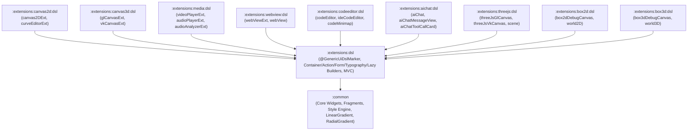

# `:extensions:dsl` & Extension `:dsl` Submodules — Declarative Kotlin UI, Gradients/Styles, & MVC Architecture

> **Navigation**: [**GenericUI Root (`../../README.md`)**](../../README.md) · [**Extensions Index (`../README.md`)**](../README.md) · [**Root Extensions Guide (`../../docs/extensions.md`)**](../../docs/extensions.md) · [**Source Sets (`../../docs/sourcesets.md`)**](../../docs/sourcesets.md) · [**Backends (`../../docs/backends.md`)**](../../docs/backends.md) · [**Gradle Plugin (`../../docs/gradle-plugin.md`)**](../../docs/gradle-plugin.md)

`:extensions:dsl` is a **Single Multiplatform Project** depending **exclusively on `:common`** (`api(project(":common"))`). It provides a `kotlinx.html`-inspired in-place component builder DSL (`@GenericUiDslMarker`, `buildDiv`, `buildContainer`, `Container.build`, `div`, `row`, `col`, `hstack`, `vstack`, `flexBox`, `h1`..`h6`, `p`, `span`, `button`, `textInput`, `select { option(...) }`, `table { tr { th(...); td(...) } }`, `lazyList`, `lazyGrid`, `treeView`), inline `style { ... }` blocks with **`LinearGradient`** and **`RadialGradient`**, and first-class Model-View-Controller (**`MvcModel`**, **`MvcView<M>`**, **`MvcController<M, V>`**) reactive state binding.

---

## 1. Modular `:dsl` Architecture & Automatic Gradle Wiring

To keep `:extensions:dsl` lightweight and free of unwanted transitive dependencies, `:extensions:dsl` **strictly never depends on other extensions**. Instead, each component-providing extension ships its own dedicated `:extensions:<ext>:dsl` submodule:



### Automatic `:extensions:<ext>:dsl` Activation in `genericui { extensions { ... } }`
When `dsl()` is enabled in the [GenericUI Gradle Plugin (`../../docs/gradle-plugin.md`)](../../docs/gradle-plugin.md), every enabled component extension automatically includes its `:extensions:<ext>:dsl` submodule:

```kotlin
plugins {
    id("com.nexustools.genericui")
}

genericui {
    backends {
        allExceptSwing()
    }
    extensions {
        dsl()        // Enables :extensions:dsl
        canvas2d()   // Automatically adds :extensions:canvas2d AND :extensions:canvas2d:dsl
        canvas3d()   // Automatically adds :extensions:canvas3d AND :extensions:canvas3d:dsl
        media()      // Automatically adds :extensions:media AND :extensions:media:dsl
        webView()    // Automatically adds :extensions:webview AND :extensions:webview:dsl
        codeEditor() // Automatically adds :extensions:codeeditor AND :extensions:codeeditor:dsl
        aiChat()     // Automatically adds :extensions:aichat AND :extensions:aichat:dsl
        threeJs()    // Automatically adds :extensions:threejs AND :extensions:threejs:dsl
        box2d()      // Automatically adds :extensions:box2d AND :extensions:box2d:dsl
        box3d()      // Automatically adds :extensions:box3d AND :extensions:box3d:dsl
    }
}
```

| Extension `:dsl` Submodule | Package | Builders Provided | Dedicated Guide |
| :--- | :--- | :--- | :--- |
| **`:extensions:canvas2d:dsl`** | `com.nexustools.genericui.ext.canvas2d.dsl` | `canvas2DExt`, `canvas2D`, `curveEditorExt`, `curveEditor` | [`canvas2d.md`](canvas2d.md) |
| **`:extensions:canvas3d:dsl`** | `com.nexustools.genericui.ext.canvas3d.dsl` | `glCanvasExt`, `glCanvas`, `vkCanvasExt`, `vkCanvas` | [`canvas3d.md`](canvas3d.md) |
| **`:extensions:media:dsl`** | `com.nexustools.genericui.ext.media.dsl` | `videoPlayerExt`, `videoPlayer`, `audioPlayerExt`, `audioPlayer`, `audioAnalyzerExt`, `audioAnalyzer` | [`media.md`](media.md) |
| **`:extensions:webview:dsl`** | `com.nexustools.genericui.ext.webview.dsl` | `webViewExt`, `webView` | [`webview.md`](webview.md) |
| **`:extensions:codeeditor:dsl`** | `com.nexustools.genericui.ext.codeeditor.dsl` | `codeEditor`, `ideCodeEditor`, `codeMinimap` | [`codeeditor.md`](codeeditor.md) |
| **`:extensions:aichat:dsl`** | `com.nexustools.genericui.ext.aichat.dsl` | `aiChat`, `aiChatContainer`, `aiChatMessageView`, `aiChatToolCallCard`, `aiChatReasoningAccordion` | [`aichat.md`](aichat.md) |
| **`:extensions:threejs:dsl`** | `com.nexustools.genericui.ext.threejs.dsl` | `threeJsGlCanvas`, `threeJsVkCanvas`, `scene`, `Scene.mesh`, `Scene.perspectiveCamera` | [`threejs.md`](threejs.md) |
| **`:extensions:box2d:dsl`** | `com.nexustools.genericui.ext.box2d.dsl` | `box2dDebugCanvas`, `world2D` (`body`, `staticBody`, `dynamicBody`, `kinematicBody`, `boxFixture`, `circleFixture`, `edgeFixture`) | [`box2d.md`](box2d.md) |
| **`:extensions:box3d:dsl`** | `com.nexustools.genericui.ext.box3d.dsl` | `box3dDebugCanvas`, `world3D` (`rigidBody`, `dynamicRigidBody`, `staticRigidBody`, `kinematicRigidBody`, `boxCollider`, `sphereCollider`, `capsuleCollider`) | [`box3d.md`](box3d.md) |

---

## 2. Core API Reference (`com.nexustools.genericui.ext.dsl`)

| Category | Functions / Classes |
| :--- | :--- |
| **DSL Marker & Entry Points** | `@GenericUiDslMarker`, `buildDiv(classes, id) { ... }: Container`, `buildContainer(classes, id) { ... }: Container`, `AbstractContainer.build(clearFirst) { ... }`, `AbstractContainer.component(child, classes, id) { ... }`. |
| **Layout & Containers (`DslContainerBuilders.kt`)** | `div`, `container`, `section`, `header`, `footer`, `main`, `nav`, `article`, `aside`, `form`, `box`, `row`, `col(classes, span, weight)` / `column`, `hstack`, `vstack`, `flexBox(direction, justify, align)`, `scrollView`, `stepScrollView`, `hr` / `divider`, `spacer(widthPx, heightPx)` / `br`, `table`, `thead`, `tbody`, `tfoot`, `tr`, `th`, `td`. |
| **Actions & Forms (`DslActionAndFormBuilders.kt`)** | `ColorRgba(r, g, b, a)`, `button(text, icon, tooltipText, type, size, outline, onClick)`, `iconButton`, `buttonGroup`, `dropdownButton`, `textInput` / `textField` / `input`, `passwordInput` / `passwordField`, `numberInput` / `numberField`, `textArea`, `searchInput` / `searchField`, `select { option(value, label, selected) }`, `checkBox`, `switch`, `radioGroup { radioButton(...) }`, `rangeSlider`, `compoundUnitInput`, `formGroup`, `inputGroup`. |
| **Typography (`DslTypographyBuilders.kt`)** | `heading(level, text)`, `h1`, `h2`, `h3`, `h4`, `h5`, `h6`, `p` / `paragraph`, `span`, `label`, `sup`, `sub`, `small`, `strong` / `b`, `em` / `i`, `a(text, href, onClick)`, `badge(text, type, pill)`, `codeBlock` / `pre` / `code`, `blockquote`, `markdownView`, `+"inline text"`. |
| **Content, Surfaces, & Feedback (`DslContentAndSurfaceBuilders.kt`)** | `card(title)`, `collapsiblePanel(title, expanded)`, `ul` / `listGroup`, `li` / `listGroupItem`, `img` / `imageView(src, alt, objectFit)`, `dataTable`, `masterDetailStepSelect`, `horizontalCarouselSelector`, `currencyPurseBar`, `navbar`, `alert`, `progressBar`, `spinner`. |
| **Virtualized Lazy Views (`DslLazyBuilders.kt`)** | `lazyList(orientation, estimatedItemExtentPx, overscanItems)`, `lazyGrid(columns, estimatedRowHeightPx, overscanRows)`, `treeView<T>(estimatedRowHeightPx, overscanRows)`. |
| **MVC Architecture (`MvcModel`, `MvcView`, `MvcController`)** | `MvcModel` (`addChangeListener`, `notifyModelChanged`), `MvcView<M>` (`model`, `autoRefreshOnModelChange`, `abstract fun Container.render()`, `refreshView()`, `bindModel(newModel)`), `MvcController<M, V>` (`attach()`, `detach()`, `updateModel { ... }`). |

---

## 3. Declarative Kotlin UI, Gradients, & Pseudo-Class Styling Examples

### Example 1: Building a Rich Dashboard with `LinearGradient`, `RadialGradient`, & Pseudo-Class `style { ... }` Rules

Every GenericUI component supports inline `style { ... }` configuration, including multi-stop **`LinearGradient`**, **`RadialGradient`**, and pseudo-class states (`hover`, `active`, `focus`, `disabled`):

```kotlin
import com.nexustools.genericui.enums.bootstrap.AlignItems
import com.nexustools.genericui.enums.bootstrap.BootstrapSize
import com.nexustools.genericui.enums.bootstrap.BootstrapType
import com.nexustools.genericui.enums.bootstrap.FlexDirection
import com.nexustools.genericui.enums.bootstrap.JustifyContent
import com.nexustools.genericui.ext.dsl.*
import com.nexustools.genericui.style.GradientStop
import com.nexustools.genericui.style.LinearGradient
import com.nexustools.genericui.style.RadialGradient

fun createHeroDashboard() = buildContainer(classes = "p-4") {
    // Hero banner with a 135-degree LinearGradient background
    div(classes = "p-4 mb-4", id = "hero-banner") {
        style {
            backgroundGradient = LinearGradient(
                angleDegrees = 135f,
                stops = listOf(
                    GradientStop(0.0f, ColorRgba(15, 23, 42, 1.0)),
                    GradientStop(0.5f, ColorRgba(30, 58, 138, 1.0)),
                    GradientStop(1.0f, ColorRgba(14, 116, 144, 1.0))
                )
            )
            borderRadiusPx = 16f
            paddingPx = 24f
        }

        h1("GenericUI Native-First Workspace")
        p("Compiled natively to Win32, Cocoa, GTK4, Qt6, Android, iOS, and Web.")

        hstack(classes = "gap-2 mt-3") {
            button(
                text = "Launch GPU Pipeline",
                icon = "🚀",
                type = BootstrapType.PRIMARY,
                size = BootstrapSize.MD
            ) {
                style {
                    borderRadiusPx = 8f
                    hover {
                        backgroundColor = ColorRgba(37, 99, 235, 1.0)
                    }
                    active {
                        backgroundColor = ColorRgba(29, 78, 216, 1.0)
                    }
                }
            }
            badge(text = "Vulkan 1.3 Ready", type = BootstrapType.SUCCESS, pill = true)
        }
    }

    // Two-column layout with RadialGradient accent card and data table
    row(classes = "gap-3") {
        col(span = 5) {
            card(title = "Spotlight Metric") {
                style {
                    backgroundGradient = RadialGradient(
                        centerXRatio = 0.5f,
                        centerYRatio = 0.3f,
                        radiusRatio = 0.85f,
                        stops = listOf(
                            GradientStop(0.0f, ColorRgba(56, 189, 248, 0.28)),
                            GradientStop(1.0f, ColorRgba(15, 23, 42, 0.95))
                        )
                    )
                    borderRadiusPx = 12f
                }
                h2("120 FPS")
                small("Hardware VBlank Synchronized")
            }
        }

        col(span = 7) {
            table(classes = "table-striped") {
                thead {
                    tr {
                        th("Extension")
                        th("Primary Backend")
                        th("Status")
                    }
                }
                tbody {
                    tr {
                        td(":extensions:gpu")
                        td("Vulkan 1.2+ SPIR-V")
                        td { badge("Active", BootstrapType.SUCCESS) }
                    }
                    tr {
                        td(":extensions:media")
                        td("Desktop libvlc + HDR")
                        td { badge("Active", BootstrapType.INFO) }
                    }
                }
            }
        }
    }
}
```

### Example 2: Reactive Model-View-Controller (`MvcModel`, `MvcView`, `MvcController`)

```kotlin
import com.nexustools.genericui.component.layout.Container
import com.nexustools.genericui.enums.bootstrap.BootstrapType
import com.nexustools.genericui.ext.dsl.*

// 1. Model extending MvcModel
class CounterModel(
    var count: Int = 0,
    var stepSize: Int = 1
) : MvcModel()

// 2. View implementing Container.render() using in-place DSL builders
class CounterView(model: CounterModel) : MvcView<CounterModel>(model, classPrefix = "p-4") {
    var onIncrementClicked: (() -> Unit)? = null
    var onResetClicked: (() -> Unit)? = null

    override fun Container.render() {
        card(title = "Reactive MVC Counter") {
            h2("Count: ${model.count}")
            p("Step Size: +${model.stepSize}")

            hstack(classes = "gap-2 mt-2") {
                button(
                    text = "+${model.stepSize}",
                    type = BootstrapType.PRIMARY,
                    onClick = { onIncrementClicked?.invoke() }
                )
                button(
                    text = "Reset",
                    type = BootstrapType.SECONDARY,
                    outline = true,
                    onClick = { onResetClicked?.invoke() }
                )
            }
        }
    }
}

// 3. Controller coordinating user actions and mutating the model via updateModel { ... }
class CounterController(
    model: CounterModel = CounterModel(),
    view: CounterView = CounterView(model)
) : MvcController<CounterModel, CounterView>(model, view) {

    override fun onAttach() {
        view.onIncrementClicked = {
            updateModel { count += stepSize }
        }
        view.onResetClicked = {
            updateModel { count = 0 }
        }
    }
}
```

---

## 4. Related Extensions & Cross-References

- **All Companion Extension `:dsl` Guides**:
  - [`:extensions:canvas2d` & `:extensions:canvas2d:dsl` (`canvas2d.md`)](canvas2d.md)
  - [`:extensions:canvas3d` & `:extensions:canvas3d:dsl` (`canvas3d.md`)](canvas3d.md)
  - [`:extensions:media` & `:extensions:media:dsl` (`media.md`)](media.md)
  - [`:extensions:webview` & `:extensions:webview:dsl` (`webview.md`)](webview.md)
  - [`:extensions:codeeditor` & `:extensions:codeeditor:dsl` (`codeeditor.md`)](codeeditor.md)
  - [`:extensions:aichat` & `:extensions:aichat:dsl` (`aichat.md`)](aichat.md)
  - [`:extensions:threejs` & `:extensions:threejs:dsl` (`threejs.md`)](threejs.md)
  - [`:extensions:box2d` & `:extensions:box2d:dsl` (`box2d.md`)](box2d.md)
  - [`:extensions:box3d` & `:extensions:box3d:dsl` (`box3d.md`)](box3d.md)
  - [`:extensions:gpu` (`gpu.md`)](gpu.md) · [`:extensions:imageprocessing` (`imageprocessing.md`)](imageprocessing.md)
- **Root & Backend Documentation**:
  - [GenericUI Root (`../../README.md`)](../../README.md) · [Extensions Architecture (`../../docs/extensions.md`)](../../docs/extensions.md) · [Source Sets (`../../docs/sourcesets.md`)](../../docs/sourcesets.md) · [Backends (`../../docs/backends.md`)](../../docs/backends.md) · [Gradle Plugin (`../../docs/gradle-plugin.md`)](../../docs/gradle-plugin.md)
  - [Desktop Backends (`../../desktop/README.md`)](../../desktop/README.md) · [Mobile Backends (`../../mobile/README.md`)](../../mobile/README.md) · [Web Backend (`../../web/README.md`)](../../web/README.md)
