# `:extensions:dsl` & Extension `:dsl` Submodules — Declarative Kotlin UI, Strictly Isolated `style { ... }` / `bootstrap { ... }` Builders, Hybrid Layout DSL, & MVC Architecture

> **Navigation**: [**GenericUI Root (`../../README.md`)**](../../README.md) · [**Extensions Index (`../README.md`)**](../README.md) · [**Root Extensions Guide (`../../docs/extensions.md`)**](../../docs/extensions.md) · [**Layouts & Responsive Helpers (`../../docs/layouts-and-helpers.md`)**](../../docs/layouts-and-helpers.md) · [**Fragments & Windows (`../../docs/fragments-and-windows.md`)**](../../docs/fragments-and-windows.md) · [**Resources (`../../docs/resources.md`)**](../../docs/resources.md) · [**Source Sets (`../../docs/sourcesets.md`)**](../../docs/sourcesets.md) · [**Backends (`../../docs/backends.md`)**](../../docs/backends.md) · [**Gradle Plugin (`../../docs/gradle-plugin.md`)**](../../docs/gradle-plugin.md)

`:extensions:dsl` is a **Single Multiplatform Project** (`src/commonMain` across all 8 platform targets) depending **exclusively on `:common`** (`api(project(":common"))`). It provides:
1. **Strictly Isolated `style { ... }`, `bootstrap { ... }`, & `important { ... }` DSL Builders (`DslStyleAndBootstrapBuilders.kt`)** — `:common` exposes only `getStyle(): ComponentStyle` and `getBootstrap(): ComponentBootstrap`; all lambda DSL builders live strictly in `:extensions:dsl`.
2. **In-Place Component Builder DSL** (`@GenericUiDslMarker`, `buildDiv`, `buildContainer`, `Container.build`, `div`, `row`, `col`, `hstack`, `vstack`, `flexBox`, `h1`..`h6`, `p`, `span`, `button`, `textInput`, `select { option(...) }`, `table { tr { th(...); td(...) } }`, `lazyList`, `lazyGrid`, `treeView`).
3. **Hybrid Responsive Layout DSL (`HybridLayoutDsl.kt`)** — Declarative builders for `HybridColumnLayout`, `HybridSplitNavigationLayout`, `CollapsibleBottomDockLayout`, `ResponsiveMasterDetailLayout`, `AdaptiveNavigationScaffold`, and `ResponsiveBentoGridLayout`.
4. **Model-View-Controller (`MvcModel`, `MvcView<M>`, `MvcController<M, V>`)** reactive state binding.

---

## 1. Strictly Isolated `style { ... }`, `bootstrap { ... }`, & `important { ... }` Builders (`DslStyleAndBootstrapBuilders.kt`)

> [!IMPORTANT]
> **Strict `:extensions:dsl` Boundary**:
> `:common` never defines DSL builder lambdas (`fun style(block: ...)` or `fun bootstrap(block: ...)`). Instead, `:common` provides `component.getStyle(): ComponentStyle` and `component.getBootstrap(): ComponentBootstrap`, while `:extensions:dsl` provides the `T.style { ... }`, `T.bootstrap { ... }`, and `ComponentStyle.important { ... }` extension functions in `DslStyleAndBootstrapBuilders.kt`.

### 1.1 `T.style { ... }` & `ComponentStyle.important { ... }` (Web-Constrained W3C Inline CSS)
- Configures `component.getStyle(): ComponentStyle` with strongly-typed W3C CSS value classes and enums:
  - **24 CSS Enums (`com.nexustools.genericui.enums.css.*`)**: `CssUnit`, `CssDisplay`, `CssVisibility`, `CssPosition`, `CssBorderStyle`, `CssBackgroundRepeat`, `CssBackgroundAttachment`, `CssBackgroundClip`, `CssBackgroundOrigin`, `CssPositionEdge`, `CssCursor`, `CssPointerEvents`, `CssUserSelect`, `CssFontStyle`, `CssTextDecoration`, `CssWhiteSpace`, `CssWordBreak`, `CssVerticalAlign`, `CssBoxSizing`, `CssFloat`, `CssClear`, `CssGenericFontFamily`, `CssAlignContent`, `CssBackgroundSizeKeyword`.
  - **Typed CSS Value Classes (`com.nexustools.genericui.style.css.*`)**: `CssLength`, `CssEdgeLengths`, `CssCornerRadii`, `CssBackgroundImage` (plus `background = LinearGradient(...)` / `RadialGradient(...)`), `CssBackgroundSize`, `CssBackgroundPosition`, `CssShadow`, `CssShadowList`, `CssFontFamily`, `CssAspectRatio`, `CssFilter`, and **`CssCustomCursor`** (custom PNG/SVG/`ImageBuffer` cursors with `hotspotX`, `hotspotY`, and `fallback: CssCursor`).
  - **Standard CSS `accentColor`**: Use `accentColor = RgbaColor(...)` (`setAccentColor(color, important)`) for native/custom control accent coloring (`accent-color`).
  - **Zero Pseudo-States on Inline `ComponentStyle`**: Because HTML `element.style` on `:web` does not support pseudo-classes (`:hover`, `:focus`, `:active`, `:disabled`, `:checked`), `ComponentStyle` contains zero pseudo-state blocks; pseudo-state rules belong in `.scss` stylesheets (`R.style.<name>` / `IApplication.addStyleSheet`).
  - **Full `!important` Support**: Every `set<Property>(value, important = true)` method supports per-property `!important`, and `important { ... }` inside `style { ... }` marks all properties assigned within its block as `!important`.

### 1.2 `T.bootstrap { ... }` (Invisible Enum-Driven Bootstrap 5 Utilities)
- Configures `component.getBootstrap(): ComponentBootstrap` right alongside `style { ... }`:
  - **Variant & Sizing**: `type: BootstrapType?` (defaults to **`BootstrapType.NONE`** — renders authentic OS-native controls on non-web targets when `NONE`, or applies semantic coloring to native controls when set to `PRIMARY`, `DANGER`, `SUCCESS`, `WARNING`, `INFO`, `SECONDARY`, `LIGHT`, `DARK`, `LINK`), `size: BootstrapSize?`, `outline: Boolean`, `width: BootstrapWidth?` (`W_25`, `W_50`, `W_75`, `W_100`, `W_AUTO`, `MW_100`, `VW_100`, `MIN_VW_100`), `height: BootstrapHeight?` (`H_25`, `H_50`, `H_75`, `H_100`, `H_AUTO`, `MH_100`, `VH_100`, `MIN_VH_100`).
  - **Display & Flexbox**: `display: DisplayMode?`, `flexDirection: FlexDirection?`, `flexWrap: FlexWrap?`, `justifyContent: JustifyContent?`, `alignItems: AlignItems?`, `alignSelf: AlignSelf?`, `flexGrow: BootstrapFlexGrow?`, `flexShrink: BootstrapFlexShrink?`, `flexFill: Boolean`, `gap: SpacingScale?`, `rowGap: SpacingScale?`, `columnGap: SpacingScale?`.
  - **Directional `SpacingScale` Margins & Paddings**: `margin`, `marginTop`, `marginBottom`, `marginStart`, `marginEnd`, `marginX`, `marginY` (including `SpacingScale.AUTO`), and `padding`, `paddingTop`, `paddingBottom`, `paddingStart`, `paddingEnd`, `paddingX`, `paddingY` (`S0`..`S5`).
  - **Colors, Borders, Shadow, & Opacity**: `backgroundType: BootstrapType?`, `textColorType: BootstrapType?`, `borderType: BootstrapType?`, `borderWidth: BootstrapBorderWidth?` (`B0`..`B5`), `borderRadius: BorderRadiusStyle?`, `shadow: ShadowElevation?`, `opacity: BootstrapOpacity?` (`O_0`, `O_25`, `O_50`, `O_75`, `O_100`).
  - **Typography & Layout Utilities**: `textAlignment: TextAlignment?`, `fontWeight: FontWeight?`, `fontSize: BootstrapFontSize?` (`FS_1`..`FS_6`), `lineHeight: BootstrapLineHeight?`, `textTransform: TextTransform?`, `textOverflow: TextOverflow?`, `position: PositionMode?`, `overflow: OverflowBehavior?`, `floatSide: BootstrapFloat?`, `userSelect: BootstrapUserSelect?`, `pointerEvents: BootstrapPointerEvents?`, `objectFit: BootstrapObjectFit?`, `aspectRatio: BootstrapAspectRatio?`, `visibility: BootstrapVisibility?`.
  - **100% Invisible Enum Classes**: All Bootstrap enum utilities populate `WebDomElement.enumClassList` on `:web` and execute natively on all 7 non-web backends, remaining completely invisible to `getClasses()`, `hasClass()`, `addClass()`, and `removeClass()`.

```kotlin
import com.nexustools.genericui.enums.bootstrap.*
import com.nexustools.genericui.enums.css.*
import com.nexustools.genericui.ext.dsl.*
import com.nexustools.genericui.style.css.*

val saveButton = buildDiv {
    button("Save Changes") {
        bootstrap {
            type = BootstrapType.PRIMARY
            size = BootstrapSize.LG
            width = BootstrapWidth.W_100
            paddingX = SpacingScale.S4
            marginBottom = SpacingScale.S3
            shadow = ShadowElevation.SM
        }
        style {
            cursor = CssCursor.POINTER
            accentColor = ColorRgba(13, 110, 253, 1.0)
            important {
                borderRadius = CssCornerRadii.px(10f)
                letterSpacing = CssLength.px(0.5f)
            }
        }
    }
}
```

---

## 2. Modular `:dsl` Architecture & Automatic Gradle Wiring (12 Companion `:dsl` Submodules)

```mermaid
flowchart TD
    BaseDsl[":extensions:dsl<br/>(@GenericUiDslMarker, style/bootstrap/important, HybridLayoutDsl, Container/Action/Form/Typography/Lazy Builders, MVC)"]
    Common[":common<br/>(Core Widgets, ComponentStyle, ComponentBootstrap, Hybrid Responsive Layouts, PrecompiledStyleSheet)"]

    OverlayDsl[":extensions:overlay:dsl<br/>(overlayHostBox, presetOverlay, trackSeekBar, sliderSeekBar, ...)"]
    C2DDsl[":extensions:canvas2d:dsl<br/>(canvas2DExt, canvas2DOverlayHost, scrollCanvas2DOverlayHost, curveEditorExt)"]
    C3DDsl[":extensions:canvas3d:dsl<br/>(glCanvasExt, vkCanvasExt, canvas3DOverlayHost, scrollCanvas3DOverlayHost)"]
    MediaDsl[":extensions:media:dsl<br/>(videoPlayerExt, videoOverlayHost, audioPlayerExt, audioAnalyzerExt)"]
    MediaControlsDsl[":extensions:mediacontrols:dsl<br/>(mediaControlsSession, metadata, buttons, onEvent)"]
    WebViewDsl[":extensions:webview:dsl<br/>(webViewExt, webView)"]
    CodeDsl[":extensions:codeeditor:dsl<br/>(codeEditor, ideCodeEditor, codeMinimap)"]
    AiDsl[":extensions:aichat:dsl<br/>(aiChat, aiChatMessageView, aiChatToolCallCard)"]
    ThreeDsl[":extensions:threejs:dsl<br/>(threeJsGlCanvas, threeJsVkCanvas, scene)"]
    Box2DDsl[":extensions:box2d:dsl<br/>(box2dDebugCanvas, world2D)"]
    Box3DDsl[":extensions:box3d:dsl<br/>(box3dDebugCanvas, world3D)"]
    AlienDsl[":extensions:alien:dsl<br/>(alienContainer, unalienContainer)"]

    BaseDsl --> Common
    OverlayDsl --> BaseDsl
    C2DDsl --> BaseDsl
    C3DDsl --> BaseDsl
    MediaDsl --> BaseDsl
    MediaControlsDsl --> BaseDsl
    WebViewDsl --> BaseDsl
    CodeDsl --> BaseDsl
    AiDsl --> BaseDsl
    ThreeDsl --> BaseDsl
    Box2DDsl --> BaseDsl
    Box3DDsl --> BaseDsl
    AlienDsl --> BaseDsl
```

To keep `:extensions:dsl` lightweight and free of unwanted transitive dependencies, `:extensions:dsl` **strictly never depends on other extensions**. Instead, each component-providing extension ships its own dedicated `:extensions:<ext>:dsl` submodule:



### Automatic `:extensions:<ext>:dsl` Activation in `genericui { extensions { ... } }`
When `dsl()` is enabled in the [GenericUI Gradle Plugin (`../../docs/gradle-plugin.md`)](../../docs/gradle-plugin.md), every enabled component extension automatically includes its `:extensions:<ext>:dsl` submodule:

```kotlin
plugins {
    id("com.nexustools.genericui")
}

genericui {
    backends {
        allExceptSwing()
    }
    extensions {
        dsl()           // Enables :extensions:dsl
        overlay()       // Automatically adds :extensions:overlay AND :extensions:overlay:dsl
        canvas2d()      // Automatically adds :extensions:canvas2d AND :extensions:canvas2d:dsl
        canvas3d()      // Automatically adds :extensions:canvas3d AND :extensions:canvas3d:dsl
        media()         // Automatically adds :extensions:media AND :extensions:media:dsl
        mediaControls() // Automatically adds :extensions:mediacontrols AND :extensions:mediacontrols:dsl
        webView()       // Automatically adds :extensions:webview AND :extensions:webview:dsl
        codeEditor()    // Automatically adds :extensions:codeeditor AND :extensions:codeeditor:dsl
        aiChat()        // Automatically adds :extensions:aichat AND :extensions:aichat:dsl
        threeJs()       // Automatically adds :extensions:threejs AND :extensions:threejs:dsl
        box2d()         // Automatically adds :extensions:box2d AND :extensions:box2d:dsl
        box3d()         // Automatically adds :extensions:box3d AND :extensions:box3d:dsl
        alien()         // Automatically adds :extensions:alien AND :extensions:alien:dsl
    }
}
```

| Extension `:dsl` Submodule | Package | Builders Provided | Dedicated Guide |
| :--- | :--- | :--- | :--- |
| **`:extensions:overlay:dsl`** | `com.nexustools.genericui.ext.overlay.dsl` | `overlayHostBox`, `defaultOverlayPreset`, `mobileOverlayPreset`, `webSystemOverlayPreset`, `gradientScrim`, `metadataHeader`, `overlayBadgeStrip`, `centerTransportCluster`, `trackSeekBar`, `sliderSeekBar`, `volumeControl`, `subtitleCueView`, `overlayPopoverPanel`, `overlayModalDialog`, `overlayCurtain` | [`overlay.md`](overlay.md) |
| **`:extensions:canvas2d:dsl`** | `com.nexustools.genericui.ext.canvas2d.dsl` | `canvas2DExt`, `canvas2D`, `canvas2DOverlayHost`, `scrollCanvas2DOverlayHost`, `curveEditorExt`, `curveEditor` | [`canvas2d.md`](canvas2d.md) |
| **`:extensions:canvas3d:dsl`** | `com.nexustools.genericui.ext.canvas3d.dsl` | `glCanvasExt`, `glCanvas`, `vkCanvasExt`, `vkCanvas`, `canvas3DOverlayHost`, `glCanvasOverlayHost`, `vkCanvasOverlayHost`, `scrollCanvas3DOverlayHost` | [`canvas3d.md`](canvas3d.md) |
| **`:extensions:media:dsl`** | `com.nexustools.genericui.ext.media.dsl` | `videoPlayerExt`, `videoPlayer`, `videoOverlayHost`, `audioPlayerExt`, `audioPlayer`, `audioAnalyzerExt`, `audioAnalyzer` | [`media.md`](media.md) |
| **`:extensions:mediacontrols:dsl`** | `com.nexustools.genericui.ext.mediacontrols.dsl` | `mediaControlsSession`, `metadata`, `playbackStatus`, `buttons`, `onEvent`, `onPlay`, `onPause`, `onTogglePlayPause`, `onStop`, `onNextTrack`, `onPreviousTrack`, `onSeekForward`, `onSeekBackward`, `onSeekTo` | [`mediacontrols.md`](mediacontrols.md) |
| **`:extensions:webview:dsl`** | `com.nexustools.genericui.ext.webview.dsl` | `webViewExt`, `webView` | [`webview.md`](webview.md) |
| **`:extensions:codeeditor:dsl`** | `com.nexustools.genericui.ext.codeeditor.dsl` | `codeEditor`, `ideCodeEditor`, `codeMinimap` | [`codeeditor.md`](codeeditor.md) |
| **`:extensions:aichat:dsl`** | `com.nexustools.genericui.ext.aichat.dsl` | `aiChat`, `aiChatContainer`, `aiChatMessageView`, `aiChatToolCallCard`, `aiChatReasoningAccordion` (including `style { ... }` and `bootstrap { ... }` on `AiChatDslConfigScope`) | [`aichat.md`](aichat.md) |
| **`:extensions:threejs:dsl`** | `com.nexustools.genericui.ext.threejs.dsl` | `threeJsGlCanvas`, `threeJsVkCanvas`, `scene`, `Scene.mesh`, `Scene.perspectiveCamera` | [`threejs.md`](threejs.md) |
| **`:extensions:box2d:dsl`** | `com.nexustools.genericui.ext.box2d.dsl` | `box2dDebugCanvas`, `world2D` (`body`, `staticBody`, `dynamicBody`, `kinematicBody`, `boxFixture`, `circleFixture`, `edgeFixture`) | [`box2d.md`](box2d.md) |
| **`:extensions:box3d:dsl`** | `com.nexustools.genericui.ext.box3d.dsl` | `box3dDebugCanvas`, `world3D` (`rigidBody`, `dynamicRigidBody`, `staticRigidBody`, `kinematicRigidBody`, `boxCollider`, `sphereCollider`, `capsuleCollider`) | [`box3d.md`](box3d.md) |
| **`:extensions:alien:dsl`** | `com.nexustools.genericui.ext.alien.dsl` | `alienContainer`, `unalienContainer` | [`alien.md`](alien.md) |

---

## 3. Hybrid Responsive Layout DSL Builders (`HybridLayoutDsl.kt`)

`:extensions:dsl` provides declarative DSL builders for all 6 hybrid responsive layout containers in `:common` (see [Layouts & Responsive Helpers (`../../docs/layouts-and-helpers.md`)](../../docs/layouts-and-helpers.md) for full architecture details):

| Hybrid Layout DSL Builder | Child Scope Builders | Description |
| :--- | :--- | :--- |
| **`hybridColumnLayout(foldMode, tabPlacement, fullscreenPolicy)`** | **`column(id, title, weight, colSm, colMd, colLg, colXl, icon, compactHeightPx, compactAspectRatio, scrollableInColumnMode, scrollableInSingleMode) { ... }`** | Multi-column Bootstrap 12-grid layout on desktop/tablet/wide web that automatically folds on compact/mobile screens (`PIN_FIRST_COLUMN_TOP` or `ALL_COLUMNS_AS_TABS`) and coordinates fullscreen transitions via `HybridFullscreenPolicy`. |
| **`hybridSplitNavigationLayout(inColumnMode)`** | **`section(id, title, icon, badge, classes) { ... }`** | Side-by-side navigation list + active section pane on wide viewports that collapses into a drill-down or tabbed navigation flow on compact viewports. |
| **`collapsibleBottomDockLayout()`** | **`mainContent { ... }`**, **`dockContent { ... }`** | Full-bleed primary workspace container paired with a persistent, expandable bottom dock bar/sheet (e.g., mini-player, transport bar, or telemetry console). |
| **`responsiveMasterDetailLayout()`** | **`masterPane(widthPx, colMd) { ... }`**, **`detailPane(colMd) { ... }`**, **`inspectorPane(widthPx, colXl) { ... }`** | 2-pane or 3-pane split layout on tablet/desktop that automatically switches to single-pane stack navigation with back-button support on compact screens. |
| **`adaptiveNavigationScaffold()`** | **`destination(id, label, icon, badge, classes) { ... }`** | Adaptive app shell rendering a full navigation sidebar on desktop/wide web, a compact navigation rail on tablet, and a bottom navigation bar + drawer on phone. |
| **`responsiveBentoGridLayout(gapPx)`** | **`bentoCard(id, title, colXs, colSm, colMd, colLg, colXl, rowSpan, minHeightPx) { ... }`** (or `bentoCard(spec) { ... }`) | Responsive 12-column Bento dashboard grid supporting per-breakpoint column spans (`colXs`..`colXl`) and multi-row spans (`rowSpan`). |

```kotlin
import com.nexustools.genericui.component.layout.HybridFoldMode
import com.nexustools.genericui.component.layout.HybridFullscreenPolicy
import com.nexustools.genericui.component.layout.HybridTabPlacement
import com.nexustools.genericui.enums.bootstrap.*
import com.nexustools.genericui.ext.dsl.*

fun createAdaptiveMediaWorkspace() = buildContainer {
    bootstrap {
        width = BootstrapWidth.W_100
        height = BootstrapHeight.H_100
    }

    hybridColumnLayout(
        foldMode = HybridFoldMode.PIN_FIRST_COLUMN_TOP,
        tabPlacement = HybridTabPlacement.TOP_TABS,
        fullscreenPolicy = HybridFullscreenPolicy.PRIMARY_COLUMN_ON_LANDSCAPE_MOBILE
    ) {
        column(
            id = "stage",
            title = "Primary Stage",
            colMd = 8,
            colLg = 9,
            compactAspectRatio = 16f / 9f
        ) {
            h3("Primary Stage Viewport")
            p("Pinned at the top on mobile phones; occupies 8–9 columns on tablet/desktop.")
        }

        column(
            id = "queue",
            title = "Up Next",
            icon = "🎵",
            colMd = 4,
            colLg = 3,
            scrollableInColumnMode = true,
            scrollableInSingleMode = true
        ) {
            h4("Playback Queue")
        }

        column(
            id = "chapters",
            title = "Chapters",
            icon = "📑",
            colMd = 12,
            colLg = 12,
            scrollableInSingleMode = true
        ) {
            h4("Chapter Markers")
        }
    }
}
```

---

## 4. Core API Reference (`com.nexustools.genericui.ext.dsl`)

| Category | Functions / Classes |
| :--- | :--- |
| **DSL Marker & Entry Points** | `@GenericUiDslMarker`, `buildDiv(classes, id) { ... }: Container`, `buildContainer(classes, id) { ... }: Container`, `AbstractContainer.build(clearFirst) { ... }`, `AbstractContainer.component(child, classes, id) { ... }`. |
| **Style & Bootstrap Builders (`DslStyleAndBootstrapBuilders.kt`)** | `T.style { ... }`, `T.bootstrap { ... }`, `ComponentStyle.important { ... }` (strictly isolated in `:extensions:dsl`). |
| **Hybrid Responsive Layouts (`HybridLayoutDsl.kt`)** | `hybridColumnLayout` (`column`), `hybridSplitNavigationLayout` (`section`), `collapsibleBottomDockLayout` (`mainContent`, `dockContent`), `responsiveMasterDetailLayout` (`masterPane`, `detailPane`, `inspectorPane`), `adaptiveNavigationScaffold` (`destination`), `responsiveBentoGridLayout` (`bentoCard`). |
| **Layout & Containers (`DslContainerBuilders.kt`)** | `div`, `container`, `section`, `header`, `footer`, `main`, `nav`, `article`, `aside`, `form`, `box`, `row`, `col(classes, span, weight)` / `column`, `hstack`, `vstack`, `flexBox(direction, justify, align)`, `scrollView`, `stepScrollView`, `hr` / `divider`, `spacer(widthPx, heightPx)` / `br`, `table`, `thead`, `tbody`, `tfoot`, `tr`, `th`, `td`. |
| **Actions & Forms (`DslActionAndFormBuilders.kt`)** | `ColorRgba(r, g, b, a)`, `button(text, icon, tooltipText, type, size, outline, onClick)`, `iconButton`, `buttonGroup`, `dropdownButton`, `textInput` / `textField` / `input`, `passwordInput` / `passwordField`, `numberInput` / `numberField`, `textArea`, `searchInput` / `searchField`, `select { option(value, label, selected) }`, `checkBox`, `switch`, `radioGroup { radioButton(...) }`, `rangeSlider`, `compoundUnitInput`, `formGroup`, `inputGroup`. |
| **Typography (`DslTypographyBuilders.kt`)** | `heading(level, text)`, `h1`, `h2`, `h3`, `h4`, `h5`, `h6`, `p` / `paragraph`, `span`, `label`, `sup`, `sub`, `small`, `strong` / `b`, `em` / `i`, `a(text, href, onClick)`, `badge(text, type, pill)`, `codeBlock` / `pre` / `code`, `blockquote`, `markdownView`, `+"inline text"`. |
| **Content, Surfaces, & Feedback (`DslContentAndSurfaceBuilders.kt`)** | `card(title)`, `collapsiblePanel(title, expanded)`, `ul` / `listGroup`, `li` / `listGroupItem`, `img` / `imageView(src, alt, objectFit)`, `dataTable`, `masterDetailStepSelect`, `horizontalCarouselSelector`, `navbar`, `alert`, `progressBar`, `spinner`. |
| **Virtualized Lazy Views (`DslLazyBuilders.kt`)** | `lazyList(orientation, estimatedItemExtentPx, overscanItems)`, `lazyGrid(columns, estimatedRowHeightPx, overscanRows)`, `treeView<T>(estimatedRowHeightPx, overscanRows)`. |
| **MVC Architecture (`MvcModel`, `MvcView`, `MvcController`)** | `MvcModel` (`addChangeListener`, `notifyModelChanged`), `MvcView<M>` (`model`, `autoRefreshOnModelChange`, `abstract fun Container.render()`, `refreshView()`, `bindModel(newModel)`), `MvcController<M, V>` (`attach()`, `detach()`, `updateModel { ... }`). |

---

## 5. Declarative Kotlin UI, Gradients, Custom Cursors, & MVC Examples

### Example 1: Building a Rich Dashboard with `bootstrap { ... }`, `style { ... }`, `LinearGradient`, `RadialGradient`, & `CssCustomCursor`

```kotlin
import com.nexustools.genericui.enums.bootstrap.*
import com.nexustools.genericui.enums.css.*
import com.nexustools.genericui.ext.dsl.*
import com.nexustools.genericui.style.css.*
import com.nexustools.genericui.style.gradient.GradientStop
import com.nexustools.genericui.style.gradient.LinearGradient
import com.nexustools.genericui.style.gradient.RadialGradient

fun createHeroDashboard() = buildContainer {
    bootstrap {
        padding = SpacingScale.S4
    }

    // Hero banner with a 135-degree LinearGradient background
    div(id = "hero-banner") {
        bootstrap {
            padding = SpacingScale.S4
            marginBottom = SpacingScale.S4
            shadow = ShadowElevation.LG
        }
        style {
            background = LinearGradient(
                angleDegrees = 135f,
                stops = listOf(
                    GradientStop(0.0f, ColorRgba(15, 23, 42, 1.0)),
                    GradientStop(0.5f, ColorRgba(30, 58, 138, 1.0)),
                    GradientStop(1.0f, ColorRgba(14, 116, 144, 1.0))
                )
            )
            borderRadius = CssCornerRadii.px(16f)
            padding = CssEdgeLengths.px(24f)
        }

        h1("GenericUI Native-First Workspace")
        p("Compiled natively to Win32, Cocoa, GTK4, Qt6, Swing, Android, iOS, and Web.")

        hstack {
            bootstrap {
                gap = SpacingScale.S2
                marginTop = SpacingScale.S3
                alignItems = AlignItems.CENTER
            }
            button(
                text = "Launch GPU Pipeline",
                icon = "🚀",
                type = BootstrapType.PRIMARY,
                size = BootstrapSize.MD
            ) {
                style {
                    cursor = CssCursor.POINTER
                    important {
                        borderRadius = CssCornerRadii.px(8f)
                    }
                }
            }
            badge(text = "Vulkan 1.3 Ready", type = BootstrapType.SUCCESS, pill = true)
        }
    }

    // Responsive Bento Grid below the hero banner
    responsiveBentoGridLayout(gapPx = 16) {
        bentoCard(id = "fps", title = "Spotlight Metric", colMd = 5, colLg = 4) {
            style {
                background = RadialGradient(
                    centerXRatio = 0.5f,
                    centerYRatio = 0.3f,
                    radiusRatio = 0.85f,
                    stops = listOf(
                        GradientStop(0.0f, ColorRgba(56, 189, 248, 0.28)),
                        GradientStop(1.0f, ColorRgba(15, 23, 42, 0.95))
                    )
                )
                borderRadius = CssCornerRadii.px(12f)
            }
            h2("120 FPS")
            small("Hardware VBlank Synchronized")
        }

        bentoCard(id = "extensions", title = "Active Extensions", colMd = 7, colLg = 8) {
            table(classes = "table-striped") {
                thead {
                    tr {
                        th("Extension")
                        th("Primary Backend")
                        th("Status")
                    }
                }
                tbody {
                    tr {
                        td(":extensions:gpu")
                        td("Vulkan 1.2+ SPIR-V")
                        td { badge("Active", BootstrapType.SUCCESS) }
                    }
                    tr {
                        td(":extensions:media")
                        td("Desktop libvlc + HDR")
                        td { badge("Active", BootstrapType.INFO) }
                    }
                }
            }
        }
    }
}
```

### Example 2: Reactive Model-View-Controller (`MvcModel`, `MvcView`, `MvcController`)

```kotlin
import com.nexustools.genericui.component.layout.Container
import com.nexustools.genericui.enums.bootstrap.BootstrapType
import com.nexustools.genericui.enums.bootstrap.SpacingScale
import com.nexustools.genericui.ext.dsl.*

// 1. Model extending MvcModel
class CounterModel(
    var count: Int = 0,
    var stepSize: Int = 1
) : MvcModel()

// 2. View implementing Container.render() using in-place DSL builders
class CounterView(model: CounterModel) : MvcView<CounterModel>(model) {
    var onIncrementClicked: (() -> Unit)? = null
    var onResetClicked: (() -> Unit)? = null

    override fun Container.render() {
        bootstrap {
            padding = SpacingScale.S4
        }
        card(title = "Reactive MVC Counter") {
            h2("Count: ${model.count}")
            p("Step Size: +${model.stepSize}")

            hstack {
                bootstrap {
                    gap = SpacingScale.S2
                    marginTop = SpacingScale.S2
                }
                button(
                    text = "+${model.stepSize}",
                    type = BootstrapType.PRIMARY,
                    onClick = { onIncrementClicked?.invoke() }
                )
                button(
                    text = "Reset",
                    type = BootstrapType.SECONDARY,
                    outline = true,
                    onClick = { onResetClicked?.invoke() }
                )
            }
        }
    }
}

// 3. Controller coordinating user actions and mutating the model via updateModel { ... }
class CounterController(
    model: CounterModel = CounterModel(),
    view: CounterView = CounterView(model)
) : MvcController<CounterModel, CounterView>(model, view) {

    override fun onAttach() {
        view.onIncrementClicked = {
            updateModel { count += stepSize }
        }
        view.onResetClicked = {
            updateModel { count = 0 }
        }
    }
}
```

---

## 6. Related Extensions & Cross-References

- **All 12 Companion Extension `:dsl` Guides**:
  - [`:extensions:overlay` & `:extensions:overlay:dsl` (`overlay.md`)](overlay.md)
  - [`:extensions:canvas2d` & `:extensions:canvas2d:dsl` (`canvas2d.md`)](canvas2d.md)
  - [`:extensions:canvas3d` & `:extensions:canvas3d:dsl` (`canvas3d.md`)](canvas3d.md)
  - [`:extensions:media` & `:extensions:media:dsl` (`media.md`)](media.md)
  - [`:extensions:mediacontrols` & `:extensions:mediacontrols:dsl` (`mediacontrols.md`)](mediacontrols.md)
  - [`:extensions:webview` & `:extensions:webview:dsl` (`webview.md`)](webview.md)
  - [`:extensions:codeeditor` & `:extensions:codeeditor:dsl` (`codeeditor.md`)](codeeditor.md)
  - [`:extensions:aichat` & `:extensions:aichat:dsl` (`aichat.md`)](aichat.md)
  - [`:extensions:threejs` & `:extensions:threejs:dsl` (`threejs.md`)](threejs.md)
  - [`:extensions:box2d` & `:extensions:box2d:dsl` (`box2d.md`)](box2d.md)
  - [`:extensions:box3d` & `:extensions:box3d:dsl` (`box3d.md`)](box3d.md)
  - [`:extensions:alien` & `:extensions:alien:dsl` (`alien.md`)](alien.md)
  - [`:extensions:gpu` (`gpu.md`)](gpu.md) · [`:extensions:imageprocessing` (`imageprocessing.md`)](imageprocessing.md)
- **Root & Backend Documentation**:
  - [GenericUI Root (`../../README.md`)](../../README.md) · [Layouts & Responsive Helpers (`../../docs/layouts-and-helpers.md`)](../../docs/layouts-and-helpers.md) · [Extensions Architecture (`../../docs/extensions.md`)](../../docs/extensions.md) · [Resources (`../../docs/resources.md`)](../../docs/resources.md) · [Source Sets (`../../docs/sourcesets.md`)](../../docs/sourcesets.md) · [Backends (`../../docs/backends.md`)](../../docs/backends.md) · [Gradle Plugin (`../../docs/gradle-plugin.md`)](../../docs/gradle-plugin.md)
  - [Desktop Backends (`../../desktop/README.md`)](../../desktop/README.md) · [Mobile Backends (`../../mobile/README.md`)](../../mobile/README.md) · [Web Backend (`../../web/README.md`)](../../web/README.md)
