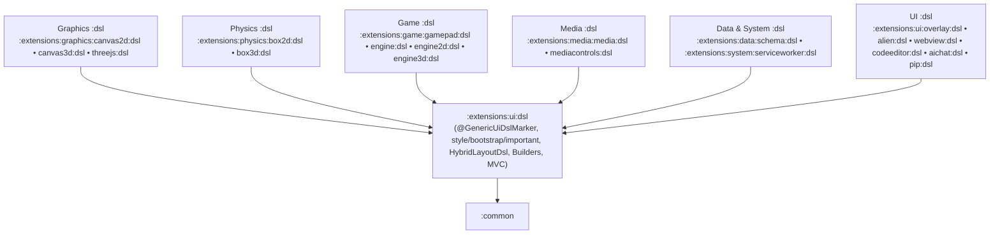

# `:extensions:ui:dsl` & Companion `:dsl` Modules — Declarative Kotlin UI, Strictly Isolated `style { ... }` / `bootstrap { ... }` Builders, Hybrid Layout DSL, & MVC

> **Navigation**: [**GenericUI Root (`../../README.md`)**](../../README.md) · [**Extensions Index (`../README.md`)**](../README.md) · [**Root Extensions Guide (`../../docs/extensions.md`)**](../../docs/extensions.md) · [**Layouts & Responsive Helpers (`../../docs/layouts-and-helpers.md`)**](../../docs/layouts-and-helpers.md) · [**Fragments & Windows (`../../docs/fragments-and-windows.md`)**](../../docs/fragments-and-windows.md) · [**Resources (`../../docs/resources.md`)**](../../docs/resources.md) · [**Source Sets (`../../docs/sourcesets.md`)**](../../docs/sourcesets.md) · [**Backends (`../../docs/backends.md`)**](../../docs/backends.md) · [**Gradle Plugin (`../../docs/gradle-plugin.md`)**](../../docs/gradle-plugin.md)

`:extensions:ui:dsl` is a **Single Consolidated KMP Project** (`src/commonMain` across all GenericUI targets) depending **exclusively on `:common`** (`api(project(":common"))`). It provides:
1. **Strictly Isolated `style { ... }`, `bootstrap { ... }`, & `important { ... }` DSL Builders (`DslStyleAndBootstrapBuilders.kt`)** — `:common` exposes only `getStyle(): ComponentStyle` and `getBootstrap(): ComponentBootstrap`; all lambda DSL builders live strictly in `:extensions:ui:dsl`.
2. **In-Place Component Builder DSL** (`@GenericUiDslMarker`, `buildDiv`, `buildContainer`, `Container.build`, `div`, `row`, `col`, `hstack`, `vstack`, `flexBox`, `h1`..`h6`, `p`, `span`, `button`, `textInput`, `select { option(...) }`, `table { tr { th(...); td(...) } }`, `lazyList`, `lazyGrid`, `treeView`).
3. **Hybrid Responsive Layout DSL (`HybridLayoutDsl.kt`)** — Declarative builders for `HybridColumnLayout`, `HybridSplitNavigationLayout`, `CollapsibleBottomDockLayout`, `ResponsiveMasterDetailLayout`, `AdaptiveNavigationScaffold`, and `ResponsiveBentoGridLayout`.
4. **Model-View-Controller (`MvcModel`, `MvcView<M>`, `MvcController<M, V>`)** reactive state binding.

---

## 1. Strictly Isolated `style { ... }`, `bootstrap { ... }`, & `important { ... }` Builders (`DslStyleAndBootstrapBuilders.kt`)

> [!IMPORTANT]
> **Strict `:extensions:ui:dsl` Boundary**:
> `:common` never defines DSL builder lambdas (`fun style(block: ...)` or `fun bootstrap(block: ...)`). Instead, `:common` provides `component.getStyle(): ComponentStyle` and `component.getBootstrap(): ComponentBootstrap`, while `:extensions:ui:dsl` provides `T.style { ... }`, `T.bootstrap { ... }`, and `ComponentStyle.important { ... }` in [`DslStyleAndBootstrapBuilders.kt`](../ui/dsl/src/commonMain/kotlin/com/nexustools/genericui/ext/dsl/DslStyleAndBootstrapBuilders.kt).

### 1.1 `T.style { ... }` & `ComponentStyle.important { ... }` (Strongly-Typed Zero-Allocation W3C Inline CSS)
- **Zero String-Keyed Style APIs**: Non-web backends operate on strongly-typed `ComponentStyle` fields and 64-bit `CssProperty` bitmasks (`activePropertiesBitmaskLow`/`High`, `importantBitmaskLow`/`High`), while `:web` translates `ComponentStyle` and `ComponentBootstrap` to DOM CSS strings via `WebCssStyleTranslator`.
- **System Backend Typography vs. Aesthetic Style Restraints**:
  - **Text / Typography Elements (`Label`, `Text`, `Heading`, `Badge`, `Blockquote`, `CodeBlock`, `MarkdownView`)**: Honor typography and text-color properties (`color`, `fontFamily`, `fontSize`, `fontWeight`, `fontStyle`, `lineHeight`, `letterSpacing`, `textAlign`, `textDecoration`, `textTransform`, `textOverflow`, `whiteSpace`, `wordBreak`, plus `bootstrap.*`).
  - **Standard Controls & Standard Containers (`Button`, `IconButton`, `CheckBox`, `Select`, `TextField`, `Container`, `Card`, etc.)**: Aesthetic overrides on `ComponentStyle` are **silently ignored** on OS-native backends (standard components are tinted via `BootstrapType`).
  - **`StyledContainer` & `StyledButton` (and `:extensions:ui:alien`)**: Honor **100% of `ComponentStyle` aesthetic properties** across all 9 backends — including hardware-accelerated `backdropFilter` (`CssFilter` / `setBackdropBlur(...)`) on **both `StyledButton` and `StyledContainer`**.
- **Zero Pseudo-States on Inline `ComponentStyle`**: Pseudo-state rules (`:hover`, `:focus`, `:active`, etc.) belong in `.scss` stylesheets (`R.style.<name>` / `IApplication.addStyleSheet`).
- **Full `!important` Support**: Assign inside `important { ... }` or call `set<Property>(value, important = true)`.

### 1.2 `T.bootstrap { ... }` (Invisible Enum-Driven Bootstrap 5 Utilities)
- Populates `WebDomElement.enumClassList` on `:web` and executes natively on all 7 non-web system targets, remaining invisible to `getClasses()` / `hasClass()` / `addClass()` / `removeClass()`:
  - **Variant & Sizing**: `type: BootstrapType?` (defaults to `NONE`), `size: BootstrapSize?`, `outline: Boolean`, `width: BootstrapWidth?`, `height: BootstrapHeight?`.
  - **Display & Flexbox**: `display: DisplayMode?`, `flexDirection: FlexDirection?`, `flexWrap: FlexWrap?`, `justifyContent: JustifyContent?`, `alignItems: AlignItems?`, `alignSelf: AlignSelf?`, `flexGrow`, `flexShrink`, `flexFill`, `gap`, `rowGap`, `columnGap`.
  - **Directional `SpacingScale` Margins & Paddings**, **Colors, Borders, Shadow, & Opacity**, and **Typography & Layout Utilities**.

```kotlin
import com.nexustools.genericui.enums.bootstrap.*
import com.nexustools.genericui.enums.css.*
import com.nexustools.genericui.ext.dsl.*
import com.nexustools.genericui.style.css.*

val saveButton = buildDiv {
    button("Save Changes") {
        bootstrap {
            type = BootstrapType.PRIMARY
            size = BootstrapSize.LG
            width = BootstrapWidth.W_100
            paddingX = SpacingScale.S4
            marginBottom = SpacingScale.S3
            shadow = ShadowElevation.SM
        }
        style {
            cursor = CssCursor.POINTER
            accentColor = ColorRgba(13, 110, 253, 1.0)
            important {
                borderRadius = CssCornerRadii.px(10f)
                letterSpacing = CssLength.px(0.5f)
            }
        }
    }
}
```

---

## 2. Modular `:dsl` Architecture & Automatic Gradle Wiring (18 Companion `:dsl` Modules)

To keep `:extensions:ui:dsl` lightweight and dependency-free outside `:common`, each DSL-enabled extension ships its own dedicated `<ext>:dsl` module wired automatically whenever `dsl()` is enabled in `genericui { extensions { ... } }`:



### Complete Companion `:dsl` Module Matrix (All 18 Modules)

| Companion `:dsl` Module | Package | Key Builders Provided | Dedicated Guide |
| :--- | :--- | :--- | :--- |
| **`:extensions:graphics:canvas2d:dsl`** | `com.nexustools.genericui.ext.canvas2d.dsl` | `canvas2D`, `canvas2DExt`, `scrollCanvas2D`, `canvas2DOverlayHost`, `scrollCanvas2DOverlayHost`, `curveEditor` | [`canvas2d.md`](canvas2d.md) |
| **`:extensions:graphics:canvas3d:dsl`** | `com.nexustools.genericui.ext.canvas3d.dsl` | `canvas3D`, `canvas3DGL`, `canvas3DVK`, `canvas3DOverlayHost`, `scrollCanvas3D`, `scrollCanvas3DOverlayHost` | [`canvas3d.md`](canvas3d.md) |
| **`:extensions:graphics:threejs:dsl`** | `com.nexustools.genericui.ext.threejs.dsl` | `threeJsCanvas`, `scene`, `Scene.mesh`, `Scene.perspectiveCamera` | [`threejs.md`](threejs.md) |
| **`:extensions:physics:box2d:dsl`** | `com.nexustools.genericui.ext.box2d.dsl` | `box2dDebugCanvas`, `world2D` (`body`, `staticBody`, `dynamicBody`, `kinematicBody`, fixtures) | [`box2d.md`](box2d.md) |
| **`:extensions:physics:box3d:dsl`** | `com.nexustools.genericui.ext.box3d.dsl` | `box3dDebugCanvas`, `world3D` (`rigidBody`, colliders, joints) | [`box3d.md`](box3d.md) |
| **`:extensions:game:gamepad:dsl`** | `com.nexustools.genericui.ext.gamepad.dsl` | `gamepadNavigation`, `gamepadButtonBadgeText` | [`gamepad.md`](../../docs/gamepad.md) |
| **`:extensions:game:engine:dsl`** | `com.nexustools.genericui.ext.engine.dsl` | `gameWorld`, `uiStageHost`, `entity`, `behavior`, `animationScheduler` | [`game-engines.md`](../../docs/game-engines.md) |
| **`:extensions:game:engine2d:dsl`** | `com.nexustools.genericui.ext.engine2d.dsl` | `game2DCanvas`, `physics2D`, `svgCharacter2D`, `tilemap2D` | [`game-engines.md`](../../docs/game-engines.md) |
| **`:extensions:game:engine3d:dsl`** | `com.nexustools.genericui.ext.engine3d.dsl` | `game3DCanvas`, `physics3D`, `characterController3D`, `humanoidRig3D`, `followCamera3D`, `directionalLight3D` | [`game-engines.md`](../../docs/game-engines.md) |
| **`:extensions:media:media:dsl`** | `com.nexustools.genericui.ext.media.dsl` | `videoPlayer`, `audioPlayer`, `seekBar`, `audioAnalyzer`, `videoOverlayHost`, `expandingVolumeSlider`, `buildExpandingVolumeSlider` | [`media.md`](media.md) |
| **`:extensions:media:mediacontrols:dsl`** | `com.nexustools.genericui.ext.mediacontrols.dsl` | `mediaControlsSession`, `metadata`, `playbackStatus`, `buttons`, `onEvent`, `onPlay` / `onPause` / `onSeekTo` | [`mediacontrols.md`](mediacontrols.md) |
| **`:extensions:data:schema:dsl`** | `com.nexustools.genericui.ext.schema.dsl` | `objectSchema`, `buildObjectSchema` (`section`, `preset`, `booleanField`, `intField`, `longField`, `doubleField`, `floatField`, `compoundNumberField`, `stringField`, `colorField`, `selectField`, `orderedMultiSelectField`, `polymorphicRowListField`, `cubicBezierField`, `objectListField`, `customField`, `group`, `asyncGroup`, `indexedGroup`, `separator`, `reactiveRule`), `schemaForm`, `buildSchemaForm`, `schemaModal` | [`schema.md`](schema.md) |
| **`:extensions:system:serviceworker:dsl`** | `com.nexustools.genericui.ext.serviceworker.dsl` | `ServiceWorker.onMessage`, `ServiceWorker.onRequest`, `ServiceWorkerChannel.onMessage`, `ServiceWorkerChannel.onRequest`, `trayMenu { item(...); separator() }`, `notificationActions { action(...); stopAction(...) }` | [`serviceworker.md`](serviceworker.md) |
| **`:extensions:ui:overlay:dsl`** | `com.nexustools.genericui.ext.overlay.dsl` | `buildOverlayHostBox`, `overlayHostBox`, `buildOverlay`, `overlay`, `attachPureOverlay`, `overlayElement`, `fillLayer`, `floatingLayer`, `buildYoutubePlayerOverlay`, `youtubePlayerOverlay`, `attachYoutubePlayerOverlay`, `hybridOverlayDifference`, `overlayControlButton`, `overlayPlayPauseButton`, `overlayFullscreenButton` | [`overlay.md`](overlay.md) |
| **`:extensions:ui:alien:dsl`** | `com.nexustools.genericui.ext.alien.dsl` | `alienContainer`, `unalienContainer` | [`alien.md`](alien.md) |
| **`:extensions:ui:webview:dsl`** | `com.nexustools.genericui.ext.webview.dsl` | `webViewExt`, `webView` | [`webview.md`](webview.md) |
| **`:extensions:ui:codeeditor:dsl`** | `com.nexustools.genericui.ext.codeeditor.dsl` | `codeEditor`, `ideCodeEditor`, `codeMinimap` | [`codeeditor.md`](codeeditor.md) |
| **`:extensions:ui:aichat:dsl`** | `com.nexustools.genericui.ext.aichat.dsl` | `aiChat`, `aiChatContainer`, `aiChatMessageView`, `aiChatToolCallCard`, `aiChatReasoningAccordion` | [`aichat.md`](aichat.md) |
| **`:extensions:ui:pip:dsl`** | `com.nexustools.genericui.ext.pip.dsl` | `Fragment.installPipHelper { ... }`, `Fragment.pipHelper` | [`pip.md`](pip.md) |

---

## 3. Hybrid Responsive Layout DSL Builders (`HybridLayoutDsl.kt`)

`:extensions:ui:dsl` provides declarative DSL builders for all 6 hybrid responsive layout containers in `:common` (see [Layouts & Responsive Helpers (`../../docs/layouts-and-helpers.md`)](../../docs/layouts-and-helpers.md)):

| Hybrid Layout DSL Builder | Child Scope Builders | Description |
| :--- | :--- | :--- |
| **`hybridColumnLayout(foldMode, tabPlacement, fullscreenPolicy)`** | **`column(...) { ... }`** | Multi-column Bootstrap 12-grid layout on desktop/tablet/wide web folding cleanly on compact screens. |
| **`hybridSplitNavigationLayout(inColumnMode)`** | **`section(...) { ... }`** | Side-by-side navigation list + active section pane collapsing into drill-down/tabbed navigation on compact viewports. |
| **`collapsibleBottomDockLayout()`** | **`mainContent { ... }`**, **`dockContent { ... }`** | Full-bleed primary workspace container with a persistent expandable bottom dock sheet. |
| **`responsiveMasterDetailLayout()`** | **`masterPane`, `detailPane`, `inspectorPane`** | 2-pane / 3-pane split layout adapting cleanly to single-pane back-stack navigation on phones. |
| **`adaptiveNavigationScaffold()`** | **`destination(...) { ... }`** | Adaptive app shell switching among sidebar (desktop), rail (tablet), and bottom bar + drawer (phone). |
| **`responsiveBentoGridLayout(gapPx)`** | **`bentoCard(...) { ... }`** | Responsive 12-column Bento dashboard grid supporting per-breakpoint spans (`colXs`..`colXl`) and `rowSpan`. |

---

## 4. Core `:extensions:ui:dsl` API Reference (`com.nexustools.genericui.ext.dsl`)

| Category | Functions / Classes |
| :--- | :--- |
| **DSL Marker & Entry Points** | `@GenericUiDslMarker`, `buildDiv(classes, id) { ... }: Container`, `buildContainer(classes, id) { ... }: Container`, `AbstractContainer.build(clearFirst) { ... }`, `AbstractContainer.component(child, classes, id) { ... }`. |
| **Style & Bootstrap Builders** | `T.style { ... }`, `T.bootstrap { ... }`, `ComponentStyle.important { ... }` (`DslStyleAndBootstrapBuilders.kt`). |
| **Hybrid Responsive Layouts** | `hybridColumnLayout`, `hybridSplitNavigationLayout`, `collapsibleBottomDockLayout`, `responsiveMasterDetailLayout`, `adaptiveNavigationScaffold`, `responsiveBentoGridLayout` (`HybridLayoutDsl.kt`). |
| **Layout & Containers** | `div`, `container`, `section`, `header`, `footer`, `main`, `nav`, `article`, `aside`, `form`, `box`, `row`, `col` / `column`, `hstack`, `vstack`, `flexBox`, `scrollView`, `stepScrollView`, `hr` / `divider`, `spacer` / `br`, `table`, `thead`, `tbody`, `tfoot`, `tr`, `th`, `td` (`DslContainerBuilders.kt`). |
| **Actions & Forms** | `ColorRgba`, `button`, `iconButton`, `buttonGroup`, `dropdownButton`, `textInput` / `textField` / `input`, `passwordInput` / `passwordField`, `numberInput` / `numberField`, `textArea`, `searchInput` / `searchField`, `select { option(...) }`, `checkBox`, `switch`, `radioGroup { radioButton(...) }`, `rangeSlider`, `compoundUnitInput`, `formGroup`, `inputGroup` (`DslActionAndFormBuilders.kt`). |
| **Typography** | `heading`, `h1`..`h6`, `p` / `paragraph`, `span`, `label`, `sup`, `sub`, `small`, `strong` / `b`, `em` / `i`, `a`, `badge`, `codeBlock` / `pre` / `code`, `blockquote`, `markdownView`, `+"inline text"` (`DslTypographyBuilders.kt`). |
| **Content, Surfaces, & Lazy Views** | `card`, `collapsiblePanel`, `ul` / `listGroup`, `li` / `listGroupItem`, `img` / `imageView`, `dataTable`, `masterDetailStepSelect`, `horizontalCarouselSelector`, `navbar`, `alert`, `progressBar`, `spinner`, `lazyList`, `lazyGrid`, `treeView` (`DslContentAndSurfaceBuilders.kt`, `DslLazyBuilders.kt`). |
| **MVC Architecture** | `MvcModel`, `MvcView<M>`, `MvcController<M, V>`. |

---

## 5. Declarative UI & MVC Examples

### Example 1: Gradients, `backdropFilter`, & Responsive Bento Dashboard

```kotlin
import com.nexustools.genericui.enums.bootstrap.*
import com.nexustools.genericui.enums.css.*
import com.nexustools.genericui.ext.dsl.*
import com.nexustools.genericui.style.css.*
import com.nexustools.genericui.style.gradient.GradientStop
import com.nexustools.genericui.style.gradient.LinearGradient

fun createHeroDashboard() = buildContainer {
    bootstrap { padding = SpacingScale.S4 }

    div(id = "hero-banner") {
        bootstrap {
            padding = SpacingScale.S4
            marginBottom = SpacingScale.S4
            shadow = ShadowElevation.LG
        }
        style {
            background = LinearGradient(
                angleDegrees = 135f,
                stops = listOf(
                    GradientStop(0.0f, ColorRgba(15, 23, 42, 1.0)),
                    GradientStop(1.0f, ColorRgba(14, 116, 144, 1.0))
                )
            )
            borderRadius = CssCornerRadii.px(16f)
            padding = CssEdgeLengths.px(24f)
        }

        h1("GenericUI Native-First Workspace")
        p("Compiled natively to Win32, Cocoa, GTK4, Qt6, Swing, Android, iOS, and Web.")
        hstack {
            bootstrap { gap = SpacingScale.S2; marginTop = SpacingScale.S3 }
            button(text = "Launch Pipeline", type = BootstrapType.PRIMARY) {
                style {
                    cursor = CssCursor.POINTER
                    important { borderRadius = CssCornerRadii.px(8f) }
                }
            }
            badge(text = "Vulkan 1.3 Ready", type = BootstrapType.SUCCESS, pill = true)
        }
    }
}
```

### Example 2: Reactive Model-View-Controller (`MvcModel`, `MvcView`, `MvcController`)

```kotlin
import com.nexustools.genericui.component.layout.Container
import com.nexustools.genericui.enums.bootstrap.BootstrapType
import com.nexustools.genericui.enums.bootstrap.SpacingScale
import com.nexustools.genericui.ext.dsl.*

class CounterModel(var count: Int = 0, var stepSize: Int = 1) : MvcModel()

class CounterView(model: CounterModel) : MvcView<CounterModel>(model) {
    var onIncrementClicked: (() -> Unit)? = null
    var onResetClicked: (() -> Unit)? = null

    override fun Container.render() {
        bootstrap { padding = SpacingScale.S4 }
        card(title = "Reactive MVC Counter") {
            h2("Count: ${model.count}")
            hstack {
                bootstrap { gap = SpacingScale.S2; marginTop = SpacingScale.S2 }
                button(text = "+${model.stepSize}", type = BootstrapType.PRIMARY, onClick = { onIncrementClicked?.invoke() })
                button(text = "Reset", type = BootstrapType.SECONDARY, outline = true, onClick = { onResetClicked?.invoke() })
            }
        }
    }
}

class CounterController(
    model: CounterModel = CounterModel(),
    view: CounterView = CounterView(model)
) : MvcController<CounterModel, CounterView>(model, view) {
    override fun onAttach() {
        view.onIncrementClicked = { updateModel { count += stepSize } }
        view.onResetClicked = { updateModel { count = 0 } }
    }
}
```

---

## 6. Related Extensions & Cross-References

- [`:extensions:data:schema` & `:dsl` (`schema.md`)](schema.md) · [`:extensions:system:serviceworker` & `:dsl` (`serviceworker.md`)](serviceworker.md) · [`:extensions:ui:pip` & `:dsl` (`pip.md`)](pip.md)
- [`:extensions:ui:overlay` & `:dsl` (`overlay.md`)](overlay.md) · [`:extensions:media:media` & `:dsl` (`media.md`)](media.md) · [`:extensions:media:mediacontrols` & `:dsl` (`mediacontrols.md`)](mediacontrols.md)
- [`:extensions:ui:alien` & `:dsl` (`alien.md`)](alien.md) · [`:extensions:ui:webview` & `:dsl` (`webview.md`)](webview.md) · [`:extensions:ui:codeeditor` & `:dsl` (`codeeditor.md`)](codeeditor.md) · [`:extensions:ui:aichat` & `:dsl` (`aichat.md`)](aichat.md)
- [`:extensions:graphics:canvas2d` (`canvas2d.md`)](canvas2d.md) · [`:extensions:graphics:canvas3d` (`canvas3d.md`)](canvas3d.md) · [`:extensions:graphics:threejs` (`threejs.md`)](threejs.md) · [`:extensions:physics:box2d` (`box2d.md`)](box2d.md) · [`:extensions:physics:box3d` (`box3d.md`)](box3d.md)
- [`:extensions:graphics:gpu` (`gpu.md`)](gpu.md) · [`:extensions:graphics:imageprocessing` (`imageprocessing.md`)](imageprocessing.md)
- [GenericUI Root (`../../README.md`)](../../README.md) · [Extensions Architecture (`../../docs/extensions.md`)](../../docs/extensions.md) · [Resources (`../../docs/resources.md`)](../../docs/resources.md) · [Gradle Plugin (`../../docs/gradle-plugin.md`)](../../docs/gradle-plugin.md)
