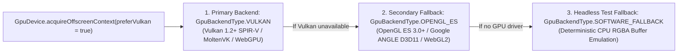

# `:extensions:gpu` — Unified Vulkan Primary & OpenGL ES Fallback GPU Foundation

> **Navigation**: [**GenericUI Root (`../../README.md`)**](../../README.md) · [**Extensions Index (`../README.md`)**](../README.md) · [**Root Extensions Guide (`../../docs/extensions.md`)**](../../docs/extensions.md) · [**Fragments & Windows (`../../docs/fragments-and-windows.md`)**](../../docs/fragments-and-windows.md) · [**Source Sets (`../../docs/sourcesets.md`)**](../../docs/sourcesets.md) · [**Backends (`../../docs/backends.md`)**](../../docs/backends.md) · [**Gradle Plugin (`../../docs/gradle-plugin.md`)**](../../docs/gradle-plugin.md)

`:extensions:gpu` is the foundational **Multi-Module Project-of-Projects** GPU compute, shader compilation, texture/buffer allocation, VBlank synchronization (`VBlankWatcher`, `VBlankTimer`), and double-buffered surface extension for GenericUI. It enforces a strict **Vulkan 1.2+ SPIR-V Primary + OpenGL ES 3.0+ Fallback** architecture across Desktop, Mobile, Swing, and Web, and powers [`:extensions:imageprocessing`](imageprocessing.md), [`:extensions:canvas2d`](canvas2d.md), [`:extensions:canvas3d`](canvas3d.md), [`:extensions:threejs`](threejs.md), [`:extensions:box3d`](box3d.md), and [`:extensions:alien`](alien.md).

---

## 1. Architecture, Submodule Layout, & Platform Backend Priority

`:extensions:gpu` is structured as a multi-module **Project-of-Projects** (`:extensions:gpu:common`, `:extensions:gpu:systemCommon`, `:extensions:gpu:desktop:nativeCommon`, `:extensions:gpu:desktop:swing`, `:extensions:gpu:mobile:common`, `:extensions:gpu:mobile:android`, `:extensions:gpu:mobile:ios`, `:extensions:gpu:web`) so each platform target links only its native GPU drivers:



| Target Family | Submodule | Primary GPU Pipeline (`GpuBackendType.VULKAN`) | Secondary Fallback (`GpuBackendType.OPENGL_ES`) | Backend Documentation |
| :--- | :--- | :--- | :--- | :--- |
| **Windows (`mingwX64`)** | `:extensions:gpu:desktop:nativeCommon` | Native `vulkan-1.dll` (`DesktopVulkanGpuContext` + `shaderc` GLSL `#version 450` $\rightarrow$ SPIR-V) | **Google ANGLE** (`libEGL.dll` + `libGLESv2.dll` over Direct3D 11 via `DesktopAngleGlesGpuContext`) | [Desktop Backends (`../../desktop/README.md`)](../../desktop/README.md) |
| **macOS (`macosArm64`, `macosX64`)** | `:extensions:gpu:desktop:nativeCommon` | **MoltenVK** (`libMoltenVK.dylib` over Apple Metal) | Native Metal-backed OpenGL ES / CGL | [Desktop Backends (`../../desktop/README.md`)](../../desktop/README.md) |
| **Linux GTK4 & Qt6 (`linuxX64`, `linuxArm64`)** | `:extensions:gpu:desktop:nativeCommon` | Native `libvulkan.so.1` (`VKContext`) | Native `libEGL.so` + `libGLESv2.so` (`GLContext`) | [Desktop Backends (`../../desktop/README.md`)](../../desktop/README.md) |
| **Desktop JVM (`:swing`)** | `:extensions:gpu:desktop:swing` | **LWJGL 3 Vulkan** (`org.lwjgl.vulkan` + `org.lwjgl.shaderc` via `SwingLwjglGpuContext`) | **LWJGL 3 OpenGL / GLES** (`org.lwjgl.opengl` / `org.lwjgl.opengles`) | [Desktop Backends (`../../desktop/README.md`)](../../desktop/README.md) |
| **Android (`:android`)** | `:extensions:gpu:mobile:android` (+ `:mobile:common`) | Android NDK Vulkan 1.1/1.3 (`AndroidVKContextImpl`) | Android `EGL14` / `GLES30` (`AndroidGLContextImpl`) | [Mobile Backends (`../../mobile/README.md`)](../../mobile/README.md) |
| **iOS (`:ios`)** | `:extensions:gpu:mobile:ios` (+ `:mobile:common`) | **MoltenVK** over Metal (`IosVKContextImpl`) | Apple `EAGLContext` OpenGL ES 3.0 (`IosGLContextImpl`) | [Mobile Backends (`../../mobile/README.md`)](../../mobile/README.md) |
| **Web (`js`, `wasmJs`)** | `:extensions:gpu:web` | **WebGPU** (`navigator.gpu` via `WebVKContextImpl`) | **WebGL2** (`WebGL2RenderingContext` via `WebGLContextImpl`) | [Web Backend (`../../web/README.md`)](../../web/README.md) |

---

## 2. Gradle Plugin Configuration

Enable `:extensions:gpu` via the [GenericUI Gradle Plugin (`../../docs/gradle-plugin.md`)](../../docs/gradle-plugin.md). The plugin automatically links the appropriate native/JVM/Web GPU submodules and registers the backend GPU provider in each target's generated launcher:

```kotlin
plugins {
    id("com.nexustools.genericui")
}

genericui {
    app {
        id = "com.example.gpulab"
        name = "GPU Compute Lab"
    }
    backends {
        allExceptSwing()
    }
    extensions {
        gpu() // Wires :extensions:gpu across all configured backends automatically
    }
}
```

> **Note**: Enabling higher-level GPU extensions such as `imageProcessing()`, `canvas2d()`, `canvas3d()`, `threeJs()`, `box2d()`, `box3d()`, or `alien()` automatically enables `:extensions:gpu` transitively.

---

## 3. Core API Reference (`com.nexustools.genericui.ext.gpu`)

| Class / Interface / Enum | Description & Key Members |
| :--- | :--- |
| `GpuDevice` | Singleton factory & provider registry. Key methods: `acquireOffscreenContext(preferVulkan: Boolean = true): GpuOffscreenContext`, `activeBackendType: GpuBackendType`, `registerProvider(backendType, provider)`, `resetProviders()`. |
| `GpuOffscreenContext` | Cross-platform headless/offscreen GPU compute & fragment shader context. Key members: `backendType`, `deviceName`, `apiVersion`, `vkContext: VKContext?`, `glContext: GLContext?`, `uploadTexture(imageBuffer): GpuTexture`, `updateTexture(texture, imageBuffer)`, `createEmptyTexture(width, height, pixelFormat): GpuTexture`, `downloadTexture(texture): ImageBuffer`, `destroyTexture(texture)`, `createBuffer(sizeBytes, usage): GpuBuffer`, `uploadBufferFloats(buffer, data)`, `destroyBuffer(buffer)`, `compileComputeOrFragmentKernel(vulkanGlsl450, gles300Shader): GpuShaderProgram`, `dispatchImageKernel(program, inputs, output, uniforms)`, `destroyShaderProgram(program)`. |
| `GpuBackendType` | Enum identifying the active GPU pipeline: `VULKAN` (primary), `OPENGL_ES` (secondary fallback), `SOFTWARE_FALLBACK` (headless test fallback). |
| `GpuTexture` | Value descriptor for an allocated 2D GPU texture (`id: Long`, `width: Int`, `height: Int`, `pixelFormat: PixelFormat`, `backendType: GpuBackendType`). |
| `GpuBuffer` | Value descriptor for an allocated GPU device buffer (`id: Long`, `sizeBytes: Long`, `usage: GpuBufferUsage`, `backendType: GpuBackendType`). |
| `GpuBufferUsage` | Enum specifying buffer binding role: `VERTEX`, `INDEX`, `UNIFORM`, `STORAGE`. |
| `GpuShaderProgram` | Compiled dual-target shader program (`id: Long`, `vulkanGlsl450Source: String`, `gles300ShaderSource: String`, `stage: GpuShaderStage`, `backendType: GpuBackendType`, `vulkanModuleHandle: Long`, `glesProgramId: Int`). |
| `GpuShaderStage` | Enum for shader stage: `VERTEX`, `FRAGMENT`, `COMPUTE`. |
| `GpuDoubleBufferedSurface` | Lock-free front/back double-buffered GPU surface (`width`, `height`, `frontTexture`, `backTexture`, `swapBuffers()`, `resize(newWidth, newHeight)`). |
| `VKContext` / `VKCanvasConfig` | Low-level Vulkan 1.2+ context (`deviceName`, `apiVersion`, `createShaderModuleFromGlsl`, `createBuffer`, `createTextureImageRgba`, `beginFrame`, `endFrameAndPresent`) and swapchain configuration (`enableValidationLayers`, `preferDiscreteGpu`, `srgbSwapchain`, `vsync`). |
| `GLContext` / `GLCanvasConfig` | Low-level OpenGL ES 3.0+ / ANGLE context (`createShader`, `createProgram`, `createBuffer`, `createTexture`, `createFramebuffer`, `texImage2DRgba`, `drawArrays`, `drawElements`) and configuration (`versionMajor`, `versionMinor`, `depthBits`, `stencilBits`, `msaaSamples`, `preferAngleOnWindows`). |

---

## 4. Imperative Kotlin Examples

### Example 1: Custom Dual-Target GPU Kernel Dispatch (`Vulkan #version 450` + `GLES #version 300 es`)

```kotlin
import com.nexustools.genericui.ext.gpu.GpuDevice
import com.nexustools.genericui.image.ImageBuffer
import com.nexustools.genericui.image.PixelFormat

fun applyCustomSepiaToneOnGpu(inputImage: ImageBuffer, intensity: Float = 0.85f): ImageBuffer {
    // 1. Acquire the active GPU context (Vulkan 1.2+ primary, OpenGL ES / ANGLE fallback)
    val gpu = GpuDevice.acquireOffscreenContext(preferVulkan = true)
    println("Executing on GPU backend: ${gpu.backendType} (${gpu.deviceName} - ${gpu.apiVersion})")

    // 2. Upload the source ImageBuffer and allocate an output RGBA_8888 texture
    val srcTex = gpu.uploadTexture(inputImage)
    val dstTex = gpu.createEmptyTexture(inputImage.width, inputImage.height, PixelFormat.RGBA_8888)

    // 3. Compile a dual-target shader program (SPIR-V #version 450 primary + #version 300 es fallback)
    val vulkanGlsl450 = """
        #version 450
        layout(location = 0) in vec2 vUv;
        layout(location = 0) out vec4 outColor;
        layout(set = 0, binding = 0) uniform sampler2D uInputTex;
        layout(push_constant) uniform PushConstants {
            float intensity;
        } ubo;
        void main() {
            vec4 c = texture(uInputTex, vUv);
            vec3 sepia = vec3(
                dot(c.rgb, vec3(0.393, 0.769, 0.189)),
                dot(c.rgb, vec3(0.349, 0.686, 0.168)),
                dot(c.rgb, vec3(0.272, 0.534, 0.131))
            );
            outColor = vec4(mix(c.rgb, clamp(sepia, 0.0, 1.0), ubo.intensity), c.a);
        }
    """.trimIndent()

    val gles300Shader = """
        #version 300 es
        precision highp float;
        in vec2 vUv;
        out vec4 outColor;
        uniform sampler2D uInputTex;
        uniform float uIntensity;
        void main() {
            vec4 c = texture(uInputTex, vUv);
            vec3 sepia = vec3(
                dot(c.rgb, vec3(0.393, 0.769, 0.189)),
                dot(c.rgb, vec3(0.349, 0.686, 0.168)),
                dot(c.rgb, vec3(0.272, 0.534, 0.131))
            );
            outColor = vec4(mix(c.rgb, clamp(sepia, 0.0, 1.0), uIntensity), c.a);
        }
    """.trimIndent()

    val program = gpu.compileComputeOrFragmentKernel(vulkanGlsl450, gles300Shader)

    try {
        // 4. Dispatch the GPU kernel and download the processed ImageBuffer
        gpu.dispatchImageKernel(
            program = program,
            inputs = listOf(srcTex),
            output = dstTex,
            uniforms = floatArrayOf(intensity)
        )
        return gpu.downloadTexture(dstTex)
    } finally {
        // 5. Release GPU resources deterministically
        gpu.destroyShaderProgram(program)
        gpu.destroyTexture(srcTex)
        gpu.destroyTexture(dstTex)
    }
}
```

### Example 2: Allocating Storage Buffers & Double-Buffered GPU Surfaces

```kotlin
import com.nexustools.genericui.ext.gpu.GpuBufferUsage
import com.nexustools.genericui.ext.gpu.GpuDevice
import com.nexustools.genericui.ext.gpu.GpuDoubleBufferedSurface

fun setupDoubleBufferedGpuSurface() {
    val gpu = GpuDevice.acquireOffscreenContext(preferVulkan = true)

    // Allocate a uniform/storage float buffer on the GPU
    val matrixFloats = floatArrayOf(
        1f, 0f, 0f, 0f,
        0f, 1f, 0f, 0f,
        0f, 0f, 1f, 0f,
        0f, 0f, 0f, 1f
    )
    val ubo = gpu.createBuffer(sizeBytes = matrixFloats.size * 4L, usage = GpuBufferUsage.UNIFORM)
    gpu.uploadBufferFloats(ubo, matrixFloats)

    // Create a tear-free double-buffered surface for offscreen rendering
    val surface = GpuDoubleBufferedSurface(width = 1920, height = 1080, context = gpu)
    surface.swapBuffers()

    // Cleanup
    gpu.destroyBuffer(ubo)
    surface.dispose()
}
```

---

## 5. Declarative `:dsl` Integration

While `:extensions:gpu` is a device/context API without its own UI widgets, its `GpuDevice`, `VKCanvasConfig`, and `GLCanvasConfig` types integrate directly into [`:extensions:dsl`](dsl.md) and [`:extensions:canvas3d:dsl`](canvas3d.md):

```kotlin
import com.nexustools.genericui.ext.canvas3d.dsl.vkCanvasExt
import com.nexustools.genericui.ext.dsl.buildDiv
import com.nexustools.genericui.ext.dsl.h3
import com.nexustools.genericui.ext.dsl.span
import com.nexustools.genericui.ext.gpu.GpuDevice
import com.nexustools.genericui.ext.gpu.VKCanvasConfig

val gpuStatusPanel = buildDiv(classes = "p-3") {
    val ctx = GpuDevice.acquireOffscreenContext(preferVulkan = true)
    h3("Active GPU: ${ctx.deviceName}")
    span("Backend: ${ctx.backendType} • API: ${ctx.apiVersion}")

    vkCanvasExt(
        config = VKCanvasConfig(preferDiscreteGpu = true, srgbSwapchain = true, vsync = true),
        width = 800,
        height = 450,
        onRender = { vkCtx, _, _, _ ->
            vkCtx.beginFrame()
            // Issue Vulkan draw calls synchronized to VBlank
            vkCtx.endFrameAndPresent()
        }
    )
}
```

---

## 6. Related Extensions & Cross-References

- **Consumer Extensions**:
  - [`:extensions:imageprocessing` (`imageprocessing.md`)](imageprocessing.md) — Uses `GpuOffscreenContext` for hardware-accelerated `ImageBuffer2DContext`, multi-pass GPU image filters, and layer compositing.
  - [`:extensions:canvas2d` (`canvas2d.md`)](canvas2d.md) — Uses `AbstractCanvas`, `VBlankWatcher`, and `ImageBuffer2DContext` for tear-free 2D rendering.
  - [`:extensions:canvas3d` (`canvas3d.md`)](canvas3d.md) — Exposes interactive `GLCanvasExt`, `VKCanvasExt`, and `ScrollCanvas3D` widgets backed by `:extensions:gpu`.
  - [`:extensions:threejs` (`threejs.md`)](threejs.md) — Renders 3D PBR scene graphs atop `:extensions:canvas3d` and `:extensions:gpu`.
  - [`:extensions:box3d` (`box3d.md`)](box3d.md) — Uses `:extensions:threejs` and `:extensions:canvas3d` for 3D rigid-body visualization.
  - [`:extensions:dsl` (`dsl.md`)](dsl.md) — Declarative Kotlin UI & Style DSL.
- **Root & Backend Documentation**:
  - [GenericUI Root (`../../README.md`)](../../README.md) · [Extensions Architecture (`../../docs/extensions.md`)](../../docs/extensions.md) · [Source Sets (`../../docs/sourcesets.md`)](../../docs/sourcesets.md) · [Backends (`../../docs/backends.md`)](../../docs/backends.md) · [Gradle Plugin (`../../docs/gradle-plugin.md`)](../../docs/gradle-plugin.md)
  - [Desktop Backends (`../../desktop/README.md`)](../../desktop/README.md) · [Mobile Backends (`../../mobile/README.md`)](../../mobile/README.md) · [Web Backend (`../../web/README.md`)](../../web/README.md)
