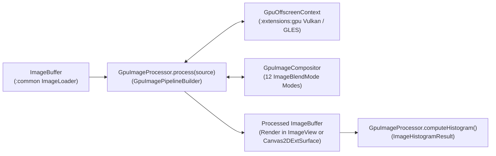

# `:extensions:imageprocessing` — Offscreen GPU Image Filtering, Resampling, & Compositing

> **Navigation**: [**GenericUI Root (`../../README.md`)**](../../README.md) · [**Extensions Index (`../README.md`)**](../README.md) · [**Root Extensions Guide (`../../docs/extensions.md`)**](../../docs/extensions.md) · [**Source Sets (`../../docs/sourcesets.md`)**](../../docs/sourcesets.md) · [**Backends (`../../docs/backends.md`)**](../../docs/backends.md) · [**Gradle Plugin (`../../docs/gradle-plugin.md`)**](../../docs/gradle-plugin.md)

`:extensions:imageprocessing` is a **Single Multiplatform Project** built directly on top of [`:extensions:gpu`](gpu.md) (`GpuDevice`, `GpuOffscreenContext`) and `:common`'s `ImageLoader` / `ImageBuffer`. It enables high-throughput **offscreen GPU image manipulation**—including chainable multi-pass filter pipelines, 12-mode multi-layer compositing, Lanczos-3 resampling, cropping, rotation, and 256-bin RGB + Rec.709 luminance histograms—without requiring an on-screen canvas.

---

## 1. Architecture & Pipeline Flow



All built-in filters implement `ImageFilterOperation`, compiling dual-target **Vulkan `#version 450` (SPIR-V)** and **OpenGL ES `#version 300 es`** shaders on `:extensions:gpu` while guaranteeing a bit-exact CPU fallback when running in headless test environments (`GpuBackendType.SOFTWARE_FALLBACK`).

---

## 2. Gradle Plugin Configuration

Enable `:extensions:imageprocessing` via the [GenericUI Gradle Plugin (`../../docs/gradle-plugin.md`)](../../docs/gradle-plugin.md):

```kotlin
plugins {
    id("com.nexustools.genericui")
}

genericui {
    backends {
        allExceptSwing()
    }
    extensions {
        imageProcessing() // Automatically includes :extensions:imageprocessing and :extensions:gpu
        dsl()             // Optional: for mounting processed ImageBuffers in declarative UI
    }
}
```

---

## 3. Core API Reference (`com.nexustools.genericui.ext.imageprocessing`)

| Class / Interface / Enum | Description & Key Members |
| :--- | :--- |
| `GpuImageProcessor` | Entry-point singleton for offscreen image manipulation. Methods: `process(source, gpu) { ... }: ImageBuffer`, `applyFilter(source, filter, gpu): ImageBuffer`, `crop(source, x, y, width, height): ImageBuffer`, `resizeLanczos(source, targetWidth, targetHeight, a = 3, gpu): ImageBuffer`, `rotate(source, angleDegrees): ImageBuffer`, `composite(base, overlay, offsetX, offsetY, blendMode, opacity, gpu): ImageBuffer`, `computeHistogram(buffer): ImageHistogramResult`. |
| `GpuImagePipelineBuilder` | Fluent multi-pass pipeline builder scoped inside `GpuImageProcessor.process { ... }`. Methods: `brightnessContrast(brightness, contrast)`, `hueSaturationLightness(hueShiftDegrees, saturation, lightness)`, `exposureGamma(exposureEv, gamma)`, `colorMatrix(matrix4x5)`, `levels(inBlack, inWhite, midtoneGamma, outBlack, outWhite)`, `gaussianBlur(radiusPx, sigma)`, `convolution(kernelWidth, kernelHeight, weights, divisor, bias)`, `chromaKey(keyR, keyG, keyB, threshold, feather)`, `vignette(innerRadius, outerRadius, intensity)`, `crop(...)`, `resizeLanczos(...)`, `rotate(...)`, `composite(...)`, `applyFilter(filter)`, `build()`. |
| `GpuImageCompositor` | Offscreen multi-layer compositor: `compositeLayer(base, overlay, offsetX, offsetY, blendMode, opacity, gpu): ImageBuffer`. |
| `ImageBlendMode` | Enum with 12 compositing blend modes: `NORMAL`, `MULTIPLY`, `SCREEN`, `OVERLAY`, `DARKEN`, `LIGHTEN`, `COLOR_DODGE`, `COLOR_BURN`, `HARD_LIGHT`, `SOFT_LIGHT`, `DIFFERENCE`, `ADDITIVE`. |
| `ImageFilterOperation` | Base interface for GPU/fallback image filters (`val name: String`, `fun executeOnGpuOrFallback(input: ImageBuffer, gpu: GpuOffscreenContext): ImageBuffer`). |
| `BrightnessContrastFilter` | Adjusts normalized brightness (`-1.0 .. 1.0`, default `0f`) and contrast (`0.0 .. 4.0`, default `1f`). |
| `HueSaturationLightnessFilter` | Shifts hue in degrees (`-180f .. 180f`), scales saturation (`0f .. 3f`), and offsets lightness (`-1f .. 1f`). |
| `ExposureGammaFilter` | Photographic exposure adjustment in EV stops (`exposureEv`, default `0f`) and gamma correction (`gamma`, default `1f`). |
| `ColorMatrixFilter` | 4x5 RGBA color transformation matrix (`matrix4x5: FloatArray` of size 20), plus presets (`ColorMatrixFilter.sepia()`, `ColorMatrixFilter.grayscale()`, `ColorMatrixFilter.invert()`). |
| `LevelsFilter` | Input/output tonal range remapping (`inBlack`, `inWhite`, `midtoneGamma`, `outBlack`, `outWhite`). |
| `GaussianBlurFilter` | Separable 2D Gaussian blur kernel (`radiusPx: Int = 3`, `sigma: Float = radiusPx / 2f`). |
| `ConvolutionKernelFilter` | Arbitrary `M x N` spatial convolution filter (`kernelWidth`, `kernelHeight`, `weights`, `divisor`, `bias`), suitable for sharpen, emboss, and Sobel edge detection. |
| `ChromaKeyFilter` | Green/blue-screen chroma-key alpha matte extraction (`keyR`, `keyG`, `keyB`, `threshold`, `feather`). |
| `VignetteFilter` | Smooth radial lens falloff (`innerRadius = 0.45f`, `outerRadius = 0.95f`, `intensity = 0.65f`). |
| `ImageHistogramResult` | 256-bin histogram result (`redBins: IntArray`, `greenBins: IntArray`, `blueBins: IntArray`, `luminanceBins: IntArray`, `totalPixels: Int`, `peakLuminanceBin(): Int`, `meanLuminance(): Float`). |

---

## 4. Imperative Kotlin Examples

### Example 1: Multi-Pass Offscreen GPU Filter Pipeline & Histogram Analysis

```kotlin
import com.nexustools.genericui.ext.imageprocessing.GpuImageProcessor
import com.nexustools.genericui.ext.imageprocessing.ImageBlendMode
import com.nexustools.genericui.image.ImageBuffer

fun gradeAndCompositeFrame(
    rawCameraFrame: ImageBuffer,
    watermarkLogo: ImageBuffer
): ImageBuffer {
    // Run a multi-pass offscreen GPU pipeline
    val graded = GpuImageProcessor.process(rawCameraFrame) {
        // 1. Key out green screen background
        chromaKey(keyR = 0, keyG = 255, keyB = 0, threshold = 0.22f, feather = 0.08f)

        // 2. Color grade: exposure, levels, and HSL boost
        exposureGamma(exposureEv = 0.35f, gamma = 1.05f)
        levels(inBlack = 0.04f, inWhite = 0.96f, midtoneGamma = 1.1f)
        hueSaturationLightness(hueShiftDegrees = -4f, saturation = 1.18f, lightness = 0.02f)
        brightnessContrast(brightness = 0.03f, contrast = 1.12f)

        // 3. Apply a 3x3 unsharp/sharpen convolution kernel
        convolution(
            kernelWidth = 3,
            kernelHeight = 3,
            weights = floatArrayOf(
                 0f, -1f,  0f,
                -1f,  5f, -1f,
                 0f, -1f,  0f
            )
        )

        // 4. Add subtle lens vignette and Lanczos-3 downscale to 1080p
        vignette(innerRadius = 0.50f, outerRadius = 0.98f, intensity = 0.40f)
        resizeLanczos(targetWidth = 1920, targetHeight = 1080, a = 3)

        // 5. Composite a watermark overlay using SCREEN blend mode
        composite(
            overlay = watermarkLogo,
            offsetX = 1920 - watermarkLogo.width - 32,
            offsetY = 1080 - watermarkLogo.height - 32,
            blendMode = ImageBlendMode.SCREEN,
            opacity = 0.85f
        )
    }

    // Compute 256-bin RGB + Rec.709 Luminance histogram
    val histogram = GpuImageProcessor.computeHistogram(graded)
    println("Processed ${histogram.totalPixels} pixels • Mean Luminance: ${histogram.meanLuminance()}")

    return graded
}
```

### Example 2: Standalone Filter & Multi-Layer Compositing

```kotlin
import com.nexustools.genericui.ext.imageprocessing.ColorMatrixFilter
import com.nexustools.genericui.ext.imageprocessing.GaussianBlurFilter
import com.nexustools.genericui.ext.imageprocessing.GpuImageCompositor
import com.nexustools.genericui.ext.imageprocessing.GpuImageProcessor
import com.nexustools.genericui.ext.imageprocessing.ImageBlendMode
import com.nexustools.genericui.image.ImageBuffer

fun createBlurredGlowBackdrop(baseLayer: ImageBuffer, foregroundLayer: ImageBuffer): ImageBuffer {
    val blurredBackdrop = GpuImageProcessor.applyFilter(
        source = baseLayer,
        filter = GaussianBlurFilter(radiusPx = 8, sigma = 4.0f)
    )
    return GpuImageCompositor.compositeLayer(
        base = blurredBackdrop,
        overlay = foregroundLayer,
        offsetX = 24,
        offsetY = 24,
        blendMode = ImageBlendMode.OVERLAY,
        opacity = 0.92f
    )
}
```

---

## 5. Declarative `:dsl` Integration (with `:extensions:dsl` & `:extensions:canvas2d:dsl`)

Combine `:extensions:imageprocessing` with [`:extensions:dsl`](dsl.md) and [`:extensions:canvas2d`](canvas2d.md) to render GPU-processed `ImageBuffer` results inside declarative layouts:

```kotlin
import com.nexustools.genericui.ext.canvas2d.dsl.canvas2DExt
import com.nexustools.genericui.ext.dsl.buildDiv
import com.nexustools.genericui.ext.dsl.button
import com.nexustools.genericui.ext.dsl.hstack
import com.nexustools.genericui.ext.dsl.span
import com.nexustools.genericui.ext.imageprocessing.GpuImageProcessor
import com.nexustools.genericui.image.ImageBuffer

fun buildPhotoFilterPreview(sourceImage: ImageBuffer) = buildDiv(classes = "p-3") {
    var currentBuffer = sourceImage

    val previewSurface = canvas2DExt(
        width = sourceImage.width,
        height = sourceImage.height,
        onRender = { _, _, _, _ ->
            // Draw the latest GPU-processed ImageBuffer onto the 2D canvas
        }
    ) {
        drawImage(currentBuffer, 0f, 0f)
    }

    val histogramLabel = span("Pixels: ${sourceImage.pixelCount}")

    hstack(classes = "gap-2 mt-2") {
        button("Apply Warm Grade + Blur") {
            onClick = {
                currentBuffer = GpuImageProcessor.process(currentBuffer) {
                    hueSaturationLightness(hueShiftDegrees = 8f, saturation = 1.25f, lightness = 0.04f)
                    gaussianBlur(radiusPx = 2, sigma = 1.0f)
                }
                previewSurface.drawImage(currentBuffer, 0f, 0f)
                val hist = GpuImageProcessor.computeHistogram(currentBuffer)
                histogramLabel.text = "Mean Lum: ${hist.meanLuminance()}"
            }
        }
    }
}
```

---

## 6. Related Extensions & Cross-References

- **Related Extensions**:
  - [`:extensions:gpu` (`gpu.md`)](gpu.md) — Provides `GpuDevice`, `GpuOffscreenContext`, `GpuTexture`, and `GpuShaderProgram`.
  - [`:extensions:canvas2d` (`canvas2d.md`)](canvas2d.md) — Draws and extracts `ImageBuffer` instances via `Canvas2DExtSurface.drawImage()` and `toImageBuffer()`, and provides `CurveEditorExt` for LUT generation.
  - [`:extensions:media` (`media.md`)](media.md) — Processes decoded video frames on the GPU using `VideoPlayerExt.processVideoFrameOnGpu()`.
  - [`:extensions:dsl` (`dsl.md`)](dsl.md) — Declarative Kotlin UI & Style DSL.
- **Root & Backend Documentation**:
  - [GenericUI Root (`../../README.md`)](../../README.md) · [Extensions Architecture (`../../docs/extensions.md`)](../../docs/extensions.md) · [Source Sets (`../../docs/sourcesets.md`)](../../docs/sourcesets.md) · [Backends (`../../docs/backends.md`)](../../docs/backends.md) · [Gradle Plugin (`../../docs/gradle-plugin.md`)](../../docs/gradle-plugin.md)
  - [Desktop Backends (`../../desktop/README.md`)](../../desktop/README.md) · [Mobile Backends (`../../mobile/README.md`)](../../mobile/README.md) · [Web Backend (`../../web/README.md`)](../../web/README.md)
