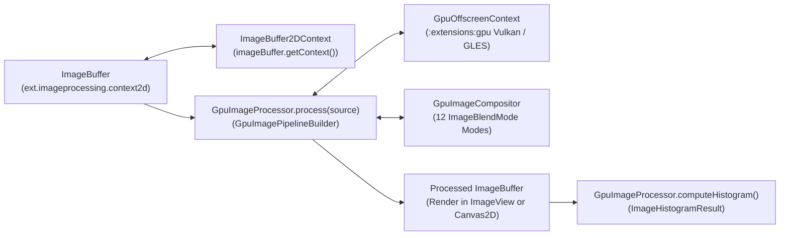

# `:extensions:imageprocessing` — Offscreen GPU Image Filtering, Resampling, Compositing, & `ImageBuffer2DContext`

> **Navigation**: [**GenericUI Root (`../../README.md`)**](../../README.md) · [**Extensions Index (`../README.md`)**](../README.md) · [**Root Extensions Guide (`../../docs/extensions.md`)**](../../docs/extensions.md) · [**Source Sets (`../../docs/sourcesets.md`)**](../../docs/sourcesets.md) · [**Backends (`../../docs/backends.md`)**](../../docs/backends.md) · [**Gradle Plugin (`../../docs/gradle-plugin.md`)**](../../docs/gradle-plugin.md)

`:extensions:imageprocessing` is built directly on top of [`:extensions:gpu`](gpu.md) (`GpuDevice`, `GpuOffscreenContext`) and `:common`'s `ImageLoader` / `ImageBuffer`. It provides both:
1. **Universal Hardware-Accelerated `ImageBuffer` & `ImageBuffer2DContext` (`com.nexustools.genericui.ext.imageprocessing.context2d`)**:
   - `ImageBuffer` extends `:common`'s `ImageBuffer` and exposes `imageBuffer.getContext(): ImageBuffer2DContext` (`context2D`) with **100% HTML5 2D Context feature parity** using strongly-typed `ImageBuffer*` enums and value types (`ImageBufferCompositeOperation`, `ImageBufferLineCap`, `ImageBufferLineJoin`, `ImageBufferFillRule`, `ImageBufferTextAlign`, `ImageBufferTextBaseline`, `ImageBufferTextDirection`, `ImageBufferFontStyle`, `ImageBufferFontKerning`, `ImageBufferFontStretch`, `ImageBufferFontVariantCaps`, `ImageBufferTextRendering`, `ImageBufferImageSmoothingQuality`, `ImageBufferPatternRepetition`, `ImageBufferPaintStyle`, `ImageBufferGradient2D`, `ImageBufferPattern2D`, `ImageBufferMatrix2D`, `ImageBufferPath2D`, `ImageBufferTextMetrics`, and `ScalableVectorFontEngine`).
   - On **System targets** (`:extensions:imageprocessing:sharedSystem`), `SystemGpuImageBuffer` and `GpuAcceleratedContext2DBackend` execute 12 hardware **Vulkan (`#version 450`)** and **OpenGL ES (`#version 300 es`)** shaders (`GpuContext2DShaderCatalog`) and support optional double buffering (`doubleBuffer = true`) and `ImageBufferDirtyListener` tracking.
   - On **Web targets** (`:extensions:imageprocessing:web`), `WebImageBuffer` and `WebImageBuffer2DContext` operate directly on the browser's 2D surface with `enableDirtyTracking = false`.
2. **Offscreen GPU Filter Pipelines & Compositing (`com.nexustools.genericui.ext.imageprocessing`)**:
   - Chainable multi-pass filter pipelines (`GpuImageProcessor`), 12-mode multi-layer compositing (`GpuImageCompositor`), Lanczos-3 resampling, cropping, rotation, and 256-bin RGB + Rec.709 luminance histograms (`ImageHistogramResult`).

---

## 1. Architecture & Pipeline Flow



---

## 2. Gradle Plugin Configuration

Enable `:extensions:imageprocessing` via the [GenericUI Gradle Plugin (`../../docs/gradle-plugin.md`)](../../docs/gradle-plugin.md):

```kotlin
plugins {
    id("com.nexustools.genericui")
}

genericui {
    backends {
        allExceptSwing()
    }
    extensions {
        imageProcessing() // Automatically includes :extensions:imageprocessing and :extensions:gpu
        dsl()             // Optional: for mounting processed ImageBuffers in declarative UI
    }
}
```

---

## 3. Core API Reference

### 3.1 `ImageBuffer` & `ImageBuffer2DContext` (`com.nexustools.genericui.ext.imageprocessing.context2d`)

| Class / Interface / Enum | Description & Key Members |
| :--- | :--- |
| `ImageBuffer` | Hardware-accelerated 2D surface extending `:common`'s `ImageBuffer`. Key members: `doubleBuffer: Boolean`, `context2D: ImageBuffer2DContext`, `getContext("2d"): ImageBuffer2DContext`, `isDirty`, `addDirtyListener`, `removeDirtyListener`, `markDirty`, `flush()`, `swapBuffers()`, `ImageBuffer.create(width, height, doubleBuffer, antialias)`. |
| `ImageBuffer2DContext` | 100% HTML5 2D Context interface operating on `ImageBuffer`. Supports state stack (`save`, `restore`, `reset`), 2D matrix transforms (`scale`, `rotate`, `translate`, `transform`, `setTransform`, `getTransform`, `resetTransform`), 26 composite operations (`globalCompositeOperation: ImageBufferCompositeOperation`), gradients & patterns (`fillStyle`, `strokeStyle`, `createLinearGradient`, `createRadialGradient`, `createConicGradient`, `createPattern`), shadows (`shadowBlur`, `shadowColor`, `shadowOffsetX`, `shadowOffsetY`), paths (`beginPath`, `moveTo`, `lineTo`, `quadraticCurveTo`, `bezierCurveTo`, `arcTo`, `arc`, `ellipse`, `rect`, `roundRect`, `fill`, `stroke`, `clip`, `isPointInPath`, `isPointInStroke`), SDF typography (`fillText`, `strokeText`, `measureText`), and 3/5/9-arg `drawImage` + `createImageData` / `getImageData` / `putImageData`. |
| `ImageBufferPath2D` | Retained reusable 2D vector path supporting `addPath`, subpaths, cubic/quadratic Bezier flattening, and analytical hit testing (`containsPoint`, `isPointNearStroke`). |
| `ImageBufferMatrix2D` | 3x2 affine transformation matrix (`a, b, c, d, e, f`) with `translated`, `scaled`, `rotated`, `multiplied`, `inverted`, and `mapPoint`. |
| `ImageBufferGradient2D` | Multi-stop linear, radial, and conic gradient (`addColorStop(offset, color)`, `sampleAt(x, y)`). |
| `ImageBufferPattern2D` | Repeating image pattern (`ImageBufferPatternRepetition`: `REPEAT`, `REPEAT_X`, `REPEAT_Y`, `NO_REPEAT`) with optional local `setTransform(ImageBufferMatrix2D)`. |
| `ScalableVectorFontEngine` | Built-in analytical SDF vector font engine rendering proportional glyphs at any size, weight (`100..900`), `ImageBufferFontStyle`, `ImageBufferFontStretch`, and `ImageBufferFontVariantCaps`, returning full `ImageBufferTextMetrics`. |
| `ImageBufferCompositeOperation` | All 26 Porter-Duff and W3C compositing & blend modes (`SOURCE_OVER`, `SOURCE_IN`, `SOURCE_OUT`, `SOURCE_ATOP`, `DESTINATION_OVER`, `DESTINATION_IN`, `DESTINATION_OUT`, `DESTINATION_ATOP`, `LIGHTER`, `COPY`, `XOR`, `MULTIPLY`, `SCREEN`, `OVERLAY`, `DARKEN`, `LIGHTEN`, `COLOR_DODGE`, `COLOR_BURN`, `HARD_LIGHT`, `SOFT_LIGHT`, `DIFFERENCE`, `EXCLUSION`, `HUE`, `SATURATION`, `COLOR`, `LUMINOSITY`). |

### 3.2 Offscreen Filter Pipeline (`com.nexustools.genericui.ext.imageprocessing`)

| Class / Interface / Enum | Description & Key Members |
| :--- | :--- |
| `GpuImageProcessor` | Entry-point singleton for offscreen image manipulation (`process`, `applyFilter`, `crop`, `resizeLanczos`, `rotate`, `composite`, `computeHistogram`). |
| `GpuImagePipelineBuilder` | Fluent multi-pass pipeline builder scoped inside `GpuImageProcessor.process { ... }`. |
| `GpuImageCompositor` | Offscreen multi-layer compositor (`compositeLayer`). |
| `ImageBlendMode` | Enum with 12 compositing blend modes (`NORMAL`, `MULTIPLY`, `SCREEN`, `OVERLAY`, `DARKEN`, `LIGHTEN`, `COLOR_DODGE`, `COLOR_BURN`, `HARD_LIGHT`, `SOFT_LIGHT`, `DIFFERENCE`, `ADDITIVE`). |
| `ImageHistogramResult` | 256-bin histogram result (`redBins`, `greenBins`, `blueBins`, `luminanceBins`, `totalPixels`, `peakLuminanceBin()`, `meanLuminance()`). |

---

## 4. Imperative Kotlin Examples

### Example 1: Offscreen 2D Vector/Text Drawing Directly on `ImageBuffer`

```kotlin
import com.nexustools.genericui.ext.imageprocessing.context2d.ImageBuffer
import com.nexustools.genericui.ext.imageprocessing.context2d.ImageBufferFontStyle
import com.nexustools.genericui.ext.imageprocessing.context2d.ImageBufferPath2D
import com.nexustools.genericui.style.RgbaColor

fun renderBadgeImageBuffer(): ImageBuffer {
    val buffer = ImageBuffer.create(width = 320, height = 120, doubleBuffer = false)
    val ctx = buffer.getContext()

    val gradient = ctx.createLinearGradient(0f, 0f, 320f, 120f).apply {
        addColorStop(0f, RgbaColor(30, 64, 175, 255))
        addColorStop(1f, RgbaColor(14, 165, 233, 255))
    }
    ctx.setFillGradient(gradient)

    val pill = ImageBufferPath2D().apply {
        roundRect(8f, 8f, 304f, 104f, 24f)
    }
    ctx.fill(pill)

    ctx.setFont("sans-serif", fontSizePx = 28f, fontWeight = 700, fontStyle = ImageBufferFontStyle.NORMAL)
    ctx.setFillColor(RgbaColor.WHITE)
    ctx.fillText("GenericUI 2D Context", 28f, 70f)

    buffer.flush()
    return buffer
}
```

### Example 2: Multi-Pass Offscreen GPU Filter Pipeline & Histogram Analysis

```kotlin
import com.nexustools.genericui.ext.imageprocessing.GpuImageProcessor
import com.nexustools.genericui.ext.imageprocessing.ImageBlendMode
import com.nexustools.genericui.image.ImageBuffer

fun gradeAndCompositeFrame(
    rawCameraFrame: ImageBuffer,
    watermarkLogo: ImageBuffer
): ImageBuffer {
    val graded = GpuImageProcessor.process(rawCameraFrame) {
        chromaKey(keyR = 0, keyG = 255, keyB = 0, threshold = 0.22f, feather = 0.08f)
        exposureGamma(exposureEv = 0.35f, gamma = 1.05f)
        levels(inBlack = 0.04f, inWhite = 0.96f, midtoneGamma = 1.1f)
        hueSaturationLightness(hueShiftDegrees = -4f, saturation = 1.18f, lightness = 0.02f)
        brightnessContrast(brightness = 0.03f, contrast = 1.12f)
        vignette(innerRadius = 0.50f, outerRadius = 0.98f, intensity = 0.40f)
        resizeLanczos(targetWidth = 1920, targetHeight = 1080, a = 3)
        composite(
            overlay = watermarkLogo,
            offsetX = 1920 - watermarkLogo.width - 32,
            offsetY = 1080 - watermarkLogo.height - 32,
            blendMode = ImageBlendMode.SCREEN,
            opacity = 0.85f
        )
    }

    val histogram = GpuImageProcessor.computeHistogram(graded)
    println("Processed ${histogram.totalPixels} pixels • Mean Luminance: ${histogram.meanLuminance()}")
    return graded
}
```

---

## 5. Related Extensions & Cross-References

- [`:extensions:gpu` (`gpu.md`)](gpu.md) — Provides `GpuDevice`, `GpuOffscreenContext`, `GpuTexture`, `GpuShaderProgram`, `AbstractCanvas`, and `VBlankWatcher`.
- [`:extensions:canvas2d` (`canvas2d.md`)](canvas2d.md) — Uses a double-buffered `ImageBuffer` (`doubleBuffer = true`) and `ImageBuffer2DContext` as the surface of `Canvas2D` and `Canvas2DExtSurface`.
- [`:extensions:media` (`media.md`)](media.md) — Processes decoded video frames on the GPU using `VideoPlayerExt.processVideoFrameOnGpu()`.
- [`:extensions:dsl` (`dsl.md`)](dsl.md) — Declarative Kotlin UI & Style DSL.
