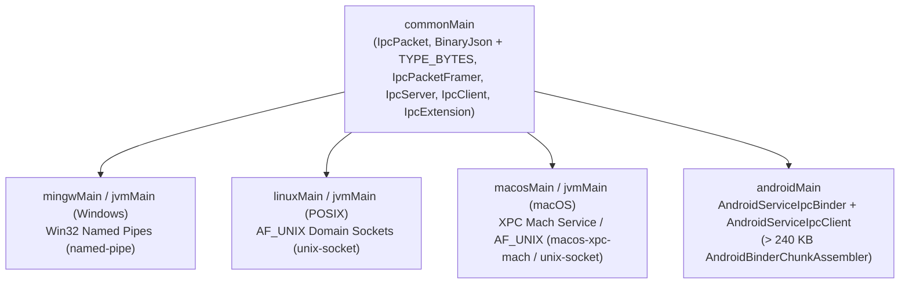

# `:extensions:system:ipc` — Target-Scoped Desktop Pipes/Sockets/XPC & Android `Service` Binder IPC

> **Navigation**: [**GenericUI Root (`../../README.md`)**](../../README.md) · [**Extensions Index (`../README.md`)**](../README.md) · [**Root Extensions Guide (`../../docs/extensions.md`)**](../../docs/extensions.md) · [**Source Sets (`../../docs/sourcesets.md`)**](../../docs/sourcesets.md) · [**Backends (`../../docs/backends.md`)**](../../docs/backends.md) · [**Gradle Plugin (`../../docs/gradle-plugin.md`)**](../../docs/gradle-plugin.md)

`:extensions:system:ipc` (`com.nexustools.genericui.ext.ipc`) provides low-level, cross-process Inter-Process Communication primitives framed over length-prefixed `:common` **`BinaryJson`** packets (`IpcPacket` with `PreferenceElement` payloads including raw `TYPE_BYTES` byte buffers).

> [!IMPORTANT]
> **Strict Target Scoping (Desktop + Android Only; Zero Web / iOS / `:dsl`)**:
> - `:extensions:system:ipc` compiles **exclusively** for **Desktop (`jvm` / Swing, `macosArm64`, `mingwX64`, `linuxX64`, `linuxArm64`)** and **Android (`android`)** targets. It defines **zero `web` (`js` / `wasmJs`)** and **zero `ios` (`iosArm64` / `iosSimulatorArm64`)** source sets or targets, and has **no `:dsl` companion module**.
> - `GenericUiExtensionsConfig` automatically excludes `:extensions:system:ipc` from non-Desktop, non-Android targets (`web`, `ios`, `ipados`), and enables it automatically on Desktop + Android when `serviceWorker()` is active or on Desktop when `webView()` is active.
> - On **Android**, `IpcPlatformExtensionInfo.isSupported` reports `false` for desktop socket/pipe `IpcServer`/`IpcClient` endpoints; Android applications instead use the dedicated Android Service Binder helpers ([`AndroidServiceIpcBinder`](../system/ipc/src/androidMain/kotlin/com/nexustools/genericui/ext/ipc/AndroidServiceIpcBinder.kt) and [`AndroidServiceIpcClient`](../system/ipc/src/androidMain/kotlin/com/nexustools/genericui/ext/ipc/AndroidServiceIpcClient.kt)).

---

## 1. Platform Transport Matrix



| Target Backend | Source Set | `IpcExtension.isSupported` (Pipe/Socket `IpcServer`/`IpcClient`) | Transport Mechanism & Notes |
| :--- | :--- | :---: | :--- |
| **Windows (`:windows`)** | `mingwMain` | **`true`** | Win32 Named Pipes (`IpcChannelAddress.TRANSPORT_WINDOWS_NAMED_PIPE = "named-pipe"`, `\\.\pipe\...`). |
| **macOS (`:macos`)** | `macosMain` | **`true`** | macOS XPC Mach service / `AF_UNIX` domain sockets (`TRANSPORT_MACOS_XPC_MACH = "macos-xpc-mach"`, `TRANSPORT_UNIX_SOCKET = "unix-socket"`). |
| **Linux (`:gtk`, `:kde`)** | `linuxMain` | **`true`** | Kernel-native `AF_UNIX` domain sockets (`TRANSPORT_UNIX_SOCKET = "unix-socket"`). |
| **Desktop JVM (`:swing`)** | `jvmMain` | **`true`** | Native Windows Named Pipes on Windows hosts or JDK `AF_UNIX` sockets on macOS/Linux hosts. |
| **Android (`:android`)** | `androidMain` | `false` *(desktop sockets)* | Dedicated Binder IPC helpers ([`AndroidServiceIpcBinder`](../system/ipc/src/androidMain/kotlin/com/nexustools/genericui/ext/ipc/AndroidServiceIpcBinder.kt), [`AndroidServiceIpcClient`](../system/ipc/src/androidMain/kotlin/com/nexustools/genericui/ext/ipc/AndroidServiceIpcClient.kt), `DeathRecipient`, and `> 240 KB` parcel chunking). |
| **iOS / iPadOS / Web** | *Not targeted* | *Excluded* | Extension module is not compiled or linked on `ios`, `ipados`, or `web` targets. |

---

## 2. Gradle Plugin Configuration

Enable `ipc()` explicitly in `build.gradle.kts` (or implicitly via `serviceWorker()` on Desktop/Android or `webView()` on Desktop):

```kotlin
plugins {
    id("com.nexustools.genericui")
}

genericui {
    app {
        id = "com.example.ipchost"
        name = "IPC Host"
    }
    backends {
        windows()
        macos()
        gtk()
        kde()
        swing()
        android()
    }
    extensions {
        ipc() // Wires :extensions:system:ipc ONLY for Desktop + Android targets (never web/ios/ipados)
    }
}
```

At startup on Desktop and Android, generated launchers invoke `com.nexustools.genericui.ext.ipc.IpcExtension.registerProviders()`, which registers `IpcPacket.CODEC` in `DataClassCodecRegistry` and records `"ipc.supported"` and `"ipc.backend"` in `GenericUiExtensionRegistry`.

---

## 3. Core API Reference (`com.nexustools.genericui.ext.ipc`)

### 3.1 Cross-Platform Framed `BinaryJson` Packets & Desktop Sockets/Pipes

| Symbol | File | Description & Key Members |
| :--- | :--- | :--- |
| **`IpcExtension`** | [`IpcExtension.kt`](../system/ipc/src/commonMain/kotlin/com/nexustools/genericui/ext/ipc/IpcExtension.kt) | Exposes `isSupported`, `backendName`, and `registerProviders()`. |
| **`IpcPacket`** | [`IpcPacket.kt`](../system/ipc/src/commonMain/kotlin/com/nexustools/genericui/ext/ipc/IpcPacket.kt) | `@BinarySerializable data class IpcPacket(id: Long = 0L, type: String, channel: String = "", payload: PreferenceElement = PreferenceElement.Null, replyToId: Long? = null, error: String? = null, headers: Map<String, String> = emptyMap())` with `toPreferenceElement()`, `toBinaryJsonBytes()`, `CODEC`, `fromPreferenceElement(...)`, and `fromBinaryJsonBytes(...)`. Preserves raw `PreferenceElement.ofBytes(...)` (`TYPE_BYTES`) buffers without Base64 encoding (used for dirty RGBA tiles in out-of-process `WebView`). |
| **`IpcPacketFramer`** | [`IpcPacketFramer.kt`](../system/ipc/src/commonMain/kotlin/com/nexustools/genericui/ext/ipc/IpcPacketFramer.kt) | 4-byte big-endian length-prefixed framing (`MAX_PACKET_BYTES = 16 * 1024 * 1024`, `encodeFrame`, `framePacket`, `decodePacket`, `writeIntBE`, `readIntBE`). |
| **`IpcConfig`** | [`IpcConfig.kt`](../system/ipc/src/commonMain/kotlin/com/nexustools/genericui/ext/ipc/IpcConfig.kt) | Transport timeouts and buffer sizing (`connectTimeoutMs = 5_000`, `maxPacketBytes = 16 * 1024 * 1024`, `pipeBufferSizeBytes = 65_536`). |
| **`IpcChannelAddress`** | [`IpcChannelAddress.kt`](../system/ipc/src/commonMain/kotlin/com/nexustools/genericui/ext/ipc/IpcChannelAddress.kt) | Resolves OS-specific endpoints via `resolveDesktopEndpoint(...)` (`TRANSPORT_WINDOWS_NAMED_PIPE`, `TRANSPORT_UNIX_SOCKET`, `TRANSPORT_MACOS_XPC_MACH`). |
| **`IpcServer`** | [`IpcServer.kt`](../system/ipc/src/commonMain/kotlin/com/nexustools/genericui/ext/ipc/IpcServer.kt) | Local IPC server: `address`, `isRunning`, `start(channelName, runtimeDir = "", config = IpcConfig(), onClientConnected: (IpcConnection) -> Unit): Boolean`, `close()`. |
| **`IpcClient`** | [`IpcClient.kt`](../system/ipc/src/commonMain/kotlin/com/nexustools/genericui/ext/ipc/IpcClient.kt) | Connects to a local server via `IpcClient.connect(address, timeoutMs = 5_000, config = IpcConfig()): IpcConnection?`. |
| **`IpcConnection`** & **`IpcConnectionState`** | [`IpcConnection.kt`](../system/ipc/src/commonMain/kotlin/com/nexustools/genericui/ext/ipc/IpcConnection.kt) | Connection handle exposing `state`, `isClosed`, `sendPacket(packet)`, `receivePacket()`, `sendBody(bytes)`, `readBody()`, and `close()`. |
| **`IpcException`** | [`IpcException.kt`](../system/ipc/src/commonMain/kotlin/com/nexustools/genericui/ext/ipc/IpcException.kt) | Typed IPC exception subclassing `GenericUiException`. |

### 3.2 Android `Service` Binder Helpers (`androidMain`)

| Symbol | File | Description & Key Members |
| :--- | :--- | :--- |
| **`AndroidServiceIpcBinder`** | [`AndroidServiceIpcBinder.kt`](../system/ipc/src/androidMain/kotlin/com/nexustools/genericui/ext/ipc/AndroidServiceIpcBinder.kt) | Server-side `android.os.Binder` implementation returning from `Service.onBind(intent)`. Supports `PING`, synchronous request/reply (`onPacketReceived`), `IBinder.DeathRecipient` client callback tracking, automatic chunk reassembly/splitting, `dispatchToClient`, `broadcastPacket`, and `sendToCallback`. |
| **`AndroidServiceIpcClient`** | [`AndroidServiceIpcClient.kt`](../system/ipc/src/androidMain/kotlin/com/nexustools/genericui/ext/ipc/AndroidServiceIpcClient.kt) | Client-side `ServiceConnection` + `IBinder.DeathRecipient` wrapper with `bind(serviceIntent, flags)`, `attachBinder(...)`, `sendPacket(...)`, `requestPacket(...)`, `ping()`, `setOnPacketReceived(...)`, `setOnConnectionStateChanged(...)`, and `unbind()`. |
| **`AndroidServiceIpcProtocol`** | [`AndroidServiceIpcProtocol.kt`](../system/ipc/src/androidMain/kotlin/com/nexustools/genericui/ext/ipc/AndroidServiceIpcProtocol.kt) | Transaction codes (`TRANSACT_SEND_PACKET`, `TRANSACT_CHUNK_*`, `CALLBACK_TRANSACT_*`) and direct parcel cap `MAX_DIRECT_PARCEL_BYTES = 240 * 1024`. |
| **`AndroidBinderChunkAssembler`** | [`AndroidBinderChunkAssembler.kt`](../system/ipc/src/androidMain/kotlin/com/nexustools/genericui/ext/ipc/AndroidBinderChunkAssembler.kt) | Splits and reassembles `BinaryJson`-encoded `IpcPacket` payloads exceeding Android Binder's direct transaction limit (`> 240 KB`), pruning stale transfers cleanly. |

---

## 4. Usage Examples

### 4.1 Desktop Server & Client (`BinaryJson` + `PreferenceElement.ofBytes`)

```kotlin
import com.nexustools.genericui.component.system.PreferenceElement
import com.nexustools.genericui.ext.ipc.IpcClient
import com.nexustools.genericui.ext.ipc.IpcPacket
import com.nexustools.genericui.ext.ipc.IpcServer

fun runDesktopIpcRoundTrip(tileRgba: ByteArray) {
    val server = IpcServer()
    val started = server.start(channelName = "worker-channel") { conn ->
        val incoming = conn.receivePacket()
        if (incoming != null) {
            conn.sendPacket(
                IpcPacket(
                    id = 2L,
                    type = "tile.ack",
                    channel = incoming.channel,
                    replyToId = incoming.id
                )
            )
        }
        conn.close()
    }
    val address = server.address
    if (!started || address == null) return

    val client = IpcClient.connect(address) ?: return
    client.sendPacket(
        IpcPacket(
            id = 1L,
            type = "tile.frame",
            channel = "webview",
            payload = PreferenceElement.ofObject(
                mapOf(
                    "width" to PreferenceElement.ofInt(128),
                    "height" to PreferenceElement.ofInt(128),
                    "rgba" to PreferenceElement.ofBytes(tileRgba)
                )
            )
        )
    )
    val reply = client.receivePacket()
    client.close()
    server.close()
}
```

### 4.2 Android `Service` Binder Bridge (`AndroidServiceIpcBinder` & `AndroidServiceIpcClient`)

```kotlin
// In src/androidMain/kotlin/...
import android.app.Service
import android.content.Context
import android.content.Intent
import android.os.IBinder
import com.nexustools.genericui.component.system.PreferenceElement
import com.nexustools.genericui.ext.ipc.AndroidServiceIpcBinder
import com.nexustools.genericui.ext.ipc.AndroidServiceIpcClient
import com.nexustools.genericui.ext.ipc.IpcPacket

class WorkerSyncService : Service() {
    private val binder = AndroidServiceIpcBinder { packet ->
        IpcPacket(
            id = packet.id,
            type = "sync.ack",
            channel = packet.channel,
            replyToId = packet.id,
            payload = PreferenceElement.ofString("ok")
        )
    }

    override fun onBind(intent: Intent?): IBinder = binder
}

fun bindWorkerService(context: Context): AndroidServiceIpcClient =
    AndroidServiceIpcClient(context).apply {
        setOnPacketReceived { pushed ->
            println("Received async service packet: ${pushed.type}")
        }
        bind(Intent(context, WorkerSyncService::class.java))
    }
```

---

## 5. Related Consumers & Documentation

- [`:extensions:ui:webview` (`webview.md`)](webview.md) — Uses `:extensions:system:ipc` (`BinaryJson` + `TYPE_BYTES` dirty RGBA tiles) on Desktop/Swing to isolate the Alien + Stylesheet + SVG + Canvas2D + Canvas3D + Media + NJS worker subprocess.
- [`:extensions:system:serviceworker` (`serviceworker.md`)](serviceworker.md) — Desktop background worker daemon & Android foreground service coordination built atop OS-native IPC channels.
- [GenericUI Root (`../../README.md`)](../../README.md) · [Extensions Architecture (`../../docs/extensions.md`)](../../docs/extensions.md) · [Gradle Plugin (`../../docs/gradle-plugin.md`)](../../docs/gradle-plugin.md)
