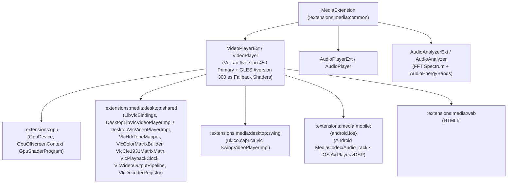

# `:extensions:media` & `:extensions:media:dsl` — Cross-Platform Video/Audio Playback, Desktop VLC HDR Pipeline, & FFT Audio Analysis

> **Navigation**: [**GenericUI Root (`../../README.md`)**](../../README.md) · [**Extensions Index (`../README.md`)**](../README.md) · [**Root Extensions Guide (`../../docs/extensions.md`)**](../../docs/extensions.md) · [**Source Sets (`../../docs/sourcesets.md`)**](../../docs/sourcesets.md) · [**Backends (`../../docs/backends.md`)**](../../docs/backends.md) · [**Gradle Plugin (`../../docs/gradle-plugin.md`)**](../../docs/gradle-plugin.md)

`:extensions:media` is a **Project-of-Projects** extension providing hardware-accelerated `VideoPlayerExt` (`VideoPlayer`), `AudioPlayerExt` (`AudioPlayer`), real-time FFT `AudioAnalyzerExt` (`AudioAnalyzer`, `AudioEnergyBands`), OS-level `MediaSessionManager`, and `WebVttSrtParser` subtitle parsing.

> [!IMPORTANT]
> **Strict Architectural Ownership of Desktop VLC & HDR Code**:
> All desktop VLC video/audio decoding, HDR tone-mapping, CIE 1931 color matrices, master playback clock synchronization, and GPU video output shaders live **exclusively inside `:extensions:media:desktop`** (and **never** inside `:desktop` core UI toolkits). Core desktop UI backends ([`../../desktop/README.md`](../../desktop/README.md)) remain lightweight windowing/widget toolkits, while `:extensions:media:desktop` owns the entire `libvlc` / `vlcj` + `:extensions:gpu` HDR multimedia stack.

---

## 1. Architecture & Platform Media Engine Matrix



| Target Family | Submodule | Media & Audio Engine | GPU Color & HDR Pipeline | Backend Documentation |
| :--- | :--- | :--- | :--- | :--- |
| **Desktop Native (`:windows`, `:macos`, `:gtk`, `:qt`)** | `:extensions:media:desktop:{shared,windows,macos,gtk,qt}` | Native `libvlc` C API (`LibVlcBindings`, `DesktopLibVlcVideoPlayerImpl` / `DesktopVlcVideoPlayerImpl`, `DesktopLibVlcAudioPlayerImpl`, `DesktopLibVlcAudioAnalyzerImpl`) | **Vulkan `#version 450` SPIR-V Primary** + **OpenGL ES `#version 300 es` / Google ANGLE Fallback** via `:extensions:gpu` | [Desktop Backends (`../../desktop/README.md`)](../../desktop/README.md) |
| **Desktop JVM (`:swing`)** | `:extensions:media:desktop:swing` | `libvlcj` (`uk.co.caprica:vlcj` via `SwingVideoPlayerImpl`, `SwingAudioPlayerImpl`, `SwingAudioAnalyzerImpl`) | LWJGL 3 Vulkan / OpenGL ES via `:extensions:gpu:desktop:swing` | [Desktop Backends (`../../desktop/README.md`)](../../desktop/README.md) |
| **Android (`:android`)** | `:extensions:media:mobile:android` | Android `MediaPlayer` / `MediaCodec` + `Visualizer` FFT (`AndroidVideoPlayerImpl`, `AndroidAudioAnalyzerImpl`) | Vulkan 1.1+ / EGL14 GLES 3.0 via `:extensions:gpu:mobile:android` | [Mobile Backends (`../../mobile/README.md`)](../../mobile/README.md) |
| **iOS (`:ios`)** | `:extensions:media:mobile:ios` | Apple `AVPlayer` + `MTAudioProcessingTap` / Accelerate `vDSP` FFT (`IosVideoPlayerImpl`, `IosAudioAnalyzerImpl`) | MoltenVK / Metal / EAGL via `:extensions:gpu:mobile:ios` | [Mobile Backends (`../../mobile/README.md`)](../../mobile/README.md) |
| **Web (`:web`)** | `:extensions:media:web` | HTML5 `<video>`, `<audio>`, and Web Audio API `AnalyserNode` (`WebVideoPlayerImpl`, `WebAudioAnalyzerImpl`) | WebGPU / WebGL2 via `:extensions:gpu:web` | [Web Backend (`../../web/README.md`)](../../web/README.md) |

---

## 2. Desktop VLC & GPU HDR Tone-Mapping Pipeline (`:extensions:media:desktop`)

On desktop targets, `:extensions:media:desktop` strictly encapsulates all VLC Cinterop/dynamic loading and HDR color science:

1. **Dynamic `libvlc` Bindings & Native Surface Attachment (`LibVlcBindings`, `LibVlcDynamicLoader`, `DesktopLibVlcVideoPlayerImpl` / `DesktopVlcVideoPlayerImpl`)**:
   - Dynamically loads `libvlc.dll` (Windows), `libvlc.dylib` (macOS), or `libvlc.so.5` (Linux).
   - Binds native window handles (`bindWin32Hwnd` $\rightarrow$ `libvlc_media_player_set_hwnd`, `bindMacosNsView` $\rightarrow$ `libvlc_media_player_set_nsobject`, `bindXWindow` $\rightarrow$ `libvlc_media_player_set_xwindow`) or routes decoded planes through `:extensions:gpu`.
2. **HDR Electro-Optical Transfer Functions & Tone-Mapping Curves (`VlcHdrToneMapper`, `VlcVideoOutputPipeline`)**:
   - **Supported HDR Transfer Functions**:
     - **`SMPTE ST 2084 (PQ)`** — Perceptual Quantizer (HDR10 / HDR10+ up to 10,000 $\text{cd/m}^2$).
     - **`ARIB STD-B67 (HLG)`** — Hybrid Log-Gamma scene-referred HDR.
     - **`Dolby Vision`** — Profile 5 / Profile 8 dynamic metadata reshaping and ICtCp/YCbCr tone mapping.
   - **Supported Tone-Mapping Operators**:
     - **`ITU-R BT.2390 EETF`** — Broadcast reference Hermite spline roll-off knee.
     - **`Hable (Uncharted 2 Filmic)`** — Filmic shoulder/toe curve preserving highlight detail.
     - **`Mobius`** — Linear-to-asymptotic highlight compression with configurable transition point.
     - **`Reinhard`** — Luminance-preserving global tone-mapping operator.
3. **CIE 1931 Gamut & YCbCr Color Matrices (`VlcColorMatrixBuilder`, `VlcCie1931MatrixMath`)**:
   - Computes exact $3 \times 3$ and $4 \times 4$ primary conversion matrices between **BT.2020**, **DCI-P3**, and **BT.709 / sRGB** using CIE 1931 $(x, y)$ chromaticity coordinates and Bradford chromatic adaptation, plus full/limited-range YCbCr (`NV12`, `P010`, `I420`, `I420_10L`) to linear RGB matrices.
4. **Master Clock, Decoder Registry, & Dual-Target GPU Shaders (`VlcPlaybackClock`, `VlcDecoderRegistry`, `MediaExtension`)**:
   - Synchronizes video PTS presentation timestamps to audio master clock (`VlcPlaybackClock`) and compiles **Vulkan `#version 450` SPIR-V primary** + **OpenGL ES `#version 300 es` fallback** fragment shaders via `MediaExtension.compileVideoFrameShader()`.

---

## 3. Gradle Plugin Configuration

Enabling `media()` in the [GenericUI Gradle Plugin (`../../docs/gradle-plugin.md`)](../../docs/gradle-plugin.md) wires `:extensions:media`, `:extensions:gpu`, and (when `dsl()` is active) `:extensions:media:dsl`:

```kotlin
plugins {
    id("com.nexustools.genericui")
}

genericui {
    backends {
        allExceptSwing()
    }
    extensions {
        dsl()   // Enables :extensions:dsl
        media() // Automatically includes :extensions:media, :extensions:gpu, and :extensions:media:dsl
    }
}
```

---

## 4. Core API Reference (`com.nexustools.genericui.ext.media` & `component.media`)

| Class / Object / Function | Package | Description & Key Members |
| :--- | :--- | :--- |
| `MediaExtension` | `ext.media` | Coordinator singleton connecting `:extensions:media` to `:extensions:gpu`. Key members: `DEFAULT_VULKAN_VIDEO_SHADER`, `DEFAULT_GLES_VIDEO_SHADER`, `acquireVideoGpuContext(preferVulkan)`, `activeVideoGpuBackend`, `compileVideoFrameShader(vulkanGlsl450, gles300Shader, gpu)`, `renderVideoFrameOnGpu(frameBuffer, program, uniforms, gpu)`. |
| `VideoPlayerExt` | `ext.media` | Hardware-accelerated video player extending `VideoPlayer`. Key members: `preferVulkanGpuPipeline: Boolean`, `gpuContext: GpuOffscreenContext`, `activeGpuBackend: GpuBackendType`, `updateVideoFrameShaders(vulkanGlsl450, gles300Shader)`, `processVideoFrameOnGpu(frame, luminanceScale, opacity): ImageBuffer`, `setSource(url, seekOffsetSeconds, durationOverrideSeconds)`, `play()`, `pause()`, `stop()`, `seekTo(seconds)`, `volume`, `isMuted`, `playbackSpeed`, `resizeMode: VideoResizeMode`, `getMediaCapabilities(): MediaCapabilitiesReport`, `getAudioTracks()`, `selectAudioTrack(trackId)`, `getSubtitleTracks()`, `addExternalSubtitleTrack(label, language, vttOrSrtUrl)`, `selectSubtitleTrack(trackId)`, `attachAudioAnalyzer(analyzer)`. |
| `AudioPlayerExt` | `ext.media` | Extended audio player component (`sourceUrl`, `volume`, `currentTimeSeconds`, `durationSeconds`, `isPlaying`, `getSupportedAudioCodecs()`, `setSource(url, seekOffsetSeconds)`, `play()`, `pause()`, `stop()`, `seekTo(seconds)`, `attachAudioAnalyzer(analyzerExt)`). |
| `AudioAnalyzerExt` | `ext.media` | Real-time FFT spectrum & waveform analyzer (`fftSize: Int = 2048`, `frequencyBinCount: Int`, `getByteTimeDomainData(dst)`, `getFloatTimeDomainData(dst)`, `getByteFrequencyData(dst)`, `getFloatFrequencyData(dst)`, `computeEnergyBands(): AudioEnergyBands`, `dispose()`). |
| `AudioEnergyBands` | `component.media` | Normalized `[0.0 .. 1.0]` multi-band audio energy snapshot (`subBass: Float`, `bass: Float`, `lowMid: Float`, `mid: Float`, `highMid: Float`, `presence: Float`, `brilliance: Float`, `rmsLevel: Float`, `peakLevel: Float`). |
| `WebVttSrtParser` | `component.media` | Cross-platform parser for `.vtt` (WebVTT) and `.srt` (SubRip) subtitle files (`parse(content: String): List<SubtitleCue>`, `activeCuesAt(cues, timeSeconds): List<SubtitleCue>`). |
| `MediaSessionManager` | `component.system` | OS media transport controls & Now Playing metadata (`updateMetadata(MediaSessionMetadata)`, `setPlaybackState(isPlaying, positionSeconds)`). |
| `DesktopLibVlcVideoPlayerImpl` | `ext.media.desktop.libvlc` | Shared native `libvlc` desktop video player implementation (`bindWin32Hwnd`, `bindMacosNsView`, `bindXWindow`, `getMediaCapabilities()`, HDR10 / Dolby Vision / HLG support). |
| `videoPlayerExt` / `videoPlayer` | `ext.media.dsl` | Declarative DSL builders in `:extensions:media:dsl` for mounting `VideoPlayerExt` and `VideoPlayer`. |
| `audioPlayerExt` / `audioPlayer` | `ext.media.dsl` | Declarative DSL builders in `:extensions:media:dsl` for mounting `AudioPlayerExt` and `AudioPlayer`. |
| `audioAnalyzerExt` / `audioAnalyzer` | `ext.media.dsl` | Declarative DSL builders in `:extensions:media:dsl` for creating `AudioAnalyzerExt` and `AudioAnalyzer`. |

---

## 5. Imperative Kotlin Examples

### Example 1: HDR Video Playback with Subtitles, Audio Track Selection, & Custom Vulkan/GLES Tone-Mapping Shader

```kotlin
import com.nexustools.genericui.component.media.WebVttSrtParser
import com.nexustools.genericui.enums.media.VideoResizeMode
import com.nexustools.genericui.ext.media.AudioAnalyzerExt
import com.nexustools.genericui.ext.media.VideoPlayerExt

fun createHdrVideoPlayer(): VideoPlayerExt {
    val player = VideoPlayerExt(
        sourceUrl = "https://cdn.example.com/movies/cosmos-hdr10-hevc.mkv",
        preferVulkanGpuPipeline = true
    ).apply {
        volume = 0.9f
        playbackSpeed = 1.0f
        resizeMode = VideoResizeMode.FIT

        // Configure custom Vulkan #version 450 (primary) + OpenGL ES #version 300 es (fallback) PQ + Hable HDR tone-mapping shaders
        updateVideoFrameShaders(
            vulkanGlsl450 = """
                #version 450
                layout(location = 0) in vec2 fragUv;
                layout(location = 0) out vec4 outColor;
                layout(set = 0, binding = 0) uniform sampler2D videoPlane0;
                layout(push_constant) uniform VideoConstants {
                    float luminanceScale;
                    float opacity;
                } ubo;
                vec3 hableCurve(vec3 x) {
                    const float A = 0.15, B = 0.50, C = 0.10, D = 0.20, E = 0.02, F = 0.30;
                    return ((x * (A * x + C * B) + D * E) / (x * (A * x + B) + D * F)) - E / F;
                }
                void main() {
                    vec4 sampleVal = texture(videoPlane0, fragUv);
                    vec3 mapped = clamp(hableCurve(sampleVal.rgb * ubo.luminanceScale) / hableCurve(vec3(11.2)), 0.0, 1.0);
                    outColor = vec4(mapped, clamp(sampleVal.a * ubo.opacity, 0.0, 1.0));
                }
            """.trimIndent(),
            gles300Shader = """
                #version 300 es
                precision highp float;
                in vec2 fragUv;
                out vec4 outColor;
                uniform sampler2D videoPlane0;
                uniform float uLuminanceScale;
                uniform float uOpacity;
                void main() {
                    vec4 sampleVal = texture(videoPlane0, fragUv);
                    outColor = vec4(clamp(sampleVal.rgb * uLuminanceScale, 0.0, 1.0), clamp(sampleVal.a * uOpacity, 0.0, 1.0));
                }
            """.trimIndent()
        )

        // Attach an external WebVTT subtitle track
        addExternalSubtitleTrack(
            label = "English (CC)",
            language = "en",
            vttOrSrtUrl = "https://cdn.example.com/movies/cosmos-en.vtt"
        )

        // Inspect hardware codec & HDR capabilities
        val caps = getMediaCapabilities()
        println("Backend: ${caps.hardwareAccelerationBackend} • HDR10=${caps.supportsHdr10} • DolbyVision=${caps.supportsDolbyVision}")
    }

    // Attach real-time 2048-bin FFT audio analyzer
    val analyzer = AudioAnalyzerExt(fftSize = 2048)
    player.attachAudioAnalyzer(analyzer.analyzer)

    player.play()
    return player
}
```

### Example 2: Real-Time FFT Audio Spectrum & `AudioEnergyBands` Visualization

```kotlin
import com.nexustools.genericui.ext.media.AudioAnalyzerExt
import com.nexustools.genericui.ext.media.AudioPlayerExt

fun startAudioWithSpectrumAnalysis(audioUrl: String): Pair<AudioPlayerExt, AudioAnalyzerExt> {
    val analyzer = AudioAnalyzerExt(fftSize = 2048)
    val audioPlayer = AudioPlayerExt(sourceUrl = audioUrl).apply {
        volume = 0.85f
        attachAudioAnalyzer(analyzer)
        play()
    }

    // Sample frequency bins and multi-band energy on each UI tick
    val freqBins = FloatArray(analyzer.frequencyBinCount)
    analyzer.getFloatFrequencyData(freqBins)
    val bands = analyzer.computeEnergyBands()
    println("Bass=${bands.bass} • Mid=${bands.mid} • Brilliance=${bands.brilliance} • RMS=${bands.rmsLevel}")

    return audioPlayer to analyzer
}
```

---

## 6. Declarative `:extensions:media:dsl` Examples

When `dsl()` and `media()` are enabled in `genericui { extensions { ... } }`, use `videoPlayerExt`, `audioPlayerExt`, and `audioAnalyzerExt` directly in declarative UI trees:

```kotlin
import com.nexustools.genericui.enums.media.VideoResizeMode
import com.nexustools.genericui.ext.canvas2d.dsl.canvas2DExt
import com.nexustools.genericui.ext.dsl.ColorRgba
import com.nexustools.genericui.ext.dsl.buildDiv
import com.nexustools.genericui.ext.dsl.button
import com.nexustools.genericui.ext.dsl.hstack
import com.nexustools.genericui.ext.dsl.span
import com.nexustools.genericui.ext.media.dsl.audioAnalyzerExt
import com.nexustools.genericui.ext.media.dsl.audioPlayerExt
import com.nexustools.genericui.ext.media.dsl.videoPlayerExt
import com.nexustools.genericui.style.color.RgbaColor

val mediaStudioView = buildDiv(classes = "p-4") {
    val spectrumAnalyzer = audioAnalyzerExt(fftSize = 2048)

    val video = videoPlayerExt(
        sourceUrl = "https://cdn.example.com/streams/keynote-hdr.mp4",
        preferVulkanGpuPipeline = true,
        volume = 0.9f,
        resizeMode = VideoResizeMode.FIT
    ) {
        attachAudioAnalyzer(spectrumAnalyzer.analyzer)
        style {
            borderRadiusPx = 12f
            backgroundColor = ColorRgba(0, 0, 0, 1.0)
        }
    }

    // Background ambient audio track
    val ambientTrack = audioPlayerExt(
        sourceUrl = "https://cdn.example.com/audio/ambient-loop.ogg",
        volume = 0.35f
    )

    // Real-time equalizer bar visualizer powered by AudioAnalyzerExt + Canvas2DExtSurface
    canvas2DExt(
        width = 800,
        height = 96,
        onRender = { ctx, _, _, _ ->
            val bands = spectrumAnalyzer.computeEnergyBands()
            val levels = floatArrayOf(
                bands.subBass, bands.bass, bands.lowMid, bands.mid,
                bands.highMid, bands.presence, bands.brilliance
            )
            ctx.clearRect(0f, 0f, ctx.width.toFloat(), ctx.height.toFloat())
            ctx.setFillColor(RgbaColor(56, 189, 248, 255))
            levels.forEachIndexed { idx, energy ->
                val barH = (energy * 84f).coerceAtLeast(4f)
                ctx.fillRect(16f + idx * 110f, 90f - barH, 88f, barH)
            }
        }
    )

    val timeReadout = span("00:00 / 00:00")
    video.setOnTimeUpdate { sec ->
        timeReadout.text = "${"%.1f".format(sec)}s / ${"%.1f".format(video.durationSeconds)}s"
    }

    hstack(classes = "gap-2 mt-3") {
        button("▶ Play") { onClick = { video.play() } }
        button("⏸ Pause") { onClick = { video.pause() } }
        button("⏹ Stop") { onClick = { video.stop() } }
    }
}
```

---

## 7. Related Extensions & Cross-References

- **Related Extensions**:
  - [`:extensions:gpu` (`gpu.md`)](gpu.md) — Provides `GpuDevice`, `GpuOffscreenContext`, and `GpuShaderProgram` for Vulkan `#version 450` primary + OpenGL ES `#version 300 es` fallback HDR video tone-mapping.
  - [`:extensions:canvas2d` (`canvas2d.md`)](canvas2d.md) — Used to render real-time FFT audio spectrum visualizers and subtitle overlays.
  - [`:extensions:imageprocessing` (`imageprocessing.md`)](imageprocessing.md) — Offscreen GPU filtering and compositing for captured video frames (`ImageBuffer`).
  - [`:extensions:dsl` (`dsl.md`)](dsl.md) — Base declarative Kotlin UI & Style DSL.
- **Root & Backend Documentation**:
  - [GenericUI Root (`../../README.md`)](../../README.md) · [Extensions Architecture (`../../docs/extensions.md`)](../../docs/extensions.md) · [Source Sets (`../../docs/sourcesets.md`)](../../docs/sourcesets.md) · [Backends (`../../docs/backends.md`)](../../docs/backends.md) · [Gradle Plugin (`../../docs/gradle-plugin.md`)](../../docs/gradle-plugin.md)
  - [Desktop Backends (`../../desktop/README.md`)](../../desktop/README.md) · [Mobile Backends (`../../mobile/README.md`)](../../mobile/README.md) · [Web Backend (`../../web/README.md`)](../../web/README.md)
