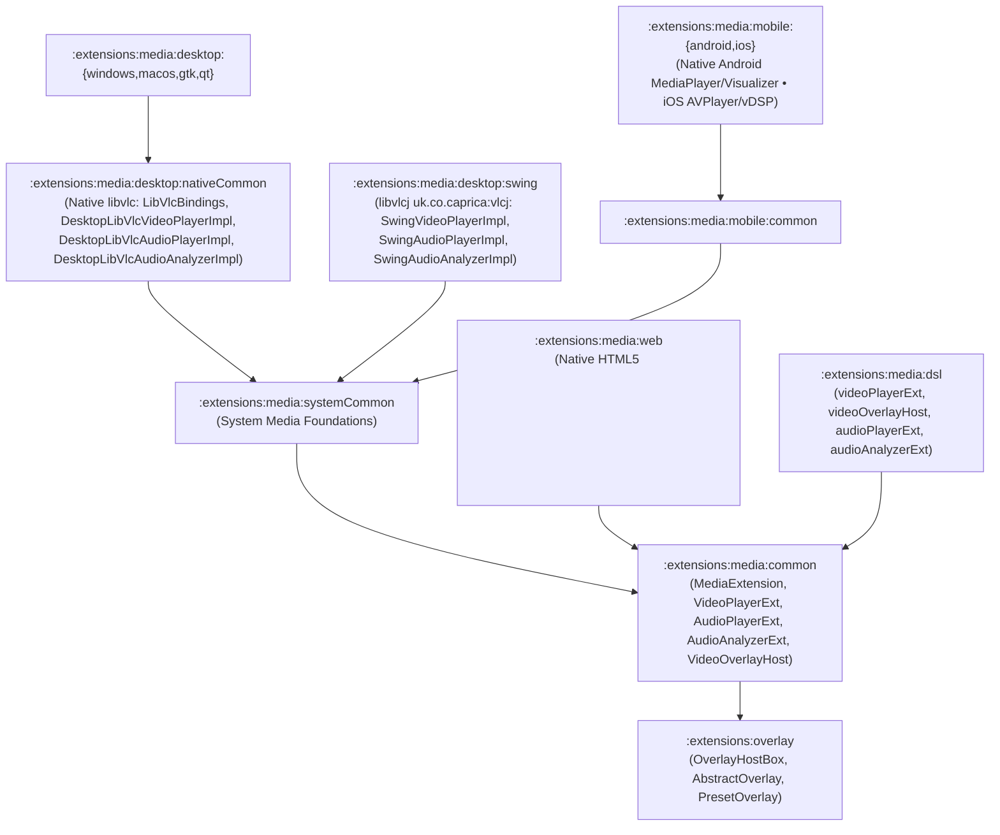

# `:extensions:media` & `:extensions:media:dsl` — Cross-Platform Video/Audio Playback, Desktop `libvlc` / `libvlcj`, `VideoOverlayHost`, & FFT Audio Analysis

> **Navigation**: [**GenericUI Root (`../../README.md`)**](../../README.md) · [**Extensions Index (`../README.md`)**](../README.md) · [**Root Extensions Guide (`../../docs/extensions.md`)**](../../docs/extensions.md) · [**Source Sets (`../../docs/sourcesets.md`)**](../../docs/sourcesets.md) · [**Backends (`../../docs/backends.md`)**](../../docs/backends.md) · [**Gradle Plugin (`../../docs/gradle-plugin.md`)**](../../docs/gradle-plugin.md)

`:extensions:media` is a **Project-of-Projects** extension providing `VideoPlayerExt` (`VideoPlayer`), `AudioPlayerExt` (`AudioPlayer`), real-time FFT `AudioAnalyzerExt` (`AudioAnalyzer`, `AudioEnergyBands`), `VideoOverlayHost` / `VideoPlayerOverlayBinder` (built atop [`:extensions:overlay`](overlay.md)), OS-level `MediaSessionManager`, and `WebVttSrtParser` subtitle parsing. It depends only on `:common`, [`:extensions:overlay`](overlay.md), and the target platform backend — it does **not** depend on `:extensions:gpu` or `:extensions:canvas2d`.

> [!IMPORTANT]
> **Strict Architectural Ownership**:
> - **Native Desktop (`:windows`, `:macos`, `:gtk`, `:qt`)**: Uses native `libvlc` (`LibVlcBindings`, `DesktopLibVlcVideoPlayerImpl`, `DesktopLibVlcAudioPlayerImpl`, `DesktopLibVlcAudioAnalyzerImpl`) inside `:extensions:media:desktop:nativeCommon`.
> - **JVM Desktop (`:swing`)**: Uses `libvlcj` (`uk.co.caprica:vlcj`) inside `:extensions:media:desktop:swing`.
> - **Mobile (`:android`, `:ios`)**: Uses native platform media components (`MediaPlayer`/`MediaCodec`/`Visualizer` on Android, `AVPlayer`/`vDSP` on iOS) inside `:extensions:media:mobile:{common,android,ios}`.
> - **Web (`:web`)**: Uses native HTML5 `<video>`, `<audio>`, and Web Audio API `AnalyserNode` components inside `:extensions:media:web`.

---

## 1. Submodule Hierarchy & Platform Media Engine Matrix



| Target Family | Submodules | Media & Audio Engine | Backend Documentation |
| :--- | :--- | :--- | :--- |
| **Desktop Native (`:windows`, `:macos`, `:gtk`, `:qt`)** | `:extensions:media:desktop:{nativeCommon,windows,macos,gtk,qt}` | Native `libvlc` C API (`LibVlcBindings`, `DesktopLibVlcVideoPlayerImpl`, `DesktopLibVlcAudioPlayerImpl`, `DesktopLibVlcAudioAnalyzerImpl`) | [Desktop Backends (`../../desktop/README.md`)](../../desktop/README.md) |
| **Desktop JVM (`:swing`)** | `:extensions:media:desktop:swing` | `libvlcj` (`uk.co.caprica:vlcj` via `SwingVideoPlayerImpl`, `SwingAudioPlayerImpl`, `SwingAudioAnalyzerImpl`) | [Desktop Backends (`../../desktop/README.md`)](../../desktop/README.md) |
| **Android (`:android`)** | `:extensions:media:mobile:{common,android}` | Native Android `MediaPlayer` / `MediaCodec` + `Visualizer` FFT (`AndroidVideoPlayerImpl`, `AndroidAudioAnalyzerImpl`) | [Mobile Backends (`../../mobile/README.md`)](../../mobile/README.md) |
| **iOS (`:ios`)** | `:extensions:media:mobile:{common,ios}` | Native Apple `AVPlayer` + `MTAudioProcessingTap` / Accelerate `vDSP` FFT (`IosVideoPlayerImpl`, `IosAudioAnalyzerImpl`) | [Mobile Backends (`../../mobile/README.md`)](../../mobile/README.md) |
| **Web (`:web`)** | `:extensions:media:web` | Native HTML5 `<video>`, `<audio>`, and Web Audio API `AnalyserNode` (`WebVideoPlayerImpl`, `WebAudioAnalyzerImpl`) | [Web Backend (`../../web/README.md`)](../../web/README.md) |

---

## 2. Desktop `libvlc` & `libvlcj` Pipeline (`:extensions:media:desktop`)

On desktop targets, `:extensions:media:desktop` encapsulates `libvlc` (native desktop in `:desktop:nativeCommon`) and `libvlcj` (Swing in `:desktop:swing`):

1. **Dynamic `libvlc` Bindings & Native Surface Attachment (`LibVlcBindings`, `LibVlcDynamicLoader`, `DesktopLibVlcVideoPlayerImpl`)**:
   - Dynamically loads `libvlc.dll` (Windows), `libvlc.dylib` (macOS), or `libvlc.so.5` (Linux).
   - Binds native window handles (`bindWin32Hwnd` $\rightarrow$ `libvlc_media_player_set_hwnd`, `bindMacosNsView` $\rightarrow$ `libvlc_media_player_set_nsobject`, `bindXWindow` $\rightarrow$ `libvlc_media_player_set_xwindow`).
2. **JVM Swing `libvlcj` Integration (`SwingVideoPlayerImpl`, `SwingAudioPlayerImpl`, `SwingAudioAnalyzerImpl`)**:
   - Uses `uk.co.caprica:vlcj` (`MediaPlayerFactory`, `EmbeddedMediaPlayer`) for native VLC media playback and audio callbacks inside Swing components.

---

## 3. Interactive `VideoOverlayHost` & `:extensions:overlay` Integration

`VideoPlayerExt` integrates directly with [`:extensions:overlay`](overlay.md) via **`VideoOverlayHost`** and **`VideoPlayerOverlayBinder`**:

- **Bidirectional State & Action Binding (`VideoPlayerOverlayBinder`)**: Automatically synchronizes `VideoPlayerExt` playback state (`isPlaying`, `currentTimeSeconds`, `durationSeconds`, `bufferedEndSeconds`, `volume`, `isMuted`, `playbackSpeed`, `audioTracks`, `subtitleTracks`, `activeSubtitleCueText`, `isFullscreen`, `isPictureInPicture`) with `OverlayPlaybackState` and routes user `OverlayAction` events (`TogglePlayPause`, `SeekTo`, `SeekRelative`, `SetVolume`, `ToggleMute`, `SetPlaybackSpeed`, `SelectAudioTrack`, `SelectSubtitleTrack`, `SelectQuality`, `ToggleFullscreen`, `TogglePictureInPicture`) back to `VideoPlayerExt`.
- **Host-Level Fullscreen**: Setting or mounting `VideoOverlayHost` calls `videoPlayer.setFullscreenTargetElementId(host.id)` so entering fullscreen expands the entire `VideoOverlayHost` (keeping the overlay visible over the video in fullscreen).
- **Picture-in-Picture (`setPictureInPictureMode`)**: Calling `host.setPictureInPictureMode(true)` enters Picture-in-Picture on `videoPlayer` while suppressing the overlay inside the main viewport.
- **Subtitle Cue Rendering**: `host.loadSubtitleContent(vttOrSrtContent)` and `host.attachSubtitleCues(cues)` parse `.vtt`/`.srt` cues via `WebVttSrtParser` and stream active cue text into the overlay's `SubtitleCueView`.

---

## 4. Gradle Plugin Configuration

Enabling `media()` in the [GenericUI Gradle Plugin (`../../docs/gradle-plugin.md`)](../../docs/gradle-plugin.md) wires `:extensions:media`, `:extensions:overlay`, and (when `dsl()` is active) `:extensions:media:dsl` and `:extensions:overlay:dsl`, and automatically registers the platform media provider at startup:

```kotlin
plugins {
    id("com.nexustools.genericui")
}

genericui {
    backends {
        allExceptSwing()
    }
    extensions {
        dsl()   // Enables :extensions:dsl
        media() // Includes :extensions:media, :extensions:overlay, and :extensions:media:dsl
    }
}
```

---

## 5. Core API Reference (`com.nexustools.genericui.ext.media` & `ext.media.overlay`)

| Class / Object / Function | Package | Description & Key Members |
| :--- | :--- | :--- |
| `MediaExtension` | `ext.media` | Coordinator singleton registering and creating platform media providers (`registerProviders`, `createVideoPlayerNative`, `createAudioPlayerNative`, `createAudioAnalyzerNative`, `createMediaSessionManagerNative`). |
| `VideoPlayerExt` | `ext.media` | Video player extending `VideoPlayer`. Key members: `setSource(url, seekOffsetSeconds, durationOverrideSeconds)`, `play()`, `pause()`, `stop()`, `seekTo(seconds)`, `volume`, `isMuted`, `playbackSpeed`, `resizeMode: VideoResizeMode`, `getMediaCapabilities(): MediaCapabilitiesReport`, `getAudioTracks()`, `selectAudioTrack(trackId)`, `getSubtitleTracks()`, `addExternalSubtitleTrack(label, language, vttOrSrtUrl)`, `selectSubtitleTrack(trackId)`, `attachAudioAnalyzer(analyzer)`, `attachVideoOverlay(overlay): VideoOverlayHost`, `withOverlay(overlay): VideoOverlayHost`. |
| `VideoOverlayHost` | `ext.media.overlay` | Specialized `OverlayHostBox` wrapping a `VideoPlayerExt` (`videoPlayer`, `binder: VideoPlayerOverlayBinder`, `loadSubtitleContent(vttOrSrtContent, trackId)`, `attachSubtitleCues(cues, trackId)`, `setPictureInPictureMode(enabled)`). |
| `VideoPlayerOverlayBinder` | `ext.media.overlay` | Bidirectional synchronizer between `VideoPlayerExt` callbacks and `OverlayHost` state/actions. |
| `AudioPlayerExt` | `ext.media` | Extended audio player component (`sourceUrl`, `volume`, `currentTimeSeconds`, `durationSeconds`, `isPlaying`, `getSupportedAudioCodecs()`, `setSource(url, seekOffsetSeconds)`, `play()`, `pause()`, `stop()`, `seekTo(seconds)`, `attachAudioAnalyzer(analyzerExt)`). |
| `AudioAnalyzerExt` | `ext.media` | Real-time FFT spectrum & waveform analyzer (`fftSize: Int = 2048`, `frequencyBinCount: Int`, `getByteTimeDomainData(dst)`, `getFloatTimeDomainData(dst)`, `getByteFrequencyData(dst)`, `getFloatFrequencyData(dst)`, `computeEnergyBands(): AudioEnergyBands`, `dispose()`). |
| `AudioEnergyBands` | `component.media` | Normalized `[0.0 .. 1.0]` multi-band audio energy snapshot (`subBass: Float`, `bass: Float`, `lowMid: Float`, `mid: Float`, `highMid: Float`, `presence: Float`, `brilliance: Float`, `rmsLevel: Float`, `peakLevel: Float`). |
| `WebVttSrtParser` | `component.media` | Cross-platform parser for `.vtt` (WebVTT) and `.srt` (SubRip) subtitle files (`parse(content: String): List<SubtitleCue>`, `activeCuesAt(cues, timeSeconds): List<SubtitleCue>`). |
| `DesktopLibVlcVideoPlayerImpl` | `ext.media.desktop.libvlc` | Native `libvlc` desktop video player implementation (`bindWin32Hwnd`, `bindMacosNsView`, `bindXWindow`, `getMediaCapabilities()`). |
| `videoPlayerExt` / `videoPlayer` | `ext.media.dsl` | Declarative DSL builders in `:extensions:media:dsl` for mounting `VideoPlayerExt` and `VideoPlayer`. |
| `videoOverlayHost` | `ext.media.dsl` | Declarative DSL builder in `:extensions:media:dsl` wrapping a `VideoPlayerExt` and an optional `AbstractOverlay` (`PresetOverlay`, custom `AbstractOverlay`). |
| `audioPlayerExt` / `audioPlayer` | `ext.media.dsl` | Declarative DSL builders in `:extensions:media:dsl` for mounting `AudioPlayerExt` and `AudioPlayer`. |
| `audioAnalyzerExt` / `audioAnalyzer` | `ext.media.dsl` | Declarative DSL builders in `:extensions:media:dsl` for creating `AudioAnalyzerExt` and `AudioAnalyzer`. |

---

## 6. Imperative Kotlin Examples

### Example 1: Video Playback with `VideoOverlayHost`, `PresetOverlay`, Subtitles, & FFT Analyzer

```kotlin
import com.nexustools.genericui.enums.media.VideoResizeMode
import com.nexustools.genericui.ext.media.AudioAnalyzerExt
import com.nexustools.genericui.ext.media.VideoPlayerExt
import com.nexustools.genericui.ext.media.overlay.VideoOverlayHost
import com.nexustools.genericui.ext.overlay.PresetOverlay

fun createOverlayVideoPlayer(): VideoOverlayHost {
    val player = VideoPlayerExt(
        sourceUrl = "https://cdn.example.com/movies/cosmos-hevc.mkv"
    ).apply {
        volume = 0.9f
        playbackSpeed = 1.0f
        resizeMode = VideoResizeMode.FIT

        // Inspect hardware codec & HDR capabilities
        val caps = getMediaCapabilities()
        println("Backend: ${caps.hardwareAccelerationBackend} • HDR10=${caps.supportsHdr10} • DolbyVision=${caps.supportsDolbyVision}")
    }

    // Attach real-time 2048-bin FFT audio analyzer
    val analyzer = AudioAnalyzerExt(fftSize = 2048)
    player.attachAudioAnalyzer(analyzer.analyzer)

    // Wrap in a VideoOverlayHost with platform-adaptive PresetOverlay
    val overlayHost = player.attachVideoOverlay(PresetOverlay()).apply {
        state.title = "Cosmos: A Spacetime Odyssey"
        state.subtitle = "Episode 1 • 4K HDR10"
        loadSubtitleContent(
            """
            WEBVTT

            00:00:01.000 --> 00:00:05.000
            The cosmos is all that is, or ever was, or ever will be.
            """.trimIndent()
        )
    }

    player.play()
    return overlayHost
}
```

### Example 2: Real-Time FFT Audio Spectrum & `AudioEnergyBands` Analysis

```kotlin
import com.nexustools.genericui.ext.media.AudioAnalyzerExt
import com.nexustools.genericui.ext.media.AudioPlayerExt

fun startAudioWithSpectrumAnalysis(audioUrl: String): Pair<AudioPlayerExt, AudioAnalyzerExt> {
    val analyzer = AudioAnalyzerExt(fftSize = 2048)
    val audioPlayer = AudioPlayerExt(sourceUrl = audioUrl).apply {
        volume = 0.85f
        attachAudioAnalyzer(analyzer)
        play()
    }

    // Sample frequency bins and multi-band energy on each UI tick
    val freqBins = FloatArray(analyzer.frequencyBinCount)
    analyzer.getFloatFrequencyData(freqBins)
    val bands = analyzer.computeEnergyBands()
    println("Bass=${bands.bass} • Mid=${bands.mid} • Brilliance=${bands.brilliance} • RMS=${bands.rmsLevel}")

    return audioPlayer to analyzer
}
```

---

## 7. Declarative `:extensions:media:dsl` Examples

When `dsl()` and `media()` are enabled in `genericui { extensions { ... } }`, use `videoOverlayHost`, `videoPlayerExt`, `audioPlayerExt`, and `audioAnalyzerExt` directly in declarative UI trees:

```kotlin
import com.nexustools.genericui.enums.media.VideoResizeMode
import com.nexustools.genericui.ext.dsl.buildDiv
import com.nexustools.genericui.ext.dsl.button
import com.nexustools.genericui.ext.dsl.hstack
import com.nexustools.genericui.ext.media.dsl.audioAnalyzerExt
import com.nexustools.genericui.ext.media.dsl.audioPlayerExt
import com.nexustools.genericui.ext.media.dsl.videoOverlayHost
import com.nexustools.genericui.ext.overlay.PresetOverlay

val mediaStudioView = buildDiv(classes = "p-4") {
    val spectrumAnalyzer = audioAnalyzerExt(fftSize = 2048)

    val host = videoOverlayHost(
        sourceUrl = "https://cdn.example.com/streams/keynote.mp4",
        overlay = PresetOverlay(),
        volume = 0.9f,
        resizeMode = VideoResizeMode.FIT
    ) {
        videoPlayer.attachAudioAnalyzer(spectrumAnalyzer.analyzer)
        state.title = "GenericUI Keynote Stream"
        state.subtitle = "Live • 60fps"
    }

    // Background ambient audio track
    val ambientTrack = audioPlayerExt(
        sourceUrl = "https://cdn.example.com/audio/ambient-loop.ogg",
        volume = 0.35f
    )

    hstack(classes = "gap-2 mt-3") {
        button("▶ Play") { onClick = { host.videoPlayer.play() } }
        button("⏸ Pause") { onClick = { host.videoPlayer.pause() } }
        button("⏹ Stop") { onClick = { host.videoPlayer.stop() } }
    }
}
```

---

## 8. Related Extensions & Cross-References

- **Related Extensions**:
  - [`:extensions:overlay` (`overlay.md`)](overlay.md) — Composable overlay host, auto-hide controller, themed `TrackSeekBar` / `SliderSeekBar`, and platform presets used by `VideoOverlayHost`.
  - [`:extensions:mediacontrols` (`mediacontrols.md`)](mediacontrols.md) — OS taskbar thumbnail media buttons, Now Playing / SMTC integration, and global hardware media key hooks.
  - [`:extensions:dsl` (`dsl.md`)](dsl.md) — Base declarative Kotlin UI & Style DSL.
- **Root & Backend Documentation**:
  - [GenericUI Root (`../../README.md`)](../../README.md) · [Extensions Architecture (`../../docs/extensions.md`)](../../docs/extensions.md) · [Source Sets (`../../docs/sourcesets.md`)](../../docs/sourcesets.md) · [Backends (`../../docs/backends.md`)](../../docs/backends.md) · [Gradle Plugin (`../../docs/gradle-plugin.md`)](../../docs/gradle-plugin.md)
  - [Desktop Backends (`../../desktop/README.md`)](../../desktop/README.md) · [Mobile Backends (`../../mobile/README.md`)](../../mobile/README.md) · [Web Backend (`../../web/README.md`)](../../web/README.md)
