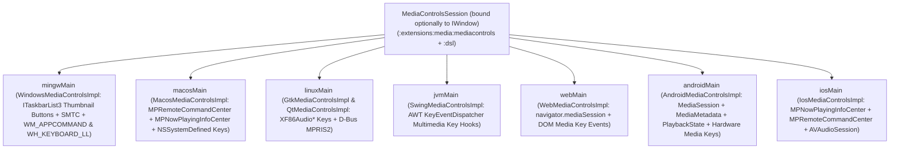

# `:extensions:media:mediacontrols` & `:extensions:media:mediacontrols:dsl` — Standalone System Media Controls, Taskbar Thumbnail Buttons, & Hardware Media Key Hooks

> **Navigation**: [**GenericUI Root (`../../README.md`)**](../../README.md) · [**Extensions Index (`../README.md`)**](../README.md) · [**Root Extensions Guide (`../../docs/extensions.md`)**](../../docs/extensions.md) · [**Fragments & Windows (`../../docs/fragments-and-windows.md`)**](../../docs/fragments-and-windows.md) · [**Source Sets (`../../docs/sourcesets.md`)**](../../docs/sourcesets.md) · [**Backends (`../../docs/backends.md`)**](../../docs/backends.md) · [**Gradle Plugin (`../../docs/gradle-plugin.md`)**](../../docs/gradle-plugin.md)

`:extensions:media:mediacontrols` (`com.nexustools.genericui.ext.mediacontrols`) is a standalone **Single Consolidated KMP Project** depending **exclusively on `:common`**. It initializes real OS media transport controls across all targets out of the box via [`DefaultPlatformMediaControlsFactory`](../media/mediacontrols/src/commonMain/kotlin/com/nexustools/genericui/ext/mediacontrols/DefaultPlatformMediaControlsFactory.kt) while [`MediaControlsRegistry`](../media/mediacontrols/src/commonMain/kotlin/com/nexustools/genericui/ext/mediacontrols/MediaControlsRegistry.kt) fails fast if no factory is installed.

> [!IMPORTANT]
> **Zero Extension Dependencies & Out-of-the-Box Real OS Media Controls**:
> - `:extensions:media:mediacontrols` does **not** depend on `:extensions:media:media`, `:extensions:ui:overlay`, `:extensions:graphics:gpu`, `:extensions:graphics:canvas2d`, or any other extension.
> - Provides real system integration across Desktop, Swing, Android (`MediaSession`), iOS & iPadOS (`MPNowPlayingInfoCenter` / `MPRemoteCommandCenter`), and Web (`navigator.mediaSession`).

---

## 1. Architecture & Source-Set Layout

`:extensions:media:mediacontrols` consolidates all platform drivers (`commonMain`, `mingwMain`, `macosMain`, `linuxMain`, `jvmMain`, `androidMain`, `iosMain`, `webMain`, plus `:dsl`):



| Target Backend | Source Set | System Media Transport & Taskbar Integration | Hardware Keyboard Media Key Hooks |
| :--- | :--- | :--- | :--- |
| **Windows (`:windows`)** | `mingwMain` | **Windows Taskbar Hover Preview Toolbar (`ITaskbarList3`)**: Attaches `ThumbBarAddButtons` / `ThumbBarUpdateButtons` + Windows System Media Transport Controls (SMTC) | Hooks `WM_APPCOMMAND` and low-level `WH_KEYBOARD_LL` (`VK_MEDIA_*`) |
| **macOS (`:macos`)** | `macosMain` | **macOS Control Center, Now Playing & Touch Bar**: `MPRemoteCommandCenter` & `MPNowPlayingInfoCenter` | Installs `NSEvent` `NSSystemDefined` (`subtype == 8`) physical media key monitor |
| **Linux GTK4 & Qt6 (`:gtk`, `:qt`)** | `linuxMain` | D-Bus `org.mpris.MediaPlayer2` transport & metadata bridge | Hooks `XF86Audio*` / `Qt::Key_Media*` multimedia keys |
| **Desktop JVM (`:swing`)** | `jvmMain` | Desktop multimedia session state tracking | AWT `KeyboardFocusManager` `KeyEventDispatcher` multimedia key hooks |
| **Android (`:android`)** | `androidMain` | `android.media.session.MediaSession`, `MediaMetadata`, & `PlaybackState` (`supportsSystemTransportControls = true`) | Dispatches hardware / Bluetooth `KeyEvent` media buttons (`supportsKeyboardMediaKeyHook = true`) |
| **iOS & iPadOS (`:ios`)** | `iosMain` | Apple `MPNowPlayingInfoCenter`, `MPRemoteCommandCenter`, & `AVAudioSession` (`supportsSystemTransportControls = true`) | Handles Lock Screen, Control Center, and accessory remote command events (`supportsKeyboardMediaKeyHook = true`) |
| **Web (`:web`)** | `webMain` | Browser `navigator.mediaSession` (`MediaMetadata` + action handlers) | DOM `keydown` listener for `MediaPlayPause`, `MediaTrackNext`, `MediaTrackPrevious`, and `MediaStop` |

---

## 2. Gradle Plugin Configuration

Enable `mediaControls()` inside `genericui { extensions { ... } }` in `build.gradle.kts` (automatically adds `:extensions:media:mediacontrols:dsl` when `dsl()` is enabled):

```kotlin
plugins {
    id("com.nexustools.genericui")
}

genericui {
    app {
        id = "com.example.mediaplayer"
        name = "Studio Player"
    }
    backends {
        allExceptSwing()
    }
    extensions {
        dsl()           // Enables :extensions:ui:dsl + :extensions:media:mediacontrols:dsl
        mediaControls() // Enables :extensions:media:mediacontrols across all active backends
    }
}
```

---

## 3. Core API Reference (`com.nexustools.genericui.ext.mediacontrols`)

| Class / Interface / Enum | Package | Description & Key Members |
| :--- | :--- | :--- |
| `MediaControlsSession` | `ext.mediacontrols` | Main session controller implementing `Disposable`, optionally bound to an `IWindow`. Key members: `capabilities: MediaControlsCapabilities`, `boundWindow: IWindow?`, `metadata: MediaControlMetadata`, `playbackStatus: MediaPlaybackStatus`, `buttonConfig: MediaControlButtonConfig`, `keyboardMediaKeysEnabled: Boolean`, `taskbarPreviewControlsEnabled: Boolean`, `isActive: Boolean`, `bindWindow(window)`, `activate()`, `deactivate()`, `updateMetadata(metadata)`, `updatePlaybackState(status, positionMs, durationMs, playbackRate)`, `updateButtonConfig(config)`, `addListener(listener)`, `removeListener(listener)`, `simulateMediaKey(action, source, seekPositionMs)`, `dispose()`. |
| `MediaControlMetadata` | `ext.mediacontrols` | Now-Playing metadata data class: `title: String = ""`, `subtitle: String = ""`, `artist: String = ""`, `album: String = ""`, `artwork: ImageBuffer? = null`, `artworkUrl: String? = null`, `durationMs: Long = 0L`, `positionMs: Long = 0L`, `playbackRate: Float = 1.0f`. |
| `MediaPlaybackStatus` | `ext.mediacontrols` | Playback state enum: `STOPPED`, `PLAYING`, `PAUSED`, `LOADING`. |
| `MediaControlButtonConfig` | `ext.mediacontrols` | Configures enabled buttons and tooltips for OS transport controls and Windows `ITaskbarList3` thumbnail toolbars: `playPauseEnabled: Boolean = true`, `previousEnabled: Boolean = true`, `nextEnabled: Boolean = true`, `stopEnabled: Boolean = false`, `seekEnabled: Boolean = true`, `previousTooltip: String = "Previous"`, `playTooltip: String = "Play"`, `pauseTooltip: String = "Pause"`, `nextTooltip: String = "Next"`, `stopTooltip: String = "Stop"`. |
| `MediaControlAction` | `ext.mediacontrols` | Transport and volume action enum: `PLAY`, `PAUSE`, `PLAY_PAUSE`, `STOP`, `NEXT`, `PREVIOUS`, `FAST_FORWARD`, `REWIND`, `SEEK_TO`, `MUTE_TOGGLE`, `VOLUME_UP`, `VOLUME_DOWN`. |
| `MediaControlEventSource` | `ext.mediacontrols` | Identifies where the command originated: `SYSTEM_TRANSPORT` (OS SMTC / Now Playing / MPRIS / `navigator.mediaSession`), `TASKBAR_THUMBNAIL_TOOLBAR` (Windows `ITaskbarList3` hover preview button), or `KEYBOARD_MEDIA_KEY` (hardware media key hook). |
| `MediaControlEvent` | `ext.mediacontrols` | Event payload delivered to listeners: `action: MediaControlAction`, `seekPositionMs: Long? = null`, `source: MediaControlEventSource`. |
| `MediaControlListener` | `ext.mediacontrols` | Functional interface: `fun onMediaControlEvent(event: MediaControlEvent)`. |
| `MediaControlsCapabilities` | `ext.mediacontrols` | Platform capability flags: `supportsSystemTransportControls: Boolean`, `supportsTaskbarThumbnailButtons: Boolean`, `supportsKeyboardMediaKeyHook: Boolean`. |
| `mediaControlsSession` | `ext.mediacontrols.dsl` | Declarative DSL builders (`mediaControlsSession(...)` and `IWindow.mediaControlsSession(...)`) in `:extensions:media:mediacontrols:dsl`. |

---

## 4. Imperative Kotlin Examples

### Example 1: Binding `MediaControlsSession` to a Fragment's `hostingWindow`

```kotlin
import com.nexustools.genericui.component.fragment.Fragment
import com.nexustools.genericui.component.fragment.FragmentBundle
import com.nexustools.genericui.component.fragment.MainAppFragment
import com.nexustools.genericui.ext.mediacontrols.MediaControlAction
import com.nexustools.genericui.ext.mediacontrols.MediaControlButtonConfig
import com.nexustools.genericui.ext.mediacontrols.MediaControlMetadata
import com.nexustools.genericui.ext.mediacontrols.MediaControlsSession
import com.nexustools.genericui.ext.mediacontrols.MediaPlaybackStatus

@MainAppFragment(label = "Audio Workstation")
class WorkstationFragment : Fragment() {

    private var mediaControls: MediaControlsSession? = null

    override fun onCreate(savedState: FragmentBundle?) {
        super.onCreate(savedState)

        val session = MediaControlsSession(window = hostingWindow).apply {
            updateButtonConfig(
                MediaControlButtonConfig(
                    playPauseEnabled = true,
                    previousEnabled = true,
                    nextEnabled = true,
                    seekEnabled = true
                )
            )
            updateMetadata(
                MediaControlMetadata(
                    title = "Analog Synth Take #4",
                    artist = "Studio Session",
                    album = "Master Tracks",
                    durationMs = 245_000L,
                    positionMs = 0L
                )
            )
            updatePlaybackState(status = MediaPlaybackStatus.PLAYING, positionMs = 0L, durationMs = 245_000L)

            addListener { event ->
                when (event.action) {
                    MediaControlAction.PLAY -> updatePlaybackState(MediaPlaybackStatus.PLAYING)
                    MediaControlAction.PAUSE -> updatePlaybackState(MediaPlaybackStatus.PAUSED)
                    MediaControlAction.PLAY_PAUSE -> {
                        val next = if (playbackStatus == MediaPlaybackStatus.PLAYING) {
                            MediaPlaybackStatus.PAUSED
                        } else {
                            MediaPlaybackStatus.PLAYING
                        }
                        updatePlaybackState(next)
                    }
                    MediaControlAction.NEXT -> println("Next track requested from ${event.source}")
                    MediaControlAction.PREVIOUS -> println("Previous track requested from ${event.source}")
                    MediaControlAction.SEEK_TO -> {
                        val targetMs = event.seekPositionMs ?: 0L
                        updatePlaybackState(playbackStatus, positionMs = targetMs)
                    }
                    else -> Unit
                }
            }

            activate()
        }

        mediaControls = session
    }

    override fun onDestroy() {
        mediaControls?.dispose()
        mediaControls = null
        super.onDestroy()
    }
}
```

---

## 5. Declarative `:extensions:media:mediacontrols:dsl` Examples

When `dsl()` and `mediaControls()` are enabled, use `mediaControlsSession { ... }` (or `hostingWindow?.mediaControlsSession { ... }`) to configure and activate system media controls declaratively:

```kotlin
import com.nexustools.genericui.component.fragment.Fragment
import com.nexustools.genericui.component.fragment.FragmentBundle
import com.nexustools.genericui.ext.mediacontrols.MediaControlAction
import com.nexustools.genericui.ext.mediacontrols.MediaControlMetadata
import com.nexustools.genericui.ext.mediacontrols.MediaPlaybackStatus
import com.nexustools.genericui.ext.mediacontrols.dsl.mediaControlsSession

fun Fragment.bindDeclarativeMediaControls() = mediaControlsSession(
    window = hostingWindow,
    metadata = MediaControlMetadata(
        title = "Episode 12 — Architecture Deep Dive",
        artist = "Kotlin Multiplatform Podcast",
        durationMs = 1_800_000L
    ),
    keyboardMediaKeysEnabled = true,
    taskbarPreviewControlsEnabled = true,
    autoActivate = true,
    onEvent = { event ->
        when (event.action) {
            MediaControlAction.PLAY_PAUSE,
            MediaControlAction.PLAY,
            MediaControlAction.PAUSE -> {
                println("Toggled playback via ${event.source}")
            }
            MediaControlAction.NEXT -> println("Skipped to next episode via ${event.source}")
            MediaControlAction.PREVIOUS -> println("Returned to previous episode via ${event.source}")
            else -> Unit
        }
    }
) {
    updatePlaybackState(status = MediaPlaybackStatus.PLAYING, positionMs = 12_000L, durationMs = 1_800_000L)
}
```

---

## 6. Related Extensions & Cross-References

- **Related Extensions**:
  - [`:extensions:media:media` & `:extensions:media:media:dsl` (`media.md`)](media.md) — Hardware-accelerated `VideoPlayer`, `AudioPlayer`, `AudioAnalyzer`, `ExpandingVolumeSlider`, and `MediaExtension`.
  - [`:extensions:ui:overlay` & `:extensions:ui:overlay:dsl` (`overlay.md`)](overlay.md) — Pure `LayeredContainer` overlay framework (`Overlay`, `YoutubePlayerOverlay`, `HybridOverlayDifferenceController`, `OverlayHostBox`).
  - [`:extensions:ui:dsl` (`dsl.md`)](dsl.md) — Base declarative Kotlin UI & Style DSL.
- **Root & Backend Documentation**:
  - [GenericUI Root (`../../README.md`)](../../README.md) · [Extensions Architecture (`../../docs/extensions.md`)](../../docs/extensions.md) · [Fragments & Windows (`../../docs/fragments-and-windows.md`)](../../docs/fragments-and-windows.md) · [Source Sets (`../../docs/sourcesets.md`)](../../docs/sourcesets.md) · [Backends (`../../docs/backends.md`)](../../docs/backends.md) · [Gradle Plugin (`../../docs/gradle-plugin.md`)](../../docs/gradle-plugin.md)
  - [Desktop Backends (`../../desktop/README.md`)](../../desktop/README.md) · [Mobile Backends (`../../mobile/README.md`)](../../mobile/README.md) · [Web Backend (`../../web/README.md`)](../../web/README.md)
