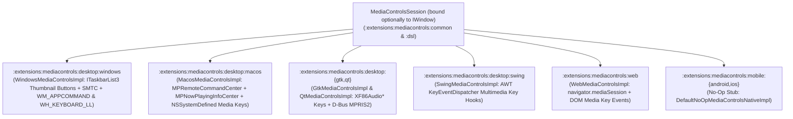

# `:extensions:mediacontrols` & `:extensions:mediacontrols:dsl` — Standalone System Media Controls, Taskbar Thumbnail Buttons, & Hardware Media Key Hooks

> **Navigation**: [**GenericUI Root (`../../README.md`)**](../../README.md) · [**Extensions Index (`../README.md`)**](../README.md) · [**Root Extensions Guide (`../../docs/extensions.md`)**](../../docs/extensions.md) · [**Fragments & Windows (`../../docs/fragments-and-windows.md`)**](../../docs/fragments-and-windows.md) · [**Source Sets (`../../docs/sourcesets.md`)**](../../docs/sourcesets.md) · [**Backends (`../../docs/backends.md`)**](../../docs/backends.md) · [**Gradle Plugin (`../../docs/gradle-plugin.md`)**](../../docs/gradle-plugin.md)

`:extensions:mediacontrols` (`com.nexustools.genericui.ext.mediacontrols`) is a standalone **Multi-Module Project-of-Projects** extension that depends **exclusively on `:common`**. It provides OS/system media transport controls, Windows Taskbar hover preview thumbnail buttons (`ITaskbarList3`), macOS Control Center / Now Playing integration, Linux MPRIS2, Web `navigator.mediaSession`, and hardware keyboard media key hooks across system and web targets.

> [!IMPORTANT]
> **Zero Extension Dependencies & System/Web Focus**:
> - `:extensions:mediacontrols` does **not** depend on `:extensions:media`, `:extensions:overlay`, `:extensions:gpu`, `:extensions:canvas2d`, or any other extension. It can be used for any workflow—video/audio players, custom synthesizers/DAWs, slide presentations, timers, or games.
> - On `:mobile:android` and `:mobile:ios`, `:extensions:mediacontrols` provides a lightweight no-op implementation (`DefaultNoOpMediaControlsNativeImpl` with `supportsSystemTransportControls = false`, `supportsTaskbarThumbnailButtons = false`, `supportsKeyboardMediaKeyHook = false`) and never registers an Android `Service` or mobile notification, leaving mobile apps free to manage their own `androidMain` foreground `Service` setup when desired.

---

## 1. Architecture & Submodule Layout

`:extensions:mediacontrols` follows the Phase 3 multi-module structure (`:common`, `:systemCommon`, `:desktop:nativeCommon`, `:desktop:{windows,macos,gtk,qt,swing}`, `:mobile:common`, `:mobile:{android,ios}`, `:web`, plus `:dsl`):



| Target Backend | Submodule | System Media Transport & Taskbar Integration | Hardware Keyboard Media Key Hooks |
| :--- | :--- | :--- | :--- |
| **Windows (`:windows`)** | `:extensions:mediacontrols:desktop:windows` | **Windows Taskbar Hover Preview Toolbar (`ITaskbarList3`)**: Attaches `ThumbBarAddButtons` / `ThumbBarUpdateButtons` (Previous, dynamic Play/Pause icon & tooltip, Next) to the `IWindow`'s `HWND` (`TaskbarButtonCreated` + `WM_COMMAND` `THBN_CLICKED`), plus Windows System Media Transport Controls (SMTC) | Hooks `WM_APPCOMMAND` (`APPCOMMAND_MEDIA_PLAY_PAUSE`, `PLAY`, `PAUSE`, `STOP`, `NEXTTRACK`, `PREVIOUSTRACK`, `FAST_FORWARD`, `REWIND`) and low-level `WH_KEYBOARD_LL` (`VK_MEDIA_PLAY_PAUSE`, `VK_MEDIA_NEXT_TRACK`, `VK_MEDIA_PREV_TRACK`, `VK_MEDIA_STOP`) |
| **macOS (`:macos`)** | `:extensions:mediacontrols:desktop:macos` | **macOS Control Center, Now Playing & Touch Bar**: Registers command handlers on `MPRemoteCommandCenter` (`playCommand`, `pauseCommand`, `togglePlayPauseCommand`, `stopCommand`, `nextTrackCommand`, `previousTrackCommand`, `changePlaybackPositionCommand`) and updates `MPNowPlayingInfoCenter` metadata & elapsed time | Installs an `NSEvent` `NSSystemDefined` (`subtype == 8`) media key monitor for physical Mac keyboard media keys (`NX_KEYTYPE_PLAY`, `NX_KEYTYPE_NEXT`, `NX_KEYTYPE_PREVIOUS`, `NX_KEYTYPE_FAST`, `NX_KEYTYPE_REWIND`) |
| **Linux GTK4 (`:gtk`)** | `:extensions:mediacontrols:desktop:gtk` | D-Bus `org.mpris.MediaPlayer2` transport & metadata bridge | Hooks `XF86AudioPlay`, `XF86AudioPause`, `XF86AudioStop`, `XF86AudioNext`, `XF86AudioPrev` multimedia keys |
| **Linux Qt6 (`:qt`)** | `:extensions:mediacontrols:desktop:qt` | D-Bus `org.mpris.MediaPlayer2` transport & metadata bridge | Hooks `Qt::Key_MediaPlay`, `Qt::Key_MediaPause`, `Qt::Key_MediaTogglePlayPause`, `Qt::Key_MediaStop`, `Qt::Key_MediaNext`, `Qt::Key_MediaPrevious` |
| **Desktop JVM (`:swing`)** | `:extensions:mediacontrols:desktop:swing` | Desktop multimedia session state tracking | AWT `KeyboardFocusManager` `KeyEventDispatcher` multimedia key hooks |
| **Web (`:web`)** | `:extensions:mediacontrols:web` | Browser `navigator.mediaSession` (`MediaMetadata` title, artist, album, artwork + action handlers for `play`, `pause`, `previoustrack`, `nexttrack`, `seekbackward`, `seekforward`, `seekto`, `stop`) | DOM `keydown` listener for `MediaPlayPause`, `MediaTrackNext`, `MediaTrackPrevious`, and `MediaStop` |
| **Mobile (`:android`, `:ios`)** | `:extensions:mediacontrols:mobile:{android,ios}` | Lightweight no-op (`supportsSystemTransportControls = false`, `supportsTaskbarThumbnailButtons = false`) | No-op (`supportsKeyboardMediaKeyHook = false`) |

---

## 2. Gradle Plugin Configuration

Enable `mediaControls()` inside the `genericui { extensions { ... } }` block in `build.gradle.kts`. The GenericUI Gradle plugin automatically wires the platform provider into each target's generated launcher (`GeneratedAppDescriptor`), and automatically adds `:extensions:mediacontrols:dsl` when `dsl()` is enabled:

```kotlin
plugins {
    id("com.nexustools.genericui")
}

genericui {
    app {
        id = "com.example.mediaplayer"
        name = "Studio Player"
    }
    backends {
        allExceptSwing()
    }
    extensions {
        dsl()           // Enables :extensions:dsl + :extensions:mediacontrols:dsl
        mediaControls() // Enables :extensions:mediacontrols across all active backends
    }
}
```

---

## 3. Core API Reference (`com.nexustools.genericui.ext.mediacontrols`)

| Class / Interface / Enum | Package | Description & Key Members |
| :--- | :--- | :--- |
| `MediaControlsSession` | `ext.mediacontrols` | Main session controller implementing `Disposable`, optionally bound to an `IWindow`. Key members: `capabilities: MediaControlsCapabilities`, `boundWindow: IWindow?`, `metadata: MediaControlMetadata`, `playbackStatus: MediaPlaybackStatus`, `buttonConfig: MediaControlButtonConfig`, `keyboardMediaKeysEnabled: Boolean`, `taskbarPreviewControlsEnabled: Boolean`, `isActive: Boolean`, `bindWindow(window)`, `activate()`, `deactivate()`, `updateMetadata(metadata)`, `updatePlaybackState(status, positionMs, durationMs, playbackRate)`, `updateButtonConfig(config)`, `addListener(listener)`, `removeListener(listener)`, `simulateMediaKey(action, source, seekPositionMs)`, `dispose()`. |
| `MediaControlMetadata` | `ext.mediacontrols` | Now-Playing metadata data class: `title: String = ""`, `subtitle: String = ""`, `artist: String = ""`, `album: String = ""`, `artwork: ImageBuffer? = null`, `artworkUrl: String? = null`, `durationMs: Long = 0L`, `positionMs: Long = 0L`, `playbackRate: Float = 1.0f`. |
| `MediaPlaybackStatus` | `ext.mediacontrols` | Playback state enum: `STOPPED`, `PLAYING`, `PAUSED`, `LOADING`. |
| `MediaControlButtonConfig` | `ext.mediacontrols` | Configures enabled buttons and tooltips for OS transport controls and Windows `ITaskbarList3` thumbnail toolbars: `playPauseEnabled: Boolean = true`, `previousEnabled: Boolean = true`, `nextEnabled: Boolean = true`, `stopEnabled: Boolean = false`, `seekEnabled: Boolean = true`, `previousTooltip: String = "Previous"`, `playTooltip: String = "Play"`, `pauseTooltip: String = "Pause"`, `nextTooltip: String = "Next"`, `stopTooltip: String = "Stop"`. |
| `MediaControlAction` | `ext.mediacontrols` | Transport and volume action enum: `PLAY`, `PAUSE`, `PLAY_PAUSE`, `STOP`, `NEXT`, `PREVIOUS`, `FAST_FORWARD`, `REWIND`, `SEEK_TO`, `MUTE_TOGGLE`, `VOLUME_UP`, `VOLUME_DOWN`. |
| `MediaControlEventSource` | `ext.mediacontrols` | Identifies where the command originated: `SYSTEM_TRANSPORT` (OS SMTC / Now Playing / MPRIS / `navigator.mediaSession`), `TASKBAR_THUMBNAIL_TOOLBAR` (Windows `ITaskbarList3` hover preview button), or `KEYBOARD_MEDIA_KEY` (hardware media key hook). |
| `MediaControlEvent` | `ext.mediacontrols` | Event payload delivered to listeners: `action: MediaControlAction`, `seekPositionMs: Long? = null`, `source: MediaControlEventSource`. |
| `MediaControlListener` | `ext.mediacontrols` | Functional interface: `fun onMediaControlEvent(event: MediaControlEvent)`. |
| `MediaControlsCapabilities` | `ext.mediacontrols` | Platform capability flags: `supportsSystemTransportControls: Boolean`, `supportsTaskbarThumbnailButtons: Boolean`, `supportsKeyboardMediaKeyHook: Boolean`. |
| `mediaControlsSession` | `ext.mediacontrols.dsl` | Declarative DSL builders (`mediaControlsSession(...)` and `IWindow.mediaControlsSession(...)`) in `:extensions:mediacontrols:dsl`. |

---

## 4. Imperative Kotlin Examples

### Example 1: Binding `MediaControlsSession` to a Fragment's `hostingWindow`

```kotlin
import com.nexustools.genericui.component.fragment.Fragment
import com.nexustools.genericui.component.fragment.FragmentBundle
import com.nexustools.genericui.component.fragment.MainAppFragment
import com.nexustools.genericui.ext.mediacontrols.MediaControlAction
import com.nexustools.genericui.ext.mediacontrols.MediaControlButtonConfig
import com.nexustools.genericui.ext.mediacontrols.MediaControlMetadata
import com.nexustools.genericui.ext.mediacontrols.MediaControlsSession
import com.nexustools.genericui.ext.mediacontrols.MediaPlaybackStatus

@MainAppFragment(label = "Audio Workstation")
class WorkstationFragment : Fragment() {

    private var mediaControls: MediaControlsSession? = null

    override fun onCreate(savedState: FragmentBundle?) {
        super.onCreate(savedState)

        val session = MediaControlsSession(window = hostingWindow).apply {
            updateButtonConfig(
                MediaControlButtonConfig(
                    playPauseEnabled = true,
                    previousEnabled = true,
                    nextEnabled = true,
                    seekEnabled = true
                )
            )
            updateMetadata(
                MediaControlMetadata(
                    title = "Analog Synth Take #4",
                    artist = "Studio Session",
                    album = "Master Tracks",
                    durationMs = 245_000L,
                    positionMs = 0L
                )
            )
            updatePlaybackState(status = MediaPlaybackStatus.PLAYING, positionMs = 0L, durationMs = 245_000L)

            addListener { event ->
                when (event.action) {
                    MediaControlAction.PLAY -> updatePlaybackState(MediaPlaybackStatus.PLAYING)
                    MediaControlAction.PAUSE -> updatePlaybackState(MediaPlaybackStatus.PAUSED)
                    MediaControlAction.PLAY_PAUSE -> {
                        val next = if (playbackStatus == MediaPlaybackStatus.PLAYING) {
                            MediaPlaybackStatus.PAUSED
                        } else {
                            MediaPlaybackStatus.PLAYING
                        }
                        updatePlaybackState(next)
                    }
                    MediaControlAction.NEXT -> println("Next track requested from ${event.source}")
                    MediaControlAction.PREVIOUS -> println("Previous track requested from ${event.source}")
                    MediaControlAction.SEEK_TO -> {
                        val targetMs = event.seekPositionMs ?: 0L
                        updatePlaybackState(playbackStatus, positionMs = targetMs)
                    }
                    else -> Unit
                }
            }

            activate()
        }

        mediaControls = session
    }

    override fun onDestroy() {
        mediaControls?.dispose()
        mediaControls = null
        super.onDestroy()
    }
}
```

---

## 5. Declarative `:extensions:mediacontrols:dsl` Examples

When `dsl()` and `mediaControls()` are enabled, use `mediaControlsSession { ... }` (or `hostingWindow?.mediaControlsSession { ... }`) to configure and activate system media controls declaratively:

```kotlin
import com.nexustools.genericui.component.fragment.Fragment
import com.nexustools.genericui.component.fragment.FragmentBundle
import com.nexustools.genericui.ext.mediacontrols.MediaControlAction
import com.nexustools.genericui.ext.mediacontrols.MediaControlMetadata
import com.nexustools.genericui.ext.mediacontrols.MediaPlaybackStatus
import com.nexustools.genericui.ext.mediacontrols.dsl.mediaControlsSession

fun Fragment.bindDeclarativeMediaControls() = mediaControlsSession(
    window = hostingWindow,
    metadata = MediaControlMetadata(
        title = "Episode 12 — Architecture Deep Dive",
        artist = "Kotlin Multiplatform Podcast",
        durationMs = 1_800_000L
    ),
    keyboardMediaKeysEnabled = true,
    taskbarPreviewControlsEnabled = true,
    autoActivate = true,
    onEvent = { event ->
        when (event.action) {
            MediaControlAction.PLAY_PAUSE,
            MediaControlAction.PLAY,
            MediaControlAction.PAUSE -> {
                println("Toggled playback via ${event.source}")
            }
            MediaControlAction.NEXT -> println("Skipped to next episode via ${event.source}")
            MediaControlAction.PREVIOUS -> println("Returned to previous episode via ${event.source}")
            else -> Unit
        }
    }
) {
    updatePlaybackState(status = MediaPlaybackStatus.PLAYING, positionMs = 12_000L, durationMs = 1_800_000L)
}
```

---

## 6. Related Extensions & Cross-References

- **Related Extensions**:
  - [`:extensions:media` & `:extensions:media:dsl` (`media.md`)](media.md) — Hardware-accelerated `VideoPlayerExt`, `AudioPlayerExt`, and `AudioAnalyzerExt`.
  - [`:extensions:overlay` & `:extensions:overlay:dsl` (`overlay.md`)](overlay.md) — Universal domain-agnostic overlay framework (`MobileOverlayPreset`, `WebSystemOverlayPreset`, `VideoOverlayHost`).
  - [`:extensions:dsl` (`dsl.md`)](dsl.md) — Base declarative Kotlin UI & Style DSL.
- **Root & Backend Documentation**:
  - [GenericUI Root (`../../README.md`)](../../README.md) · [Extensions Architecture (`../../docs/extensions.md`)](../../docs/extensions.md) · [Fragments & Windows (`../../docs/fragments-and-windows.md`)](../../docs/fragments-and-windows.md) · [Source Sets (`../../docs/sourcesets.md`)](../../docs/sourcesets.md) · [Backends (`../../docs/backends.md`)](../../docs/backends.md) · [Gradle Plugin (`../../docs/gradle-plugin.md`)](../../docs/gradle-plugin.md)
  - [Desktop Backends (`../../desktop/README.md`)](../../desktop/README.md) · [Mobile Backends (`../../mobile/README.md`)](../../mobile/README.md) · [Web Backend (`../../web/README.md`)](../../web/README.md)
