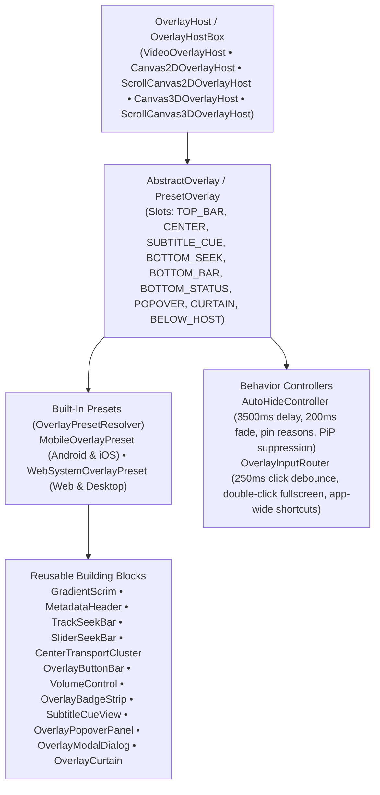

# `:extensions:overlay` & `:extensions:overlay:dsl` — Universal Domain-Agnostic Overlay Framework

> **Navigation**: [**GenericUI Root (`../../README.md`)**](../../README.md) · [**Extensions Index (`../README.md`)**](../README.md) · [**Root Extensions Guide (`../../docs/extensions.md`)**](../../docs/extensions.md) · [**Fragments & Windows (`../../docs/fragments-and-windows.md`)**](../../docs/fragments-and-windows.md) · [**Source Sets (`../../docs/sourcesets.md`)**](../../docs/sourcesets.md) · [**Backends (`../../docs/backends.md`)**](../../docs/backends.md) · [**Gradle Plugin (`../../docs/gradle-plugin.md`)**](../../docs/gradle-plugin.md)

`:extensions:overlay` (`com.nexustools.genericui.ext.overlay`) is a **Single Multiplatform Project** depending **exclusively on `:common`**. It provides a 100% generic, domain-agnostic overlay architecture for interactive media players, 2D/3D canvases, visualizers, viewports, and custom surfaces across all 8 GenericUI backends.

Its companion module `:extensions:overlay:dsl` (`com.nexustools.genericui.ext.overlay.dsl`) provides declarative `kotlinx.html`-style builders for `OverlayHostBox`, `MobileOverlayPreset`, `WebSystemOverlayPreset`, `OverlayPresetResolver`, and every reusable overlay building block.

---

## 1. Architectural Principles & Preset Matrix

- **100% Domain-Agnostic Core**:
  - `:extensions:overlay` contains zero application-specific domain assumptions. Instead, it provides structured slots (`OverlaySlot`), reactive state (`OverlayState`) with `customProperties`, action callbacks (`OverlayActions`) with `onCustomAction`, generic badges (`OverlayBadge`, `OverlayBadgeStrip`), transport controls, seek bars, popovers, modal dialogs, curtains, auto-hide timers, and keyboard shortcut routing.
- **Integrated Across Media, Canvas2D, & Canvas3D**:
  - [`:extensions:media`](media.md) provides `VideoOverlayHost` and `VideoPlayerOverlayBinder` (`videoPlayer.attachVideoOverlay(...)` / `videoPlayer.withOverlay(...)`).
  - [`:extensions:canvas2d`](canvas2d.md) provides `Canvas2DOverlayHost` and `ScrollCanvas2DOverlayHost` (`canvas.attachOverlay(...)` / `scrollCanvas.attachOverlay(...)`).
  - [`:extensions:canvas3d`](canvas3d.md) provides `Canvas3DOverlayHost` and `ScrollCanvas3DOverlayHost` (`glCanvas.attachOverlay(...)` / `vkCanvas.attachOverlay(...)` / `scrollCanvas3D.attachOverlay(...)`).
  - On `ScrollCanvas2D` and `ScrollCanvas3D`, the overlay host covers **only the visible viewport area (`viewportWidth` x `viewportHeight`)**, never obscuring the horizontal or vertical scrollbars (`overlayCoversScrollbars == false`).
  - No default overlay is attached to 2D or 3D canvases unless explicitly configured by the consumer.
- **Picture-in-Picture (PiP) Awareness**:
  - Calling `host.setPictureInPictureMode(true)` or `overlay.setPictureInPictureMode(true)` immediately hides and disables the overlay (`isInPictureInPictureMode == true`) while the host surface is in Picture-in-Picture mode, and restores normal auto-hide behavior when exiting PiP.



### Mobile (`MobileOverlayPreset`) vs. System + Web (`WebSystemOverlayPreset`) Comparison

`OverlayPresetResolver.resolveForBackend(backend)` automatically selects `MobileOverlayPreset` on mobile touch targets (`Android`, `IOS`) and `WebSystemOverlayPreset` on Web and desktop/system targets (`Windows`, `MacOS`, `Gtk`, `Qt`, `Swing`):

| Feature Area | `MobileOverlayPreset` (`Android`, `IOS`) | `WebSystemOverlayPreset` (`Web`, `Windows`, `MacOS`, `Gtk`, `Qt`, `Swing`) |
| :--- | :--- | :--- |
| **Gradient Scrims** | Top scrim (`#EE000000 → #99000000 → transparent`) + bottom scrim helper | Top (`rgba(0,0,0,0.65) → transparent`) & bottom (`rgba(0,0,0,0.8) → transparent`) gradient scrims |
| **Top Bar & Status (`OverlaySlot.TOP_BAR` / `BOTTOM_STATUS`)** | `MetadataHeader` (title 15sp bold, subtitle 12sp, outlined `topBadges` chips, trailing 44dp circle action buttons); centered bottom `OverlayStatusPill` (`#88000000`) when `statusText` is non-empty | `MetadataHeader` with inline status/loading line visible whenever `statusText` is non-empty |
| **Badge Strip (`OverlaySlot.BELOW_HOST`)** | Outlined chips in `TOP_BAR` + optional `BELOW_HOST` strip | `OverlayBadgeStrip` mounted in `host.belowHostContainer` outside the overlay surface, supporting `NEUTRAL`, `SUCCESS`, `DANGER`, `INFO`, `THEME`, and `OUTLINED` badge variants with click callbacks |
| **Transport & Bottom Controls** | `CenterTransportCluster` (**−30s** 56dp, **Play/Pause** 64dp with `LoadingIndicator`, **+30s** 56dp on `#88000000` circles); bottom bar with formatted `timePill` (`0:00 / --:--`) + 44dp circle action buttons (`optionsButton`, `fullscreenButton`, custom buttons) | Center `LoadingIndicator`; bottom `OverlayButtonBar` with leading Play/Pause, optional Next (`actions.onNext != null`), hover-expanding `VolumeControl`, formatted `timeLabel`, `customLeadingSlot`, `customTrailingSlot`, `settingsButton`, and `fullscreenButton` |
| **Seek Bar & Time Format** | `SliderSeekBar` in `BOTTOM_SEEK` below the button row: uses app primary `themeColor` by default, disabled until duration is known, drag with live time preview, commit on release (`[0, dur−0.5]`); formats both times as `H:MM:SS` once either is $\ge 1\text{h}$ (`--:--` when unknown) | `TrackSeekBar` (6px track expanding to 10px on hover) in `BOTTOM_SEEK` above the button row: uses app primary `themeColor` by default, hover time tooltip + drag-with-live-preview and click-to-seek; same `H:MM:SS` time format |
| **Pointer / Tap, Auto-Hide, & PiP** | Single tap toggles overlay visibility (`instantHideOnTap = true`); `3500ms` auto-hide delay with `200ms` fade-in/out; generic pin reasons (`setPinned(reason, Boolean)`); hidden in PiP (`setPictureInPictureMode(true)`) | Single click = Play/Pause (`250ms` debounce), double-click = Fullscreen (`onToggleFullscreen`); pointer move shows overlay, **pointer leave hides immediately** (`onPointerLeave`); cursor hidden while overlay is hidden; same `3500ms`/`200ms` auto-hide, pin reasons, & PiP suppression |
| **Keyboard Shortcuts (`OverlayInputRouter`)** | Configurable shortcuts on all 8 backends (`Space`/`K` Play/Pause, `ArrowLeft`/`J` −10s, `ArrowRight`/`L` +10s, `ArrowUp`/`ArrowDown` Volume ±5%, `M` Mute, `F` Fullscreen, plus custom `OverlayShortcutBinding`s; ignored when a text input has focus) | Identical configurable keyboard shortcuts |
| **Settings / Menus, Subtitles, & Curtain** | `OverlayModalDialog` for audio/subtitle tracks, playback speed, and custom sections (`registerCustomMenuSection`); `SubtitleCueView` in `SUBTITLE_CUE`; `OverlayCurtain` in `CURTAIN` | Anchored `OverlayPopoverPanel` for audio/subtitle tracks, playback speed, and custom sections (`registerCustomMenuSection`); `SubtitleCueView` in `SUBTITLE_CUE`; `OverlayCurtain` in `CURTAIN` |

---

## 2. Gradle Plugin Configuration

Enable `overlay()` in the `genericui { extensions { ... } }` block in `build.gradle.kts` (note that enabling `media()`, `canvas2d()`, or `canvas3d()` automatically enables `overlay()`, and enabling `dsl()` automatically adds `:extensions:overlay:dsl`):

```kotlin
plugins {
    id("com.nexustools.genericui")
}

genericui {
    app {
        id = "com.example.overlaydemo"
        name = "Overlay Demo"
    }
    backends {
        allExceptSwing()
    }
    extensions {
        dsl()     // Enables :extensions:dsl and auto-wires :extensions:overlay:dsl
        overlay() // Enables :extensions:overlay across all configured backends
    }
}
```

---

## 3. Core API Reference (`com.nexustools.genericui.ext.overlay`)

| Class / Interface / Enum | Description & Key Members |
| :--- | :--- |
| `OverlayExtension` | Global registry for default `themeColorHex` and custom `OverlayElementFactory` registrations (`effectiveDefaultThemeColorHex()`, `registerElementFactory`, `createElement`). |
| `OverlayHost` / `OverlayHostBox` | Host contract and `Container` implementation wrapping a `content` component, layering `overlayRoot` on top, and mounting `belowHostContainer` (`OverlaySlot.BELOW_HOST`) directly underneath. Key members: `activeOverlay`, `state`, `actions`, `isInPictureInPictureMode`, `themeColorHex`, `attachOverlay(overlay)`, `detachOverlay()`, `updateState { ... }`, `updateActions { ... }`, `setPictureInPictureMode(enabled)`. |
| `AbstractOverlay` | Base overlay `Container` managing the 9 `OverlaySlot` containers, `autoHideController`, `inputRouter`, `state`, `actions`, and `setPictureInPictureMode(enabled)`. Key methods: `addElement`, `removeElement`, `getElement`, `getElementsInSlot`, `clearSlot`, `updateState`, `updateActions`. |
| `PresetOverlay` | Open subclass of `AbstractOverlay` providing `metadataHeader`, `subtitleCueView`, `bottomButtonBar`, `curtain`, `belowHostBadgeStrip`, and convenience mutators (`addTopBarIconButton`, `addBottomIconButton`, `addBottomPillButton`, `addBottomLeadingControl`, `addBottomTrailingControl`, `registerCustomMenuSection`, `setCurtainContent`, `setBelowHostBadges`). |
| `MobileOverlayPreset` | Built-in mobile touch preset (`topScrim`, `bottomScrim`, `centerTransportCluster`, `statusPill`, `timePill`, `sliderSeekBar`, `modalDialog`, `optionsButton`, `fullscreenButton`, `addBottomCircleButton`). |
| `WebSystemOverlayPreset` | Built-in Web & desktop preset (`topScrim`, `bottomScrim`, `loadingIndicator`, `trackSeekBar`, `playPauseButton`, `nextButton`, `volumeControl`, `timeLabel`, `popoverPanel`, `settingsButton`, `fullscreenButton`). |
| `OverlayPresetResolver` | Resolves `MobileOverlayPreset` when `backend.isMobile == true` and `WebSystemOverlayPreset` otherwise (`resolveForBackend(backend)`). |
| `OverlaySlot` | Enum defining the 9 overlay regions: `TOP_BAR`, `CENTER`, `SUBTITLE_CUE`, `BOTTOM_SEEK`, `BOTTOM_BAR`, `BOTTOM_STATUS`, `POPOVER`, `CURTAIN`, `BELOW_HOST`. |
| `OverlayState` | Immutable state snapshot: `title`, `subtitle`, `statusText`, `isPlaying`, `isLoading`, `positionSec`, `durationSec`, `bufferedRanges`, `volumePercent`, `isMuted`, `playbackSpeed`, `availableSpeeds`, `isFullscreen`, `isInPictureInPictureMode`, `subtitleCueText`, `audioTracks`, `subtitleTracks`, `topBadges`, `belowHostBadges`, `customProperties`, `formattedPosition`, `formattedDuration`, `formattedTimePair`. |
| `OverlayActions` | Callback bundle: `onPlayPause`, `onPlay`, `onPause`, `onSeekToSec`, `onSkipDeltaSec`, `onNext`, `onPrevious`, `onVolumeChange`, `onMuteToggle`, `onSpeedChange`, `onSelectAudioTrack`, `onSelectSubtitleTrack`, `onToggleFullscreen`, `onBadgeClick`, `onCustomAction`. |
| `AutoHideController` / `AutoHideSpec` | Lifecycle-bound timer controller (`delayMs = 3500`, `fadeInMs = 200`, `fadeOutMs = 200`, `hideImmediatelyOnPointerLeave`, `hideCursorWhenOverlayHidden`, `instantHideOnTap`). Key methods: `setPinned(reason, pinned)`, `clearAllPins()`, `showOverlay()`, `hideOverlay(instant)`, `notifyUserActivity()`, `notifyPointerLeave()`, `toggleVisibilityByTap()`, `setPictureInPictureMode(inPip)`. |
| `OverlayInputRouter` / `OverlayShortcutBinding` | Routes pointer clicks (`250ms` debounce), double-clicks (fullscreen), pointer enter/move/leave, and keyboard shortcuts (`registerShortcut`, `unregisterShortcut`, `resetDefaultShortcuts`), ignoring keys while a text input is focused. |
| `TrackSeekBar` & `SliderSeekBar` | Desktop/Web thin expandable seek track with hover time tooltip (`TrackSeekBar`) and Mobile slider seek bar (`SliderSeekBar`), both supporting live drag preview, buffered range rendering, and app `themeColor` styling via standard CSS `getStyle().setAccentColor(...)` and `getStyle().setBackgroundColor(...)`. |
| `GradientScrim` / `MetadataHeader` / `CenterTransportCluster` / `VolumeControl` / `OverlayButtonBar` | Modular UI building blocks implementing `OverlayElement`. |
| `OverlayBadge` / `OverlayBadgeStrip` / `OverlayBadgeSpec` / `OverlayBadgeVariant` | Clickable or informational badge chips (`NEUTRAL`, `SUCCESS`, `DANGER`, `INFO`, `THEME`, `OUTLINED`) mountable in `TOP_BAR` or `BELOW_HOST`. |
| `OverlayPopoverPanel` / `OverlayModalDialog` / `SubtitleCueView` / `OverlayCurtain` | Settings popover/modal shells, formatted subtitle cue box, and full-surface overlay curtain slot. |

---

## 4. Imperative Kotlin Examples

### Example 1: Attaching a Platform-Resolved Preset Overlay to a `VideoPlayerExt`

```kotlin
import com.nexustools.genericui.ext.media.VideoPlayerExt
import com.nexustools.genericui.ext.media.overlay.VideoOverlayHost
import com.nexustools.genericui.ext.overlay.OverlayBadgeSpec
import com.nexustools.genericui.ext.overlay.OverlayBadgeVariant
import com.nexustools.genericui.ext.overlay.OverlayPresetResolver
import com.nexustools.genericui.ext.overlay.OverlayShortcutBinding

fun createVideoPlayerWithAdaptiveOverlay(): VideoOverlayHost {
    val player = VideoPlayerExt(sourceUrl = "https://cdn.example.com/streams/concert.mp4")

    // Resolve MobileOverlayPreset on Android/iOS, or WebSystemOverlayPreset on Desktop/Web
    val overlay = OverlayPresetResolver.resolveForBackend().apply {
        // Add a custom action button to the bottom bar
        addBottomPillButton(
            id = "skip-intro",
            text = "Skip Intro",
            variant = OverlayBadgeVariant.THEME,
            leading = false
        ) {
            player.seekTo(85.0)
        }

        // Register a custom keyboard shortcut ('S' to skip intro)
        inputRouter.registerShortcut(
            OverlayShortcutBinding(id = "skip_intro_key", key = "s", allowRepeat = false) { _, actions ->
                actions.onSeekToSec?.invoke(85.0)
            }
        )
    }

    // Wrap the VideoPlayerExt in a VideoOverlayHost (automatically binds state, tracks, and actions)
    val host = player.attachVideoOverlay(overlay)
    host.updateState { state ->
        state.copy(
            title = "Live Symphony Broadcast",
            subtitle = "Season 4 • Episode 2",
            belowHostBadges = listOf(
                OverlayBadgeSpec(id = "uhd", text = "4K UHD", variant = OverlayBadgeVariant.SUCCESS, clickable = true),
                OverlayBadgeSpec(id = "hdr", text = "HDR10", variant = OverlayBadgeVariant.INFO, clickable = true),
                OverlayBadgeSpec(id = "codec", text = "V: HEVC • A: FLAC", variant = OverlayBadgeVariant.NEUTRAL)
            )
        )
    }

    return host
}
```

### Example 2: Attaching an Overlay to a `ScrollCanvas2D` (Covering Only the Viewport)

```kotlin
import com.nexustools.genericui.ext.canvas2d.ScrollCanvas2D
import com.nexustools.genericui.ext.canvas2d.overlay.ScrollCanvas2DOverlayHost
import com.nexustools.genericui.ext.overlay.WebSystemOverlayPreset

fun createScrollableCanvasWithHudOverlay(): ScrollCanvas2DOverlayHost {
    val scrollCanvas = ScrollCanvas2D(
        viewportWidth = 960,
        viewportHeight = 540,
        contentWidth = 4000,
        contentHeight = 3000
    )

    val overlay = WebSystemOverlayPreset(overlayId = "canvas-hud").apply {
        addTopBarIconButton(id = "reset-zoom", symbol = "🔍", tooltip = "Reset View") {
            scrollCanvas.scrollTo(0, 0)
        }
    }

    // Attaches the overlay strictly over the 960x540 viewport area, excluding scrollbars
    return scrollCanvas.attachOverlay(overlay).apply {
        updateState { it.copy(title = "Interactive Vector Map", statusText = "Zoom: 100%") }
    }
}
```

---

## 5. Declarative `:extensions:overlay:dsl` Examples

When `dsl()` and `overlay()` (or `media()`, `canvas2d()`, `canvas3d()`) are enabled in `genericui { extensions { ... } }`, use `videoOverlayHost`, `canvas2DOverlayHost`, `scrollCanvas2DOverlayHost`, `glCanvasOverlayHost`, `vkCanvasOverlayHost`, `overlayHostBox`, `defaultOverlayPreset`, `mobileOverlayPreset`, and `webSystemOverlayPreset` in declarative UI layouts:

```kotlin
import com.nexustools.genericui.component.fragment.AppFragment
import com.nexustools.genericui.component.fragment.Fragment
import com.nexustools.genericui.component.fragment.FragmentBundle
import com.nexustools.genericui.ext.dsl.build
import com.nexustools.genericui.ext.dsl.div
import com.nexustools.genericui.ext.media.dsl.videoOverlayHost
import com.nexustools.genericui.ext.overlay.OverlayBadgeSpec
import com.nexustools.genericui.ext.overlay.OverlayBadgeVariant
import com.nexustools.genericui.ext.overlay.dsl.defaultOverlayPreset

@AppFragment(label = "Media Overlay Player", route = "player")
class MediaOverlayPlayerFragment : Fragment() {
    override fun onCreate(savedState: FragmentBundle?) {
        super.onCreate(savedState)
        rootContainer.build {
            div(classes = "p-3") {
                videoOverlayHost(
                    sourceUrl = "https://cdn.example.com/video/documentary.mp4",
                    themeColorHex = "#0d6efd"
                ) {
                    defaultOverlayPreset {
                        addBottomPillButton(
                            id = "next-chapter",
                            text = "Next Chapter ⏭",
                            variant = OverlayBadgeVariant.THEME,
                            leading = false
                        ) {
                            videoPlayer.skipDelta(60.0)
                        }
                        setBelowHostBadges(
                            listOf(
                                OverlayBadgeSpec(
                                    id = "direct-play",
                                    text = "Direct Play",
                                    variant = OverlayBadgeVariant.SUCCESS,
                                    clickable = true
                                )
                            )
                        )
                    }
                    updateState {
                        it.copy(
                            title = "Deep Ocean Exploration",
                            subtitle = "Chapter 1 • Mariana Trench"
                        )
                    }
                }
            }
        }
    }
}
```

---

## 6. Related Extensions & Cross-References

- **Integrated Host Extensions**:
  - [`:extensions:media` & `:extensions:media:dsl` (`media.md`)](media.md) — `VideoOverlayHost`, `VideoPlayerOverlayBinder`, `VideoPlayerExt.attachVideoOverlay`, and `videoOverlayHost { ... }`.
  - [`:extensions:canvas2d` & `:extensions:canvas2d:dsl` (`canvas2d.md`)](canvas2d.md) — `Canvas2DOverlayHost`, `ScrollCanvas2DOverlayHost`, `canvas2DOverlayHost { ... }`, and `scrollCanvas2DOverlayHost { ... }`.
  - [`:extensions:canvas3d` & `:extensions:canvas3d:dsl` (`canvas3d.md`)](canvas3d.md) — `Canvas3DOverlayHost`, `ScrollCanvas3DOverlayHost`, `glCanvasOverlayHost { ... }`, `vkCanvasOverlayHost { ... }`, and `scrollCanvas3DOverlayHost { ... }`.
  - [`:extensions:mediacontrols` & `:extensions:mediacontrols:dsl` (`mediacontrols.md`)](mediacontrols.md) — Companion standalone OS media transport controls, Windows taskbar preview buttons, and hardware keyboard media key hooks.
  - [`:extensions:dsl` (`dsl.md`)](dsl.md) — Base declarative Kotlin UI & Style DSL.
- **Root & Backend Documentation**:
  - [GenericUI Root (`../../README.md`)](../../README.md) · [Extensions Architecture (`../../docs/extensions.md`)](../../docs/extensions.md) · [Fragments & Windows (`../../docs/fragments-and-windows.md`)](../../docs/fragments-and-windows.md) · [Source Sets (`../../docs/sourcesets.md`)](../../docs/sourcesets.md) · [Backends (`../../docs/backends.md`)](../../docs/backends.md) · [Gradle Plugin (`../../docs/gradle-plugin.md`)](../../docs/gradle-plugin.md)
