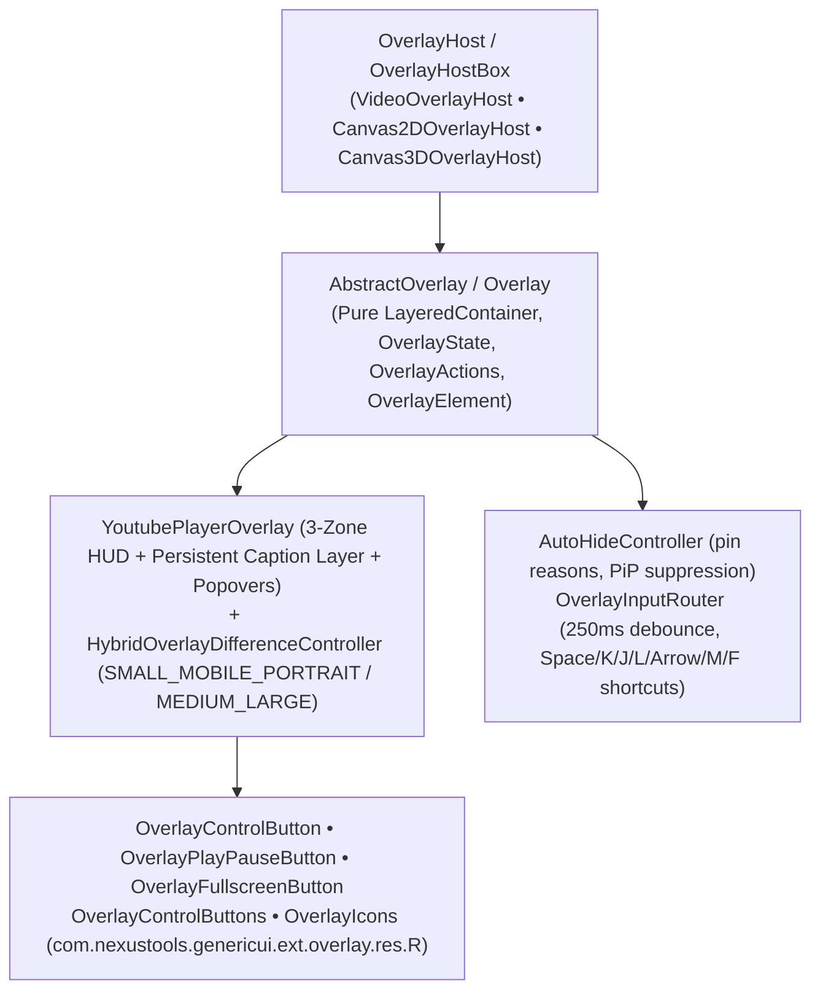

# `:extensions:ui:overlay` & `:extensions:ui:overlay:dsl` — Pure Layered Overlay Chrome, `style.scss`/`theme.scss`, `.hidden` Fading (`Animator`), & `YoutubePlayerOverlay`

> **Navigation**: [**GenericUI Root (`../../README.md`)**](../../README.md) · [**Extensions Index (`../README.md`)**](../README.md) · [**Root Extensions Guide (`../../docs/extensions.md`)**](../../docs/extensions.md) · [**Fragments & Windows (`../../docs/fragments-and-windows.md`)**](../../docs/fragments-and-windows.md) · [**Resources (`../../docs/resources.md`)**](../../docs/resources.md) · [**Source Sets (`../../docs/sourcesets.md`)**](../../docs/sourcesets.md) · [**Backends (`../../docs/backends.md`)**](../../docs/backends.md) · [**Gradle Plugin (`../../docs/gradle-plugin.md`)**](../../docs/gradle-plugin.md)

`:extensions:ui:overlay` (`com.nexustools.genericui.ext.overlay`) is a **Single Consolidated KMP Project** depending **exclusively on `:common`**. It provides a pure, background-free `LayeredContainer` overlay framework (`OverlayHost`, `OverlayHostBox`, `AbstractOverlay`, `FadingOverlay`, `Overlay`, `OverlayStageProvider`), built-in pure-Bezier SVG icons (`com.nexustools.genericui.ext.overlay.res.R`), stylesheet-driven transport buttons (`OverlayControlButton`, `OverlayPlayPauseButton`, `OverlayFullscreenButton`, `OverlayControlButtons`), a ready-to-bind 3-zone player HUD (`YoutubePlayerOverlay`), responsive mobile/desktop layout policy (`HybridOverlayDifferenceController`), `.hidden`-class auto-hide (`AutoHideController`), and app-wide keyboard/pointer/drag routing (`OverlayInputRouter`).

Its companion module `:extensions:ui:overlay:dsl` (`com.nexustools.genericui.ext.overlay.dsl`) exposes declarative builders (`overlayHostBox`, `overlay`, `attachPureOverlay`, `youtubePlayerOverlay`, `attachYoutubePlayerOverlay`, `hybridOverlayDifference`, `overlayControlButton`, `overlayPlayPauseButton`, `overlayFullscreenButton`).

---

## 1. Architectural Principles (`LayeredContainer`, Pure Visual Chrome, & PiP Awareness)

- **100% Pure, Background-Free `OverlayHostBox` & `Overlay`**:
  - [`OverlayHostBox`](../ui/overlay/src/commonMain/kotlin/com/nexustools/genericui/ext/overlay/OverlayHostBox.kt) and [`Overlay`](../ui/overlay/src/commonMain/kotlin/com/nexustools/genericui/ext/overlay/Overlay.kt) auto-attach zero preset chrome or background scrims unless explicitly configured, layering `overlayRoot` cleanly over any hosted `AbstractComponent` (`VideoPlayer`, `Canvas2D`, `Canvas3D`, or custom widgets).
- **Integrated Across Media, Picture-in-Picture, Canvas2D, & Canvas3D**:
  - [`:extensions:media:media`](media.md) pairs [`VideoOverlayHost`](../media/media/src/commonMain/kotlin/com/nexustools/genericui/ext/media/overlay/VideoOverlayHost.kt) + [`YoutubeMediaOverlayHelper`](../media/media/src/commonMain/kotlin/com/nexustools/genericui/ext/media/overlay/YoutubeMediaOverlayHelper.kt) with `YoutubePlayerOverlay`.
  - [`:extensions:ui:pip`](pip.md) extends `AbstractOverlay` for floating [`PipControlOverlay`](../ui/pip/src/commonMain/kotlin/com/nexustools/genericui/ext/pip/PipControlOverlay.kt).
  - [`:extensions:graphics:canvas2d`](canvas2d.md) and [`:extensions:graphics:canvas3d`](canvas3d.md) expose `Canvas2DOverlayHost`, `ScrollCanvas2DOverlayHost`, `Canvas3DOverlayHost`, and `ScrollCanvas3DOverlayHost` (covering only the visible viewport without obscuring scrollbars).
- **Hardware `backdrop-filter`, `style.scss` / Raw `theme.scss` Template, & `.hidden` Fading Overlays**:
  - `StyledComponent`, `StyledButton`, and `StyledContainer` honor hardware `backdropFilter` (`backdropBlurPx`) across all 9 backends via `style.scss` (`:extensions:ui:overlay/src/commonMain/resources/styles/style.scss`). Meanwhile, `:extensions:ui:overlay/src/commonMain/resources/styles/theme.scss` is packaged solely as a **raw uncompiled template** in `META-INF/genericui/themes/<scopeId>.scss` and `META-INF/genericui/module-resources/<scopeId>.json` (library artifacts NEVER pre-compile or integrate `theme.scss`); only the consumer application's `:gradle-plugin` build extracts it, substitutes the consumer app's `genericui { theme { ... } }` SCSS variables (`$accent`, `rgba($accent, ...)`), and integrates `GenericUiGeneratedThemeStyleSheet` (`:system`) and `gui/genericui-theme.css` (`:web`) solely into the consumer app to color `OverlayControlButton` (`.player-btn`, `.player-pill-inner-btn`, `:hover`, `:focus-visible`, `:disabled`) with zero direct Kotlin style setters.
  - Fading overlays (`FadingOverlay` / `AutoHideController`) fade the entire overlay (including embedded `OverlayWindowTitleBar` and all HUD bars) atomically by adding/removing `"hidden"` (`opacity: 0; pointer-events: none; cursor: none;`) paired with CSS `@keyframes` fade-in/fade-out rules in `overlay/style.scss` — executed by VBlank-synced `Animator` (`SystemCssAnimationController`) on `:system` and native browser CSS on `:web`. Persistent stage layers such as captions mount outside the fading overlay in `OverlayHostBox`'s persistent layer slot.
  - Calling `host.setPictureInPictureMode(true)` or `overlay.setPictureInPictureMode(true)` immediately hides and disables the main viewport overlay (`AutoHideController.setPictureInPictureMode`) while PiP is active, and restores auto-hide when PiP exits.



---

## 2. Gradle Plugin Configuration

Enable `overlay()` in `genericui { extensions { ... } }` inside `build.gradle.kts` (automatically enabled by `media()`, `pip()`, `canvas2d()`, and `canvas3d()`; `dsl()` auto-wires `:extensions:ui:overlay:dsl`):

```kotlin
plugins {
    id("com.nexustools.genericui")
}

genericui {
    app {
        id = "com.example.overlaydemo"
        name = "Overlay Demo"
    }
    backends {
        allExceptSwing()
    }
    extensions {
        dsl()     // Enables :extensions:ui:dsl + :extensions:ui:overlay:dsl
        overlay() // Enables :extensions:ui:overlay across all configured backends
    }
}
```

---

## 3. Built-In Vector Icons (`com.nexustools.genericui.ext.overlay.res.R`) & Control Chrome

### 3.1 `com.nexustools.genericui.ext.overlay.res.R` (9 Pure-Bezier SVGs)
All overlay icon drawables live inside `:extensions:ui:overlay` as pure-Bezier SVGs under `src/commonMain/resources/drawable/` and are resolved through `com.nexustools.genericui.ext.overlay.res.R` and [`OverlayIcons`](../ui/overlay/src/commonMain/kotlin/com/nexustools/genericui/ext/overlay/OverlayIcons.kt):

| [`OverlayIconType`](../ui/overlay/src/commonMain/kotlin/com/nexustools/genericui/ext/overlay/OverlayIconType.kt) | Generated `R.drawable` Resource ID | SVG File |
| :--- | :--- | :--- |
| `OverlayIconType.PLAY` | `R.drawable.ic_play` | [`ic_play.svg`](../ui/overlay/src/commonMain/resources/drawable/ic_play.svg) |
| `OverlayIconType.PAUSE` | `R.drawable.ic_pause` | [`ic_pause.svg`](../ui/overlay/src/commonMain/resources/drawable/ic_pause.svg) |
| `OverlayIconType.REWIND` | `R.drawable.ic_rewind` | [`ic_rewind.svg`](../ui/overlay/src/commonMain/resources/drawable/ic_rewind.svg) |
| `OverlayIconType.FAST_FORWARD` | `R.drawable.ic_fast_forward` | [`ic_fast_forward.svg`](../ui/overlay/src/commonMain/resources/drawable/ic_fast_forward.svg) |
| `OverlayIconType.STOP` | `R.drawable.ic_stop` | [`ic_stop.svg`](../ui/overlay/src/commonMain/resources/drawable/ic_stop.svg) |
| `OverlayIconType.NEXT` | `R.drawable.ic_next` | [`ic_next.svg`](../ui/overlay/src/commonMain/resources/drawable/ic_next.svg) |
| `OverlayIconType.PREVIOUS` | `R.drawable.ic_previous` | [`ic_previous.svg`](../ui/overlay/src/commonMain/resources/drawable/ic_previous.svg) |
| `OverlayIconType.FULLSCREEN_ENTER` | `R.drawable.ic_fullscreen_enter` | [`ic_fullscreen_enter.svg`](../ui/overlay/src/commonMain/resources/drawable/ic_fullscreen_enter.svg) |
| `OverlayIconType.FULLSCREEN_EXIT` | `R.drawable.ic_fullscreen_exit` | [`ic_fullscreen_exit.svg`](../ui/overlay/src/commonMain/resources/drawable/ic_fullscreen_exit.svg) |

Use `OverlayIcons.resourceFor(type)` to retrieve a `ResourceID` or `OverlayIcons.uriFor(type)` for resource URIs.

### 3.2 `OverlayControlButton`, `OverlayFullscreenButton`, & `OverlayControlButtons`
- **[`OverlayControlButton`](../ui/overlay/src/commonMain/kotlin/com/nexustools/genericui/ext/overlay/OverlayControlButton.kt)**: Extends `:common`'s `StyledButton` with CSS class-driven circular HUD chrome in `overlay/style.scss` & `overlay/theme.scss` (using `$accent` from consumer `genericui { theme { ... } }` for `:hover`/`:focus-visible` states with zero direct Kotlin style/color setters, and `tooltipText = null` unless explicitly set), configurable [`OverlayButtonVariant`](../ui/overlay/src/commonMain/kotlin/com/nexustools/genericui/ext/overlay/OverlayButtonVariant.kt):
  - `CIRCLE_PILL` (`40x40`, `.player-circle-btn`)
  - `CENTER_PRIMARY` (`64x64`, `.player-circle-btn` with `data-overlay-role="primary-center-action"`)
  - `CENTER_SECONDARY` (`56x56`, `.player-circle-btn`)
  - `INNER_PILL` (`32x32`, `.player-pill-inner-btn` borderless button for inside `40px` pill containers)
  - Frosted-glass backdrop blur chrome (`backdrop-filter`) is applied via CSS classes in `overlay/style.scss` rather than imperative Kotlin style overrides.
- **[`OverlayPlayPauseButton`](../ui/overlay/src/commonMain/kotlin/com/nexustools/genericui/ext/overlay/OverlayPlayPauseButton.kt)**: Stateful `OverlayControlButton` toggling `R.drawable.ic_play` / `R.drawable.ic_pause` via `isPlaying` (`data-playing`, `aria-pressed`).
- **[`OverlayFullscreenButton`](../ui/overlay/src/commonMain/kotlin/com/nexustools/genericui/ext/overlay/OverlayFullscreenButton.kt)**: Stateful `OverlayControlButton` switching between `R.drawable.ic_fullscreen_enter` and `R.drawable.ic_fullscreen_exit` via `isFullscreen` (`data-fullscreen`, `aria-pressed`) + `toggle()`.
- **[`OverlayControlButtons`](../ui/overlay/src/commonMain/kotlin/com/nexustools/genericui/ext/overlay/OverlayControlButtons.kt)**: Factory helpers:
  - Transport & icon buttons: `play`, `pause`, `playPause`, `rewind`, `fastForward`, `stop`, `next`, `previous`, `fullscreenEnter`, `fullscreenExit`, `fullscreenToggle`
  - Structural pills & badges: `createControlsPill(role, backgroundColor, borderColor, backdropFilter, id)`, `createTimePill(initialText, backgroundColor, borderColor, backdropFilter, id)`, `createOutlinedBadge(text, borderColor, textColor, id)`

---

## 4. `YoutubePlayerOverlay` & `HybridOverlayDifferenceController`

### 4.1 `YoutubePlayerOverlay` Structure & APIs
[`YoutubePlayerOverlay`](../ui/overlay/src/commonMain/kotlin/com/nexustools/genericui/ext/overlay/YoutubePlayerOverlay.kt) (configured via [`YoutubeOverlayConfig`](../ui/overlay/src/commonMain/kotlin/com/nexustools/genericui/ext/overlay/YoutubeOverlayConfig.kt)) arranges three clean layer stacks inside `AbstractOverlay`:
1. **`hudControlsContainer` (`zIndex = 10`, `data-overlay-role = "controls-layer"`)**: Auto-hidden after `config.autoHideSpec.delayMs` (`5000ms` default, `220ms` fade-in/out) while keeping the root hit-testable to wake the HUD on pointer/tap activity:
   - `topBar`: `titleLabel`, `subtitleLabel`, `statusLabel`, `topBadgesContainer` (`addTopBadge`), `topRightActionsRow` (`addTopRightAction`).
   - `centerZone`: `loadingSpinner` + `centerTransportRow` (`centerPreviousButton`, `centerRewindButton`, `centerPlayPauseButton`, `centerStopButton`, `centerFastForwardButton`, `centerNextButton`).
   - `bottomBar`: [`timelineContainer`](../ui/overlay/src/commonMain/kotlin/com/nexustools/genericui/ext/overlay/YoutubeTimelinePlacement.kt) (placed `ABOVE_CONTROLS` or `BELOW_CONTROLS` via `setTimelinePlacement`), hover `seekHoverBubble` (`showTimelineHover(fraction, label)` / `hideTimelineHover()`), and `controlsRow` containing left transport buttons (`previousButton`, `playPauseButton`, `stopButton`, `rewindButton`, `fastForwardButton`, `nextButton`), `leftAccessoryContainer` (e.g., for `ExpandingVolumeSlider`), `timePillContainer` / `timeReadoutLabel`, and `rightControlsPill` (`rightPillAccessoryRow` + `fullscreenButton`, extended via `addRightPillButton`).
2. **`subtitleBanner` (`zIndex = 15`, `LayerAlignment.BOTTOM_CENTER`, `data-overlay-role = "caption-banner"`)**: Mounted outside `hudControlsContainer` so subtitles (`setSubtitleCueText`) remain visible even when HUD chrome auto-hides.
3. **Registered Popover Layers (`zIndex = 30`)**: Managed via `registerPopoverLayer(id, component, constraint)`, `unregisterPopoverLayer`, `setPopoverOpen`, `togglePopover`, `closeAllPopovers`, automatically pinning/unpinning `autoHideController` while open.

### 4.2 `HybridOverlayDifferenceController` (`SMALL_MOBILE_PORTRAIT` vs `MEDIUM_LARGE`)
[`HybridOverlayDifferenceController`](../ui/overlay/src/commonMain/kotlin/com/nexustools/genericui/ext/overlay/HybridOverlayDifferenceController.kt) reconciles responsive layout differences on `YoutubePlayerOverlay` using `:common`'s `HybridBreakpointSpec`, viewport dimensions, and `BackendTarget` per [`HybridOverlayDifferenceSpec`](../ui/overlay/src/commonMain/kotlin/com/nexustools/genericui/ext/overlay/HybridOverlayDifferenceSpec.kt):

| Behavior | `HybridOverlayLayoutMode.SMALL_MOBILE_PORTRAIT` | `HybridOverlayLayoutMode.MEDIUM_LARGE` |
| :--- | :--- | :--- |
| **Timeline Placement (`YoutubeTimelinePlacement`)** | **`BELOW_CONTROLS`** (thumb-reachable under the bottom transport bar) | **`ABOVE_CONTROLS`** (wide desktop/tablet/web layout) |
| **Center Transport Cluster** | Revealed (`centerRewindButton` `56x56`, `centerPlayPauseButton` `64x64`, `centerFastForwardButton` `56x56`) | Hidden by default (shows bottom controls row + loading spinner) |
| **Frosted Hardware `backdrop-filter`** | Applies `CssFilter(blur = CssLength.px(16f), saturate = 1.2f)` + frosted fill `rgba(20, 24, 32, 97)` + border `rgba(255, 255, 255, 56)` via `setCenterTransportBackdropFilter(...)` | Clears frosted filter (`mediumLargeCenterBackdropFilter = null`) and resets center chrome |
| **Bottom Duplicate Transport Buttons** | Hides `playPauseButton`, `rewindButton`, and `fastForwardButton` when `hideDuplicateBottomTransportInCompact == true` | Displays bottom transport buttons according to `overlay.config` |

---

## 5. Core API Summary (`com.nexustools.genericui.ext.overlay`)

| Symbol | Key Members |
| :--- | :--- |
| [`OverlayExtension`](../ui/overlay/src/commonMain/kotlin/com/nexustools/genericui/ext/overlay/OverlayExtension.kt) | `defaultThemeColorHex`, `activeApplication`, `effectiveDefaultThemeColorHex()`, `elementRegistry`, `createOverlay(...)`. |
| [`OverlayHost`](../ui/overlay/src/commonMain/kotlin/com/nexustools/genericui/ext/overlay/OverlayHost.kt) / [`OverlayHostBox`](../ui/overlay/src/commonMain/kotlin/com/nexustools/genericui/ext/overlay/OverlayHostBox.kt) | Pure host wrapping `contentComponent`, exposing `overlay` / `activeOverlay`, `overlayRoot`, `state`, `actions`, `isInPictureInPictureMode`, `attachOverlay`, `detachOverlay`, `updateState`, `updateActions`, `setPictureInPictureMode`, `bindToFramePresentTarget`. |
| [`AbstractOverlay`](../ui/overlay/src/commonMain/kotlin/com/nexustools/genericui/ext/overlay/AbstractOverlay.kt) & [`Overlay`](../ui/overlay/src/commonMain/kotlin/com/nexustools/genericui/ext/overlay/Overlay.kt) | Pure background-free `LayeredContainer` managing `OverlayElement`s (`addElement`, `removeElement`, `getElement`, `clearElements`), `autoHideController`, `inputRouter`, `updateState`, `updateActions`, `setPictureInPictureMode`, frame hooks (`onBeforeTargetFramePresent`, `notifyTargetRenderFrame`, `notifyTargetResize`). |
| [`OverlayState`](../ui/overlay/src/commonMain/kotlin/com/nexustools/genericui/ext/overlay/OverlayState.kt) & [`OverlayActions`](../ui/overlay/src/commonMain/kotlin/com/nexustools/genericui/ext/overlay/OverlayActions.kt) | Immutable snapshot (`title`, `subtitle`, `statusText`, `isPlaying`, `isLoading`, `positionSec`, `durationSec`, `bufferedRanges`, `volumePercent`, `isMuted`, `playbackSpeed`, `availableSpeeds`, `isFullscreen`, `isInPictureInPictureMode`, `subtitleCueText`, `audioTracks`, `subtitleTracks`, `customProperties`) and callback bundle (`onPlayPause`, `onPlay`, `onPause`, `onSeekToSec`, `onSkipDeltaSec`, `onNext`, `onPrevious`, `onVolumeChange`, `onMuteToggle`, `onSpeedChange`, `onSelectAudioTrack`, `onSelectSubtitleTrack`, `onToggleFullscreen`, `onBadgeClick`, `onCustomAction`). |
| [`AutoHideController`](../ui/overlay/src/commonMain/kotlin/com/nexustools/genericui/ext/overlay/AutoHideController.kt) & [`AutoHideSpec`](../ui/overlay/src/commonMain/kotlin/com/nexustools/genericui/ext/overlay/AutoHideSpec.kt) | `setPinned(reason, Boolean)`, `clearAllPins()`, `setPictureInPictureMode(Boolean)`, `showOverlay()` (`removeClass("hidden")`), `hideOverlay()` (`addClass("hidden")`), `notifyUserActivity()`, `notifyPointerLeave()`, `toggleVisibilityByTap()`. |
| [`OverlayInputRouter`](../ui/overlay/src/commonMain/kotlin/com/nexustools/genericui/ext/overlay/OverlayInputRouter.kt) | `>= 5px` stage drag-slop (`window.startSystemMove()` when `windowDragEnabled == true`), `250ms` click debounce on Desktop/Web, single-tap HUD toggle on touch-primary targets, double-click fullscreen toggle, `isolateInteractiveComponent(...)`, and configurable shortcuts (`Space`/`K`, `ArrowLeft`/`J`, `ArrowRight`/`L`, `ArrowUp`/`ArrowDown`, `M`, `F`, plus `registerShortcut` / `unregisterShortcut`), ignored while text inputs have focus. |

---

## 6. `:extensions:ui:overlay:dsl` Usage Examples

### Example 1: Custom Pure Layer Overlay (`attachPureOverlay` + `floatingLayer`)

```kotlin
import com.nexustools.genericui.component.layout.LayerAlignment
import com.nexustools.genericui.ext.dsl.buildDiv
import com.nexustools.genericui.ext.dsl.p
import com.nexustools.genericui.ext.overlay.OverlayButtonVariant
import com.nexustools.genericui.ext.overlay.OverlayIconType
import com.nexustools.genericui.ext.overlay.dsl.attachPureOverlay
import com.nexustools.genericui.ext.overlay.dsl.floatingLayer
import com.nexustools.genericui.ext.overlay.dsl.overlayControlButton
import com.nexustools.genericui.ext.overlay.dsl.overlayHostBox

fun createCanvasWithPureHud(surface: com.nexustools.genericui.core.AbstractComponent) = buildDiv {
    overlayHostBox(content = surface) {
        attachPureOverlay(classPrefix = "viewport-hud") {
            floatingLayer(
                elementId = "hud-status",
                alignment = LayerAlignment.TOP_START,
                leftPx = 12,
                topPx = 12,
                component = p("60 FPS")
            )
            floatingLayer(
                elementId = "fullscreen-btn",
                alignment = LayerAlignment.BOTTOM_END,
                rightPx = 12,
                bottomPx = 12,
                component = overlayControlButton(
                    iconType = OverlayIconType.FULLSCREEN_ENTER,
                    variant = OverlayButtonVariant.CIRCLE_PILL
                )
            )
        }
    }
}
```

### Example 2: `YoutubePlayerOverlay` with `hybridOverlayDifference`

```kotlin
import com.nexustools.genericui.ext.dsl.buildDiv
import com.nexustools.genericui.ext.media.dsl.videoOverlayHost
import com.nexustools.genericui.ext.media.overlay.YoutubeMediaOverlayHelper
import com.nexustools.genericui.ext.overlay.YoutubeOverlayConfig
import com.nexustools.genericui.ext.overlay.dsl.attachYoutubePlayerOverlay
import com.nexustools.genericui.ext.overlay.dsl.hybridOverlayDifference

fun createAdaptiveYoutubePlayer() = buildDiv {
    videoOverlayHost(sourceUrl = "https://cdn.example.com/streams/concert.mp4") {
        val overlay = attachYoutubePlayerOverlay(
            config = YoutubeOverlayConfig(skipDeltaSeconds = 10.0)
        ) {
            hybridOverlayDifference()
        }
        YoutubeMediaOverlayHelper(overlay = overlay, includeVolumeSlider = true)
        updateState {
            it.copy(
                title = "Live Symphony Broadcast",
                subtitle = "Season 4 • Episode 2"
            )
        }
    }
}
```

---

## 7. Related Extensions & Cross-References

- [`:extensions:media:media` & `:extensions:media:media:dsl` (`media.md`)](media.md) — `VideoOverlayHost`, `VideoPlayerOverlayBinder`, `YoutubeMediaOverlayHelper`, and 3-wave `ExpandingVolumeSlider`.
- [`:extensions:ui:pip` (`pip.md`)](pip.md) — `PipControlOverlay` floating Picture-in-Picture HUD and PiP suppression (`setPictureInPictureMode`).
- [`:extensions:graphics:canvas2d` (`canvas2d.md`)](canvas2d.md) & [`:extensions:graphics:canvas3d` (`canvas3d.md`)](canvas3d.md) — Viewport-scoped `Canvas2DOverlayHost` and `Canvas3DOverlayHost`.
- [`:extensions:ui:dsl` (`dsl.md`)](dsl.md) — Base declarative Kotlin UI & Style DSL.
