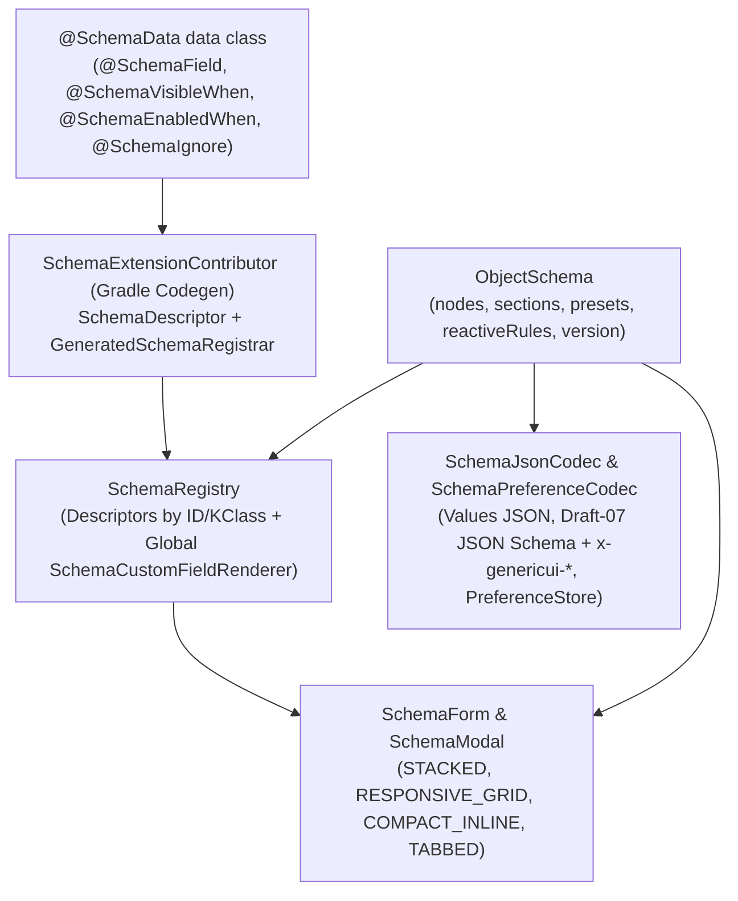

# `:extensions:data:schema` & `:extensions:data:schema:dsl` — Meta-Schema Engine, `SchemaForm`, `SchemaModal`, `@SchemaData` Codegen, & JSON Schema Interop

> **Navigation**: [**GenericUI Root (`../../README.md`)**](../../README.md) · [**Extensions Index (`../README.md`)**](../README.md) · [**Root Extensions Guide (`../../docs/extensions.md`)**](../../docs/extensions.md) · [**Source Sets (`../../docs/sourcesets.md`)**](../../docs/sourcesets.md) · [**Backends (`../../docs/backends.md`)**](../../docs/backends.md) · [**Gradle Plugin (`../../docs/gradle-plugin.md`)**](../../docs/gradle-plugin.md)

`:extensions:data:schema` (`com.nexustools.genericui.ext.schema`) is a **Single Consolidated KMP Project** compiled across all GenericUI targets (native Desktop, JVM Swing, Android, iOS, iPadOS, and Web JS/WasmJS) depending only on `:common`. It delivers a declarative meta-schema engine capable of rendering reactive, validated forms (`SchemaForm`) and modal dialogs (`SchemaModal`), persisting values via `:common`'s `PreferenceStore` (`SchemaPreferenceCodec`), serializing to/from JSON values and Draft-07 JSON Schema (`SchemaJsonCodec`), and generating compile-time reflection-free descriptors (`<ClassName>SchemaDescriptor`) from `@SchemaData`-annotated Kotlin classes via [`SchemaExtensionContributor`](../../gradle-plugin/src/main/kotlin/com/nexustools/genericui/plugin/spi/SchemaExtensionContributor.kt).

Its companion module `:extensions:data:schema:dsl` (`com.nexustools.genericui.ext.schema.dsl`) provides declarative builders (`objectSchema`, `buildObjectSchema`, `schemaForm`, `buildSchemaForm`, `schemaModal`) for constructing schemas and UI forms in-place.

---

## 1. Architecture & Compilation Model



---

## 2. Gradle Plugin Configuration

Enable `schema()` in `genericui { extensions { ... } }` inside `build.gradle.kts` (note that enabling `media()` automatically enables `schema()`, and enabling `dsl()` automatically adds `:extensions:data:schema:dsl`):

```kotlin
plugins {
    id("com.nexustools.genericui")
}

genericui {
    app {
        id = "com.example.schemademo"
        name = "Schema Demo"
    }
    backends {
        allExceptSwing()
    }
    extensions {
        dsl()    // Auto-wires :extensions:data:schema:dsl when schema() is enabled
        schema() // Enables :extensions:data:schema & @SchemaData descriptor codegen
    }
}
```

---

## 3. Field Specs & Structural Nodes (`SchemaNode` / `SchemaFieldSpec`)

Every node in [`ObjectSchema`](../data/schema/src/commonMain/kotlin/com/nexustools/genericui/ext/schema/ObjectSchema.kt) implements `SchemaNode` (carrying `key`, `label`, `description`, `sectionId`, `colSpan`, `visibleWhen`, `enabledWhen`, `legacyKeys`) or `SchemaFieldSpec` (`defaultValue`, `required`, `widgetHint: SchemaWidgetHint`):

### 3.1 Supported `SchemaFieldSpec` Types

| Spec Class | Stored Kotlin Value | Purpose & Notable Properties |
| :--- | :--- | :--- |
| [`BooleanFieldSpec`](../data/schema/src/commonMain/kotlin/com/nexustools/genericui/ext/schema/BooleanFieldSpec.kt) | `Boolean` | Checkbox or toggle switch (`SchemaWidgetHint.CHECKBOX` / `SWITCH`). |
| [`IntFieldSpec`](../data/schema/src/commonMain/kotlin/com/nexustools/genericui/ext/schema/IntFieldSpec.kt) | `Long` / `Int` | Integer/Long field with `min`, `max`, `step`, `unit`, `useLong`, and `quickChips: List<Int>` (one-click preset pills; also exposed via `intField` / `longField` in `:dsl`). |
| [`DoubleFieldSpec`](../data/schema/src/commonMain/kotlin/com/nexustools/genericui/ext/schema/DoubleFieldSpec.kt) | `Double` / `Float` | Floating-point field with `min`, `max`, `step`, `precision`, `unit`, `useFloat`, `preferSlider`, and `quickChips: List<Double>` (exposed via `doubleField` / `floatField` in `:dsl`). |
| [`CompoundNumberFieldSpec`](../data/schema/src/commonMain/kotlin/com/nexustools/genericui/ext/schema/CompoundNumberFieldSpec.kt) | `Double` / `List<Double>` | Multi-unit radix or vector tuple editor (`unitLabels`, `radices`, `radixStep`, `tupleMode`, `min`, `max`, `step`, `precision`). |
| [`StringFieldSpec`](../data/schema/src/commonMain/kotlin/com/nexustools/genericui/ext/schema/StringFieldSpec.kt) | `String` | Single-line, multiline (`multiline = true` / `SchemaWidgetHint.MULTILINE`), or masked password input (`secret = true` / `SchemaWidgetHint.SECRET`), plus `placeholder`, `maxLength`, and `pattern`. |
| [`ColorFieldSpec`](../data/schema/src/commonMain/kotlin/com/nexustools/genericui/ext/schema/ColorFieldSpec.kt) | `String` (Hex) | Color swatch + hex editor supporting `allowAlpha` and `quickChips: List<String>` palette swatches. |
| [`SelectFieldSpec`](../data/schema/src/commonMain/kotlin/com/nexustools/genericui/ext/schema/SelectFieldSpec.kt) | `String` | Single-choice dropdown/radio with static `options: List<SchemaOption>`, synchronous `optionsProvider: ((SchemaEvalContext) -> List<SchemaOption>)?`, or asynchronous `asyncOptionsProvider`. |
| [`OrderedMultiSelectFieldSpec`](../data/schema/src/commonMain/kotlin/com/nexustools/genericui/ext/schema/OrderedMultiSelectFieldSpec.kt) | `List<String>` | Ordered multi-selection checklist/pill list with static/dynamic options and reordering controls (`minItems`, `maxItems`). |
| [`PolymorphicRowListFieldSpec`](../data/schema/src/commonMain/kotlin/com/nexustools/genericui/ext/schema/PolymorphicRowListFieldSpec.kt) | `List<Map<String, Any?>>` | Typed heterogeneous row collection configured with `variants: List<SchemaRowVariantSpec>` (each row picks a variant type key and renders its variant schema). |
| [`CubicBezierFieldSpec`](../data/schema/src/commonMain/kotlin/com/nexustools/genericui/ext/schema/CubicBezierFieldSpec.kt) | `List<Float>` (4 control values) | Cubic-Bezier `[x1, y1, x2, y2]` easing curve editor. |
| [`ObjectListFieldSpec`](../data/schema/src/commonMain/kotlin/com/nexustools/genericui/ext/schema/ObjectListFieldSpec.kt) | `List<Map<String, Any?>>` | Repeatable list of nested object entries driven by a nested `itemSchema: ObjectSchema` (`addLabel`, `minItems`, `maxItems`). |
| [`CustomFieldSpec`](../data/schema/src/commonMain/kotlin/com/nexustools/genericui/ext/schema/CustomFieldSpec.kt) | `Any?` | Delegates rendering and value extraction to a consumer [`SchemaCustomFieldRenderer`](../data/schema/src/commonMain/kotlin/com/nexustools/genericui/ext/schema/SchemaCustomFieldRenderer.kt) matched by `inlineRenderer`, form-local `customRenderers[rendererId]`, or [`SchemaRegistry.getCustomRenderer(rendererId)`](../data/schema/src/commonMain/kotlin/com/nexustools/genericui/ext/schema/SchemaRegistry.kt). |

### 3.2 Structural Group & Layout Nodes

| Structural Spec | Purpose |
| :--- | :--- |
| [`SchemaGroupSpec`](../data/schema/src/commonMain/kotlin/com/nexustools/genericui/ext/schema/SchemaGroupSpec.kt) | Nested object group (`key` maps to a child `Map<String, Any?>`) with optional `collapsible` / `initiallyCollapsed` header chrome and nested `children`. |
| [`SchemaIndexedGroupSpec`](../data/schema/src/commonMain/kotlin/com/nexustools/genericui/ext/schema/SchemaIndexedGroupSpec.kt) | Fixed-size indexed slot group (`count`, `slotLabelPattern`, `collapsibleSlots`) repeating `children` per index. |
| [`SchemaAsyncGroupSpec`](../data/schema/src/commonMain/kotlin/com/nexustools/genericui/ext/schema/SchemaAsyncGroupSpec.kt) | Asynchronous dynamic node loader (`loader: suspend (SchemaEvalContext) -> SchemaAsyncResult<List<SchemaNode>>`, `loadingMessage`, `emptyMessage`, `retryButtonText`) supporting live reload on parent field changes. |
| [`SchemaSeparatorSpec`](../data/schema/src/commonMain/kotlin/com/nexustools/genericui/ext/schema/SchemaSeparatorSpec.kt) | Visual horizontal divider (`label` optional) for grouping sections cleanly. |

---

## 4. Layout Modes, Conditions, Presets, & Reactive Rules

### 4.1 `SchemaLayoutMode`
[`SchemaLayoutMode`](../data/schema/src/commonMain/kotlin/com/nexustools/genericui/ext/schema/SchemaLayoutMode.kt) defines the four layout strategies supported by [`SchemaForm`](../data/schema/src/commonMain/kotlin/com/nexustools/genericui/ext/schema/SchemaForm.kt) and [`SchemaModal`](../data/schema/src/commonMain/kotlin/com/nexustools/genericui/ext/schema/SchemaModal.kt):
- **`SchemaLayoutMode.STACKED`**: Vertical stacked rows (full-width controls, optional section headers).
- **`SchemaLayoutMode.RESPONSIVE_GRID`**: Bootstrap 12-column responsive grid (`ColumnLayout`) respecting per-node `colSpan` and `fullWidth`.
- **`SchemaLayoutMode.COMPACT_INLINE`**: Horizontal `HStack` rows for dense toolbars and inline property panels.
- **`SchemaLayoutMode.TABBED`**: Renders each [`SchemaSectionSpec`](../data/schema/src/commonMain/kotlin/com/nexustools/genericui/ext/schema/SchemaSectionSpec.kt) inside a `:common` `TabContainer` tab (plus an automatic general tab for unsectioned nodes).

### 4.2 Conditional Visibility & Enablement (`visibleWhen` / `enabledWhen`)
Every `SchemaNode` supports declarative [`SchemaCondition`](../data/schema/src/commonMain/kotlin/com/nexustools/genericui/ext/schema/SchemaCondition.kt) trees evaluated reactively whenever dependencies change:
- `SchemaCondition.Equals(fieldPath, value)` & `SchemaCondition.NotEquals(fieldPath, value)`
- `SchemaCondition.In(fieldPath, values)`
- `SchemaCondition.IsTrue(fieldPath)` & `SchemaCondition.IsFalse(fieldPath)`
- `SchemaCondition.GreaterThan(fieldPath, threshold, inclusive)` & `SchemaCondition.LessThan(fieldPath, threshold, inclusive)`
- `SchemaCondition.IsNotBlank(fieldPath)`
- Boolean combinators: `SchemaCondition.And(...)`, `SchemaCondition.Or(...)`, `SchemaCondition.Not(...)`

### 4.3 `SchemaPreset` & `SchemaReactiveRule`
- **`SchemaPreset(id, label, description, values)`**: Named preset value snapshot applied atomically via `form.applyPreset(presetId)` / `form.applyPreset(preset)` or picked directly from `SchemaModal.presetSelect`.
- **`SchemaReactiveRule(sourceFieldPaths, targetPath, target, syncEvaluator, asyncEvaluator)`**: Cross-field synchronous or coroutine-based reactive rules modifying [`SchemaConstraintTarget`](../data/schema/src/commonMain/kotlin/com/nexustools/genericui/ext/schema/SchemaConstraintTarget.kt)s (value overrides, bounds, enabled/visible state, options refresh, or custom targets handled via `form.customConstraintHandler`).

---

## 5. `SchemaForm`, `SchemaModal`, & Custom Field Renderers

### 5.1 `SchemaForm` Key APIs
[`SchemaForm`](../data/schema/src/commonMain/kotlin/com/nexustools/genericui/ext/schema/SchemaForm.kt) manages controllers, dirty tracking, validation, reactive updates, and typed data binding:

- **Snapshot & Dirty Diff APIs**:
  - `getData(): LinkedHashMap<String, Any?>` — full coerced field map of current form state.
  - `getStringData(): LinkedHashMap<String, String>` — formatted string representations for each field.
  - `getModifiedData(): LinkedHashMap<String, Any?>` & `getModifiedStringData(): LinkedHashMap<String, String>` — **only** keys modified since the last saved baseline.
  - `getSavedData(): LinkedHashMap<String, Any?>` & `isChanged: Boolean` — saved baseline map and dirty flag.
- **Mutation, Presets, Save & Reset**:
  - `setData(data: Map<String, Any?>, markAsSaved: Boolean = true)` & `updateValues(partial: Map<String, Any?>)`
  - `applyPreset(presetId: String): Boolean` / `applyPreset(preset: SchemaPreset)`
  - `save()` — commits the current values as the saved baseline.
  - `reset()` — reverts all fields back to `getSavedData()`.
  - `resetToDefaults()` — reverts all fields back to schema default values (`schema.resolveDefaults()`).
  - `enableAll()` / `disableAll()`, `findField(path: String): SchemaFieldController?`, `refreshDynamicOptions()`.
- **Validation & Banner / Error Presentation**:
  - `validate(): Boolean` & `validateDetailed(): SchemaValidationResult` — runs [`SchemaValidator`](../data/schema/src/commonMain/kotlin/com/nexustools/genericui/ext/schema/SchemaValidator.kt) constraints (`Required`, `NumericRange`, `MaxLength`, `MinLength`, `RegexMatch`, `Custom`) skipping invisible nodes, displays per-field error labels, and returns structured `fieldErrors`.
  - `setBannerMessage(message: String, type: BootstrapType = BootstrapType.INFO)`, `setError(message: String)`, `hideBannerMessage()`.
- **Change Observation & Typed Data Binding**:
  - `onChange(listener: (key: String, value: Any?) -> Unit): Disposable`
  - `bindDataClass<T>(instance, markAsSaved = true)` & `toDataClass<T>(): T`

### 5.2 `SchemaModal`
[`SchemaModal`](../data/schema/src/commonMain/kotlin/com/nexustools/genericui/ext/schema/SchemaModal.kt) extends `ModalWindow` and embeds a live `SchemaForm` (`modal.form`) alongside optional `presetSelect`, `resetDefaultsButton`, `cancelButton`, and `applyButton`:
- Validates automatically on Apply when `validateOnApply == true`, invoking `onApply: ((SchemaForm, Map<String, Any?>) -> Unit)?` and closing if `closeOnApply == true`.
- Exposes factory helpers `SchemaModal.forData<T>(descriptor, ...)` and reified `SchemaModal.forData<T>(...)` backed by [`SchemaRegistry`](../data/schema/src/commonMain/kotlin/com/nexustools/genericui/ext/schema/SchemaRegistry.kt).

### 5.3 Custom Field Renderers (`SchemaCustomFieldRenderer`)
Implement [`SchemaCustomFieldRenderer`](../data/schema/src/commonMain/kotlin/com/nexustools/genericui/ext/schema/SchemaCustomFieldRenderer.kt) (`rendererId: String` + `createFieldController(spec, initialContext, labelText, hostForm): SchemaFieldController`) and provide it in any of three ways (checked in priority order):
1. Inline on [`CustomFieldSpec.inlineRenderer`](../data/schema/src/commonMain/kotlin/com/nexustools/genericui/ext/schema/CustomFieldSpec.kt).
2. Per-form/per-modal via `customRenderers: Map<String, SchemaCustomFieldRenderer>`.
3. Globally via `SchemaRegistry.registerCustomRenderer(renderer)`.

---

## 6. `@SchemaData` Compile-Time Codegen & Legacy Key Migration

Annotate any Kotlin `data class` with `@SchemaData` (`id`, `title`, `description`) and annotate constructor properties with `@SchemaField`, `@SchemaVisibleWhen`, `@SchemaEnabledWhen`, and `@SchemaIgnore`:

```kotlin
import com.nexustools.genericui.ext.schema.SchemaData
import com.nexustools.genericui.ext.schema.SchemaEnabledWhen
import com.nexustools.genericui.ext.schema.SchemaField
import com.nexustools.genericui.ext.schema.SchemaIgnore
import com.nexustools.genericui.ext.schema.SchemaVisibleWhen
import com.nexustools.genericui.ext.schema.SchemaWidgetHint

enum class TransportProtocol { HTTP, HTTPS, WEBSOCKET }

@SchemaData(
    id = "endpoint_settings",
    title = "Endpoint Settings",
    description = "Network transport, authentication, and retry settings."
)
data class EndpointSettings(
    @SchemaField(
        label = "Protocol",
        legacyKeys = ["scheme", "transport"]
    )
    val protocol: TransportProtocol = TransportProtocol.HTTPS,

    @SchemaField(
        label = "Endpoint URL",
        placeholder = "https://api.example.com",
        required = true
    )
    val url: String = "https://api.example.com",

    @SchemaField(
        label = "API Token",
        secret = true,
        widgetHint = SchemaWidgetHint.SECRET,
        legacyKeys = ["authToken", "api_key"]
    )
    val token: String = "",

    @SchemaField(label = "Verify TLS Certificate", widgetHint = SchemaWidgetHint.SWITCH)
    @SchemaVisibleWhen(field = "protocol", inValues = ["HTTPS", "WEBSOCKET"])
    val verifyTls: Boolean = true,

    @SchemaField(label = "Max Retries", min = 0.0, max = 10.0, step = 1.0)
    @SchemaEnabledWhen(field = "url")
    val maxRetries: Int = 3,

    @SchemaIgnore
    val transientSessionId: String? = null
)
```

At build time, [`SchemaExtensionContributor`](../../gradle-plugin/src/main/kotlin/com/nexustools/genericui/plugin/spi/SchemaExtensionContributor.kt):
1. Parses `@SchemaData` classes without Kotlin runtime reflection.
2. Generates `<ClassName>SchemaDescriptor` implementing [`SchemaDescriptor<T>`](../data/schema/src/commonMain/kotlin/com/nexustools/genericui/ext/schema/SchemaDescriptor.kt) (mapping `toValueMap`, `fromValueMap`, `toPreferenceElement`, `fromPreferenceElement`, `toJson`, `fromJson`, `saveTo`, `loadFrom`).
3. Emits `GeneratedSchemaRegistrar.ensureRegistered()` and invokes it automatically inside every target's generated launcher.
4. Propagates `legacyKeys` through [`SchemaValueCodec`](../data/schema/src/commonMain/kotlin/com/nexustools/genericui/ext/schema/SchemaValueCodec.kt), so older preference files or JSON payloads stored under `legacyKeys` (such as `"authToken"` or `"api_key"`) migrate seamlessly to the current field key (`"token"`).

---

## 7. `SchemaJsonCodec` & Declarative `:extensions:data:schema:dsl` Examples

### 7.1 `SchemaJsonCodec` (Values & Draft-07 JSON Schema)
[`SchemaJsonCodec`](../data/schema/src/commonMain/kotlin/com/nexustools/genericui/ext/schema/SchemaJsonCodec.kt) provides two symmetric pairs of functions:
- **Values JSON**: `SchemaJsonCodec.encodeValues(schema, values, pretty = true)` and `SchemaJsonCodec.decodeValues(schema, json)`.
- **Draft-07 JSON Schema Interop**: `SchemaJsonCodec.toJsonSchema(schema, includeUiMetadata = true)` (emits standard JSON Schema properties plus `x-genericui-version`, `x-genericui-sections`, `x-genericui-presets`, `x-genericui-widget`, `x-genericui-quickChips`, `x-genericui-legacyKeys`, `x-genericui-optionLabels`, etc.) and `SchemaJsonCodec.fromJsonSchema(json, id)`.

### 7.2 Declarative `:extensions:data:schema:dsl` Example

```kotlin
import com.nexustools.genericui.component.fragment.AppFragment
import com.nexustools.genericui.component.fragment.Fragment
import com.nexustools.genericui.component.fragment.FragmentBundle
import com.nexustools.genericui.enums.bootstrap.BootstrapType
import com.nexustools.genericui.ext.dsl.build
import com.nexustools.genericui.ext.dsl.button
import com.nexustools.genericui.ext.dsl.div
import com.nexustools.genericui.ext.dsl.hstack
import com.nexustools.genericui.ext.schema.SchemaCondition
import com.nexustools.genericui.ext.schema.SchemaJsonCodec
import com.nexustools.genericui.ext.schema.SchemaLayoutMode
import com.nexustools.genericui.ext.schema.SchemaOption
import com.nexustools.genericui.ext.schema.SchemaWidgetHint
import com.nexustools.genericui.ext.schema.dsl.objectSchema
import com.nexustools.genericui.ext.schema.dsl.schemaForm

@AppFragment(label = "Pipeline Settings", route = "settings")
class PipelineSettingsFragment : Fragment() {
    override fun onCreate(savedState: FragmentBundle?) {
        super.onCreate(savedState)

        val settingsSchema = objectSchema(
            id = "render_pipeline",
            title = "Render Pipeline",
            description = "Configure GPU target quality and export codec."
        ) {
            section(id = "general", title = "General")
            section(id = "video", title = "Video Output")

            selectField(
                key = "quality",
                label = "Quality Tier",
                options = listOf(
                    SchemaOption("low", "Low (720p)"),
                    SchemaOption("high", "High (1080p)"),
                    SchemaOption("ultra", "Ultra (4K)")
                ),
                defaultValue = "high",
                sectionId = "general"
            )
            intField(
                key = "fpsCap",
                label = "Frame Rate Cap",
                unit = "fps",
                min = 24,
                max = 240,
                defaultValue = 60,
                quickChips = listOf(30, 60, 120, 144),
                sectionId = "general"
            )
            booleanField(
                key = "useAuth",
                label = "Authenticated Relay",
                widgetHint = SchemaWidgetHint.SWITCH,
                defaultValue = false,
                sectionId = "video"
            )
            stringField(
                key = "relayPassword",
                label = "Relay Password",
                secret = true,
                required = true,
                widgetHint = SchemaWidgetHint.SECRET,
                visibleWhen = SchemaCondition.IsTrue("useAuth"),
                sectionId = "video"
            )
            colorField(
                key = "watermarkColor",
                label = "Accent Color",
                defaultValue = "#0D6EFD",
                quickChips = listOf("#0D6EFD", "#198754", "#DC3545"),
                sectionId = "video"
            )
            preset(
                id = "broadcast",
                label = "Broadcast 120 FPS",
                values = mapOf("quality" to "ultra", "fpsCap" to 120)
            )
        }

        rootContainer.build {
            div(classes = "p-3") {
                val form = schemaForm(
                    schema = settingsSchema,
                    layoutMode = SchemaLayoutMode.TABBED,
                    showHeader = true
                )
                hstack(classes = "gap-2 mt-3") {
                    button("Save", type = BootstrapType.PRIMARY) {
                        onClick = {
                            if (form.validate()) {
                                val diff = form.getModifiedData()
                                val json = SchemaJsonCodec.encodeValues(settingsSchema, form.getData(), pretty = true)
                                form.save()
                                form.setBannerMessage("Saved ${diff.size} modified setting(s).", BootstrapType.SUCCESS)
                            } else {
                                form.setError("Please fix highlighted validation errors.")
                            }
                        }
                    }
                    button("Reset", type = BootstrapType.SECONDARY) {
                        onClick = { form.reset() }
                    }
                }
            }
        }
    }
}
```

---

## 8. Related Extensions & Cross-References

- [`:extensions:media:media` (`media.md`)](media.md) — Registers `VlcConfigurationSchemaDescriptor` and exposes backend player settings dynamically via `MediaExtension.getPlayerSettingsSchema()`.
- [`:extensions:ui:dsl` (`dsl.md`)](dsl.md) — Base declarative Kotlin UI & Style DSL.
- [GenericUI Root (`../../README.md`)](../../README.md) · [Extensions Architecture (`../../docs/extensions.md`)](../../docs/extensions.md) · [Gradle Plugin (`../../docs/gradle-plugin.md`)](../../docs/gradle-plugin.md)
