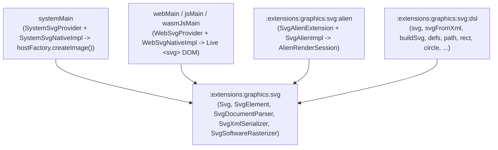

# `:extensions:graphics:svg`, `:extensions:graphics:svg:dsl`, & `:extensions:graphics:svg:alien` — Cross-Platform Vector Graphics Scene Graph, Software Rasterizer, & Alien Integration

> **Navigation**: [**GenericUI Root (`../../README.md`)**](../../README.md) · [**Extensions Index (`../README.md`)**](../README.md) · [**Root Extensions Guide (`../../docs/extensions.md`)**](../../docs/extensions.md) · [**Source Sets (`../../docs/sourcesets.md`)**](../../docs/sourcesets.md) · [**Backends (`../../docs/backends.md`)**](../../docs/backends.md) · [**Gradle Plugin (`../../docs/gradle-plugin.md`)**](../../docs/gradle-plugin.md)

`:extensions:graphics:svg` (`com.nexustools.genericui.ext.svg`) is a standalone **Single Consolidated KMP Project** depending **only on `:common`**. It models a live, mutable W3C SVG DOM scene graph ([`Svg`](../graphics/svg/src/commonMain/kotlin/com/nexustools/genericui/ext/svg/Svg.kt) extending `AbstractComponent("svg")`) paired with XML parsing/serialization, inverse-transform hit-testing, pure-Kotlin anti-aliased RGBA software rasterization on system targets, native `<svg>` DOM creation on `:web`, declarative builders in `:extensions:graphics:svg:dsl`, and self-rendered canvas compositing in `:extensions:graphics:svg:alien`.

---

## 1. Platform Architecture & Rendering Matrix



| Backend / Mode | Source Set / Module | Native Provider | Rendering & Hit-Testing Strategy |
| :--- | :--- | :--- | :--- |
| **System Targets (`windows`, `macos`, `gtk`, `kde`, `swing`, `android`, `ios`, `ipados`)** | `systemMain` | [`SystemSvgProvider`](../graphics/svg/src/systemMain/kotlin/com/nexustools/genericui/ext/svg/system/SystemSvgProvider.kt) / [`SystemSvgNativeImpl`](../graphics/svg/src/systemMain/kotlin/com/nexustools/genericui/ext/svg/system/SystemSvgNativeImpl.kt) | Wraps `hostFactory.createImage()` (`ImageNativeImpl<*>`) and rasterizes mutable [`Svg`](../graphics/svg/src/commonMain/kotlin/com/nexustools/genericui/ext/svg/Svg.kt) scenes into `RGBA_8888` [`ImageBuffer`](../../docs/media-and-canvases.md) surfaces via [`SvgSoftwareRasterizer`](../graphics/svg/src/commonMain/kotlin/com/nexustools/genericui/ext/svg/SvgSoftwareRasterizer.kt) with inverse-transform pointer `hitTest`. Depends zero on `:canvas2d`, `:gpu`, `:imageprocessing`, or `:overlay`. |
| **Web (`:web` — `wasmJs` / `js`)** | `webMain` + `jsMain` / `wasmJsMain` | [`WebSvgProvider`](../graphics/svg/src/webMain/kotlin/com/nexustools/genericui/ext/svg/web/WebSvgProvider.kt) / [`WebSvgNativeImpl`](../graphics/svg/src/webMain/kotlin/com/nexustools/genericui/ext/svg/web/WebSvgNativeImpl.kt) | Emits live namespace-qualified `<svg>` DOM elements (`http://www.w3.org/2000/svg`) via `WebSvgDomBridge` (and mirrors DOM elements in headless `:web` tests), attaching `click`, `mouseenter`, and `mouseleave` listeners per node. |
| **Alien Self-Rendered UI** | **`:extensions:graphics:svg:alien`** | [`SvgAlienExtension`](../graphics/svg/alien/src/commonMain/kotlin/com/nexustools/genericui/ext/svg/alien/SvgAlienExtension.kt) / [`SvgAlienImpl`](../graphics/svg/alien/src/commonMain/kotlin/com/nexustools/genericui/ext/svg/alien/SvgAlienImpl.kt) | Auto-added & auto-registered (`SvgAlienExtension.register()`) whenever `alien` + `svg` (or Desktop `webView()`) are enabled. Caches rasterized `RGBA_8888` buffers by `(sceneVersion, rasterWidth, rasterHeight)` and paints straight into `AlienRenderSession`'s `Canvas2D` surface with zero OS underlay holes. |

---

## 2. Gradle Plugin Configuration

Enable `svg()` inside `genericui { extensions { ... } }` (automatically wires `:extensions:graphics:svg:dsl` when `dsl()` is active, and `:extensions:graphics:svg:alien` when `alien()` is active):

```kotlin
plugins {
    id("com.nexustools.genericui")
}

genericui {
    app {
        id = "com.example.vectorstudio"
        name = "Vector Studio"
    }
    backends {
        allExceptSwing()
    }
    extensions {
        svg()   // Enables :extensions:graphics:svg
        dsl()   // Enables :extensions:ui:dsl + :extensions:graphics:svg:dsl
        alien() // Optional: auto-adds + auto-registers :extensions:graphics:svg:alien
    }
}
```

---

## 3. Core API Reference (`com.nexustools.genericui.ext.svg`)

| Class / Interface | Role & Key Members |
| :--- | :--- |
| **[`Svg`](../graphics/svg/src/commonMain/kotlin/com/nexustools/genericui/ext/svg/Svg.kt)** | Root component extending `AbstractComponent("svg")` and `SvgContainer`. Exposes `viewBox: SvgViewBox?`, `svgWidth`, `svgHeight`, `preserveAspectRatio`, `defs: SvgDefs`, `children`, `sceneVersion`, `loadXml(markup)`, `Svg.fromXml(markup)`, `toXml(pretty)`, `renderToImageBuffer(widthPx, heightPx)`, `hitTest(viewportX, viewportY, viewportWidth, viewportHeight)`, `findById(id)`, `queryByTag(tag)`, `querySelector(selector)`, and `querySelectorAll(selector)`. |
| **[`SvgElement`](../graphics/svg/src/commonMain/kotlin/com/nexustools/genericui/ext/svg/SvgElement.kt)** & **[`SvgContainer`](../graphics/svg/src/commonMain/kotlin/com/nexustools/genericui/ext/svg/SvgContainer.kt)** | Mutable SVG DOM base node supporting `id`, `classList`, `className`, `fill`, `fillOpacity`, `fillRule`, `stroke`, `strokeWidth`, `strokeOpacity`, `strokeLinecap`, `strokeLinejoin`, `strokeDasharray`, `strokeDashoffset`, `opacity`, `transformList`, `setTransform(...)`, `clipPathId`, `visible`, `attributes`, `onClick`, `onPointerEnter`, and `onPointerLeave`. Container subclasses: `Svg`, `SvgGroup`, [`SvgDefs`](../graphics/svg/src/commonMain/kotlin/com/nexustools/genericui/ext/svg/SvgDefs.kt), `SvgClipPath`. |
| **Vector Shapes & Gradients** | [`SvgRect`](../graphics/svg/src/commonMain/kotlin/com/nexustools/genericui/ext/svg/SvgRect.kt), `SvgCircle`, `SvgEllipse`, `SvgLine`, `SvgPolyline`, `SvgPolygon`, [`SvgPath`](../graphics/svg/src/commonMain/kotlin/com/nexustools/genericui/ext/svg/SvgPath.kt) (keeping `d` and `commands: List<SvgPathCommand>` synchronized), `SvgText`, `SvgUse`, `SvgLinearGradient`, `SvgRadialGradient`, `SvgGradientStop`. |
| **[`SvgPaint`](../graphics/svg/src/commonMain/kotlin/com/nexustools/genericui/ext/svg/SvgPaint.kt)** & **[`SvgViewBox`](../graphics/svg/src/commonMain/kotlin/com/nexustools/genericui/ext/svg/SvgViewBox.kt)** | Typed paint (`None`, `CurrentColor`, `SolidColor`, `GradientRef`) and `viewBox` / `SvgPreserveAspectRatio` / `SvgTransform` models. |
| **[`SvgSoftwareRasterizer`](../graphics/svg/src/commonMain/kotlin/com/nexustools/genericui/ext/svg/SvgSoftwareRasterizer.kt)** | Pure-Kotlin scanline anti-aliased vector rasterizer (`NONZERO` / `EVENODD` fills, stroke dash/cap/join expansion, linear/radial gradients, `<clipPath>`, `<use>`, built-in `<text>` vector glyphs) and inverse-transform hit-testing. |
| **[`SvgDocumentParser`](../graphics/svg/src/commonMain/kotlin/com/nexustools/genericui/ext/svg/SvgDocumentParser.kt)** & **[`SvgXmlSerializer`](../graphics/svg/src/commonMain/kotlin/com/nexustools/genericui/ext/svg/SvgXmlSerializer.kt)** | W3C SVG markup parser and serializer with inline CSS `style="..."` extraction and `<defs>` resolution. |
| **[`SvgExtension`](../graphics/svg/src/commonMain/kotlin/com/nexustools/genericui/ext/svg/SvgExtension.kt)** & **[`SvgNativeImpl`](../graphics/svg/src/commonMain/kotlin/com/nexustools/genericui/ext/svg/SvgNativeImpl.kt)** | Platform provider bridge (`registerProvider`, `hasRegisteredProvider`, `createSvgNative`, `syncSvgScene`, `invalidateSvgScene`, `hitTestViewport`). |
| **`:extensions:graphics:svg:dsl`** | [`DslSvgBuilders.kt`](../graphics/svg/dsl/src/commonMain/kotlin/com/nexustools/genericui/ext/svg/dsl/DslSvgBuilders.kt): `svg`, `svgFromXml`, `buildSvg`, `viewBox`, `defs`, `linearGradient`, `radialGradient`, `stop`, `clipPath`, `g`, `rect`, `circle`, `ellipse`, `line`, `polyline`, `polygon`, `path`, `text`, `use`, `fillColor`, `fill`, `fillGradient`, `strokeColor`, `stroke`, `translate`, `scale`, `rotate`, `skewX`, `skewY`, `transform`, and `onClick`. |

---

## 4. Usage Examples

### 4.1 Imperative XML Loading & Offscreen Rasterization

```kotlin
import com.nexustools.genericui.ext.svg.Svg
import com.nexustools.genericui.ext.svg.SvgPaint
import com.nexustools.genericui.style.color.RgbaColor

fun createBadgeSvg(): Svg {
    val badge = Svg.fromXml(
        """
        <svg viewBox="0 0 120 40" width="120" height="40">
            <rect id="bg" x="2" y="2" width="116" height="36" rx="8" fill="#1e293b"/>
            <circle id="dot" cx="22" cy="20" r="6" fill="#22c55e"/>
            <text x="36" y="25" font-size="14" fill="#f8fafc">LIVE</text>
        </svg>
        """.trimIndent()
    )
    val dot = badge.findById("dot")
    dot?.onClick = {
        dot.fill = SvgPaint.SolidColor(RgbaColor(56, 189, 248, 255))
    }
    return badge
}
```

### 4.2 Declarative `:extensions:graphics:svg:dsl` Scene Graph

```kotlin
import com.nexustools.genericui.ext.dsl.buildDiv
import com.nexustools.genericui.ext.svg.dsl.circle
import com.nexustools.genericui.ext.svg.dsl.defs
import com.nexustools.genericui.ext.svg.dsl.fillGradient
import com.nexustools.genericui.ext.svg.dsl.linearGradient
import com.nexustools.genericui.ext.svg.dsl.onClick
import com.nexustools.genericui.ext.svg.dsl.path
import com.nexustools.genericui.ext.svg.dsl.rect
import com.nexustools.genericui.ext.svg.dsl.stop
import com.nexustools.genericui.ext.svg.dsl.svg
import com.nexustools.genericui.ext.svg.dsl.viewBox
import com.nexustools.genericui.ext.svg.SvgPaint
import com.nexustools.genericui.style.color.RgbaColor

fun createVectorCard() = buildDiv(classes = "p-3") {
    svg(width = 160f, height = 160f) {
        viewBox(0f, 0f, 160f, 160f)
        defs {
            linearGradient(id = "cardGlow", x1 = 0f, y1 = 0f, x2 = 1f, y2 = 1f) {
                stop(0f, "#2563eb")
                stop(1f, "#06b6d4")
            }
        }
        rect(x = 8f, y = 8f, width = 144f, height = 144f, rx = 18f) {
            fillGradient("cardGlow")
        }
        circle(cx = 80f, cy = 80f, r = 42f, stroke = SvgPaint.SolidColor(RgbaColor.WHITE), strokeWidth = 4f) {
            onClick {
                fill = SvgPaint.SolidColor(RgbaColor(15, 23, 42, 200))
            }
        }
        path(
            d = "M 64 82 L 76 94 L 98 68",
            stroke = SvgPaint.SolidColor(RgbaColor.WHITE),
            strokeWidth = 5f,
            fill = SvgPaint.None
        )
    }
}
```

---

## 5. Related Extensions & Cross-References

- [`:extensions:ui:alien` (`alien.md`)](alien.md) — Auto-enables `:extensions:graphics:svg:alien` (`SvgAlienExtension`) for tear-free `Canvas2D` compositing inside `IAlien` trees.
- [`:extensions:ui:webview` (`webview.md`)](webview.md) — Desktop WebView worker automatically enables `svg()` + `:extensions:graphics:svg:alien` when `enableSvg = true`.
- [`:extensions:graphics:canvas2d` (`canvas2d.md`)](canvas2d.md) & [`:extensions:ui:dsl` (`dsl.md`)](dsl.md)
- [GenericUI Root (`../../README.md`)](../../README.md) · [Extensions Architecture (`../../docs/extensions.md`)](../../docs/extensions.md) · [Gradle Plugin (`../../docs/gradle-plugin.md`)](../../docs/gradle-plugin.md)
