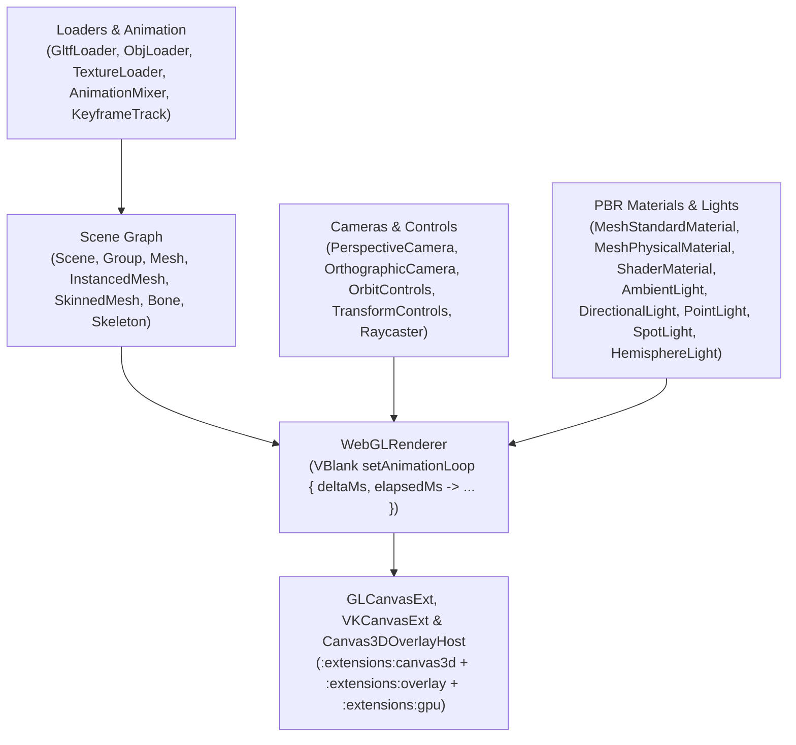

# `:extensions:threejs` & `:extensions:threejs:dsl` — 3D Scene Graph, PBR Materials, Controls, & Loaders on `GLCanvasExt` / `VKCanvasExt`

> **Navigation**: [**GenericUI Root (`../../README.md`)**](../../README.md) · [**Extensions Index (`../README.md`)**](../README.md) · [**Root Extensions Guide (`../../docs/extensions.md`)**](../../docs/extensions.md) · [**Source Sets (`../../docs/sourcesets.md`)**](../../docs/sourcesets.md) · [**Backends (`../../docs/backends.md`)**](../../docs/backends.md) · [**Gradle Plugin (`../../docs/gradle-plugin.md`)**](../../docs/gradle-plugin.md)

`:extensions:threejs` is a **Single Multiplatform Project** (`src/commonMain` across all 8 platform targets) providing a pure Kotlin Multiplatform port of the **Three.js** 3D engine built directly atop [`:extensions:canvas3d`](canvas3d.md) (`GLCanvasExt`, `VKCanvasExt`, `Canvas3DOverlayHost`), [`:extensions:gpu`](gpu.md), and `:common`'s `ImageLoader` / `ImageBuffer`. It includes hierarchical scene graphs (`Scene`, `Object3D`, `Group`), PBR materials (`MeshStandardMaterial`, `MeshPhysicalMaterial`, `ShaderMaterial`), lights & shadows, `OrbitControls` / `TransformControls`, skeletal animations (`SkinnedMesh`, `AnimationMixer`), 3D picking (`Raycaster`), asset loaders (`GltfLoader`, `ObjLoader`, `TextureLoader`), and declarative `threeJsGlCanvas { ... }` / `threeJsVkCanvas { ... }` builders in `:extensions:threejs:dsl`.

---

## 1. Architecture & Rendering Pipeline



---

## 2. Gradle Plugin Configuration

Enabling `threeJs()` in the [GenericUI Gradle Plugin (`../../docs/gradle-plugin.md`)](../../docs/gradle-plugin.md) automatically configures `:extensions:threejs`, `:extensions:canvas3d`, `:extensions:overlay`, `:extensions:gpu`, and (when `dsl()` is active) `:extensions:threejs:dsl`, and automatically registers the underlying 3D/GPU providers at startup:

```kotlin
plugins {
    id("com.nexustools.genericui")
}

genericui {
    backends {
        allExceptSwing()
    }
    extensions {
        dsl()     // Enables :extensions:dsl
        threeJs() // Automatically includes :extensions:threejs, :extensions:canvas3d, :extensions:overlay, :extensions:gpu, and :extensions:threejs:dsl
    }
}
```

---

## 3. Core API Reference (`com.nexustools.genericui.ext.threejs.*`)

| Category | Classes & Key Members |
| :--- | :--- |
| **Scenes & Core (`scenes`, `core`)** | `Scene` (`background: Color?`, `fog: Fog?`, `environment: Texture?`), `Object3D` (`position: Vector3`, `rotation: Euler`, `quaternion: Quaternion`, `scale: Vector3`, `matrixWorld: Matrix4`, `add(child)`, `remove(child)`, `lookAt(target)`), `BufferGeometry`, `BufferAttribute`, `Clock`, `Raycaster` (`setFromCamera(coords, camera)`, `intersectObjects(objects, recursive): List<Intersection>`), `Layers`, `Fog`, `FogExp2`. |
| **Cameras (`cameras`)** | `PerspectiveCamera(fov, aspect, near, far)` (`updateProjectionMatrix()`), `OrthographicCamera(left, right, top, bottom, near, far)`, `ArrayCamera`. |
| **Geometries (`geometries`)** | `BoxGeometry(width, height, depth)`, `SphereGeometry(radius, widthSegments, heightSegments)`, `TorusGeometry(radius, tube, radialSegments, tubularSegments)`, `CylinderGeometry`, `ConeGeometry`, `PlaneGeometry`. |
| **Materials (`materials`)** | `MeshStandardMaterial` (`color`, `roughness`, `metalness`, `map`, `normalMap`, `emissive`), `MeshPhysicalMaterial` (`clearcoat`, `clearcoatRoughness`, `transmission`, `ior`), `ShaderMaterial` (`vertexShader`, `fragmentShader`, `uniforms`), `MeshPhongMaterial`, `MeshLambertMaterial`, `MeshBasicMaterial`, `LineBasicMaterial`, `PointsMaterial`. |
| **Lights (`lights`)** | `AmbientLight(color, intensity)`, `DirectionalLight(color, intensity)` (`castShadow`), `PointLight(color, intensity, distance, decay)`, `SpotLight(color, intensity, distance, angle, penumbra, decay)`, `HemisphereLight(skyColor, groundColor, intensity)`. |
| **Objects (`objects`)** | `Mesh(geometry, material)`, `InstancedMesh(geometry, material, count)` (`setMatrixAt(index, matrix)`), `SkinnedMesh(geometry, material)`, `Skeleton`, `Bone`, `Group`, `Line`, `LineSegments`, `Points`, `Sprite`. |
| **Controls (`controls`)** | `OrbitControls(camera, domElementCanvas)` (`target: Vector3`, `enableDamping`, `dampingFactor`, `autoRotate`, `update()`), `TransformControls(camera, domElementCanvas)` (`attach(object3D)`, `mode`: `"translate"` / `"rotate"` / `"scale"`). |
| **Loaders & Textures (`loaders`, `textures`)** | `GltfLoader` (`parse(jsonOrBytes)`), `ObjLoader` (`parse(objText)`), `TextureLoader` (`fromImageBuffer(imageBuffer)`), `Texture`, `DataTexture`, `CubeTexture`. |
| **Animation (`animation`)** | `AnimationMixer(rootObject)` (`clipAction(clip): AnimationAction`, `update(deltaSeconds)`), `AnimationClip`, `AnimationAction` (`play()`, `stop()`), `KeyframeTrack`. |
| **Renderer (`renderers`)** | `WebGLRenderer(config, glCanvas, vkCanvas)` (`setSize(width, height)`, `setAnimationLoop { deltaMs, elapsedTimeMs -> ... }`, `render(scene, camera)`, `info: WebGLRenderInfo`), `WebGLRendererConfig`, `WebGLRenderTarget`. |
| **Math (`math`)** | `Vector2`, `Vector3`, `Vector4`, `Matrix3`, `Matrix4`, `Quaternion`, `Euler`, `Color`, `Box2`, `Box3`, `Sphere`, `Plane`, `Ray`, `Frustum`, `MathUtils`. |
| **Declarative DSL (`dsl`)** | `threeJsGlCanvas`, `threeJsVkCanvas`, `scene { ... }`, `ThreeSceneDslScope` (`background`, `perspectiveCamera`, `orthographicCamera`, `mesh`, `boxMesh`, `sphereMesh`, `group`, `ambientLight`, `directionalLight`, `pointLight`, `onAnimate`). |

---

## 4. Imperative Kotlin Examples

### Example 1: Interactive 3D Viewport with `WebGLRenderer`, `OrbitControls`, `TransformControls`, `Raycaster`, & `GltfLoader`

```kotlin
import com.nexustools.genericui.ext.canvas3d.GLCanvasExt
import com.nexustools.genericui.ext.threejs.cameras.PerspectiveCamera
import com.nexustools.genericui.ext.threejs.controls.OrbitControls
import com.nexustools.genericui.ext.threejs.controls.TransformControls
import com.nexustools.genericui.ext.threejs.core.Raycaster
import com.nexustools.genericui.ext.threejs.geometries.TorusGeometry
import com.nexustools.genericui.ext.threejs.lights.AmbientLight
import com.nexustools.genericui.ext.threejs.lights.DirectionalLight
import com.nexustools.genericui.ext.threejs.lights.SpotLight
import com.nexustools.genericui.ext.threejs.materials.MeshPhysicalMaterial
import com.nexustools.genericui.ext.threejs.math.Color
import com.nexustools.genericui.ext.threejs.math.Vector2
import com.nexustools.genericui.ext.threejs.objects.Mesh
import com.nexustools.genericui.ext.threejs.renderers.WebGLRenderer
import com.nexustools.genericui.ext.threejs.scenes.Scene

fun createInteractiveThreeViewport(): GLCanvasExt {
    val glCanvas = GLCanvasExt(width = 1280, height = 720)
    val renderer = WebGLRenderer(glCanvas = glCanvas)

    val scene = Scene().apply {
        background = Color(0x0f172a)
    }

    val camera = PerspectiveCamera(fov = 50f, aspect = 1280f / 720f, near = 0.1f, far = 2000f).apply {
        position.set(0f, 2.5f, 6f)
    }

    // OrbitControls & TransformControls gizmo attached to the 3D canvas
    val orbitControls = OrbitControls(camera, glCanvas).apply {
        enableDamping = true
        dampingFactor = 0.06f
    }
    val transformControls = TransformControls(camera, glCanvas)
    scene.add(transformControls)

    // Lighting setup
    scene.add(AmbientLight(color = Color(0xffffff), intensity = 0.4f))
    scene.add(DirectionalLight(color = Color(0xffffff), intensity = 1.2f).apply {
        position.set(5f, 10f, 7f)
        castShadow = true
    })
    scene.add(SpotLight(color = Color(0x38bdf8), intensity = 0.9f).apply {
        position.set(-4f, 6f, 4f)
    })

    // Clearcoat PBR Torus mesh
    val torus = Mesh(
        geometry = TorusGeometry(radius = 1.1f, tube = 0.35f, radialSegments = 24, tubularSegments = 64),
        material = MeshPhysicalMaterial(
            color = Color(0x3b82f6),
            roughness = 0.15f,
            metalness = 0.8f,
            clearcoat = 1.0f,
            clearcoatRoughness = 0.08f
        )
    )
    scene.add(torus)
    transformControls.attach(torus)

    // 3D Raycaster picking on pointer click
    val raycaster = Raycaster()
    glCanvas.setOnPointerDown { ev ->
        val ndcX = (ev.x / glCanvas.surfaceWidth.toFloat()) * 2f - 1f
        val ndcY = -(ev.y / glCanvas.surfaceHeight.toFloat()) * 2f + 1f
        raycaster.setFromCamera(Vector2(ndcX, ndcY), camera)
        val hits = raycaster.intersectObjects(scene.children, recursive = true)
        hits.firstOrNull()?.let { hit ->
            transformControls.attach(hit.object3D)
        }
    }

    // VBlank-driven animation loop
    renderer.setAnimationLoop { deltaMs, _ ->
        val dtSec = (deltaMs / 1000.0).toFloat()
        torus.rotation.y += dtSec * 0.6f
        orbitControls.update()
        renderer.render(scene, camera)
    }

    return glCanvas
}
```

### Example 2: Embedding a Three.js 3D Viewport in `:common`'s `OverlayDockWorkspaceFragment` or `Canvas3DOverlayHost`

`GLCanvasExt` and `VKCanvasExt` mount as central background viewports inside `:common`'s `OverlayDockWorkspaceFragment` (with translucent floating inspector docks layered over the 3D scene) or inside [`:extensions:canvas3d`](canvas3d.md)'s `Canvas3DOverlayHost` (`viewport3D.withOverlay(PresetOverlay())`):

```kotlin
import com.nexustools.genericui.component.docking.DockEdge
import com.nexustools.genericui.component.docking.OverlayDockPanelSpec
import com.nexustools.genericui.component.docking.OverlayDockWorkspaceFragment
import com.nexustools.genericui.component.layout.VStack
import com.nexustools.genericui.component.typography.Heading

fun createStudioWorkspace(): OverlayDockWorkspaceFragment {
    val workspace = OverlayDockWorkspaceFragment()
    val viewport3D = createInteractiveThreeViewport()

    // Mount the 3D canvas as the full-bleed central workspace canvas
    workspace.setCenterViewport(viewport3D)

    // Dock a floating Scene Hierarchy panel on the left edge over the 3D viewport
    val hierarchyPanel = VStack().apply {
        addChild(Heading("Scene Graph", level = 5))
    }
    workspace.registerDockPanel(
        OverlayDockPanelSpec(
            id = "scene-hierarchy",
            title = "Hierarchy",
            edge = DockEdge.LEFT,
            content = hierarchyPanel
        )
    )
    return workspace
}
```

---

## 5. Declarative `:extensions:threejs:dsl` Examples

With `dsl()` and `threeJs()` enabled, use `threeJsGlCanvas { ... }`, `threeJsVkCanvas { ... }`, or standalone `scene { ... }` builders directly in declarative UI layouts:

```kotlin
import com.nexustools.genericui.ext.dsl.ColorRgba
import com.nexustools.genericui.ext.dsl.buildDiv
import com.nexustools.genericui.ext.dsl.h3
import com.nexustools.genericui.ext.threejs.dsl.threeJsGlCanvas
import com.nexustools.genericui.ext.threejs.geometries.TorusGeometry
import com.nexustools.genericui.ext.threejs.materials.MeshStandardMaterial
import com.nexustools.genericui.ext.threejs.math.Color

val declarative3DSceneView = buildDiv(classes = "p-3") {
    h3("Declarative Three.js 3D Scene")

    threeJsGlCanvas(width = 960, height = 540, id = "main-3d-viewport") {
        background(0x0b1120)

        perspectiveCamera(fov = 50f, aspect = 960f / 540f, near = 0.1f, far = 1000f) {
            position.set(0f, 2f, 6f)
            lookAt(0f, 0f, 0f)
        }

        ambientLight(colorHex = 0xffffff, intensity = 0.45f)
        directionalLight(colorHex = 0xffffff, intensity = 1.25f, x = 4f, y = 8f, z = 6f)
        pointLight(colorHex = 0x38bdf8, intensity = 1.0f, distance = 25f) {
            position.set(-3f, 2f, 3f)
        }

        val cube = boxMesh(width = 1.2f, height = 1.2f, depth = 1.2f, colorHex = 0x3b82f6) {
            position.set(-1.6f, 0f, 0f)
        }

        val sphere = sphereMesh(radius = 0.8f, colorHex = 0x10b981) {
            position.set(1.6f, 0f, 0f)
        }

        val ring = mesh(
            geometry = TorusGeometry(radius = 2.4f, tube = 0.08f),
            material = MeshStandardMaterial(color = Color(0xf59e0b), metalness = 0.7f, roughness = 0.2f),
            name = "orbit-ring"
        )

        onAnimate { deltaMs, _ ->
            val dt = (deltaMs / 1000.0).toFloat()
            cube.rotation.x += dt * 0.8f
            cube.rotation.y += dt * 1.1f
            ring.rotation.z += dt * 0.4f
        }
    }.apply {
        style {
            borderRadius = com.nexustools.genericui.style.css.CssCornerRadii.px(12f)
            borderWidth = com.nexustools.genericui.style.css.CssEdgeLengths.px(1f)
            borderStyle = com.nexustools.genericui.enums.css.CssBorderStyle.SOLID
            borderColor = ColorRgba(59, 130, 246, 0.5)
        }
    }
}
```

---

## 6. Related Extensions & Cross-References

- **Related Extensions**:
  - [`:extensions:canvas3d` (`canvas3d.md`)](canvas3d.md) — Provides `GLCanvasExt`, `VKCanvasExt`, `Canvas3DOverlayHost`, and `ScrollCanvas3DOverlayHost` swapchain viewports for `WebGLRenderer`.
  - [`:extensions:overlay` (`overlay.md`)](overlay.md) — Composable overlay host and HUD widgets for 3D viewports.
  - [`:extensions:gpu` (`gpu.md`)](gpu.md) — Provides the underlying Vulkan 1.2+ and OpenGL ES 3.0+ / ANGLE GPU contexts.
  - [`:extensions:box3d` (`box3d.md`)](box3d.md) — 3D rigid-body physics engine that automatically synchronizes `RigidBody3D` world transforms with Three.js `Object3D` / `Mesh` nodes every physics step.
  - [`:extensions:aichat` (`aichat.md`)](aichat.md) — AI Studio chat with tool execution for natural-language 3D scene manipulation.
  - [`:extensions:dsl` (`dsl.md`)](dsl.md) — Base declarative Kotlin UI & Style DSL.
- **Root & Backend Documentation**:
  - [GenericUI Root (`../../README.md`)](../../README.md) · [Extensions Architecture (`../../docs/extensions.md`)](../../docs/extensions.md) · [Source Sets (`../../docs/sourcesets.md`)](../../docs/sourcesets.md) · [Backends (`../../docs/backends.md`)](../../docs/backends.md) · [Gradle Plugin (`../../docs/gradle-plugin.md`)](../../docs/gradle-plugin.md)
  - [Desktop Backends (`../../desktop/README.md`)](../../desktop/README.md) · [Mobile Backends (`../../mobile/README.md`)](../../mobile/README.md) · [Web Backend (`../../web/README.md`)](../../web/README.md)
