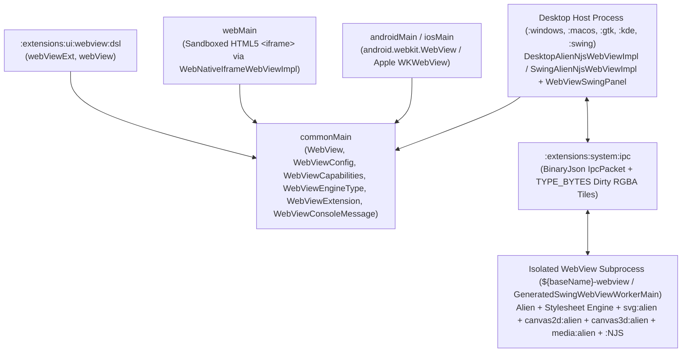

# `:extensions:ui:webview` & `:extensions:ui:webview:dsl` — Hybrid Subprocess WebView (`Alien + Stylesheet + SVG + Canvas2D/3D + Media + :NJS` on Desktop; Native on Mobile & Web)

> **Navigation**: [**GenericUI Root (`../../README.md`)**](../../README.md) · [**Extensions Index (`../README.md`)**](../README.md) · [**Root Extensions Guide (`../../docs/extensions.md`)**](../../docs/extensions.md) · [**Source Sets (`../../docs/sourcesets.md`)**](../../docs/sourcesets.md) · [**Backends (`../../docs/backends.md`)**](../../docs/backends.md) · [**Gradle Plugin (`../../docs/gradle-plugin.md`)**](../../docs/gradle-plugin.md)

`:extensions:ui:webview` (`com.nexustools.genericui.ext.webview`) is a **Single Consolidated KMP Project** providing the cross-platform **`WebView`** component (`webViewExt` / `webView` in `:extensions:ui:webview:dsl`) with URL and HTML loading, navigation history, JavaScript evaluation, bidirectional host $\leftrightarrow$ guest communication functions, console/error hooks, and web messaging.

> [!IMPORTANT]
> **Platform Engine Architecture**:
> - **Desktop (`:windows`, `:macos`, `:gtk`, `:kde`, `:swing`) — Isolated Out-of-Process Alien + Stylesheet Engine + Media/Graphics + `:NJS` Worker (`WebViewEngineType.ALIEN_NJS`)**:
>   - Runs HTML/DOM layout and compositing inside an **isolated per-instance OS subprocess** combining [`:extensions:ui:alien`](alien.md), GenericUI's `:system` stylesheet & layout engine, [`:extensions:graphics:svg:alien`](svg.md), [`:extensions:graphics:canvas2d:alien`](canvas2d.md), [`:extensions:graphics:canvas3d:alien`](canvas3d.md), [`:extensions:media:media:alien`](media.md), and [**`:NJS` (`../../lib/NJS/README.md`)**](../../lib/NJS/README.md) ([AsmJit/SLJIT Native JIT (`../../lib/NJS/docs/native-jit.md`)](../../lib/NJS/docs/native-jit.md) on Kotlin/Native, and [`javax.tools.JavaCompiler` JVM bytecode compilation (`../../lib/NJS/docs/jvm-compiler.md`)](../../lib/NJS/docs/jvm-compiler.md) via `JavaTranspiler` on JVM/Swing).
>   - Communicates cleanly over [**`:extensions:system:ipc`** (`ipc.md`) using length-framed **`BinaryJson`** (`IpcPacket`) messages and raw **`TYPE_BYTES`** (`PreferenceElement.ofBytes`) dirty RGBA framebuffer tiles—eliminating browser memory bloat in the main UI process and preventing single-tab crashes or infinite guest scripts from hanging the host app.
>   - **Native Desktop (`windows`, `macos`, `gtk`, `kde`)** spawns a dedicated `${baseName}-webview` (`${baseName}-webview.exe` on Windows; macOS helper bundle executable) contributed by [`WebViewExtensionContributor`](../../gradle-plugin/src/main/kotlin/com/nexustools/genericui/plugin/spi/WebViewExtensionContributor.kt) entering `WebViewWorkerMain.main(args)`.
>   - **Desktop JVM (`swing`)** spawns a child JVM process running `<genPkg>.GeneratedSwingWebViewWorkerMain` packaged directly inside the main application JAR (entering `WebViewWorkerMain.main(args)`).
> - **Mobile (`:android`, `:ios`)**: Uses native OS platform WebViews — **`android.webkit.WebView`** (`WebViewEngineType.ANDROID_WEBVIEW`) on Android and Apple **`WKWebView`** (`WebViewEngineType.APPLE_WKWEBVIEW`) on iOS/iPadOS — and **never links or executes `:NJS`** or desktop IPC subprocesses.
> - **Web (`:web`)**: Uses a sandboxed browser **`<iframe>`** (`WebNativeIframeWebViewImpl`, `WebViewEngineType.WEB_IFRAME`) — **never links `:NJS`** and obeys standard browser cross-origin security policies (`Same-Origin Policy`, `X-Frame-Options`, `Content-Security-Policy: frame-ancestors`).

---

## 1. Source-Set & Out-of-Process Engine Matrix



| Target Backend | Source Set | Rendering & Layout Engine | JavaScript Runtime | `WebViewEngineType` |
| :--- | :--- | :--- | :--- | :--- |
| **Windows (`:windows`)** | `nativeDesktopMain` + `mingwMain` | `DesktopAlienNjsWebViewImpl` $\leftrightarrow$ isolated `${baseName}-webview.exe` worker (`Alien` + `:system` stylesheet/layout + `svg:alien`, `canvas2d:alien`, `canvas3d:alien`, `media:alien`) streaming dirty RGBA tiles over `:extensions:system:ipc` (Named Pipes) | `:NJS` AsmJit / SLJIT Native x86_64 JIT | `ALIEN_NJS` |
| **macOS (`:macos`)** | `nativeDesktopMain` + `macosMain` | `DesktopAlienNjsWebViewImpl` $\leftrightarrow$ isolated `${baseName}-webview` helper worker (`Alien` + `:system` stylesheet/layout + Alien companions) over `:extensions:system:ipc` (`AF_UNIX` / XPC) | `:NJS` AsmJit / SLJIT Native ARM64 JIT | `ALIEN_NJS` |
| **Linux GTK4 (`:gtk`) & KDE (`:kde`)** | `nativeDesktopMain` + `linuxMain` | `DesktopAlienNjsWebViewImpl` $\leftrightarrow$ isolated `${baseName}-webview` worker (`Alien` + `:system` stylesheet/layout + Alien companions) over `:extensions:system:ipc` (`AF_UNIX`) | `:NJS` AsmJit / SLJIT Native JIT | `ALIEN_NJS` |
| **Desktop JVM (`:swing`)** | `jvmMain` | `SwingAlienNjsWebViewImpl` + `WebViewSwingPanel` $\leftrightarrow$ isolated child JVM running `<genPkg>.GeneratedSwingWebViewWorkerMain` (`Alien` + `:system` stylesheet/layout + Alien companions) over `:extensions:system:ipc` | `:NJS` `JavaCompiler` JVM Bytecode (`JavaTranspiler`) | `ALIEN_NJS` |
| **Android (`:android`)** | `androidMain` | Native `android.webkit.WebView` (`AndroidNativeWebViewImpl`) | Android System WebView JS *(Never `:NJS`)* | `ANDROID_WEBVIEW` |
| **iOS & iPadOS (`:ios`)** | `iosMain` | Native Apple `WKWebView` (`IosNativeWebViewImpl`) | Apple JavaScriptCore *(Never `:NJS`)* | `APPLE_WKWEBVIEW` |
| **Web (`:web`)** | `webMain` | Sandboxed HTML5 `<iframe>` (`WebNativeIframeWebViewImpl`) | Host Browser JS Engine *(Never `:NJS`)* | `WEB_IFRAME` |

> [!NOTE]
> **Web (`:web`) Cross-Origin Sandboxing (`WebNativeIframeWebViewImpl`)**:
> Because `:web` mounts an HTML5 `<iframe>` inside the browser document, third-party URLs are governed by standard browser security rules:
> - Cross-origin frames cannot be arbitrarily scripted via `evaluateJavascript` or direct DOM traversal (`SecurityError`), and sites sending `X-Frame-Options: DENY/SAMEORIGIN` or restrictive `Content-Security-Policy: frame-ancestors` headers cannot be framed.
> - Same-origin URLs and inline `loadHtml(html, baseUrl)` documents (`srcdoc`) support full `evaluateJavascript`, `registerCommunicationFunction`, `postWebMessage`, and `onConsoleMessage` / `onJavaScriptError` hooks via `WebIframeDomBridge`, while cross-origin frames communicate cleanly via standard `window.postMessage` (`postWebMessage` / `onWebMessageReceived`).

---

## 2. Gradle Plugin Configuration (`webView { ... }`)

Enabling `webView()` in the [GenericUI Gradle Plugin (`../../docs/gradle-plugin.md`)](../../docs/gradle-plugin.md) configures `:extensions:ui:webview` across all active backends (plus `:extensions:ui:webview:dsl` when `dsl()` is enabled).

On **Desktop** targets (`windows`, `macos`, `gtk`, `kde`, `swing`), `webView { ... }` automatically enables `:extensions:system:ipc`, `:extensions:ui:alien`, `:extensions:ui:overlay`, and the matching capability/Alien companion modules (while Mobile and Web builds omit `:extensions:system:ipc` and Desktop-only worker artifacts automatically):

```kotlin
plugins {
    id("com.nexustools.genericui")
}

genericui {
    app {
        id = "com.example.browser"
        name = "Studio Browser"
        baseName = "studiobrowser"
    }
    backends {
        all()
    }
    extensions {
        dsl() // Enables :extensions:ui:dsl + :extensions:ui:webview:dsl
        webView {
            enableCanvas2D = true   // Wires canvas2d + canvas2d:alien on Desktop
            enableWebGL = true      // Wires canvas3d + canvas3d:alien (+ canvas2d) on Desktop
            enableMedia = true      // Wires media + media:alien on Desktop
            enableSvg = true        // Wires svg + svg:alien on Desktop
            enableWebAudio = true   // Wires media + media:alien on Desktop
            enableWebSockets = true
            enableStorage = true
            enableShadowDom = true
            enableIframes = true
            enableWorkers = true
        }
    }
}
```

[`GenericUiWebViewExtensionSpec`](../../gradle-plugin/src/main/kotlin/com/nexustools/genericui/plugin/GenericUiWebViewExtensionSpec.kt) exposes those 10 `Boolean` flags (all defaulting to `true`), which [`WebViewExtensionContributor`](../../gradle-plugin/src/main/kotlin/com/nexustools/genericui/plugin/spi/WebViewExtensionContributor.kt) also propagates into `GenericUiExtensionRegistry` (`webview.capability.*`, `webview.desktop.workerBinaryBaseName`, and `webview.swing.workerMainClass`) and registers matching Alien providers (`SystemAlienBootstrap`, `SystemSvgProvider`, `SvgAlienExtension`, `Canvas2DAlienExtension`, `Canvas3DAlienExtension`, `MediaAlienExtension`, and `IpcExtension`) in generated Desktop worker entrypoints.

---

## 3. Core API Reference (`com.nexustools.genericui.ext.webview`)

| Class / Enum / Function | Package | Description & Key Members |
| :--- | :--- | :--- |
| **`WebView`** | `ext.webview` | Cross-platform WebView widget extending `AbstractComponent`. Key members: `url: String?`, `htmlContent: String?`, `htmlBaseUrl: String?`, `config: WebViewConfig`, `engineType: WebViewEngineType`, `loadUrl(targetUrl: String)`, `loadHtml(html: String, baseUrl: String? = null)`, `reload()`, `goBack()`, `goForward()`, `canGoBack(): Boolean`, `canGoForward(): Boolean`, `evaluateJavascript(script: String, callback: ((String?) -> Unit)? = null)`, `postWebMessage(message: String)`, `registerCommunicationFunction(name, handler)`, `unregisterCommunicationFunction(name)`, `hasCommunicationFunction(name)`, `getCommunicationFunctionNames()`, `callCommunicationFunction(name, payloadJson, callback)`, `onWebMessageReceived: ((String) -> Unit)?`, `onPageFinished: ((String) -> Unit)?`, `onConsoleMessage: ((WebViewConsoleMessage) -> Unit)?`, `onJavaScriptError: ((String) -> Unit)?`. |
| **`WebViewConfig`** | `ext.webview` | Configuration data class: `enableJavaScript: Boolean = true`, `domStorageEnabled: Boolean = true`, `enableDevTools: Boolean = false`, `userAgentOverride: String? = null`, `allowFileAccess: Boolean = false`, `capabilities: WebViewCapabilities = WebViewCapabilities()`, `initialViewportWidth: Int = 1024`, `initialViewportHeight: Int = 768`. |
| **`WebViewCapabilities`** | `ext.webview` | Per-instance optional capability overrides (`canvas2d`, `webgl`, `media`, `svg`, `webAudio`, `webSockets`, `storage`, `shadowDom`, `iframes`, `workers`); `null` inherits the `webview.capability.*` setting registered in `GenericUiExtensionRegistry` (default `true`). |
| **`WebViewConsoleMessage`** | `ext.webview` | Guest console payload: `level: String`, `message: String`, `sourceId: String = ""`, `line: Int = 0`. |
| **`WebViewEngineType`** | `ext.webview` | Engine enum: `ALIEN_NJS`, `ANDROID_WEBVIEW`, `APPLE_WKWEBVIEW`, `WEB_IFRAME`. |
| **`WebViewExtension`** | `ext.webview` | Extension provider registry (`activeEngineType: WebViewEngineType`, `registerProvider(engineType, factory)`). |
| **`webViewExt` / `webView`** | `ext.webview.dsl` | Declarative DSL builders in `:extensions:ui:webview:dsl` ([`DslWebViewBuilders.kt`](../ui/webview/dsl/src/commonMain/kotlin/com/nexustools/genericui/ext/webview/dsl/DslWebViewBuilders.kt)) for mounting and configuring `WebView` components in-place. |

---

## 4. Imperative Kotlin Examples

### Example 1: Loading URLs, Bidirectional Communication Functions, & JS Evaluation

```kotlin
import com.nexustools.genericui.ext.webview.WebView
import com.nexustools.genericui.ext.webview.WebViewConfig

fun createInteractiveDocumentationWebView(): WebView {
    val config = WebViewConfig(
        enableJavaScript = true,
        domStorageEnabled = true,
        enableDevTools = false,
        userAgentOverride = null,
        allowFileAccess = false
    )

    val webView = WebView(
        initialUrl = "https://example.com/docs",
        config = config
    ).apply {
        // Expose a named host callback callable from guest JavaScript
        registerCommunicationFunction("getHostPlatform") { _ ->
            """{"engine":"$engineType"}"""
        }

        // Listen for string/JSON payloads posted from guest JS
        onWebMessageReceived = { payloadJson ->
            println("Received message from WebView ($engineType): $payloadJson")
        }

        onConsoleMessage = { console ->
            println("[WebView ${console.level}] ${console.message} (${console.sourceId}:${console.line})")
        }

        onJavaScriptError = { err ->
            println("[WebView JS Error] $err")
        }

        // Run custom JavaScript once the page finishes loading
        onPageFinished = { loadedUrl ->
            println("Finished loading: $loadedUrl")
            evaluateJavascript("document.title") { resultTitle ->
                println("Document title: $resultTitle")
            }
            postWebMessage("""{"type":"themeChanged","mode":"dark"}""")
        }
    }

    return webView
}
```

### Example 2: Rendering Self-Contained HTML/CSS/JS Templates with `loadHtml`

```kotlin
import com.nexustools.genericui.ext.webview.WebView

fun createInlineChartWebView(): WebView {
    val view = WebView()
    view.onWebMessageReceived = { msg ->
        println("Guest posted action: $msg")
    }
    view.loadHtml(
        html = """
            <!DOCTYPE html>
            <html>
            <body style="background:#0f172a;color:#f8fafc;font-family:sans-serif;">
                <h2 id="headline">Telemetry Live View</h2>
                <button onclick="window.genericUiBridge && window.genericUiBridge.postMessage('export_csv')">Export CSV</button>
            </body>
            </html>
        """.trimIndent(),
        baseUrl = "https://app.local/"
    )
    return view
}
```

---

## 5. Declarative `:extensions:ui:webview:dsl` Example

With `dsl()` and `webView()` enabled, use `webViewExt { ... }` (or `webView { ... }`) inside any [`:extensions:ui:dsl`](dsl.md) layout container:

```kotlin
import com.nexustools.genericui.ext.dsl.ColorRgba
import com.nexustools.genericui.ext.dsl.buildDiv
import com.nexustools.genericui.ext.dsl.button
import com.nexustools.genericui.ext.dsl.hstack
import com.nexustools.genericui.ext.dsl.span
import com.nexustools.genericui.ext.dsl.textInput
import com.nexustools.genericui.ext.webview.WebView
import com.nexustools.genericui.ext.webview.WebViewConfig
import com.nexustools.genericui.ext.webview.dsl.webViewExt

fun createEmbeddedBrowserPanel() = buildDiv(classes = "p-3") {
    lateinit var browser: WebView
    val statusBadge = span("Ready")

    hstack(classes = "gap-2 mb-2") {
        button("Back") {
            onClick = { if (browser.canGoBack()) browser.goBack() }
        }
        button("Forward") {
            onClick = { if (browser.canGoForward()) browser.goForward() }
        }
        button("Reload") {
            onClick = { browser.reload() }
        }
        val urlBar = textInput(
            value = "https://genericui.dev",
            placeholder = "Enter URL..."
        )
        button("Go") {
            onClick = { browser.loadUrl(urlBar.value) }
        }
    }

    browser = webViewExt(
        initialUrl = "https://genericui.dev",
        config = WebViewConfig(enableJavaScript = true, domStorageEnabled = true),
        onWebMessageReceived = { msg ->
            statusBadge.text = "JS Bridge: $msg"
        },
        onPageFinished = { url ->
            statusBadge.text = "Loaded: $url (${browser.engineType})"
        }
    ) {
        style {
            borderRadius = com.nexustools.genericui.style.css.CssCornerRadii.px(8f)
            borderWidth = com.nexustools.genericui.style.css.CssEdgeLengths.px(1f)
            borderStyle = com.nexustools.genericui.enums.css.CssBorderStyle.SOLID
            borderColor = ColorRgba(71, 85, 105, 1.0)
        }
    }
}
```

---

## 6. Related Extensions & Cross-References

- **Core Desktop Subprocess Pillars**:
  - [`:extensions:ui:alien` (`alien.md`)](alien.md) — Self-rendered DOM/CSS/Bootstrap surface & transition engine inside the Desktop worker.
  - [`:extensions:system:ipc` (`ipc.md`)](ipc.md) — Target-scoped `BinaryJson` + `TYPE_BYTES` dirty RGBA tile transport connecting Host & Worker subprocess.
  - [`:extensions:graphics:svg` (`svg.md`)](svg.md), [`:extensions:graphics:canvas2d` (`canvas2d.md`)](canvas2d.md), [`:extensions:graphics:canvas3d` (`canvas3d.md`)](canvas3d.md), [`:extensions:media:media` (`media.md`)](media.md) — Provide the `:alien` companion renderers (`svg:alien`, `canvas2d:alien`, `canvas3d:alien`, `media:alien`).
- **Companion Tools & DSL**:
  - [`:extensions:ui:dsl` (`dsl.md`)](dsl.md) — Base declarative Kotlin UI & Style DSL.
  - [`:extensions:ui:codeeditor` (`codeeditor.md`)](codeeditor.md) — Pair `IdeCodeEditor` with `WebView` for live HTML/CSS/JS/Markdown preview panes.
  - [`:extensions:ui:aichat` (`aichat.md`)](aichat.md) — Multi-provider AI Studio chat container.
- **Root & Backend Documentation**:
  - [GenericUI Root (`../../README.md`)](../../README.md) · [Extensions Architecture (`../../docs/extensions.md`)](../../docs/extensions.md) · [Source Sets (`../../docs/sourcesets.md`)](../../docs/sourcesets.md) · [Backends (`../../docs/backends.md`)](../../docs/backends.md) · [Gradle Plugin (`../../docs/gradle-plugin.md`)](../../docs/gradle-plugin.md)
  - [Desktop Backends (`../../desktop/README.md`)](../../desktop/README.md) · [Mobile Backends (`../../mobile/README.md`)](../../mobile/README.md) · [Web Backend (`../../web/README.md`)](../../web/README.md)
