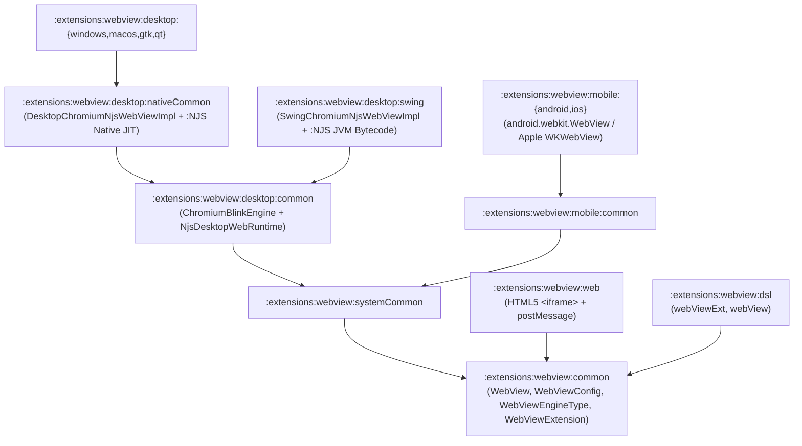

# `:extensions:webview` & `:extensions:webview:dsl` — Embedded Web Engine (`Chromium` + `:NJS` JIT on Desktop; Native on Mobile & Web)

> **Navigation**: [**GenericUI Root (`../../README.md`)**](../../README.md) · [**Extensions Index (`../README.md`)**](../README.md) · [**Root Extensions Guide (`../../docs/extensions.md`)**](../../docs/extensions.md) · [**Source Sets (`../../docs/sourcesets.md`)**](../../docs/sourcesets.md) · [**Backends (`../../docs/backends.md`)**](../../docs/backends.md) · [**Gradle Plugin (`../../docs/gradle-plugin.md`)**](../../docs/gradle-plugin.md)

`:extensions:webview` is a **Project-of-Projects** extension providing the cross-platform **`WebView`** widget (`webViewExt` / `webView` in `:extensions:webview:dsl`) with URL and raw HTML loading, navigation history, JavaScript evaluation, and bidirectional Kotlin $\leftrightarrow$ JavaScript message bridges.

> [!IMPORTANT]
> **Strict Platform Engine Rule**:
> - **Desktop (`:windows`, `:macos`, `:gtk`, `:qt`, `:swing`)**: Uses **Chromium (`ChromiumBlinkEngine`)** for HTML/CSS DOM layout & rendering paired with [**`:NJS` (`../../lib/NJS/README.md`)**](../../lib/NJS/README.md) (`NjsDesktopWebRuntime` — [AsmJit/SLJIT Native JIT (`../../lib/NJS/docs/native-jit.md`)](../../lib/NJS/docs/native-jit.md) on Kotlin/Native inside `:extensions:webview:desktop:nativeCommon`, and [`javax.tools.JavaCompiler` JVM bytecode compilation (`../../lib/NJS/docs/jvm-compiler.md`)](../../lib/NJS/docs/jvm-compiler.md) on JVM/Swing inside `:extensions:webview:desktop:swing`). See the [NJS Master Documentation Index (`../../lib/NJS/docs/README.md`)](../../lib/NJS/docs/README.md) and [NJS CLI & WebView Host Embedding (`../../lib/NJS/docs/cli-and-embedding.md`)](../../lib/NJS/docs/cli-and-embedding.md).
> - **Mobile (`:android`, `:ios`) & Web (`:web`)**: Uses the native OS browser control (`android.webkit.WebView` on Android, `WKWebView` on iOS, and HTML5 `<iframe>` on Web) and **NEVER links or executes `:NJS`**.

---

## 1. Submodule Hierarchy & Platform WebView Engine Matrix



| Target Backend | Submodules | HTML/CSS Layout Engine | JavaScript Runtime | `WebViewEngineType` | Backend Documentation |
| :--- | :--- | :--- | :--- | :--- | :--- |
| **Windows (`:windows`)** | `:extensions:webview:desktop:{common,nativeCommon,windows}` | `ChromiumBlinkEngine` (`DesktopChromiumNjsWebViewImpl`) | `:NJS` AsmJit / SLJIT Native x86_64 JIT (`NjsDesktopWebRuntime`) | `DESKTOP_CHROMIUM_NJS_JIT` | [Desktop Backends (`../../desktop/README.md`)](../../desktop/README.md) |
| **macOS (`:macos`)** | `:extensions:webview:desktop:{common,nativeCommon,macos}` | `ChromiumBlinkEngine` (`DesktopChromiumNjsWebViewImpl`) | `:NJS` AsmJit / SLJIT Native ARM64/x64 JIT (`NjsDesktopWebRuntime`) | `DESKTOP_CHROMIUM_NJS_JIT` | [Desktop Backends (`../../desktop/README.md`)](../../desktop/README.md) |
| **Linux GTK4 (`:gtk`)** | `:extensions:webview:desktop:{common,nativeCommon,gtk}` | `ChromiumBlinkEngine` (`DesktopChromiumNjsWebViewImpl`) | `:NJS` AsmJit / SLJIT Native JIT (`NjsDesktopWebRuntime`) | `DESKTOP_CHROMIUM_NJS_JIT` | [Desktop Backends (`../../desktop/README.md`)](../../desktop/README.md) |
| **Linux Qt6 (`:qt`)** | `:extensions:webview:desktop:{common,nativeCommon,qt}` | `ChromiumBlinkEngine` (`DesktopChromiumNjsWebViewImpl`) | `:NJS` AsmJit / SLJIT Native JIT (`NjsDesktopWebRuntime`) | `DESKTOP_CHROMIUM_NJS_JIT` | [Desktop Backends (`../../desktop/README.md`)](../../desktop/README.md) |
| **Desktop JVM (`:swing`)** | `:extensions:webview:desktop:{common,swing}` | `ChromiumBlinkEngine` (`SwingChromiumNjsWebViewImpl`) | `:NJS` `JavaCompiler` JVM Bytecode Transpiler | `DESKTOP_CHROMIUM_NJS_JIT` | [Desktop Backends (`../../desktop/README.md`)](../../desktop/README.md) |
| **Android (`:android`)** | `:extensions:webview:mobile:{common,android}` | `android.webkit.WebView` (`AndroidWebViewImpl`) | Android System V8 *(Never `:NJS`)* | `MOBILE_NATIVE_WEBVIEW` | [Mobile Backends (`../../mobile/README.md`)](../../mobile/README.md) |
| **iOS (`:ios`)** | `:extensions:webview:mobile:{common,ios}` | Apple `WKWebView` (`IosWebViewImpl`) | Apple JavaScriptCore *(Never `:NJS`)* | `MOBILE_NATIVE_WEBVIEW` | [Mobile Backends (`../../mobile/README.md`)](../../mobile/README.md) |
| **Web (`:web`)** | `:extensions:webview:web` | Browser HTML5 `<iframe>` (`WebNativeIframeWebViewImpl`) | Host Browser JS Engine *(Never `:NJS`)* | `WEB_NATIVE_IFRAME` | [Web Backend (`../../web/README.md`)](../../web/README.md) |

---

## 2. Gradle Plugin Configuration

Enabling `webView()` in the [GenericUI Gradle Plugin (`../../docs/gradle-plugin.md`)](../../docs/gradle-plugin.md) configures `:extensions:webview` across all active backends, automatically registers the platform `WebView` provider at startup, and includes `:extensions:webview:dsl` when `dsl()` is enabled:

```kotlin
plugins {
    id("com.nexustools.genericui")
}

genericui {
    backends {
        allExceptSwing()
    }
    extensions {
        dsl()     // Enables :extensions:dsl
        webView() // Automatically includes :extensions:webview and :extensions:webview:dsl
    }
}
```

---

## 3. Core API Reference (`com.nexustools.genericui.ext.webview`)

| Class / Enum / Function | Package | Description & Key Members |
| :--- | :--- | :--- |
| `WebView` (`WebViewExt`) | `ext.webview` | Embedded web browser widget extending `AbstractComponent`. Key members: `url: String?`, `htmlContent: String?`, `htmlBaseUrl: String?`, `config: WebViewConfig`, `engineType: WebViewEngineType`, `loadUrl(targetUrl: String)`, `loadHtml(html: String, baseUrl: String? = null)`, `reload()`, `goBack()`, `goForward()`, `canGoBack(): Boolean`, `canGoForward(): Boolean`, `evaluateJavascript(script: String, callback: ((String?) -> Unit)? = null)`, `postWebMessage(message: String)`, `onWebMessageReceived: ((String) -> Unit)?`, `onPageFinished: ((String) -> Unit)?`. |
| `WebViewConfig` | `ext.webview` | Configuration data class: `enableJavaScript: Boolean = true`, `enableDomStorage: Boolean = true`, `allowFileAccess: Boolean = false`, `customUserAgent: String? = null`, `transparentBackground: Boolean = false`. |
| `WebViewEngineType` | `ext.webview` | Enum identifying the underlying runtime: `DESKTOP_CHROMIUM_NJS_JIT`, `MOBILE_NATIVE_WEBVIEW`, `WEB_NATIVE_IFRAME`. |
| `WebViewExtension` | `ext.webview` | Extension provider registry (`activeEngineType: WebViewEngineType`, `registerProvider(engineType, factory)`). |
| `ChromiumBlinkEngine` | `ext.webview.desktop` | Desktop HTML/CSS parser and layout tree builder producing `ChromiumBlinkDomNode` hierarchies on Desktop/Swing (`:extensions:webview:desktop:common`). |
| `NjsDesktopWebRuntime` | `ext.webview.desktop` | Desktop-only `:NJS` JavaScript execution context binding `window`, `document`, and `window.genericUiBridge.postMessage(...)` (`:extensions:webview:desktop:common`). |
| `webViewExt` / `webView` | `ext.webview.dsl` | Declarative DSL builders in `:extensions:webview:dsl` for mounting and configuring `WebView` components in-place. |

---

## 4. Imperative Kotlin Examples

### Example 1: Loading Remote URLs, Evaluating JavaScript, & Bidirectional JS Bridge

```kotlin
import com.nexustools.genericui.ext.webview.WebView
import com.nexustools.genericui.ext.webview.WebViewConfig

fun createInteractiveDocumentationWebView(): WebView {
    val config = WebViewConfig(
        enableJavaScript = true,
        enableDomStorage = true,
        transparentBackground = false
    )

    val webView = WebView(
        initialUrl = "https://example.com/docs",
        config = config
    ).apply {
        // Listen for messages sent from JS via window.genericUiBridge.postMessage(...)
        onWebMessageReceived = { payloadJson ->
            println("Received message from WebView (${engineType}): $payloadJson")
        }

        // Run custom JavaScript once the page finishes loading
        onPageFinished = { loadedUrl ->
            println("Finished loading: $loadedUrl")
            evaluateJavascript("document.title") { resultTitle ->
                println("Document title: $resultTitle")
            }
            // Send a message from Kotlin into the page's JavaScript listener
            postWebMessage("""{"type":"themeChanged","mode":"dark"}""")
        }
    }

    return webView
}
```

### Example 2: Rendering Self-Contained HTML/CSS/JS Templates with `loadHtml`

```kotlin
import com.nexustools.genericui.ext.webview.WebView

fun createInlineChartWebView(): WebView {
    val view = WebView()
    view.loadHtml(
        html = """
            <!DOCTYPE html>
            <html>
            <body style="background:#0f172a;color:#f8fafc;font-family:sans-serif;">
                <h2 id="headline">Telemetry Live View</h2>
                <button onclick="window.genericUiBridge.postMessage('export_csv')">Export CSV</button>
            </body>
            </html>
        """.trimIndent(),
        baseUrl = "https://app.local/"
    )
    return view
}
```

---

## 5. Declarative `:extensions:webview:dsl` Examples

With `dsl()` and `webView()` enabled, use `webViewExt { ... }` (or its alias `webView { ... }`) inside any [`:extensions:dsl`](dsl.md) layout container:

```kotlin
import com.nexustools.genericui.ext.dsl.ColorRgba
import com.nexustools.genericui.ext.dsl.buildDiv
import com.nexustools.genericui.ext.dsl.button
import com.nexustools.genericui.ext.dsl.hstack
import com.nexustools.genericui.ext.dsl.span
import com.nexustools.genericui.ext.dsl.textInput
import com.nexustools.genericui.ext.webview.WebViewConfig
import com.nexustools.genericui.ext.webview.dsl.webViewExt

val embeddedBrowserPanel = buildDiv(classes = "p-3") {
    lateinit var browser: com.nexustools.genericui.ext.webview.WebView
    val statusBadge = span("Ready")

    hstack(classes = "gap-2 mb-2") {
        button("◀ Back") {
            onClick = { if (browser.canGoBack()) browser.goBack() }
        }
        button("▶ Forward") {
            onClick = { if (browser.canGoForward()) browser.goForward() }
        }
        button("↻ Reload") {
            onClick = { browser.reload() }
        }
        val urlBar = textInput(
            value = "https://genericui.dev",
            placeholder = "Enter URL..."
        )
        button("Go") {
            onClick = { browser.loadUrl(urlBar.value) }
        }
    }

    browser = webViewExt(
        initialUrl = "https://genericui.dev",
        config = WebViewConfig(enableJavaScript = true, enableDomStorage = true),
        onWebMessageReceived = { msg ->
            statusBadge.text = "JS Bridge: $msg"
        },
        onPageFinished = { url ->
            statusBadge.text = "Loaded: $url (${browser.engineType})"
        }
    ) {
        style {
            borderRadiusPx = 8f
            borderWidthPx = 1f
            borderColor = ColorRgba(71, 85, 105, 1.0)
        }
    }
}
```

---

## 6. Related Extensions & Cross-References

- **Related Extensions**:
  - [`:extensions:dsl` (`dsl.md`)](dsl.md) — Base declarative Kotlin UI & Style DSL.
  - [`:extensions:codeeditor` (`codeeditor.md`)](codeeditor.md) — Pair `IdeCodeEditor` with `WebView` for live HTML/CSS/JS/Markdown preview panes.
  - [`:extensions:aichat` (`aichat.md`)](aichat.md) — Multi-provider AI Studio chat container.
  - [`:extensions:media` (`media.md`)](media.md) — Native hardware-accelerated video/audio playback.
- **Root & Backend Documentation**:
  - [GenericUI Root (`../../README.md`)](../../README.md) · [Extensions Architecture (`../../docs/extensions.md`)](../../docs/extensions.md) · [Source Sets (`../../docs/sourcesets.md`)](../../docs/sourcesets.md) · [Backends (`../../docs/backends.md`)](../../docs/backends.md) · [Gradle Plugin (`../../docs/gradle-plugin.md`)](../../docs/gradle-plugin.md)
  - [Desktop Backends (`../../desktop/README.md`)](../../desktop/README.md) · [Mobile Backends (`../../mobile/README.md`)](../../mobile/README.md) · [Web Backend (`../../web/README.md`)](../../web/README.md)
